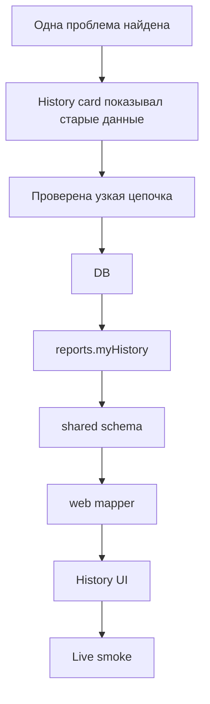
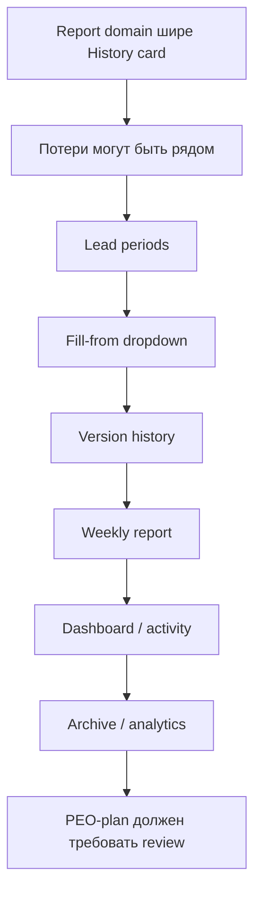
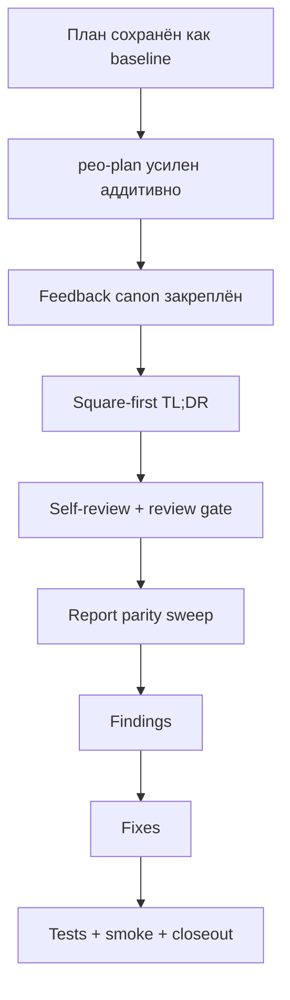

# Report Domain Data Parity Sweep

Baseline artifact for the approved 2026-05-15 execution plan. This file keeps
the full working intent visible in repo state before implementation changes.

## 0. Короткий TL;DR Для Человека

### Было



Проверка была настоящая, но узкая: она доказала класс дефекта, где данные
существуют в доменной модели, но теряются между API, schema, mapper и UI.

### Проблема



Если не пройти всю доменную модель, останутся соседние места с нулевыми
fallback или неполной схемой. Если не закрепить стандарт в peo-plan, следующий
план снова может стать слишком коротким или без нормального review gate.

### Станет



Сначала сохраняется текущая версия плана и усиливается peo-plan, чтобы в
следующий раз он автоматически планировал в таком стиле или лучше. Потом по
этому стандарту выполняется sweep и фиксируются подтверждённые gaps.

Each block must be readable independently. If a diagram becomes wide, split it.
If labels become tiny, move detail into prose below.

## 1. Главная Цель

Сделать две связанные вещи:

1. Зафиксировать текущий план как baseline-артефакт.
2. Обновить peo-plan skill так, чтобы он в будущем сам требовал такой уровень
   структуры, детализации, визуальности, review и self-review.

После этого выполнить customreport report-domain parity sweep:
Prisma/read model -> API/router -> shared schema -> web mapper -> UI text.

## 2. Что Нельзя Потерять

| Смысл                                        | Где сохранить            |
| -------------------------------------------- | ------------------------ |
| Проверка была узкая, но настоящая            | plan artifact + closeout |
| Scope: Report domain                         | plan artifact            |
| Known candidate: mapLeadPeriods drops counts | findings seed            |
| Нужно обновить peo-plan                      | skill update             |
| Нужен review до и после fixes                | skill + plan             |
| Нужны вертикальные схемы                     | skill + template         |
| Нужны отдельные Было / Проблема / Станет     | skill + template         |
| Нельзя мельчить на больших планах            | skill rule               |
| Ничего не удалять, только добавлять новое    | implementation boundary  |

## 3. Сохранение Плана

- Save path: .planning/plans/2026-05-15-report-domain-data-parity-sweep.md.
- Не переписывать старые planning files.
- Если похожий план уже есть, не затирать: создать dated file или addendum.

## 4. PEO Plan Skill Update Scope

Tracked source only:

- /Users/ap/work/core-principles/skills/peo-plan/SKILL.md
- /Users/ap/work/core-principles/skills/peo-plan/templates/phase-plan.md
- /Users/ap/work/core-principles/skills/peo-plan/scripts/plan-self-check.sh
- /Users/ap/work/core-principles/skills/peo-plan/examples/good-plan-rich.md
- /Users/ap/work/core-principles/skills/peo-plan/examples/good-plan-ascii.md
- /Users/ap/work/core-principles/skills/peo-plan/examples/bad-plan.md

Do not edit runtime copies under ~/.codex/_, ~/.claude/_, or
~/.config/opencode/\*.

## 5. Additive-Only Rule

- Не удалять существующие правила.
- Не переписывать смысл старых секций.
- Добавлять новые секции, checks, examples.
- Если шаблон расширяется, сохранить старый смысл.

## 6. Feedback Canon: Visual PEO Planning

For non-trivial plans, especially repo/domain sweeps:

- Do not make the plan "куцый".
- Do not over-compress meaningful implementation detail.
- TL;DR must be visually understandable before reading the rest.
- Split schematic blocks into separate sections: Было, Проблема, Станет.
- Prefer vertical Mermaid, specifically flowchart TB, over horizontal layouts.
- Design diagrams for square review viewport.
- Avoid wide multi-column subgraph strips.
- Keep node labels short.
- Put detail below diagrams, not inside tiny nodes.
- Include review as a first-class phase.
- Include self-review before ExitPlanMode.
- If user says "сделай по PEO-plan", the skill must improve the plan
  automatically, not wait for repeated feedback.

## 7. Square-First Visual Rule

- Primary plan visual must fit a square-ish review panel.
- Use flowchart TB.
- Do not use flowchart LR for TL;DR.
- Avoid 3-column subgraph layouts as the main TL;DR.
- Each TL;DR block must be independently readable.
- Use max 7-10 nodes per diagram.
- Do not put paragraph labels inside Mermaid nodes.
- Put details below diagrams.

## 8. Detail Density Rule

| Task type         | Required density             |
| ----------------- | ---------------------------- |
| Trivial task      | compact plan allowed         |
| Multi-file change | state, changes, tests, risks |
| Repo/domain sweep | all PEO blocks below         |

Repo/domain sweeps include:

- Сейчас
- Recovered intent
- Git audit
- GSD audit
- Boundaries
- Detailed implementation phases
- Review gate
- Subagent roadmap
- Token economy
- Agent/Human split
- Open questions with defaults
- Verification
- Done definition

## 9. PEO Review Gate

Before implementation, run a read-only review strategy. After implementation,
run post-fix review. Review output must be PASS or BLOCK.

BLOCK requires evidence and exact file/line. Review checks:

- source-of-truth alignment;
- tests cover the bug class;
- no unrelated dirty files touched;
- no hidden fallback zeros;
- no stale comments contradicting behavior.

## 10. Template Update

templates/phase-plan.md must make the TL;DR structure mandatory with three
separate headings: Было, Проблема, Станет. Each section uses a vertical
flowchart TB Mermaid block in rich mode.

Add the rule: each block must be readable independently; wide diagrams must be
split; tiny labels move into prose below.

## 11. Self-Check Script Update

Extend plan-self-check.sh checks:

| Check                             | Behavior                  |
| --------------------------------- | ------------------------- |
| no "### Было"                     | fail                      |
| no "### Проблема"                 | fail                      |
| no "### Станет"                   | fail                      |
| no "flowchart TB"                 | fail in rich mode         |
| "flowchart LR" in TL;DR           | warn                      |
| no "Review Gate"                  | fail for code/audit plans |
| no "Iteration Reserve"            | fail                      |
| no "Agent does / Human does"      | fail                      |
| no "Open questions with defaults" | fail                      |
| no "Done Definition"              | fail                      |

After changing the shell script:

```bash
shellcheck /Users/ap/work/core-principles/skills/peo-plan/scripts/plan-self-check.sh
```

## 12. Examples Update

- good-plan-rich.md: separate Mermaid blocks, vertical flow, review gate,
  detailed phases, no wide horizontal layout.
- good-plan-ascii.md: fallback with Было, Проблема, Станет.
- bad-plan.md: anti-patterns for wide flowchart LR, 3-column subgraphs, куцый
  plans without Git/GSD audit, no review, no tests, and user-punted
  agent-doable work.

## 13. CustomReport Sweep: Source Truth

| Object          | Must trace                                               |
| --------------- | -------------------------------------------------------- |
| Report          | dates, deadline, status, periodStatus, publishedSnapshot |
| ReportSection   | author, status, timestamps, late                         |
| Item            | projectId, type, workflowStatus, completed, stages       |
| Risk            | projectId, severity, impact, mitigation, stages          |
| Decision        | productId, owner, deadline, resolvedAt, impact, stages   |
| Priority        | productId, rank, stages                                  |
| ProjectStatus   | product traffic                                          |
| StageStatus     | stage traffic                                            |
| VersionSnapshot | version, createdAt, JSON counts                          |

## 14. CustomReport Sweep: Surfaces

| Surface            | What to verify                        |
| ------------------ | ------------------------------------- |
| reports.myHistory  | counts, traffic, versions, timestamps |
| reports.getActive  | active section aggregate completeness |
| leadForm.byPeriod  | full section read model               |
| leadForm.versions  | real snapshot counts                  |
| weeklyReport.get   | product slicing and escalations       |
| activity.live      | counts and lastEditAt                 |
| dashboard mappers  | lead counts, archive defaults         |
| fill-from dropdown | period counts                         |
| version modal      | version deltas                        |

## 15. Classification

| Class                | Meaning                                    | Action               |
| -------------------- | ------------------------------------------ | -------------------- |
| BUG                  | data exists but is dropped/defaulted       | fix now              |
| CONTRACT_GAP         | UI wants data but endpoint/schema lacks it | extend or defer      |
| INTENTIONAL_DEFERRED | explicit TODO/stub                         | keep trace           |
| TEST_GAP             | behavior works but no regression test      | add test             |
| DOC_GAP              | comments/docs describe stale behavior      | update docs/comments |

## 16. Known First Fix Candidate

mapLeadPeriods returns no counts even though LeadReportPeriod supports
productCount, itemCount, riskCount; FillFromButton renders these fields; and
MyHistoryEntry can carry these counts.

Fix:

- map productCount from e.productCount;
- map itemCount from e.itemCount;
- map riskCount from e.riskCount;
- update stale comment in lead-form.ts;
- add mapper test for mapLeadPeriods;
- add UI test only if mapper test is not enough.

## 17. Review Gate For This Work

Pre-fix review strategy:

```bash
peo-review --domain typescript --domain react --domain tests --track stdout \
  "audit customreport report-domain data parity gaps"
```

If the local peo-review executable is unavailable, emulate the read-only review
with scoped grep plus reviewer agents and record the findings table.

Output columns:

| surface       | source truth     | loss point | class | fix owner | proof     |
| ------------- | ---------------- | ---------- | ----- | --------- | --------- |
| report domain | repo read models | TBD        | TBD   | TBD       | file:line |

Post-fix review verifies:

- no new fallback zeros;
- schemas and mappers aligned;
- tests cover bug class;
- comments updated;
- unrelated dirty files untouched;
- live smoke confirms UI when a local stack is available.

## 18. Git Audit

CustomReport:

```bash
cd /Users/ap/work/customreport
git status --short --branch
git log --oneline --decorate -5
git diff --stat
git worktree list --porcelain
```

Core Principles:

```bash
cd /Users/ap/work/core-principles
git status --short --branch
git log --oneline --decorate -5
git diff --stat -- skills/peo-plan
```

Rules: separate repo state, separate commits if committing, no unrelated file
cleanup.

## 19. GSD Audit

```bash
cd /Users/ap/work/customreport
test -f .planning/STATE.md && sed -n '1,160p' .planning/STATE.md
test -f .planning/HANDOFF.json && sed -n '1,220p' .planning/HANDOFF.json
find .planning -maxdepth 3 -type f -name "*PLAN*.md" -o -name "*SUMMARY*.md" -o -name "*VERIFICATION*.md"
```

Capture PRJ-2/UAT status, deferred scope, dirty file warnings, and whether the
saved plan needs a .planning/STATE.md pointer.

## 20. Roadmap Субагентов

| Stage | Agent                     | Model tier       | Scope                          | Writes | Output             |
| ----- | ------------------------- | ---------------- | ------------------------------ | ------ | ------------------ |
| 0     | Orchestrator              | current strong   | Git/GSD/live truth             | no     | state snapshot     |
| 1     | Plan preservation auditor | GPT Mini / Haiku | plan artifact completeness     | no     | missing sections   |
| 2     | PEO skill auditor         | GPT Mini / Haiku | skill/template/script/examples | no     | additive map       |
| 3     | Report parity scanner     | GPT Mini / Haiku | API/schema/mapper/UI           | no     | findings table     |
| 4     | Test scanner              | GPT Mini / Haiku | existing coverage              | no     | test gaps          |
| 5     | Advisor                   | current strong   | dedupe + work order            | no     | implementation map |
| 6     | Skill worker              | current strong   | skills/peo-plan/\*             | yes    | skill patch        |
| 7     | App worker                | current strong   | confirmed customreport files   | yes    | app patch          |
| 8     | Reviewer                  | GPT Mini first   | changed files                  | no     | PASS/BLOCK         |
| 9     | Orchestrator              | current strong   | verify/closeout                | yes    | final report       |

## 21. Token Economy

| Work                      | Model                 | Writes     |
| ------------------------- | --------------------- | ---------- |
| grep/classify             | GPT Mini / Haiku      | no         |
| compare schema/API/mapper | GPT Mini / Haiku      | no         |
| plan/skill synthesis      | current strong        | no         |
| implementation            | current strong        | yes        |
| unresolved conflict       | deep only if verified | no default |

## 22. Agent Does / Human Does

Agent does:

- save current plan;
- update peo-plan additively;
- run sweep;
- implement confirmed fixes;
- run tests/review/smoke;
- close out.

Human does:

- nothing by default.

Ask human only when scope must expand beyond Report domain, a deferred feature
should become active, or source-of-truth conflict cannot be resolved from repo.

## 23. Open Questions With Defaults

| Question                     | Default                                                       | Ask human when                |
| ---------------------------- | ------------------------------------------------------------- | ----------------------------- |
| Expand beyond Report domain? | no                                                            | explicit user request         |
| Activate deferred features?  | no                                                            | user explicitly reopens       |
| Deep model?                  | no                                                            | verified conflict remains     |
| Touch unrelated dirty files? | no                                                            | confirmed finding inside file |
| Commit both repos?           | yes, separately                                               | user says no                  |
| Save plan where?             | .planning/plans/2026-05-15-report-domain-data-parity-sweep.md | path conflict exists          |

## 24. Verification

Core Principles:

```bash
cd /Users/ap/work/core-principles
bash skills/peo-plan/scripts/plan-self-check.sh <candidate-plan.md>
shellcheck skills/peo-plan/scripts/plan-self-check.sh
npm run lint:md
```

CustomReport:

```bash
cd /Users/ap/work/customreport
pnpm exec prettier --check <changed-files>
pnpm --filter @customreport/shared typecheck
pnpm --filter @customreport/api typecheck
pnpm --filter @customreport/web typecheck
pnpm --filter @customreport/web exec vitest run src/lib/mappers/lead-history.test.ts src/lib/mappers/lead-form.test.ts
pnpm --filter @customreport/shared exec vitest run src/schemas/__tests__/report.test.ts
pnpm --filter @customreport/api exec eslint <changed-api-files>
pnpm --filter @customreport/web exec eslint <changed-web-files>
```

Live smoke:

- /reports?tab=drafts
- /lead/report/:id
- fill-from dropdown
- version history modal

## 25. Pillar Review

| Pillar          | Gate                                        |
| --------------- | ------------------------------------------- |
| Workflow        | follows updated peo-plan                    |
| Git             | both repos audited                          |
| GSD             | STATE/HANDOFF checked                       |
| Source of truth | tracked source only                         |
| Tests           | parity bug class covered                    |
| Skills/docs     | markdown + shell script checks pass         |
| Token economy   | cheap scan, strong implementation           |
| Visual quality  | separated vertical Было / Проблема / Станет |
| Iteration       | feedback folded before edits                |

## 26. Iteration Reserve

- 20% reserve for plan hardening.
- Reject if diagrams are too wide.
- Reject if plan becomes "куцый".
- Reject if review gate missing.
- Reject if current feedback is not encoded in skill.
- Reject if plan artifact drops sections from this version.

## 27. Done Definition

Done only when:

- current plan is saved as a planning artifact;
- peo-plan has additive rules for vertical/square/detailed/review planning;
- templates/examples/self-check reflect the feedback;
- report-domain sweep findings table exists;
- confirmed BUG findings are fixed;
- deferred/contract gaps are explicitly classified;
- tests/typecheck/eslint/live smoke pass or blockers are recorded;
- post-fix review returns PASS or all BLOCKs are resolved;
- final Git status separates customreport and core-principles changes cleanly.
