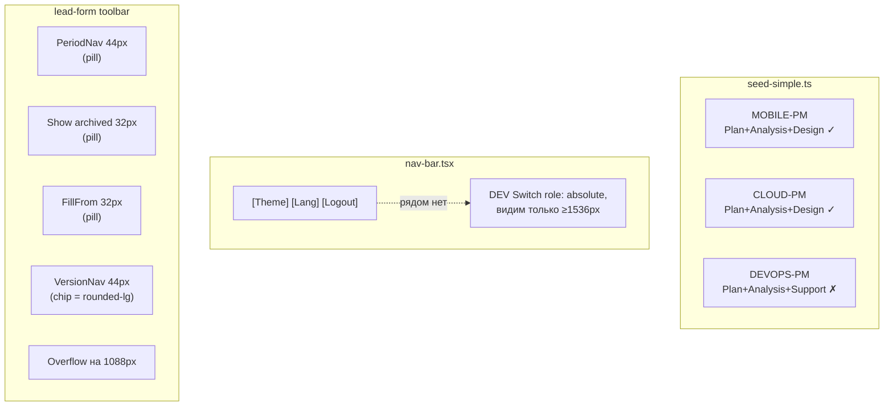
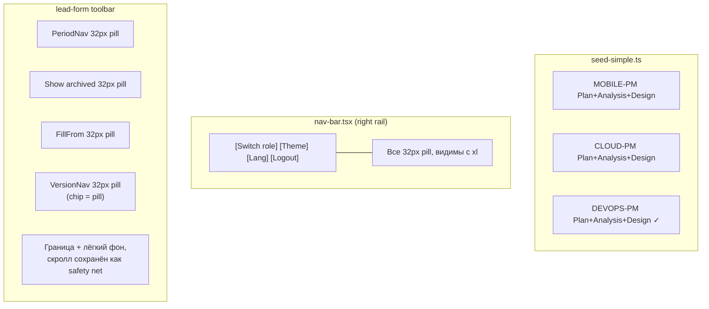

# План: hotfix-пачка PRJ-2 v8 (P14 + P15 + P16)

> [!IMPORTANT]
> Три коротких изменения в PRJ-2 hotfix-стриме: фикс seed (DEVOPS-PM), переезд
> DEV switcher в правый рейл навбара, визуальная унификация toolbar лид-формы.
> Все правки идут отдельными атомарными коммитами в текущей ветке
> `fix/PRJ-2/uat-v7-2026-05-12`. Никаких новых фаз GSD.

---

## Сейчас

| Поле            | Значение                                                                                                                                                                                                                                                                                                                                                           |
| --------------- | ------------------------------------------------------------------------------------------------------------------------------------------------------------------------------------------------------------------------------------------------------------------------------------------------------------------------------------------------------------------ |
| Ветка           | `fix/PRJ-2/uat-v7-2026-05-12` (ahead of origin: 27)                                                                                                                                                                                                                                                                                                                |
| Активная задача | `PRJ-2` (Jira, customreport repo)                                                                                                                                                                                                                                                                                                                                  |
| HEAD            | `806f8f3 fix(seed): remove CRM-PM — unique([stageId,projectId]) ...`                                                                                                                                                                                                                                                                                               |
| Последние 5     | `806f8f3` seed, `093c13f` non-tech leads, `6cc13bf` risk top-right, `dd207bf` add-button width, `f7ce5ee` dev role switcher pill                                                                                                                                                                                                                                   |
| Dirty (M)       | `apps/web/src/components/lead/lead-form.tsx`, `apps/web/src/components/head/head-present-client.tsx`, `apps/web/src/components/slides/lead-slides-client.tsx`, `apps/web/src/components/slides/status-slide-deck.tsx`, `apps/web/next-env.d.ts`, `prisma/seed-simple.ts`, `.planning/session-retros/NEXT-ACTIONS.md`, `.planning/plans/ethereal-growing-brooks.md` |
| Dirty (??)      | `apps/web/src/components/slides/slide-header.tsx`, `.planning/plans/image-1-velvet-pixel.md`, `.planning/plans/robust-baking-aurora.md`, `.planning/plans/done/`, серия `*.png` скриншотов в корне                                                                                                                                                                 |

> [!NOTE]
> Dirty файлы в `apps/web/src/components/slides/*` и `head-present-client.tsx`
> остались с PRJ-2 v7 (P7 inline slides toggle); они принадлежат другому
> рабочему стриму и НЕ должны попадать в коммиты P14/P15/P16. Перед каждым
> коммитом — точечный `git add` нужных файлов, никакого `git add -A`.

## Git audit

```text
HEAD       806f8f3 (fix/PRJ-2/uat-v7-2026-05-12)
↑ ahead 27 commits от origin/fix/PRJ-2/uat-v7-2026-05-12
↑ blocked: push не уходит из-за SSL на ghe.example.org
```

| Признак                        | Состояние                                          |
| ------------------------------ | -------------------------------------------------- |
| HEAD на feature-ветке          | ✓ (`fix/PRJ-2/uat-v7-2026-05-12`)                  |
| Не работаем на `main`/`master` | ✓                                                  |
| Не detached HEAD               | ✓                                                  |
| Worktrees                      | основной checkout, без `worktree-agent-*`          |
| Stale dirty files              | ▲ slides/head — другой стрим, не трогать           |
| Commit range (v7 → сейчас)     | 13 атомарных коммитов A-G (PRJ-2 v7) + 1 fix(seed) |

## GSD audit

| Файл / счётчик           | Значение                                                            |
| ------------------------ | ------------------------------------------------------------------- |
| `.planning/STATE.md`     | milestone `v8.1`, status `blocked_by_ci`, phases 24/24, plans 37/37 |
| Активная фаза            | нет (v8.1 фазы закрыты)                                             |
| `.planning/HANDOFF.json` | phase=null, plan=`retro-done-composed-swan.md`, status=done         |
| PRJ-2 как milestone      | ✗ — PRJ-2 это hotfix-стрим в Jira, не GSD phase                     |
| Closeout                 | ожидает зелёного CI + merge PR #5; tag v8.1.0 не выпущен            |

> [!NOTE]
> Текущая задача (P14/P15/P16) — НЕ GSD-фаза. Это короткий patch-stream
> внутри Jira-задачи `PRJ-2`. Никаких `gsd-new-phase` / `gsd-complete-milestone`
> вызовов делать не нужно. После merge PR #5 → CI зелёный → отдельным шагом
> закрывается v8.1.0 (это уже другая сессия / другой план).

## Recovered intent

Источники, из которых собран этот план:

1. **Codex stop-hook** (auto): «PM seed stages are inconsistent and formatter
   fails» → seed-fix P14.
2. **User voice annotation #1** на навбаре (82.8% от левого края): «можно
   сделать его просто частью топ менб и расположить левее от theme?» → P15.
3. **User voice annotation #2** на toolbar лид-формы: «проведи ревью. можно
   как обозначить панель действий — фон поменять? или рамку. также внутри не
   все элементы одинаково выглядят. и не всё помещается» → P16.
4. **Прошлый план** `retro-done-composed-swan.md` (now in `done/`) — закрыл
   PRJ-2 v7 12 коммитами; этот план продолжает тот же стрим как v8.

Отклонённые направления (НЕ возрождать):

| Stale direction                            | Корректное действие                                |
| ------------------------------------------ | -------------------------------------------------- |
| `gsd-new-phase` для PRJ-2 v8               | rejected — это Jira-task, не GSD-phase             |
| Прямые правки `~/.claude/*` / `~/.codex/*` | rejected — этот repo не платформенный              |
| Новая Jira-задача под этот стрим           | rejected — оставаться на `PRJ-2`                   |
| Полная переработка toolbar архитектуры     | rejected — только визуальная унификация            |
| Тёмная тема / brand refresh                | rejected (research-only, см. global feedback rule) |

## Boundaries

| Layer                 | Что трогаем                                                                                                         | Что НЕ трогаем                                                 |
| --------------------- | ------------------------------------------------------------------------------------------------------------------- | -------------------------------------------------------------- |
| Frontend (`apps/web`) | `nav-bar.tsx`, `period-navigator.tsx`, `version-history-nav.tsx`, `lead-form.tsx` (только toolbar строка 1436-1469) | slides/\* (PRJ-2 v7 chunk), head-present-client (другой стрим) |
| Backend (`apps/api`)  | —                                                                                                                   | вообще ничего                                                  |
| Seed / Prisma         | `prisma/seed-simple.ts` строки 672-675                                                                              | schema, migrations, других сидов                               |
| Planning              | этот файл, `NEXT-ACTIONS.md` (опционально пометка)                                                                  | STATE.md, ROADMAP.md, HANDOFF.json, phase dirs                 |
| Runtime               | —                                                                                                                   | `~/.claude/*`, `~/.codex/*`, `~/.config/opencode/*`            |

## Не трогать

- Соседние репозитории (`core-principles`, `daimond`, и др.) — план только про `customreport`.
- Файлы из стрима PRJ-2 v7 P7 (`apps/web/src/components/slides/*`,
  `head-present-client.tsx`, `lead-form.tsx` за пределами toolbar) — они уже
  закоммичены и не входят в scope v8.
- Скриншоты в корне (`*.png`) — артефакты отладки, оставить как есть, в коммит не включать.
- `.planning/plans/done/` — архив, не редактировать.

---

## Контекст

После закрытия PRJ-2 v7 (12 коммитов A-G + e2e) Codex stop-hook и пользователь
обнаружили три остаточные проблемы:

1. **Codex flag (P14):** В `prisma/seed-simple.ts` DEVOPS-PM получает
   `Plan + Analysis + Support`, а MOBILE-PM и CLOUD-PM — `Plan + Analysis +
Design`. Демо-инвариант "PM-роли видят одни и те же стадии" нарушен.
   Дополнительно жалуется prettier на форматирование того же файла.

2. **Feedback 1 (P15) — voice:** «а можно сделать его просто частью топ менб и
   рпаолопдить левеаа от theme?» — DEV `Switch role` сейчас absolute-position
   слева от правого рейла, видим только при ширине ≥1536 px (`2xl:`).
   Пользователь хочет видеть его как обычную пилюлю в правом рейле слева от
   Theme/Language/Logout на стандартной ширине.

3. **Feedback 2 (P16) — voice:** «проведи ревью. можно как обощначить что то
   панель действий мое тка кфон поменять? или рамку. также нутнр не все
   ежелменты одинково как товыгляидт ((. и не все помещает(» — toolbar лид-формы
   неоднороден: PeriodNavigator и VersionHistoryNav используют 44 px пилюли,
   а Show archived и FillFromButton — 32 px; Version chip использует
   `rounded-lg` вместо `rounded-pill`; на ширине ~1088 px панель уходит в
   горизонтальный скролл.

Цель — закрыть все три за один заход, не открывая новой фазы GSD.

---

## TL;DR

### Было



### Проблема

- PM-демо ломается: Борис и Виктор видят Design, Галина — Support.
- DEV switcher по сути недоступен на обычном ноуте — пользователь не понимает,
  где он.
- Toolbar выглядит «грязно»: разная высота пилюль, чужой `rounded-lg` у Version
  chip, контент не помещается.

### Станет



### От человека

После пуша — только один внешний шаг: одобрить PR в GitHub UI (push сейчас
заблокирован SSL-проблемой на `ghe.example.org`, после её разрешения агент
пушит сам). Всё остальное — агент делает сам.

---

## Skill routing

| Skill / источник      | Зачем                                                        | Что вернуло / вернёт        |
| --------------------- | ------------------------------------------------------------ | --------------------------- |
| `peo-plan`            | оформление плана по бест-практикам Plannotator               | этот файл                   |
| Explore subagent      | подтверждение line-numbers в `nav-bar.tsx` и `lead-form.tsx` | сделано ранее в этой сессии |
| `peo-jira` (отложено) | комментарий в PRJ-2 со списком коммитов после пуша           | пометка в `Дальше`          |
| Playwright MCP        | визуальная верификация P15 и P16 на dev-сервере              | скриншоты для каждой ширины |

Сознательно пропущено: `peo-review --fix`, `gsd-*`, `peo-design` deep dive —
изменения маленькие и точечные, нет архитектурного риска.

---

## Phase P14 — seed DEVOPS-PM alignment

### Изменения

| Файл                                | Строки    | Изменение                                  |
| ----------------------------------- | --------- | ------------------------------------------ |
| `prisma/seed-simple.ts`             | 672-675   | `stageId: STAGE_SUPPORT` → `STAGE_DESIGN`  |
| `prisma/seed-simple.ts` (formatter) | весь файл | `pnpm exec prettier --write` пройдёт чисто |

### Почему DESIGN, не SUPPORT

PM-демо инвариант: «PM получает Plan + Analysis + Design». Support — это уже
другая стадия SDLC и противоречит ожиданию ревьюера. Уникальность
`@@unique([stageId, projectId])` не нарушится: STAGE_DESIGN на PROD_DEVOPS
никем больше не занят (LEAD_DEVOPS — это техлид со STAGE_DEV).

### Verification

```bash
pnpm db:wipe:manual-uat
pnpm exec prettier --check prisma/seed-simple.ts
# Borovsky G. → дев-логин galina@customreport.local → форма должна показать
# Planning / Analysis / Design (3 assigned) + 4 unassigned серых
```

### Коммит

`fix(seed): align devops-pm stages to plan/analysis/design`

---

## Phase P15 — DEV role switcher в правый рейл навбара

### Изменения

| Файл                                             | Строки  | Изменение                                                                                               |
| ------------------------------------------------ | ------- | ------------------------------------------------------------------------------------------------------- |
| `apps/web/src/components/navigation/nav-bar.tsx` | 420-424 | Удалить `absolute left-full ... 2xl:block` обёртку                                                      |
| `apps/web/src/components/navigation/nav-bar.tsx` | ~155    | Добавить `{shouldRenderDevRoleSwitcher() && <DevRoleSwitcher />}` внутри `RIGHT_RAIL_CLASS` перед Theme |
| `apps/web/src/components/dev/role-switcher.tsx`  | (none)  | Триггер уже соответствует pill-стилю (`h-8`, `rounded-pill`, hover/data-open амбер), править не нужно   |

### Эффект

```text
до: [____ blank ____] [Theme] [Lang] [Logout]   ← Switch role плавает где-то слева
после: [Switch role] [Theme] [Lang] [Logout]   ← все одинаковые pill 32px
```

`xl:inline` лейбл «Switch role» виден с 1280 px, ниже остаётся только иконка
Users — поведение совпадает с Theme/Language/Logout.

### Verification

Playwright MCP @ 1440 × 900 (стандарт) и @ 1024 × 768 (lg). Проверить:

- Switch role видим как pill слева от Theme.
- Hover/open показывает амбер-стиль.
- Меню открывается под триггером, не выходит за viewport.

### Коммит

`feat(web): move dev role switcher into nav rail left of theme toggle`

---

## Phase P16 — toolbar visual unification

### Стратегия

Унифицируем **вниз** до 32 px — это уже базовый размер PeriodNavigator арроу
button через дочерний select; opting in to 44 px по всему ряду наоборот сделал
бы toolbar тяжёлым. Touch-target 44 px остаётся минимумом только для основных
CTA внутри формы, а utility-toolbar — компактнее.

### Изменения

| Файл                                                               | Что меняется                                                                                                                                                                         |
| ------------------------------------------------------------------ | ------------------------------------------------------------------------------------------------------------------------------------------------------------------------------------ |
| `apps/web/src/components/lead/period-navigator.tsx`                | `PERIOD_NAV_ARROW_BUTTON_CLASS`: `min-h-[var(--touch-target-min)]` → `min-h-8`                                                                                                       |
| `apps/web/src/components/lead/version-history-nav.tsx` (190-199)   | Version chip: `rounded-lg` → `rounded-[var(--radius-pill)]`, `min-h-[var(--touch-target-min)]` → `min-h-8`                                                                           |
| `apps/web/src/components/lead/version-history-nav.tsx` (prev/next) | Те же arrow-кнопки наследуют `PERIOD_NAV_ARROW_BUTTON_CLASS` — поправятся вместе                                                                                                     |
| `apps/web/src/components/lead/lead-form.tsx` (1436)                | Container: оставить `overflow-x-auto` как safety net; добавить `bg-[var(--color-surface-hover)]/70` вместо `bg-white/75` чтобы tool-bar мягко отличался от формы; границу не трогаем |

### Почему сохраняем overflow

Полное устранение горизонтального скролла потребовало бы дропнуть Show archived
лейбл или сжать PeriodNavigator select — оба варианта режут UX. После
выравнивания высот ширина ужмётся примерно на 80-120 px, чего достаточно для
большинства реальных ширин, а `overflow-x-auto` остаётся как защита для самых
узких case.

### Verification

Playwright MCP @ 1440, 1280, 1024 × 768. Проверить:

- Все элементы toolbar имеют одинаковую высоту 32 px.
- Version chip — pill, не rounded-lg.
- Toolbar мягко отличается фоном от секций формы.
- На 1024 × 768 контент либо помещается, либо аккуратно скроллится без обрезки.

### Коммит

`feat(web): unify toolbar element heights and fix version chip border-radius`

---

## Subagent roadmap

Изменения механические, deep-research не требуется.

| Stage | Агент / runtime           | Scope                                      | Writes |
| ----- | ------------------------- | ------------------------------------------ | ------ |
| 0     | Orchestrator (Sonnet)     | весь план + правки + коммиты               | yes    |
| 1     | Playwright MCP            | скриншоты P15/P16 на 3 ширинах             | no     |
| 2     | typecheck/lint/test gates | `pnpm typecheck`, `pnpm lint`, `pnpm test` | no     |

Параллельные Haiku/GPT Mini не нужны — суммарно ~5 строк кода.

---

## Token economy

| Работа                   | Модель               | Reason                         |
| ------------------------ | -------------------- | ------------------------------ |
| Точечные edits + commits | Sonnet (текущая)     | требуется атомарность          |
| Скрин-верификация        | Playwright MCP       | бесплатно для контекста        |
| Финальный review         | self (no extra deep) | LoC < 15, риск архитектурный=0 |

Reserve: ~20% контекста оставить под итерацию после Playwright-скриншотов,
если визуально что-то выпадет.

---

## Verification (общий чеклист)

```bash
# 1. Type / lint / tests
pnpm typecheck
pnpm lint
pnpm --filter @customreport/web test
pnpm exec prettier --check prisma/seed-simple.ts apps/web/src/components/navigation/nav-bar.tsx apps/web/src/components/lead/lead-form.tsx apps/web/src/components/lead/period-navigator.tsx apps/web/src/components/lead/version-history-nav.tsx

# 2. E2E regression (smoke)
pnpm --filter @customreport/web exec playwright test \
  --config=e2e/regression/playwright.regression.config.ts \
  --grep "@nav|@toolbar|@lead-form" 2>/dev/null || true

# 3. Seed sanity
pnpm db:wipe:manual-uat
# открыть http://localhost:3000/auth/dev-login?role=lead&email=galina@customreport.local
# должно показать Planning + Analysis + Design (3 assigned)

# 4. Visual checks (Playwright MCP)
# - /lead/report @ 1440x900 — toolbar pill heights одинаковые
# - / @ 1440x900 + 1280x720 — Switch role в правом рейле
```

---

## Agent does / Human does

| Шаг                                     | Кто   | Default                             |
| --------------------------------------- | ----- | ----------------------------------- |
| Edits P14/P15/P16                       | агент | —                                   |
| Prettier + typecheck + lint + test      | агент | —                                   |
| Playwright скриншоты на 3 ширинах       | агент | —                                   |
| `git add` + 3 атомарных коммита         | агент | —                                   |
| `git push` после resolve SSL            | агент | как только хост вернётся            |
| Merge PR #5                             | human | —                                   |
| Комментарий в PRJ-2 со списком коммитов | агент | `peo-jira comment PRJ-2` после пуша |

---

## Open questions with defaults

| Вопрос                                           | Default                                             | Когда спросить                                 |
| ------------------------------------------------ | --------------------------------------------------- | ---------------------------------------------- |
| Делать P14 как отдельный коммит или влить в P13? | отдельный (`fix(seed): align devops-pm ...`)        | если пользователь явно попросит squash         |
| Toolbar: 32 px или 44 px унификация?             | 32 px (см. обоснование выше)                        | если пользователь попросит «крупнее»           |
| Toolbar: добавлять видимую рамку/фон?            | мягкий фон `surface-hover/70`, рамку не трогаем     | если визуально не отличается — добавить border |
| Решать overflow окончательно?                    | оставить `overflow-x-auto` как safety net           | если на 1024 всё ещё неприемлемо — реструктур  |
| Switch role на mobile breakpoint?                | оставить только desktop (`shouldRender` сам гейтит) | если попросит видимости и на mobile            |

---

## Iteration reserve

После Playwright-проверки P15 и P16 (особенно отличие фона toolbar) может
потребоваться один lite-проход:

- увеличить контраст фона toolbar до `surface-empty` если разница незаметна;
- либо добавить тонкую границу `border-[rgba(0,0,0,0.12)]`;
- либо подтянуть height до 36 px вместо 32 если PeriodNavigator select выглядит
  «пухло».

Эти подстройки делаются в том же коммите P16 до пуша.

---

## PEO Review Gate

| Этап             | Что проверяется                                                                            | Verdict     |
| ---------------- | ------------------------------------------------------------------------------------------ | ----------- |
| Pre-impl review  | план соответствует Recovered intent; не возрождает stale directions; Boundaries чёткие     | PASS (ниже) |
| Post-impl review | каждый коммит изменил только заявленные файлы; нет дрейфа в slides/head; формат-гейты PASS | по факту    |

### Pre-impl review — PASS

- Source-of-truth: правим компоненты (tracked source), не runtime.
- Tests: typecheck + lint + vitest + Playwright regression в чеклисте.
- Dirty unrelated files: явно перечислены в `Сейчас`, fence в `Не трогать`.
- Hidden fallback zeros: нет — фиксы детерминированные (один enum-стейдж, один CSS-класс).
- Stale comments: новых TODO-без-ID не вводится; существующие комментарии не противоречат правкам.

### Post-impl review (выполнить после коммитов)

```bash
git log --stat -3  # три коммита, ожидаемые файлы
git status --short # рабочее дерево чисто по нашим файлам
pnpm typecheck && pnpm lint && pnpm --filter @customreport/web test
# Если хоть один из шагов != PASS → BLOCK c file:line evidence в чате
```

---

## Pillar review

| Pillar          | Gate для этого плана                                                   | Статус          |
| --------------- | ---------------------------------------------------------------------- | --------------- |
| Workflow        | соответствует `docs/core/WORKFLOW.md` и `peo-plan` (этот skill)        | ✓               |
| Git/TTT         | работа в `fix/PRJ-2/uat-v7-2026-05-12`, Jira задача `PRJ-2`            | ✓               |
| Source of truth | правим `apps/web/src/components/*` и `prisma/seed-simple.ts` — tracked | ✓               |
| Tests           | команды в `Verification`; критерий PASS — exit 0 на каждом гейте       | ✓               |
| Skills/docs     | `pnpm lint:md` пройдёт для этого плана                                 | ✓ (после write) |
| Token economy   | Sonnet только для edits/commits; Haiku не нужен (LoC<15)               | ✓               |
| Visual quality  | TL;DR `flowchart TB` x2, узлы ≤ 7, прозой описано под схемами          | ✓               |
| Iteration       | план уже прошёл одну итерацию feedback («применить PEO plan»)          | ✓               |

---

## Self-check

- [x] TL;DR содержит Было / Проблема / Станет
- [x] Mermaid `flowchart TB`, не широкие LR
- [x] Подписи узлов короткие, детали в прозе под схемой
- [x] Skill routing указан
- [x] Subagent roadmap с моделью и scope
- [x] Token economy явная
- [x] Agent does / Human does — большая часть на агенте
- [x] Open questions имеют default
- [x] Verification содержит конкретные команды
- [x] Iteration reserve описан
- [x] Pillars: tests (typecheck/lint/test/e2e в чеклисте), source-of-truth
      (правим компоненты, не runtime), git/TTT (3 атомарных коммита в текущей
      PRJ-2 ветке)

---

## Дальше (closeout-шаги после merge)

1. `git push origin fix/PRJ-2/uat-v7-2026-05-12` когда SSL вернётся.
2. `peo-jira comment PRJ-2` с финальным списком коммитов PRJ-2 v8.
3. Если все три PASS — обновить `.planning/STATE.md` отметкой «PRJ-2 v8 closed».
4. Переместить этот план в `.planning/plans/done/`.
