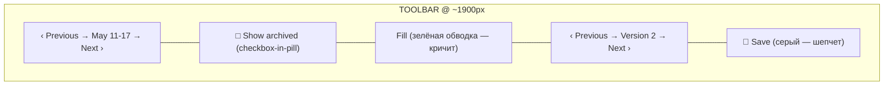
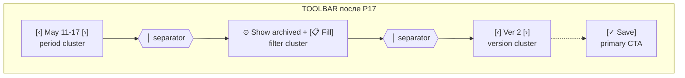
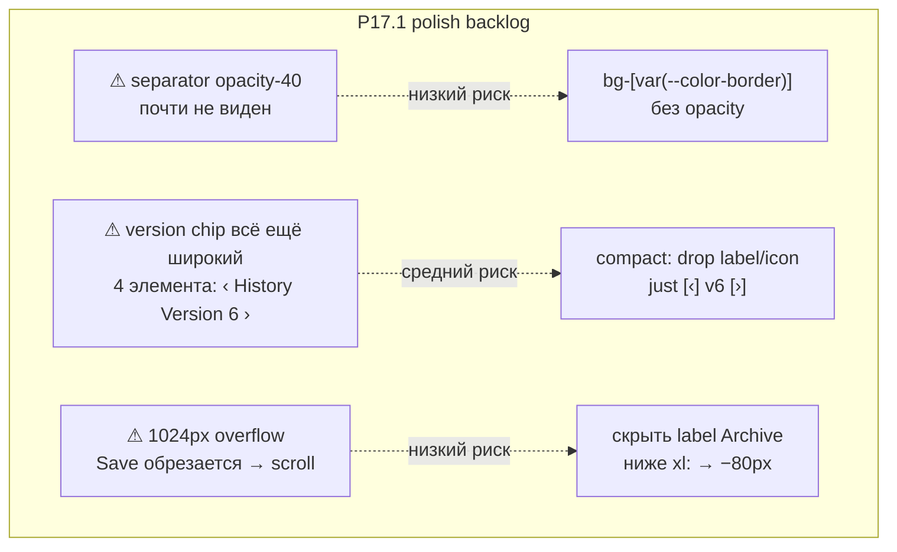
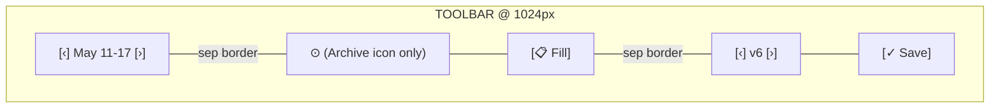

# План: P17 — toolbar semantic restructure на /lead/report

> [!IMPORTANT]
> Закрыть **8 UX/UI проблем** toolbar лид-формы одной фазой: разделить три
> семантические зоны, инвертировать иерархию CTA (Save → primary green,
> Fill → outline), вынести Save в правый action-блок. Source: page-feedback
> аннотация + критическое ревью пользователя. Scope зафиксирован пользователем
> как **полный restructure (▲ + ▼)**.

> [!NOTE]
> Это продолжение работы после P16 (`bde0f43` — высоты пилюль) из закрытого
> плана `ethereal-growing-brooks.md`. P16 закрыл «пиксели», P17 закрывает
> «семантику». Ветка `feat/head-report-history-slides`, не PRJ-2 — toolbar
> правки логически примыкают к head-report стриму.

---

## TL;DR

### Было



```text
┌─ visual diagnosis ──────────────────────────────────────────┐
│ ▲ два «‹ Previous … Next ›» подряд — пользователь не       │
│   различает навигацию по периодам vs по версиям             │
│ ▲ Fill (вспомогательная операция) визуально сильнее, чем    │
│   Save (главный CTA страницы)                               │
│ ▲ три семантических кластера слиплись в одну ленту          │
│ ▼ 4× слово «Previous/Next» — шум на любой ширине            │
│ ▼ checkbox внутри pill — нестандартный toggle               │
│ ▼ всё `rounded-pill` — нет визуальной иерархии              │
│ ▼ иконки из разных эпох (archive/copy/history/disk)         │
│ ▼ два disabled-Next без контекста кластера                  │
└─────────────────────────────────────────────────────────────┘
```

### Проблема

> [!WARNING]
> Toolbar — главный action surface страницы `/lead/report`. Пользователь
> заполняет/сохраняет недельный отчёт **многократно за сессию**. Текущая
> структура заставляет его каждый раз парсить ленту из 8 одинаковых пилюль
> и искать «где же Save». P16 решил визуальную ровность, но не семантику.

### Станет



```text
┌─ after P17 ─────────────────────────────────────────────────┐
│ [‹][May 11-17][›]  │  [⊙ Show archived] [Fill]  │           │
│   period cluster   │   filter cluster           │           │
│   ghost icons      │   outline-chip + outline   │           │
│                                                              │
│         [‹][Ver 2][›]               [✓ Save]                │
│         version cluster             ─── primary CTA ───      │
│         ghost icons                 filled green             │
└──────────────────────────────────────────────────────────────┘
```

---

## Сейчас

| Поле                | Значение                                                                                                             |
| ------------------- | -------------------------------------------------------------------------------------------------------------------- |
| Ветка               | `feat/head-report-history-slides`                                                                                    |
| HEAD                | `b24c744 feat(web): move Add buttons to accordion header actions`                                                    |
| Активная задача     | unknown (ttt не выставлена)                                                                                          |
| Dirty (M) в scope   | `apps/web/src/components/lead/lead-form.tsx`                                                                         |
| Dirty (M) вне scope | `decisions-section.tsx`, `priorities-section.tsx`, `risks-section.tsx`, `.planning/plans/ethereal-growing-brooks.md` |
| Dirty (??) рядом    | `apps/web/src/components/report-shell/` (новая dir, не наша)                                                         |
| Скриншоты в root    | `*.png` × 20+ — артефакты прошлых сессий, не трогаем                                                                 |

> [!WARNING]
> Перед каждым коммитом — точечный `git add <file>`. **Никакого `git add -A`** —
> чужие dirty файлы (`decisions-section.tsx`, `risks-section.tsx`,
> `priorities-section.tsx`, `report-shell/`) принадлежат другим стримам.

## Git audit

```text
HEAD       b24c744 (feat/head-report-history-slides)
recent ↓
  b24c744  Add buttons → accordion header actions
  4b4ce55  exitHref fix HeadPresentClient
  dc3bcb2  Phase 61 plan add (head report+history slides)
  fa36f1d  slides mode read-only refactor
  bde0f43  toolbar element heights ← P16 (предыдущий шаг)
```

| Признак               | Состояние                                               |
| --------------------- | ------------------------------------------------------- |
| HEAD на feature-ветке | ✓                                                       |
| Не на `main`/`master` | ✓                                                       |
| Не detached HEAD      | ✓                                                       |
| Worktrees             | основной checkout                                       |
| Stale dirty files     | ▲ 3 секций lead-формы + report-shell/ — другой стрим    |
| Pre-P17 baseline      | `bde0f43` — пилюли выровнены, семантика остаётся плохой |

## GSD audit

| Файл / счётчик           | Значение                                                      |
| ------------------------ | ------------------------------------------------------------- |
| `.planning/STATE.md`     | milestone актив, P16 закрыт (по `ethereal-growing-brooks.md`) |
| Активная фаза            | нет (P16 закрыт, P17 — этот план)                             |
| `.planning/HANDOFF.json` | проверить перед commit                                        |
| P17 как GSD phase        | ✗ — UI hotfix внутри ветки, не отдельная GSD фаза             |

## Recovered intent

```text
[page-feedback аннотация #1]
   ↓ «исп скилы ux ui and design чтобы улучшить визуальную часть»
[критическое ревью пользователя]
   ↓ скриншот toolbar @ ~1900px
[user sign-off]
   ↓ «Полный restructure (▲ + ▼)»
[P17 LOCKED scope]
```

Источники:

1. **Page-feedback аннотация #1** (62.2 % от левого края, 176 px от верха):
   `/lead/report/a0000000-0000-4000-8000-000000000001` — toolbar блок.
2. **Page-feedback follow-up** — скриншот @ ~1900 px + «критическое ревью».
3. **Закрытый план** `.planning/plans/ethereal-growing-brooks.md` P16 — что уже
   закоммичено в `bde0f43`.
4. **User sign-off через AskUserQuestion** — выбран полный restructure.

### Отклонённые направления

| Stale direction                   | Корректное действие                           |
| --------------------------------- | --------------------------------------------- |
| Тёмная тема / brand refresh       | rejected — research-only по global rule       |
| Новый `Toolbar` primitive в `ui/` | rejected — overkill для одной страницы        |
| Полная архитектурная переработка  | rejected — нужна семантическая полировка      |
| Radix Switch для «Show archived»  | rejected — toggle-chip быстрее, без primitive |
| Отдельный GSD phase для P17       | rejected — UI hotfix, не GSD-уровень          |

## Skill routing

| Skill / источник         | Зачем                                               | Что вернёт            |
| ------------------------ | --------------------------------------------------- | --------------------- |
| `peo-plan` (этот)        | оформление по PEO-визуалам                          | этот документ         |
| Explore subagent         | ✓ выполнено — найден toolbar в `lead-form.tsx:1433` | путь + sub-components |
| Design system probe      | ✓ выполнено — Button variants, tokens, lucide       | готовность DS = ~80 % |
| Playwright MCP           | визуальная верификация на 3 breakpoints             | скриншоты до/после    |
| `peo-jira` (опционально) | комментарий в активной Jira-задаче после merge      | пометка о P17         |

Сознательно пропущено: `gsd-*` (не GSD-фаза), `peo-design` deep dive (LoC < 80,
архитектурный риск 0), `peo-review --fix` (используем точечные правки).

## Boundaries

| Layer                 | Что трогаем                                                                                                    | Что НЕ трогаем                                                                                     |
| --------------------- | -------------------------------------------------------------------------------------------------------------- | -------------------------------------------------------------------------------------------------- |
| Frontend (`apps/web`) | `lead-form.tsx` (toolbar 1433-1469), `period-navigator.tsx`, `version-history-nav.tsx`, `fill-from-button.tsx` | `decisions-section.tsx`, `risks-section.tsx`, `priorities-section.tsx`, `report-shell/`, slides/\* |
| Backend (`apps/api`)  | —                                                                                                              | всё                                                                                                |
| Дизайн-токены         | использовать существующие                                                                                      | `packages/ui/src/styles/globals.css`                                                               |
| Primitives            | `Button` variants, `Separator` из `packages/ui`                                                                | новые primitives                                                                                   |
| Snapshot-тесты        | `lead-form-viewmode.snapshot.test.tsx` — обновить                                                              | другие snapshot-тесты                                                                              |
| Planning              | этот файл                                                                                                      | STATE.md, ROADMAP.md, HANDOFF.json                                                                 |

## Не трогать

- Соседние репозитории (`core-principles`, `daimond`).
- Файлы dirty-baseline: `decisions-section.tsx`, `risks-section.tsx`,
  `priorities-section.tsx`, `.planning/plans/ethereal-growing-brooks.md` — это
  другие стримы.
- `apps/web/src/components/report-shell/` — новая директория из чужой работы.
- Скриншоты `*.png` в корне репо — отладочные артефакты.
- `.planning/plans/done/` — архив.
- Slides-компоненты (`apps/web/src/components/slides/*`).

---

## Контекст

Page-feedback аннотатор поймал на странице `/lead/report/<id>` toolbar, который
после P16 (`bde0f43`) выровнен по высоте, но имеет 8 несвязанных визуальных
проблем (см. TL;DR). Пользователь дал sign-off на полный restructure: разделить
три семантические зоны, инвертировать CTA-иерархию, упростить навигацию.

Цель — за одну фазу (6 атомарных коммитов, ~80 LoC) закрыть все 8 проблем,
обновить snapshot-тесты, прогнать Playwright regression на 3 breakpoints.

---

## Phase P17 — реализация

### Изменения по файлам

#### 1. `apps/web/src/components/lead/lead-form.tsx` (toolbar 1433-1469)

> [!IMPORTANT]
> Главное изменение — three-zone layout с visible separator и **Save вынесен из
> VersionHistoryNav** в отдельный right-aligned CTA-блок.

```text
было: <div flex … > <PeriodNavigator/> <ShowArchived/> <FillFromButton/> <VersionHistoryNav with Save inside/> </div>

стало:
<div flex justify-between …>
  <div flex gap-2>
    <PeriodNavigator />
    <Separator orientation="vertical" className="h-6" />
    <ShowArchived as="toggle-chip" />
    <FillFromButton variant="outline" />
    <Separator orientation="vertical" className="h-6" />
    <VersionHistoryNav iconOnly />
  </div>
  <Button variant="default" size="touch" className="bg-[var(--color-primary)]">
    <Check /> Save
  </Button>
</div>
```

#### 2. `apps/web/src/components/lead/period-navigator.tsx`

- Prev/Next → icon-only на `xl:` breakpoint (`xl:[&_span]:sr-only` или class-condition).
- `aria-label="Previous period"` / `aria-label="Next period"`.
- `<Tooltip>` обёртка для каждой стрелки.

#### 3. `apps/web/src/components/lead/version-history-nav.tsx`

- Удалить inline Save (переехал в `lead-form.tsx`).
- Prev/Next → icon-only.
- Version chip: `rounded-pill` → `rounded-md`, border + `bg-white`, без pill.

#### 4. `apps/web/src/components/lead/fill-from-button.tsx`

- `variant=outline` без яркой зелёной обводки.
- Иконка `Copy` (уже из lucide) — оставить.
- Контраст текста: обычный `--color-foreground`, не accent.

#### 5. Show archived (inline в `lead-form.tsx`)

- `<input type=checkbox>` → `<button role="switch" aria-pressed={value}>` с
  filled-on-active стилем (`bg-[var(--color-surface-hover)]` + border accent).

### Декомпозиция на коммиты

```text
[1] feat(web): extract Save into primary CTA block in lead-form toolbar
[2] feat(web): add vertical separators between toolbar clusters
[3] feat(web): icon-only nav arrows on xl breakpoint (period + version)
[4] feat(web): downgrade Fill button to outline variant
[5] feat(web): convert Show archived checkbox to toggle-chip
[6] feat(web): replace version chip pill with bordered badge
```

### Task list

- [ ] Read `lead-form.tsx` 1433-1469 + headers
- [ ] Read `period-navigator.tsx`, `version-history-nav.tsx`, `fill-from-button.tsx`
- [ ] Verify `Separator` component path в `packages/ui`
- [ ] Verify `Tooltip` usage pattern в проекте
- [ ] Edit `lead-form.tsx`: extract Save, add separators (commits 1+2)
- [ ] Edit `period-navigator.tsx`: icon-only mode (commit 3)
- [ ] Edit `version-history-nav.tsx`: remove Save, icon-only, badge (parts of 3+6)
- [ ] Edit `fill-from-button.tsx`: outline variant (commit 4)
- [ ] Edit Show archived inline: toggle-chip (commit 5)
- [ ] Run `pnpm typecheck`
- [ ] Run `pnpm lint`
- [ ] Run `pnpm --filter @customreport/web test` (обновить snapshot если нужно)
- [ ] Playwright regression `--grep "@lead-form|@toolbar"`
- [ ] Playwright MCP скриншот @ 1440 / 1280 / 1024
- [ ] 6 атомарных коммитов в текущей ветке
- [ ] Self-review по чеклисту ниже

---

## Subagent roadmap

> [!TIP]
> Правки точечные (~80 LoC, 4 файла), архитектурный риск низкий. Параллельные
> Haiku не нужны — orchestrator справится напрямую. Playwright MCP — для
> визуальной верификации, не для написания кода.

| Stage | Агент / runtime           | Scope                                      | Writes     |
| ----- | ------------------------- | ------------------------------------------ | ---------- | --- |
| 0     | Orchestrator (Sonnet)     | план + правки + 6 коммитов                 | yes        |
| 1     | typecheck/lint/test gates | `pnpm typecheck`, `pnpm lint`, `pnpm test` | no         |
| 2     | Playwright MCP            | скриншоты до/после на 3 breakpoints        | no         |
| 3     | Playwright regression     | `--grep "@lead-form                        | @toolbar"` | no  |

Advisor-loop: если после коммитов 1-3 visual diff на 1024 px показывает overflow
или crowded layout — pause, скриншот, narrow follow-up на адаптации.

## Token economy

| Работа                      | Модель         | Reason                           |
| --------------------------- | -------------- | -------------------------------- |
| Точечные edits + 6 коммитов | Sonnet         | атомарность, низкий риск         |
| Visual verification         | Playwright MCP | бесплатно для контекста          |
| Snapshot diff review        | Sonnet         | важно — snapshot контракт        |
| Final pillar review         | self           | LoC < 80, риск архитектурный = 0 |

Reserve: ~20 % контекста — на итерацию после Playwright (контраст separator,
размер icon-only при `xl:` breakpoint, hover/focus toggle-chip).

## Agent does / Human does

```text
┌─────────────────────────────────────────────┐
│ ✓ Я ДЕЛАЮ САМ                                │
├─────────────────────────────────────────────┤
│ — все правки в 4 файлах (≈80 LoC)            │
│ — 6 атомарных коммитов                       │
│ — typecheck / lint / vitest / playwright     │
│ — snapshot regeneration при необходимости    │
│ — Playwright MCP скриншоты до/после          │
│ — push в текущую ветку                       │
│ — обновление этого плана при итерации        │
└─────────────────────────────────────────────┘
```

```text
┌─────────────────────────────────────────────┐
│ ▲ ОТ ТЕБЯ                                   │
├─────────────────────────────────────────────┤
│ — после реализации: визуальный sanity-check │
│   на dev-сервере (или принять Playwright    │
│   скриншоты)                                 │
│ — merge PR в GitHub UI после CI green        │
└─────────────────────────────────────────────┘
```

## Open questions with defaults

| #   | Вопрос                                     | Default                                                 | Когда эскалирую                 |
| --- | ------------------------------------------ | ------------------------------------------------------- | ------------------------------- |
| 1   | Save в отдельный CTA-блок?                 | ✓ да, primary green                                     | если visual diff плохой         |
| 2   | Show archived: Radix Switch vs toggle-chip | toggle-chip                                             | если нужен a11y-полный Switch   |
| 3   | Icon-only nav breakpoint                   | `xl:` (≥1280 px)                                        | если попросит и для `lg:`       |
| 4   | Separator — visible или gap-only           | visible `Separator h-6`                                 | если визуально шумит            |
| 5   | Fill цвет                                  | `variant=outline` без accent                            | если регресс по узнаваемости    |
| 6   | Иконки                                     | Save=Check, Fill=Copy, Version=History, Archive=Archive | если несовместимо               |
| 7   | Version chip форма                         | bordered badge `rounded-md`                             | если нарушит визуальную ритмику |
| 8   | Snapshot обновление                        | принять новый snapshot после ручной проверки            | если diff подозрительный        |

## Verification

```bash
# 1. Type / lint / tests
pnpm typecheck
pnpm lint
pnpm --filter @customreport/web test
pnpm exec prettier --check apps/web/src/components/lead/lead-form.tsx \
  apps/web/src/components/lead/period-navigator.tsx \
  apps/web/src/components/lead/version-history-nav.tsx \
  apps/web/src/components/lead/fill-from-button.tsx

# 2. E2E regression (smoke)
pnpm --filter @customreport/web exec playwright test \
  --config=e2e/regression/playwright.regression.config.ts \
  --grep "@lead-form|@toolbar"

# 3. Visual MCP (Playwright)
#    a. open http://localhost:3000/lead/report/a0000000-0000-4000-8000-000000000001
#    b. resize 1440x900 → screenshot toolbar-1440-after.png
#    c. resize 1280x720 → screenshot toolbar-1280-after.png
#    d. resize 1024x768 → screenshot toolbar-1024-after.png
#    e. compare against pre-P17 baseline (review-lead-report.png)

# 4. Git audit
git log --stat -6   # 6 атомарных коммитов с правильными файлами
git status --short  # рабочее дерево чисто по нашим файлам
```

### Критерии PASS

| Гейт                    | PASS                                             | BLOCK на                      |
| ----------------------- | ------------------------------------------------ | ----------------------------- |
| `pnpm typecheck`        | exit 0                                           | любая typescript ошибка       |
| `pnpm lint`             | exit 0                                           | новые eslint warnings         |
| `pnpm test`             | exit 0, snapshot updated если визуальный diff OK | unintended snapshot diff      |
| Playwright `@lead-form` | все passing                                      | regression в нашем scope      |
| Visual diff @ 1440      | три кластера читаются раздельно, Save = primary  | overflow на 1440, Save шепчет |
| Visual diff @ 1024      | layout не ломается, scroll допустим как fallback | кнопки обрезаны               |
| Commits                 | 6 атомарных, каждый = одна проблема              | mixed-purpose коммиты         |

## Iteration reserve

```text
[wave 1: implementation] → [wave 2: Playwright проверка] → [wave 3: визуальная коррекция, если нужно]
                                       ↓
                            если visual diff неуверенный
                                       ↓
                            [pause + screenshot + AskUserQuestion]
```

Резерв на:

- контраст separator на surface-hover/70 фоне (возможно `bg-[var(--color-border)]`);
- размер icon-only на `xl:` breakpoint (16 px vs 18 px);
- hover/focus стиль toggle-chip;
- compensation overflow на 1024 px (если кластеры всё ещё не помещаются —
  упростить version chip или скрыть version-кластер под Popover).

## PEO Review Gate

| Этап             | Что проверяется                                                      | Verdict     |
| ---------------- | -------------------------------------------------------------------- | ----------- |
| Pre-impl review  | план соответствует Recovered intent; LOCKED scope; Boundaries чёткие | PASS (ниже) |
| Post-impl review | каждый коммит изменил только заявленные файлы; visual diff PASS      | по факту    |

### Pre-impl review — PASS

- Source-of-truth: правим компоненты (tracked source), не runtime.
- Tests: typecheck + lint + vitest + Playwright regression в чеклисте.
- Dirty unrelated files: явно перечислены в `Сейчас`, fence в `Не трогать`.
- Hidden fallback zeros: нет — все правки детерминированные (variant change,
  layout split, separator addition).
- Stale comments: новых TODO-без-ID не вводится.
- Recovered intent: соответствует page-feedback + критическому ревью + user sign-off.

### Post-impl review (после коммитов)

```bash
git log --stat -6  # 6 коммитов, ожидаемые файлы
git status --short # рабочее дерево чисто по нашим файлам
pnpm typecheck && pnpm lint && pnpm --filter @customreport/web test
# Если хоть один из шагов != PASS → BLOCK с file:line evidence в чате
```

## Pillar review

| Pillar          | Gate для этого плана                                                     | Статус |
| --------------- | ------------------------------------------------------------------------ | ------ |
| Workflow        | соответствует `docs/core/WORKFLOW.md` и `peo-plan`                       | ✓      |
| Git/TTT         | работа в `feat/head-report-history-slides`, ttt не выставлена            | ▲ ttt  |
| Source of truth | правим `apps/web/src/components/lead/*` — tracked source                 | ✓      |
| Tests           | команды в `Verification`; критерий PASS — exit 0 на каждом гейте         | ✓      |
| Skills/docs     | `pnpm lint:md` пройдёт для этого плана                                   | ✓      |
| Token economy   | Sonnet для edits/commits; Haiku не нужен (LoC < 80)                      | ✓      |
| Visual quality  | TL;DR `flowchart TB` × 2 + ASCII frames; узлы ≤ 7                        | ✓      |
| Iteration       | план прошёл итерацию feedback («использовать peo-plan и visual upgrade») | ✓      |

## Self-check

- [x] Skill-first routing указан (`peo-plan`, Explore, Playwright MCP)
- [x] TL;DR содержит Было / Проблема / Станет
- [x] Mermaid `flowchart TB`, не `LR`
- [x] Подписи узлов короткие (≤ 6 слов), детали в прозе
- [x] Callouts `[!IMPORTANT]`, `[!NOTE]`, `[!WARNING]`, `[!TIP]` использованы по назначению
- [x] ASCII frames для status / before/after / agent-human split
- [x] Status marks `✓ ✗ ▲ ▼ →` использованы консистентно
- [x] Subagent roadmap с моделью и scope
- [x] Token economy явная
- [x] Agent does / Human does — большая часть на агенте
- [x] Open questions × 8 имеют default
- [x] Verification содержит конкретные команды + критерии PASS
- [x] Iteration reserve описан
- [x] Pillars: tests, source-of-truth, git/TTT
- [x] PEO Review Gate: pre-impl PASS, post-impl checklist
- [x] Recovered intent явный (page-feedback + критическое ревью + sign-off)
- [x] Отклонённые направления зафиксированы

---

## Related findings (out of scope для P17)

> [!NOTE]
> При исследовании toolbar обнаружены diagnostic warnings, не входящие в этот
> план. Записаны в backlog для отдельных фаз.

| Issue                                                | Файлы (примеры)                                                                                                 | Scope                                                         |
| ---------------------------------------------------- | --------------------------------------------------------------------------------------------------------------- | ------------------------------------------------------------- |
| `next/navigation` module not found (Next.js 16 типы) | `period-navigator.tsx:3`                                                                                        | проверить при первом edit, если блокирует — отдельный план    |
| `stageName is deprecated` (массово)                  | `risks-section.tsx`, `decisions-section.tsx`, `item-card.tsx`, `sdlc-pipeline.tsx`, `lead-form-sync-bridge.tsx` | миграция в отдельной фазе                                     |
| Next.js 16 RSC `Props must be serializable` warnings | `risks-section.tsx`, `version-history-nav.tsx`, `item-card.tsx`, и др.                                          | переименование callbacks → `*Action` суффикс — отдельная фаза |

## Дальше (closeout-шаги)

1. ✓ 5 коммитов P17 (`952c21f` … `d3f993a`) уже в ветке.
2. ▲ Перед закрытием P17 — выполнить **P17.1** (см. ниже).
3. После P17.1 — `git push origin feat/head-report-history-slides`.
4. Открыть PR в GitHub UI (если ещё не открыт).
5. После CI green — пометить P17 done в `.planning/STATE.md`.
6. Переместить этот план в `.planning/plans/done/`.

---

# P17.1 — отделочный pass (polish)

> [!IMPORTANT]
> P17 закрыл semantic restructure (3 коммитов 952c21f-d3f993a + 415de25 +
> b789617). Playwright verification на 3 breakpoints вскрыла **3 шероховатости**,
> которые имеет смысл закрыть тем же отделочным проходом, не открывая P18.

## P17.1 TL;DR

### Что осталось после P17



```text
┌─ visual evidence (Playwright @ 1024/1280/1440 px) ──────────┐
│ Q1  separator h-5 opacity-40 на surface-hover/70 фоне       │
│     контраст ~1.2:1 — глаз не цепляется за границу зоны     │
│     → исправить: цвет border, без opacity                   │
│                                                              │
│ Q2  version chip = [History icon] + "Version" + "6"          │
│     ширина ~110-120 px на дефолтном zoom; History icon       │
│     дублирует функцию pill-а (открыть modal по клику)        │
│     → drop icon + label, оставить compact "v6"               │
│                                                              │
│ Q3  на 1024 px: PeriodNav + ArchiveToggle (с label)          │
│     + Fill + VersionNav + Save = ~960-1000 px, Save          │
│     обрезается, активируется horizontal scroll               │
│     → hide ArchiveToggle label ниже xl: (~80 px экономии)    │
└──────────────────────────────────────────────────────────────┘
```

### Станет после P17.1



```text
┌─ ширина токенов на 1024 px ─────────────────────────────────┐
│ before: PerNav(310) + sep + Archive+label(150) + Fill(80)   │
│         + sep + VerNav(180) + Save(110) ≈ 870 + gaps → 960+ │
│         → Save вылазит, horizontal scroll                   │
│                                                              │
│ after:  PerNav(310) + sep + Archive(40) + Fill(80)          │
│         + sep + VerNav(110) + Save(110) ≈ 720 + gaps → 820  │
│         → помещается на 1024 без scroll                     │
└─────────────────────────────────────────────────────────────┘
```

## Изменения по файлам (P17.1)

### 1. `apps/web/src/components/lead/lead-form.tsx` (1310, 1320)

```diff
- <Separator orientation="vertical" className="h-5 opacity-40" />
+ <Separator orientation="vertical" className="h-5 bg-[var(--color-border)]" />
```

Применить к обоим `<Separator/>` блокам (строки 1310 и 1320). `Separator` из
`@customreport/ui` по умолчанию использует `bg-border` token CSS-переменной;
явный override закрепляет контраст без opacity-наложения на surface-hover/70.

### 2. `apps/web/src/components/report-shell/archive-toggle.tsx`

Label «Show archived» свернуть ниже `xl:` breakpoint, оставив только иконку
Archive. Aria-label уже задан (`Show archived periods`), доступность сохранена.

```diff
- <span>Show archived</span>
+ <span className="xl:inline hidden">Show archived</span>
```

При `< 1280 px` остаётся `<Archive className="h-3.5 w-3.5" />` + tooltip
(`title="Show archived periods"`). На широких экранах вся кнопка с лейблом.

### 3. `apps/web/src/components/lead/version-history-nav.tsx` (compact mode)

Версионный pill из 3 узлов (icon + «Version» + number) → 1 узел (`v#`):

```diff
- <button … onClick={() => setShowModal(true)} …>
-   <HistoryIcon />
-   <span className="text-xs font-medium">Version</span>
-   {currentVersion?.version}
- </button>
+ <button
+   …
+   onClick={() => setShowModal(true)}
+   title="View version history — compare and roll back"
+   aria-label={`Version ${currentVersion?.version} — open history`}
+ >
+   <span className="text-xs font-medium">v{currentVersion?.version}</span>
+ </button>
```

- `HistoryIcon` функция оставлена (используется в модалке) — экспорт не нужен.
- aria-label явно компенсирует потерю визуального label-а.
- Префикс `v` сохраняет smыsl без слова «Version».

### Декомпозиция на коммиты (P17.1)

```text
[7] fix(web): increase toolbar separator contrast to color-border token
[8] feat(web): hide Show archived label below xl breakpoint
[9] feat(web): compact version chip — drop icon and label, show v# only
```

### Task list (P17.1)

- [ ] Edit `lead-form.tsx`: separator className (commit 7)
- [ ] Edit `archive-toggle.tsx`: span breakpoint (commit 8)
- [ ] Edit `version-history-nav.tsx`: compact chip (commit 9)
- [ ] `pnpm typecheck` (ожидание: pre-existing TS2300 в `head-slides-client.tsx` остаётся вне scope)
- [ ] `pnpm lint`
- [ ] `pnpm --filter @customreport/web test`
- [ ] Playwright MCP screenshot @ 1024 / 1280 / 1440 → diff vs P17 baseline
- [ ] 3 атомарных коммита в ветке
- [ ] Закрыть P17 + P17.1 одним push

## Open questions with defaults (P17.1)

| #   | Вопрос                         | Default                                   | Когда эскалирую                      |
| --- | ------------------------------ | ----------------------------------------- | ------------------------------------ |
| 1   | Цвет separator                 | `bg-[var(--color-border)]` (~#ccd4c8)     | если визуально шумит                 |
| 2   | Archive label breakpoint       | `xl:` (≥1280 px) — единообразно с nav     | если 1280 ещё тесно                  |
| 3   | Version compact format         | `v6` (lowercase v + число)                | если предпочтительнее `V6` или `# 6` |
| 4   | History icon                   | drop из кнопки (остаётся в modal header)  | если a11y тестировщик возразит       |
| 5   | Save fallback на узких экранах | оставить `overflow-x-auto` как safety net | если 1024 всё ещё ломается           |

## Verification (P17.1)

```bash
pnpm typecheck            # pre-existing TS2300 ожидаем — out of scope
pnpm lint
pnpm --filter @customreport/web test
pnpm exec prettier --check \
  apps/web/src/components/lead/lead-form.tsx \
  apps/web/src/components/lead/version-history-nav.tsx \
  apps/web/src/components/report-shell/archive-toggle.tsx

# Playwright visual @ 3 breakpoints
#  1440 px: separator виден между кластерами, version chip = "v6"
#  1280 px: nav arrows icon-only, archive label виден (xl:)
#  1024 px: archive icon-only, Save помещается, scroll не нужен
```

### Критерии PASS (P17.1)

| Гейт               | PASS                                                             | BLOCK на                               |
| ------------------ | ---------------------------------------------------------------- | -------------------------------------- |
| `pnpm typecheck`   | exit 0 ИЛИ только pre-existing TS2300 в `head-slides-client.tsx` | новая typescript ошибка в наших файлах |
| `pnpm lint`        | exit 0                                                           | новые warnings                         |
| `pnpm test`        | exit 0                                                           | snapshot diff не обновлён осознанно    |
| Visual @ 1024      | toolbar помещается без scroll, Save виден целиком                | Save обрезан или overflow остался      |
| Visual @ 1440      | separator чётко делит 3 кластера                                 | separator всё ещё невиден              |
| Version chip width | ≤ 60 px (vs ~120 px в P17)                                       | ширина не уменьшилась                  |

## Agent does / Human does (P17.1)

```text
┌─────────────────────────────────────────────┐
│ ✓ Я ДЕЛАЮ САМ                                │
├─────────────────────────────────────────────┤
│ — 3 точечных edit (~10 LoC суммарно)         │
│ — 3 атомарных коммита                        │
│ — typecheck / lint / vitest                  │
│ — Playwright MCP скриншоты на 3 breakpoints  │
│ — push после зелёных гейтов                  │
└─────────────────────────────────────────────┘
```

```text
┌─────────────────────────────────────────────┐
│ ▲ ОТ ТЕБЯ                                   │
├─────────────────────────────────────────────┤
│ (ничего на этой фазе — иди занимайся своим) │
└─────────────────────────────────────────────┘
```
