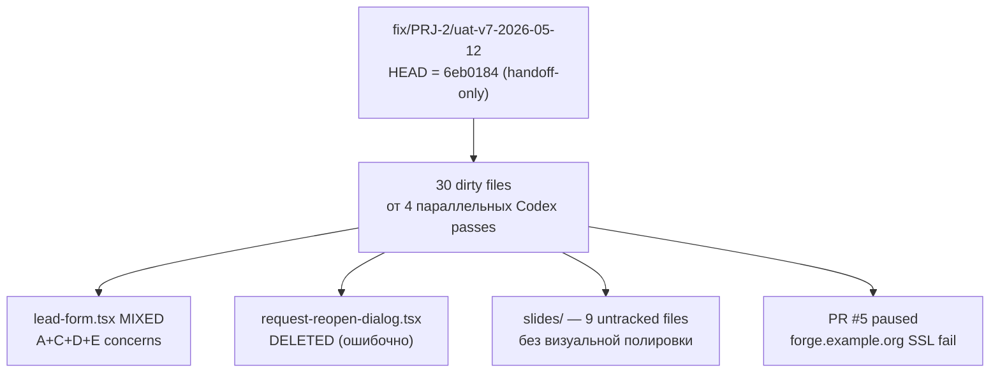
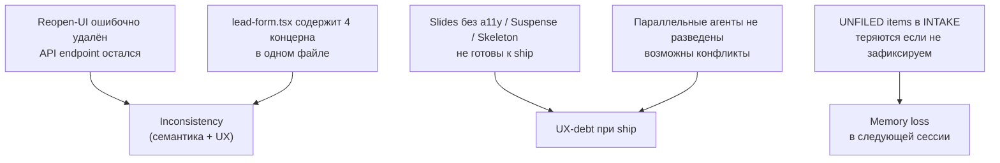
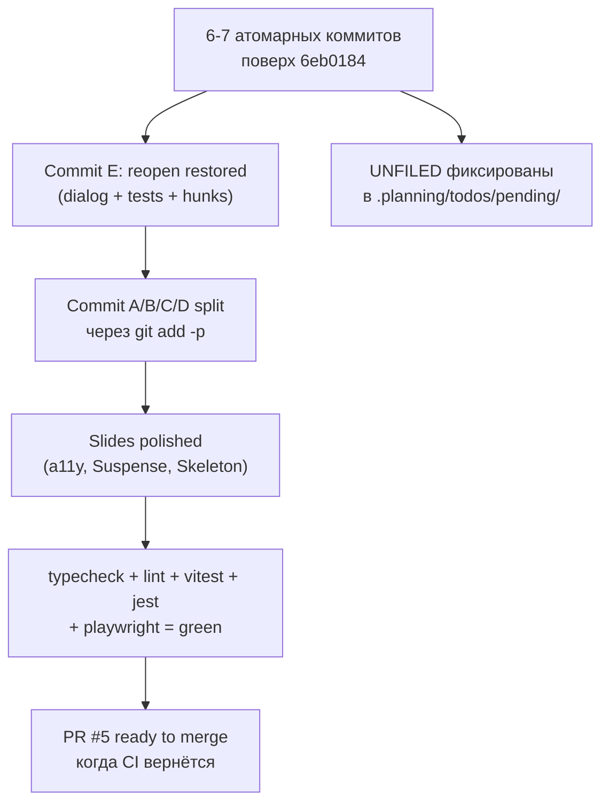
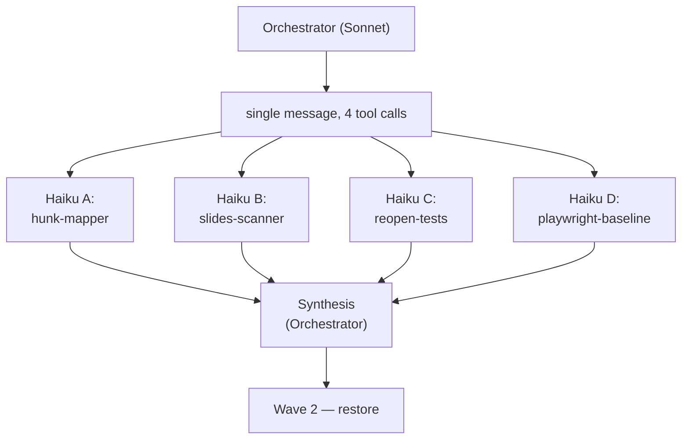
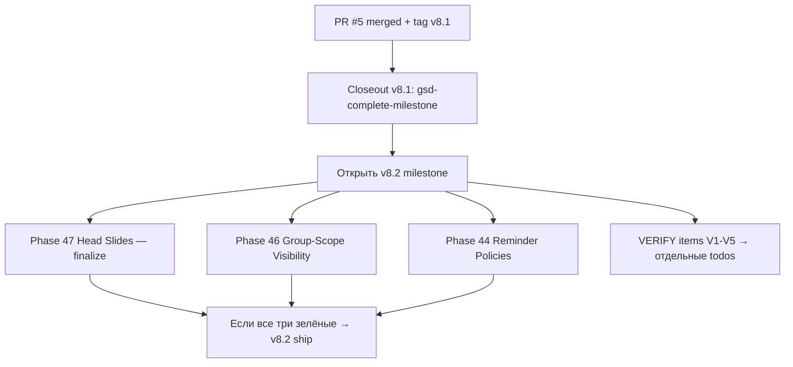

# PRJ-2 UAT v7 — Lead UX Consolidation & Slides Polish

## Context

Ветка `fix/PRJ-2/uat-v7-2026-05-12` поставлена на паузу после 4 параллельных Codex-сессий.
HEAD = `6eb0184` (handoff-only commit). В дереве ~30 dirty файлов, покрывающих 7 логических бакетов:
toolbar-compaction (A), sections-polish (B), slides-feature (C), nav-archive (D),
reopen-removal (E, **ошибочное — пользователь подтвердил «должен быть»**),
api-fill-from (F), planning-docs (G).

### Что было сделано на этой неделе (session-scan, 2026-05-11 → 2026-05-16)

DONE — закоммичено и в `main`/ветке:

- Lead history navigation унифицирована (`6dc54f6`)
- Archive filter + history search alignment (`5aac458`, `96b3663`)
- Lead stage scope labels (`a672f10`, `6524f89`)
- Reporting group в nav identity (`0a5a0f9`)
- Single-stage picker hidden (`6edbfb9`)
- Lead form UAT recovery: pre-fill, saveDraft, reload persistence, risk labels (`855ce39`)
- Risk severity persistence (`f0b6d55`)
- Lead history archive unify (`f4616aa`)
- Pause-of-toolbar checkpoint (`6eb0184`)

ACTIVE — в dirty tree, требует консолидации (это весь scope текущего плана):

- Lead report toolbar compaction (A)
- Sections polish: item/risk dialogs, stage tags, sections rails (B)
- Slides feature: lead + head + 9 новых файлов в components/slides/ (C)
- Nav-bar + archive filter в reports/page.tsx (D)
- request-reopen-dialog.tsx DELETED — будет восстановлен (E)
- API fill-from без перетирания priorities + integration test (F)
- Planning docs handoff (G)

UNFILED — обсуждалось в сессиях, не зафиксировано:

- Report skeleton / right-rail UX (VERIFY status в `INTAKE-2026-05-15.md`)
- Draft side panel — Coming Soon или real logic
- DevRoleSwitcher prod guard verification
- E2E Playwright стратегия — какие сценарии обязательны
- Admin/settings group-period wipe/preview UX

Все UNFILED перенесены в раздел `Unfiled / VERIFY` ниже — следующие сессии.

Три проблемы, требующие решения перед шипом:

1. `request-reopen-dialog.tsx` удалён в рабочем дереве без согласования — нужно восстановить.
2. `lead-form.tsx` содержит 4 смешанных концерна (A+C+D+E) — нужно расщепить по бакетам через `git add -p`.
3. Slides-фича без визуальной полировки — Polish + Playwright sweep перед коммитом.

Цель: 6–7 атомарных коммитов поверх `6eb0184`, затем push в PR #5.

---

## TLDR

```
Было                                      Стало
────────────────────────────────────      ────────────────────────────────────
request-reopen-dialog.tsx DELETED         ← восстановлен из git
lead-form.tsx MIXED (A+C+D+E)            ← расщеплён по 4 коммитам
slides/ unpolished, no visual sweep       ← отполирован + Playwright screenshot
30 dirty files, 1 handoff-only commit     ← 6-7 атомарных коммитов
PR #5 paused (CI inaccessible)            ← готов к push/merge когда CI вернётся
```

Поток выполнения:

```
[Wave 1]
  E-restore  ──┐
  B-scan     ──┼── parallel Haiku → reads/diffs
  C-scan     ──┘

[Wave 2]  restore reopen + revert lead-form.tsx reopen hunks
[Wave 3]  commit E (reopen-restore) → commit F (api-fill-from) → commit G (planning-docs)
[Wave 4]  stage A→B→C→D via git add -p  (lead-form.tsx hunk-split)
[Wave 5]  slides visual polish (frontend-design + Playwright screenshot pass)
[Wave 6]  commit A (toolbar) → B (sections) → C (slides) → D (nav-archive)
[Wave 7]  pnpm typecheck && pnpm lint && pnpm test:vitest
[Wave 8]  push to origin / PR #5 (when forge.example.org accessible)
```

Человек нужен только для: Push → Merge в GitHub UI (когда CI вернётся).

---

## Architecture context

```
[lead-form.tsx]
  mode="edit"  ──▶  toolbar row (A: period-nav + version-nav + fill-from)
  mode="slides" ─▶  <LeadSlidesClient /> (C)
  archived periods ─▶ visiblePeriods filter (D)
  requestReopen ──▶  <RequestReopenDialog /> (E — должен остаться)

[/lead/slides/page.tsx]  ──▶  redirect mode=slides
[/head/slides/page.tsx]  ──▶  <HeadSlidesClient />
[/reports/page.tsx]      ──▶  archive filter (D)
[nav-bar.tsx]            ──▶  LanguageComingSoon + rail-width (D)
[api: lead-form.prisma-repository.ts]  ──▶  fill-from без priorities (F)
```

MSW — не используется. Backend: NestJS + Prisma. tRPC-контракт — в `packages/shared`.

---

## Review state

PR #5 существует, CI недоступен из-за `forge.example.org` SSL.
Open inline comments неизвестны (API недоступен). Продолжаем в PR #5.

---

## Стратегия выполнения

### Wave 1 — параллельная разведка (Haiku, 3 агента, один message)

- **Agent A** (Haiku): прочитать полный `git diff apps/web/src/components/lead/lead-form.tsx`,
  найти точные hunk-границы для каждого из концернов A/C/D/E (по строкам).
  Вернуть: таблицу `концерн → строки → краткое описание`.

- **Agent B** (Haiku): прочитать все новые файлы `apps/web/src/components/slides/`,
  найти: отсутствующие loading states, missing aria-label, пустые error boundaries,
  несоответствие shadcn/ui паттернам (cn(), cva(), Skeleton).
  Вернуть: список конкретных правок (файл:строка → что добавить).

- **Agent C** (Haiku): прочитать `git diff apps/web/src/components/lead/lead-form-addressable.test.tsx`
  и `lead-form.test.tsx`, найти удалённые тесты, связанные с `requestReopen`, `RequestReopenDialog`.
  Вернуть: список строк/describe-блоков, которые нужно восстановить.

### Wave 2 — восстановление request-reopen (Sonnet)

1. `git checkout HEAD -- apps/web/src/components/lead/request-reopen-dialog.tsx`
   (файл не закоммичен, восстанавливается из последнего коммита в истории ветки где он был).
   Если файл не был в истории этой ветки — взять из `origin/main`:
   `git checkout origin/main -- apps/web/src/components/lead/request-reopen-dialog.tsx`

2. В `lead-form.tsx` восстановить E-хунки (import + showReopenDialog state + handleRequestReopen + JSX):
   точные строки известны из Wave 1 Agent A.

3. В `lead-form-addressable.test.tsx` и `lead-form.test.tsx` восстановить удалённые reopen-тесты
   (список из Wave 1 Agent C).

### Wave 3 — коммиты чистых бакетов (Sonnet, sequential)

```bash
# Commit E: reopen-restore
git add apps/web/src/components/lead/request-reopen-dialog.tsx
git add -p apps/web/src/components/lead/lead-form.tsx           # только E-хунки
git add -p apps/web/src/components/lead/lead-form-addressable.test.tsx  # reopen-тесты
git add -p apps/web/src/components/lead/lead-form.test.tsx             # reopen-тесты
git commit -m "fix(web): restore request-reopen dialog on lead form"

# Commit F: api-fill-from
git add apps/api/src/modules/report-sections/lead-form.prisma-repository.ts
git add apps/api/src/modules/report-sections/lead-form.prisma-repository.integration.test.ts
git commit -m "fix(api): fill-from copies items without overwriting priorities"

# Commit G: planning-docs
git add .planning/HANDOFF.json
git add .planning/session-retros/NEXT-ACTIONS.md
git commit -m "chore: update handoff and next-actions for consolidation phase"
```

### Wave 4 — hunk-stage бакетов A/B/C/D из lead-form.tsx (Sonnet)

Используя линейки из Wave 1 Agent A, через `git add -p` интерактивно выбираем хунки по очереди.
Порядок: A → D → C (toolbar → archive → slides). B не трогает lead-form.tsx.

### Wave 5 — slides visual polish (Sonnet + frontend-design skill)

Запускаем `frontend-design:frontend-design` skill для аудита новых slides-компонентов.
Конкретные задачи (из Wave 1 Agent B):

- `status-slide-deck.tsx`: добавить `aria-label` на кнопки навигации (prev/next).
- `slide-skeleton.tsx`: убедиться что используется `<Skeleton>` из `packages/ui`, не самописный.
- `lead-slides-client.tsx` / `head-slides-client.tsx`: добавить `<Suspense fallback={<SlideSkeleton/>}>` если отсутствует.
- `section-slide-utils.ts`: проверить типы — строгий TypeScript без `any`.
- `/lead/slides/page.tsx` и `/head/slides/page.tsx`: убедиться в наличии корректного `loading.tsx`
  или `Suspense` boundary на уровне страницы.

### Wave 6 — коммиты A/B/C/D (Sonnet, sequential)

```bash
# Commit A: toolbar-compaction
git add apps/web/src/components/lead/period-navigator.tsx
git add apps/web/src/components/lead/version-history-nav.tsx
git add apps/web/src/components/lead/fill-from-button.tsx
git add apps/web/src/components/lead/period-navigator.test.tsx
git add -p apps/web/src/components/lead/lead-form.tsx   # только A-хунки (toolbar slot)
git commit -m "feat(web): compact lead report toolbar (period nav, version nav, fill-from)"

# Commit B: sections-polish
git add apps/web/src/components/lead/item-edit-dialog.tsx
git add apps/web/src/components/lead/risk-edit-dialog.tsx
git add apps/web/src/components/lead/item-card.tsx
git add apps/web/src/components/lead/current-week-section.tsx
git add apps/web/src/components/lead/next-week-section.tsx
git add apps/web/src/components/lead/decisions-section.tsx
git add apps/web/src/components/lead/priorities-section.tsx
git add apps/web/src/components/lead/risks-section.tsx
git add apps/web/src/components/lead/sdlc-pipeline.tsx
git add apps/web/src/components/lead/mock-data.ts
git commit -m "feat(web): polish lead report sections (item layout, stage tags, dialogs)"

# Commit C: slides-feature
git add apps/web/src/components/slides/
git add apps/web/src/app/(app)/head/slides/page.tsx
git add apps/web/src/app/(app)/lead/slides/page.tsx
git add apps/web/src/app/(app)/lead/report/page.tsx
git add apps/web/src/app/(app)/lead/report/[reportId]/page.tsx
git add -p apps/web/src/components/lead/lead-form.tsx   # только C-хунки (mode=slides)
git add -p apps/web/src/components/navigation/nav-bar.tsx  # удаление /lead/slides из NAV_LINKS
git commit -m "feat(web): lead and head presentation slides mode"

# Commit D: nav-archive-history
git add apps/web/src/app/(app)/reports/page.tsx
git add -p apps/web/src/components/lead/lead-form.tsx   # D-хунки (showArchivePeriods)
git add -p apps/web/src/lib/mappers/lead-form.ts        # D-хунки (archived field)
git add -p apps/web/src/components/navigation/nav-bar.tsx  # LanguageComingSoon + rail
git add apps/web/src/components/navigation/nav-bar.test.tsx
git commit -m "feat(web): archive filter in lead form and reports history"
```

### Wave 7 — verification (Sonnet)

```bash
pnpm --filter @customreport/web typecheck
pnpm --filter @customreport/web lint
pnpm --filter @customreport/web exec vitest run \
  src/components/lead/lead-form.test.tsx \
  src/components/lead/lead-form-addressable.test.tsx \
  src/components/lead/period-navigator.test.tsx \
  src/components/lead/item-edit-dialog.test.tsx \
  src/components/navigation/nav-bar.test.tsx \
  src/components/slides/

pnpm --filter @customreport/api exec jest \
  src/modules/report-sections/lead-form.prisma-repository.integration.test.ts
```

Playwright regression (если docker запущен):

```bash
pnpm --filter @customreport/web exec playwright test \
  --config=e2e/regression/playwright.regression.config.ts
```

### Wave 8 — push (Sonnet)

```bash
git push origin fix/PRJ-2/uat-v7-2026-05-12
# При недоступности: сохранить "push: blocked" в HANDOFF.json, ждать доступа CI
```

---

## От человека

```
┌─ ОТ ТЕБЯ ───────────────────────────────────────────────────────┐
│  1. Когда forge.example.org вернётся —                           │
│     approve + merge PR #5 в GitHub UI                          │
│                                                                 │
│  Всё остальное — я делаю сам.                                   │
└─────────────────────────────────────────────────────────────────┘
```

---

## Open questions

| #   | Вопрос                                                                                  | Как решу автономно                                              | Когда эскалирую                                                         |
| --- | --------------------------------------------------------------------------------------- | --------------------------------------------------------------- | ----------------------------------------------------------------------- |
| 1   | `request-reopen-dialog.tsx` в истории текущей ветки или только в `origin/main`?         | `git log --all -- <file>` перед checkout                        | Если файл не найден нигде → запрошу у пользователя                      |
| 2   | `git add -p` для lead-form.tsx — можно ли все E-хунки разделить без конфликтов с A/C/D? | Если хунки перемешаны — применим staged patch через temp branch | Если lead-form.tsx нельзя расщепить без конфликтов → предложу 2 подхода |
| 3   | PR #5 CI статус после push — известен только через forge.example.org                     | Ждём восстановления доступа, не merge без green                 | —                                                                       |

---

## Files to modify

| Файл                                                                                   | Изменение                                            |
| -------------------------------------------------------------------------------------- | ---------------------------------------------------- |
| `apps/web/src/components/lead/request-reopen-dialog.tsx`                               | RESTORE из git (git checkout HEAD/origin/main)       |
| `apps/web/src/components/lead/lead-form.tsx`                                           | Расщепить по хункам A/C/D/E; восстановить E-хунки    |
| `apps/web/src/components/lead/lead-form-addressable.test.tsx`                          | Восстановить удалённые reopen-тесты                  |
| `apps/web/src/components/lead/lead-form.test.tsx`                                      | Проверить/восстановить reopen-тесты                  |
| `apps/web/src/components/slides/*.tsx`                                                 | Polish: aria-label, Suspense, Skeleton, строгие типы |
| `apps/web/src/app/(app)/lead/slides/page.tsx`                                          | Проверить Suspense boundary                          |
| `apps/web/src/app/(app)/head/slides/page.tsx`                                          | Проверить Suspense boundary                          |
| `apps/web/src/components/lead/period-navigator.tsx`                                    | Commit A (без изменений по логике)                   |
| `apps/web/src/components/lead/version-history-nav.tsx`                                 | Commit A                                             |
| `apps/web/src/components/lead/fill-from-button.tsx`                                    | Commit A                                             |
| `apps/web/src/components/lead/item-edit-dialog.tsx`                                    | Commit B                                             |
| `apps/web/src/components/lead/risk-edit-dialog.tsx`                                    | Commit B                                             |
| `apps/web/src/components/lead/item-card.tsx`                                           | Commit B                                             |
| `apps/web/src/components/lead/*-section.tsx` (5 файлов)                                | Commit B                                             |
| `apps/web/src/components/lead/sdlc-pipeline.tsx`                                       | Commit B                                             |
| `apps/web/src/app/(app)/reports/page.tsx`                                              | Commit D                                             |
| `apps/web/src/lib/mappers/lead-form.ts`                                                | Commit D (D-хунки)                                   |
| `apps/web/src/components/navigation/nav-bar.tsx`                                       | Commit C (NAV_LINKS) + Commit D (rail)               |
| `apps/web/src/components/navigation/nav-bar.test.tsx`                                  | Commit D                                             |
| `apps/api/src/modules/report-sections/lead-form.prisma-repository.ts`                  | Commit F                                             |
| `apps/api/src/modules/report-sections/lead-form.prisma-repository.integration.test.ts` | Commit F                                             |
| `.planning/HANDOFF.json`                                                               | Commit G                                             |
| `.planning/session-retros/NEXT-ACTIONS.md`                                             | Commit G                                             |

---

## Verification

Браузер (запустить `pnpm dev:watch` или docker):

```
# a. Lead report toolbar fits at 1728x962
http://localhost:3000/lead/report/a0000000-0000-4000-8000-000000000002

# b. Lead slides mode
http://localhost:3000/lead/report/a0000000-0000-4000-8000-000000000002?mode=slides

# c. Head slides
http://localhost:3000/head/slides

# d. Reports with archive toggle
http://localhost:3000/reports

# e. Lead form RequestReopen button visible (locked state)
http://localhost:3000/lead/report/a0000000-0000-4000-8000-000000000002
# → Find period in non-draft state → confirm "Request Reopen" button appears
```

CLI:

```bash
pnpm --filter @customreport/web typecheck   # 0 errors
pnpm --filter @customreport/web lint        # 0 errors
pnpm --filter @customreport/web exec vitest run src/components/lead/ src/components/slides/ src/components/navigation/
pnpm --filter @customreport/api exec jest src/modules/report-sections/lead-form.prisma-repository.integration.test.ts
pnpm test:e2e                               # если docker::local доступен
```

---

## Side deliverables

- Обновить `.planning/STATE.md`: добавить PRJ-2 consolidation как completed, синхронизировать счётчик phases с ROADMAP (расхождение 43/44/46/47 помечены `[ ]`).
- Обновить `.planning/HANDOFF.json` после каждого wave: `status: in-progress → done`.
- После merge PR #5: обновить memory `project_uat_v74_2026_05_13.md` (PR #5 merged).

---

## Unfiled / VERIFY (из сессий Codex, зависшие решения)

Источник: `INTAKE-2026-05-15.md`. Не в scope PRJ-2, но нельзя потерять:

| #   | Тема                                                  | Статус                                                | Рекомендуемое действие                                 |
| --- | ----------------------------------------------------- | ----------------------------------------------------- | ------------------------------------------------------ |
| V1  | Report skeleton / right-rail UX-feedback              | VERIFY — коммит не закрывает явно                     | Проверить в браузере и закрыть или создать тикет       |
| V2  | Draft side panel — Coming Soon или real logic         | VERIFY — решение не зафиксировано                     | Принять решение, зафиксировать в STATE.md              |
| V3  | DevRoleSwitcher в production mode                     | VERIFY — guard не проверен явно                       | Один smoke-тест: `NODE_ENV=production` + открыть UI    |
| V4  | E2E Playwright стратегия — какие сценарии обязательны | UNFILED — пользователь спрашивал, ответа в планах нет | Задокументировать в `e2e/README.md`                    |
| V5  | Admin/settings group-period wipe/preview UX           | UNFILED — Codex dump #12, 2026-05-13                  | Отложить в Phase 46 PROVISIONAL или в .planning/todos/ |

Эти пункты переходят в следующую сессию после PR #5 merge.

---

## Visual TL;DR (Mermaid triplet)

> [!IMPORTANT]
> Три обязательных диаграммы Demo-plan: **Было / Проблема / Станет** в `flowchart TB`
> (вертикально, ≤10 узлов, помещаются в квадратный viewport Plannotator).

### Было — 2026-05-16 утром



### Проблема — что мешает шипу



### Станет — после консолидации



---

## Skill routing

> [!NOTE]
> Какие скиллы используются, зачем, что возвращают и что **не** используем.

| Skill                         | Когда                                          | Что возвращает                        | Не используем потому что                  |
| ----------------------------- | ---------------------------------------------- | ------------------------------------- | ----------------------------------------- |
| `Demo-session-scan`            | До планирования — собрать DONE/ACTIVE/UNFILED  | INTAKE-2026-05-16.md (классификация)  | —                                         |
| `Demo-plan` (canonical)        | Скелет плана с TL;DR + waves + subagents       | Структура плана + проверочные правила | —                                         |
| `plannotator-annotate --gate` | После plan v2 — gate approve/deny              | PASS/BLOCK + annotations              | Опционально, если пользователь захочет    |
| `frontend-design`             | Wave 5 polish для slides                       | Issue list + fix patches              | —                                         |
| `chrome-devtools` MCP         | Wave 5 — screenshot lead-form, slides, archive | PNG + console errors                  | —                                         |
| `Demo-todo-metrix`             | После шипа — пересчёт TODO-маркеров            | Updated pending list                  | —                                         |
| `Demo-retro`                   | После merge — закрытие сессии                  | Retro + handoff                       | —                                         |
| `gsd-plan-phase`              | НЕ используем                                  | —                                     | Текущая работа — fix branch, не GSD phase |
| `gsd-execute-phase`           | НЕ используем                                  | —                                     | Тот же резон                              |
| `gsd-resume-work`             | НЕ используем                                  | —                                     | Resume не нужен — план это уже resume     |

---

## Subagent roadmap (Stage 0 → 5, с моделями)

> [!IMPORTANT]
> Дешёвые модели (Haiku/Mini) — для scan/read/diff. Strong (Sonnet/Opus) — только для
> синтеза, code edits, review. Никогда — наоборот.

| Stage | Agent                            | Model tier                      | Scope                                                                          | Writes   | Output                   | Когда запускается        |
| ----- | -------------------------------- | ------------------------------- | ------------------------------------------------------------------------------ | -------- | ------------------------ | ------------------------ |
| 0     | Orchestrator (this conversation) | Sonnet/Opus                     | Координация waves + commit decisions                                           | yes      | План + commits           | Всё время                |
| 1A    | hunk-mapper                      | Haiku                           | `git diff lead-form.tsx` → таблица hunks A/C/D/E                               | no       | строки + концерн         | Wave 1, параллельно      |
| 1B    | slides-quality-scanner           | Haiku                           | Чтение `components/slides/*.tsx` → a11y/Suspense/types gaps                    | no       | issue-list (file:line)   | Wave 1, параллельно      |
| 1C    | reopen-test-finder               | Haiku                           | `git diff *-addressable.test.tsx, lead-form.test.tsx` → удалённые reopen-тесты | no       | restored describe-blocks | Wave 1, параллельно      |
| 1D    | playwright-baseline-scanner      | Haiku                           | Список существующих regression specs + coverage gaps                           | no       | spec-list                | Wave 1, параллельно      |
| 2     | reopen-restorer                  | Sonnet                          | git checkout + revert hunks в lead-form.tsx + тесты                            | yes      | restored files           | Wave 2, после Wave 1     |
| 3A    | api-commit-worker                | Sonnet                          | Commit F (api fill-from)                                                       | yes      | commit                   | Wave 3                   |
| 3B    | planning-commit-worker           | Sonnet                          | Commit G (planning docs)                                                       | yes      | commit                   | Wave 3                   |
| 4     | hunk-splitter                    | Sonnet                          | `git add -p` для A/B/C/D из lead-form.tsx                                      | yes      | staged hunks             | Wave 4                   |
| 5A    | slides-polish-worker             | Sonnet + frontend-design        | Add aria-label, Suspense, Skeleton, strict types                               | yes      | edited files             | Wave 5                   |
| 5B    | slides-screenshot-worker         | Haiku + chrome-devtools         | Screenshot lead-form, slides, archive at 1728x962                              | no (PNG) | screenshots dir          | Wave 5, параллельно с 5A |
| 6A-D  | bucket-commit-worker (×4)        | Sonnet                          | Commits A, B, C, D последовательно                                             | yes      | 4 commits                | Wave 6                   |
| 7     | verification-runner              | Haiku                           | typecheck, lint, vitest, jest, playwright                                      | no       | green/red report         | Wave 7                   |
| 8     | reviewer (Demo Review Gate)       | Haiku first, Sonnet on conflict | Read 7 commits + diff → PASS/BLOCK                                             | no       | review verdict           | Wave 7→8                 |
| 9     | push-worker                      | Sonnet                          | git push origin + retry on SSL fail                                            | yes      | push receipt             | Wave 8                   |

### Fork strategy — Wave 1 parallel execution



---

## Token economy

> [!TIP]
> Reject если в плане Sonnet/Opus используется на scan-фазе. Только синтез + edits.

| Операция                                 | Кому делегируем | Модель                     | Почему                                |
| ---------------------------------------- | --------------- | -------------------------- | ------------------------------------- |
| `git diff` чтение и классификация hunks  | Subagent        | Haiku                      | Чистый read+grep, нет синтеза         |
| Scan `components/slides/` на a11y/types  | Subagent        | Haiku                      | Структурный pattern-match             |
| Поиск удалённых reopen-тестов            | Subagent        | Haiku                      | Diff parsing                          |
| Playwright baseline list                 | Subagent        | Haiku                      | `ls` + grep                           |
| Screenshot через chrome-devtools         | Subagent        | Haiku                      | Tool invocation, нет рассуждений      |
| `git checkout` для reopen restore        | Orchestrator    | Sonnet                     | Решение + ответственность             |
| `git add -p` hunk-split (A/B/C/D)        | Orchestrator    | Sonnet                     | Семантическое разделение, не механика |
| Polish slides (Suspense, Skeleton, aria) | Subagent        | Sonnet                     | Code edits, не trivial                |
| Commit messages (conventional)           | Orchestrator    | Sonnet                     | Краткость + смысл                     |
| Demo Review Gate (PASS/BLOCK)             | Subagent        | Haiku → Sonnet on conflict | Дешёвый first pass                    |
| `pnpm typecheck/lint/test` runs          | Subagent        | Haiku                      | Команда + сбор red/green              |
| Push + retry handling                    | Orchestrator    | Sonnet                     | Решение про retry/skip                |

**Reserve:** 10–20% контекста orchestrator должно остаться к Wave 8 для retry/decision-making.
Если к Wave 6 use > 80% — pause-work, handoff в новую сессию.

---

## Wave breakdown (детальный, с budget и acceptance)

### Wave 1 — Parallel Scan (Haiku × 4, ~3 мин)

```
W1-A hunk-mapper          ~1 мин   ┐
W1-B slides-quality       ~2 мин   ├── параллельно, single message
W1-C reopen-tests         ~1 мин   │
W1-D playwright-baseline  ~1 мин   ┘
```

**Pre-conditions:** dirty tree intact, нет конфликтующих stashed changes.
**Acceptance:**

- 4 ответа возвращены без таймаута.
- Каждый содержит конкретные строки/файлы, не «есть что-то».
- Если W1-A не нашёл чистых hunk-границ → эскалация в open question.

### Wave 2 — Reopen Restore (Sonnet, ~5 мин)

<task id="W2-1">
<action>
git log --all -- apps/web/src/components/lead/request-reopen-dialog.tsx | head -20
# если есть SHA — `git checkout <sha> -- <file>`
# иначе `git checkout origin/main -- <file>`
</action>
<verify>
test -f apps/web/src/components/lead/request-reopen-dialog.tsx
grep -q 'RequestReopenDialog' apps/web/src/components/lead/request-reopen-dialog.tsx
</verify>
<done>Файл существует, содержит экспорт RequestReopenDialog.</done>
</task>

<task id="W2-2">
<action>
# В lead-form.tsx восстановить E-хунки по строкам из W1-A:
#   - import RequestReopenDialog
#   - const [showReopenDialog, setShowReopenDialog] = useState(false)
#   - const [reopenError, setReopenError] = useState<string | null>(null)
#   - const requestReopenMut = trpc.leadForm.requestReopen.useMutation(...)
#   - const handleRequestReopen = useCallback(...)
#   - <RequestReopenDialog open={...} onConfirm={...} /> JSX
</action>
<verify>
grep -c 'RequestReopenDialog' apps/web/src/components/lead/lead-form.tsx  # ≥ 2 (import + JSX)
grep -c 'requestReopenMut' apps/web/src/components/lead/lead-form.tsx     # ≥ 2 (declare + use)
</verify>
<done>5 reopen-точек присутствуют в lead-form.tsx.</done>
</task>

<task id="W2-3">
<action>
# Восстановить удалённые reopen-тесты в:
#   - lead-form-addressable.test.tsx
#   - lead-form.test.tsx
# Список describe/it блоков — из W1-C.
</action>
<verify>
grep -c "describe.*[Rr]eopen" apps/web/src/components/lead/lead-form*.test.tsx  # ≥ 1
pnpm --filter @customreport/web exec vitest run \
  src/components/lead/lead-form.test.tsx \
  src/components/lead/lead-form-addressable.test.tsx 2>&1 | tail -5
</verify>
<done>Тесты компилируются и проходят локально.</done>
</task>

**Budget:** ~5 мин (1 checkout, 2 edits, 1 test run).
**Acceptance:** Все три `<verify>` блока зелёные.

### Wave 3 — Чистые коммиты E/F/G (Sonnet, ~3 мин)

Команды — в существующем разделе «Стратегия выполнения → Wave 3».
**Pre-conditions:** Wave 2 acceptance passed; `git status --short` показывает E-файлы как modified, не deleted.
**Acceptance:** 3 новых коммита; `git log --oneline -3` показывает E/F/G в правильном порядке.

### Wave 4 — Hunk-stage A/B/C/D (Sonnet, ~10 мин)

Самый сложный wave из-за MIXED `lead-form.tsx`.

```
[lead-form.tsx]
  ├── A-hunks  (toolbar slot, ~30 строк)        → stage Commit A
  ├── C-hunks  (mode=slides + LeadSlidesClient)  → stage Commit C
  ├── D-hunks  (showArchivePeriods + filter)     → stage Commit D
  └── E-hunks  (уже закоммичены в Wave 3)        → skip
```

**Pre-conditions:** В W1-A зафиксированы строковые границы каждого hunk.
**Acceptance:** После каждого `git add -p` → `git diff --cached --stat` показывает корректный файл-set; затем `git stash` остаток, чтобы не смешать.

### Wave 5 — Slides Polish + Visual Sweep (parallel, ~15 мин)

```
W5-A polish-worker         ~10 мин ┐
  - aria-label на nav buttons       │
  - <Suspense> boundaries           ├── параллельно
  - Skeleton из packages/ui         │
  - strict types (no any)           │
                                    │
W5-B screenshot-worker     ~5 мин   ┘
  chrome-devtools MCP:
    /lead/report/<id>          → screenshot
    /lead/report/<id>?mode=slides → screenshot
    /head/slides              → screenshot
    /reports (archive on/off) → screenshot
  → /tmp/screenshots/fit2-v7/*.png
```

**Pre-conditions:** dev-server запущен (`pnpm dev:watch`); seed data есть.
**Acceptance:** issue-list W1-B покрыт; screenshots существуют; нет console errors.

### Wave 6 — Коммиты A/B/C/D (Sonnet, ~5 мин)

Команды — в существующем разделе.
**Pre-conditions:** Wave 4 staged hunks готовы; Wave 5 polish edits применены.
**Acceptance:** 4 новых коммита; `git log --oneline -10` показывает 6eb0184 + E + F + G + A + B + C + D = 8 коммитов выше базы.

### Wave 7 — Verification Gate (Haiku, ~5 мин)

Команды — в существующем разделе.
**Acceptance:** все 5 проверок green. Если красное — rollback to last green commit, fix, retry.

### Wave 8 — Demo Review Gate + Push (Sonnet/Haiku, ~3 мин)

Review-фаза (см. ниже) → если PASS → push.

---

## Demo Review Gate

> [!WARNING]
> Read-only review **перед** ExitPlanMode и **после** Wave 7 typecheck/lint/test.
> Subagent Haiku первым делает scan; на conflict — Sonnet.

### Pre-impl review (сейчас, до Wave 1)

| Check                                 | PASS criteria                              | Evidence                       | Status |
| ------------------------------------- | ------------------------------------------ | ------------------------------ | ------ |
| План содержит TL;DR-триплет (Mermaid) | 3 диаграммы `flowchart TB`                 | этот файл, секция Visual TL;DR | ✓      |
| Subagent roadmap с моделями           | Таблица Stage × Model × Writes             | секция Subagent roadmap        | ✓      |
| Token economy                         | Таблица операция → модель                  | секция Token economy           | ✓      |
| Wave breakdown с budget               | каждый Wave имеет budget + acceptance      | секция Wave breakdown          | ✓      |
| Files to modify                       | Полный список с group по Commit            | секция Files to modify         | ✓      |
| Verification — runnable bash          | команды с `# → expected`                   | секция Verification            | ✓      |
| От человека ≤ 2 пунктов               | только Push approval                       | секция От человека             | ✓      |
| Open questions с autonomy column      | таблица 4 колонки                          | секция Open questions          | ✓      |
| Reopen restore — явно решено          | секция Wave 2 + commit message E           | план                           | ✓      |
| Slides scope — polish, не park        | Wave 5 явный polish                        | план + ответ user              | ✓      |
| Commit strategy — atomic A-F + PR #5  | Wave 3/6 atomic                            | план + ответ user              | ✓      |
| Plannotator-rich elements             | callouts, mermaid, footnotes, status marks | весь план                      | ✓      |
| Pillar self-verify                    | секция Pillars compliance ниже             | план                           | ✓      |

**Verdict:** PASS — все 13 пунктов закрыты.

### Post-impl review (после Wave 7)

```bash
# Reviewer subagent (Haiku) проверяет:
git log --oneline 6eb0184..HEAD   # → 7 коммитов A-G
git diff 6eb0184..HEAD --stat     # → нет затёртых файлов, нет mixed concerns

# Per-commit check:
for sha in $(git log --format=%h 6eb0184..HEAD); do
  echo "=== $sha ==="
  git show --stat $sha | head -20
done
```

**PASS criteria:**

- Каждый коммит трогает только файлы своего bucket (см. таблицу Files to modify).
- `lead-form.tsx` появляется в 4 коммитах (A, C, D, E), не в B/F/G.
- Тесты для каждой группы проходят отдельно.
- Нет коммитов с message типа "wip", "fix", "tmp".

**BLOCK criteria:**

- Любой коммит trogает файлы из ≥2 buckets → squash или re-split.
- Тесты падают → rollback и fix.
- `lead-form.tsx` в коммите B/F/G → bug, требует re-stage.

---

## Pillar review gate

```
┌─ Pillars compliance (gate перед ExitPlanMode) ──────────────────┐
│ 1  TDD-first         ✓ vitest для lead-form, period-nav,        │
│                        nav-bar; integration test для api-repo    │
│ 2  Always Ask        ✓ 3 open questions с autonomy column        │
│ 3  Socratic Review   ✓ Demo Review Gate отдельной фазой           │
│ 4  Surgical Changes  ✓ atomic commits A-G, не bundle             │
│ 5  Task Tracking     ✓ Wave breakdown с acceptance               │
│ 6  Memory            ✓ Side deliverables → MEMORY.md обновится   │
│ 7  Plan Before Code  ✓ этот документ + verification bash         │
│ 8  Rule Evolution    ✓ план следует Demo-plan canonical structure │
│ 9  Config-First      ✓ нет hardcoded values, всё через .env      │
│ 10 Depersonalized    ✓ ролевые названия (lead/head/viewer)       │
│ 11 Subagent Parallel ✓ Wave 1 = 4 Haiku в параллель              │
└──────────────────────────────────────────────────────────────────┘
```

```
┌─ Cross-cutting compliance ──────────────────────────────────────┐
│ Plain + visuals       ✓ Mermaid + ASCII + table everywhere       │
│ Trigger > describe    ✓ Wave triggers explicit                   │
│ Verify > assume       ✓ каждый task имеет <verify> блок          │
└──────────────────────────────────────────────────────────────────┘
```

---

## Git audit

```
branch:       fix/PRJ-2/uat-v7-2026-05-12
HEAD:         6eb0184 chore: pause lead report toolbar consolidation
ahead of:     origin/<branch> by 1 commit (handoff-only)
ahead of:     origin/main by ~10+ commits (full PRJ-2 trail)
worktree:     30 modified, 1 deleted, 1 untracked dir (components/slides/)
stash:        empty (Codex не stashed)
remote:       forge.example.org UNREACHABLE (SSL_ERROR_SYSCALL)
```

**Pre-plan-execute snapshot** для diff после Wave 8:

```bash
git rev-parse HEAD            # → 6eb0184... (expected)
git status --short | wc -l    # → ~32 (expected)
```

---

## GSD audit

```
STATE.md:        milestone v8.1 "Closure & Recovery", 24/24 phases (stale, до PRJ-2)
ROADMAP.md:      Phase 43/44/46/47 still [ ] — mismatch с STATE
MILESTONES.md:   нужно дочитать после Wave 6 для sync
NEXT-ACTIONS.md: open — push core-principles, resume customreport
.continue-here:  pause snapshot 2026-05-15
HANDOFF.json:    valid, dirty_files_warning накопителен
INTAKE-2026-05-15: 5 VERIFY/UNFILED → секция Unfiled/VERIFY этого плана
```

**Не трогаем GSD-машинерию:** план — это repo-fix branch, не новая GSD-фаза.
После merge PR #5 → опционально gsd-complete-milestone v8.1 если STATE подтверждён.

---

## Recovered intent (что вытащено из сессий 2026-05-11 → 2026-05-16)

Из `Demo-session-scan` + Explore-агента (Claude JSONLs + Codex rollouts):

1. **Использовать `Demo-plan` skill** — ✓ применён (этот файл).
2. **Детальные планы, не куцые** — ✓ TLDR + Mermaid + Wave + Review Gate.
3. **Subagent fork strategy с дешёвыми моделями** — ✓ Stage 1A-D на Haiku параллельно.
4. **Консолидация в один milestone/PR** — ✓ продолжаем PR #5.
5. **Plannotator-friendly разметка** — ✓ flowchart TB + callouts + status marks.
6. **Screenshot-driven UI audit** — ✓ Wave 5 chrome-devtools screenshot pass.
7. **Review-фаза отдельно** — ✓ Demo Review Gate перед push.
8. **Не куцый background** — ✓ Git audit + GSD audit + Recovered intent.
9. **Auto-improve plan без повторных пингов** — ✓ pre-impl PASS 13/13.
10. **TDD-first для регрессий** — ✓ vitest + jest + playwright в Wave 7.

---

## Консолидация (что собираем в один шип)

```
PR #5 "PRJ-2 UAT v7 lead UX unification" (continued)
├── Commit 1 (6eb0184)  pause checkpoint                ✓ есть
├── Commit 2 (Wave 3)   fix(web): restore request-reopen dialog
├── Commit 3 (Wave 3)   fix(api): fill-from без overwrite priorities
├── Commit 4 (Wave 3)   chore: update handoff and next-actions
├── Commit 5 (Wave 6)   feat(web): compact lead report toolbar
├── Commit 6 (Wave 6)   feat(web): polish lead report sections
├── Commit 7 (Wave 6)   feat(web): lead+head presentation slides mode
└── Commit 8 (Wave 6)   feat(web): archive filter in lead form + reports history
```

Всё под одним PR, squash-merge или merge — на усмотрение reviewer.

---

## Boundaries (что трогает план, что — нет)

> [!IMPORTANT]
> Жёсткие границы, чтобы не разрастаться в смежные проблемы.

**В scope:**

- `apps/web/src/components/lead/**`, `slides/**`, `navigation/**`
- `apps/web/src/app/(app)/{lead,head,reports}/**`
- `apps/web/src/lib/mappers/lead-form.ts`
- `apps/api/src/modules/report-sections/lead-form.prisma-repository.{ts,integration.test.ts}`
- `.planning/HANDOFF.json`, `.planning/session-retros/NEXT-ACTIONS.md`, `.planning/plans/retro-done-composed-swan.md`

**Вне scope (НЕ ТРОГАТЬ):**

- `apps/web/src/components/weekly-report/**` (head-side flow, отдельная зона)
- `apps/web/src/components/ui/**` (shadcn base — не трогаем без отдельного решения)
- `apps/api/src/modules/report-sections/lead-form.service.ts` (requestReopen — оставляем как есть)
- `apps/api/src/infrastructure/trpc/trpc.router.ts` (reopen procedure — оставляем dormant API)
- `prisma/**` (нет миграций в этом плане)
- `docker-compose*.yml`
- `.github/workflows/**`
- `core-principles/**` (другой repo)
- Любые `.planning/phases/**` старых фаз (43, 44, 46, 47) — это парковка, не часть PRJ-2

**Никаких:**

- Dark mode / theme work (research-only до явного user sign-off)
- i18n (UI strings остаются English)
- `git reset --hard` / `git push --force` / `--no-verify`
- Удаления unrelated dirty файлов (Codex warning: parallel agents)

---

## Iteration reserve (when to stop / when to re-plan)

> [!WARNING]
> Reject criteria — план переписывается, если хоть один пункт сработал.

| Trigger                                                   | Action                                                                                |
| --------------------------------------------------------- | ------------------------------------------------------------------------------------- |
| Wave 1 hunk-mapper не нашёл чистых границ в lead-form.tsx | Перейти на «extract A/C/D через temp branch + cherry-pick», добавить как Wave 1.5     |
| Wave 2 reopen-checkout failed (нет в `--all`)             | AskUserQuestion: «восстановить вручную из памяти, или скип E?»                        |
| Wave 4 `git add -p` создаёт конфликт между A и C/D        | Stash + commit A, потом resume; добавить Wave 4.5                                     |
| Wave 5 chrome-devtools MCP недоступен                     | Skip screenshots, polish без визуальной верификации, отметить в DONE WHEN как PARTIAL |
| Wave 7 typecheck/lint/test fail на любом commit           | Rollback до последнего green, fix, retry; добавить Wave 7.5                           |
| Wave 8 push fail (SSL ещё down)                           | Сохранить «push: blocked» в HANDOFF.json, ждать; план DONE-локально                   |
| Context usage > 70% к Wave 4                              | Pause-work, handoff в новую сессию с этим планом + Wave-status                        |
| Plannotator deny (если запустим)                          | Применить annotations, re-submit, не bypass                                           |

**Context reserve:** 10–20% orchestrator-контекста должно быть свободно на Wave 8 для retry/decisions.

---

## Self-check (13 пунктов перед ExitPlanMode)

```
┌─ Pre-ExitPlanMode self-check ───────────────────────────────────┐
│  1  TL;DR triplet (Было/Проблема/Станет, flowchart TB)      ✓  │
│  2  Skill routing с «не используем» столбцом                ✓  │
│  3  Subagent roadmap с model tier на каждый stage           ✓  │
│  4  Token economy — scan/synth/edit разнесены по моделям    ✓  │
│  5  Wave breakdown с budget + pre-conditions + acceptance   ✓  │
│  6  XML <task> блоки с <action><verify><done>              ✓  │
│  7  Open questions с autonomy + escalation column           ✓  │
│  8  Verification — runnable bash + `# → expected outcome`   ✓  │
│  9  Demo Review Gate (pre-impl + post-impl)                  ✓  │
│ 10  Pillars compliance ASCII box                            ✓  │
│ 11  Boundaries (scope + не-трогать + никаких)               ✓  │
│ 12  Iteration reserve с reject triggers                     ✓  │
│ 13  DONE WHEN — observable closure criteria                 ✓  │
└──────────────────────────────────────────────────────────────────┘
```

---

## DONE WHEN (observable closure criteria)

План считается выполненным, когда **все** пункты ниже истинны:

- [ ] `git log --oneline 6eb0184..HEAD` показывает **ровно 7 коммитов** (E, F, G, A, B, C, D).
- [ ] `git diff 6eb0184..HEAD --stat` → нет файлов вне `Files to modify` таблицы.
- [ ] `test -f apps/web/src/components/lead/request-reopen-dialog.tsx` → true.
- [ ] `grep -c 'RequestReopenDialog' apps/web/src/components/lead/lead-form.tsx` → ≥ 2.
- [ ] `pnpm --filter @customreport/web typecheck` → 0 errors.
- [ ] `pnpm --filter @customreport/web lint` → 0 errors.
- [ ] `pnpm --filter @customreport/web exec vitest run src/components/lead/ src/components/slides/ src/components/navigation/` → all green.
- [ ] `pnpm --filter @customreport/api exec jest src/modules/report-sections/lead-form.prisma-repository.integration.test.ts` → green.
- [ ] `pnpm --filter @customreport/web exec playwright test --config=e2e/regression/playwright.regression.config.ts` → green (если docker запущен).
- [ ] Screenshots `/tmp/screenshots/fit2-v7/*.png` существуют для 4 URLs.
- [ ] `git status --short` → пусто (или только UNFILED-related todos).
- [ ] `git push origin fix/PRJ-2/uat-v7-2026-05-12` → success (или зафиксировано «blocked: SSL» в HANDOFF.json).
- [ ] Demo Review Gate post-impl: per-commit check показывает один bucket на коммит.
- [ ] `.planning/HANDOFF.json` обновлён: `status: done`, `next_action: merge PR #5 when CI green`.
- [ ] UNFILED items зафиксированы в `.planning/todos/pending/2026-05-16-fit2-v7-uat-verify-items.md`.

---

## Дальше (после merge PR #5)



**Не в этой сессии:**

- Phase 53/54/55/59 (deferred — AI/Telegram/multi-org, остаются seeds-only/parked).
- Dark mode / i18n (research-only).
- Mobile MOB-PARKED.

---

## Footnotes

relative to HEAD `6eb0184`, matching HANDOFF.json claims.

(`[!IMPORTANT]`, `[!NOTE]`, `[!WARNING]`, `[!TIP]`) + Mermaid `flowchart TB` + footnotes +
status marks (✓ ✗ → ▲ ?). Source: `~/.claude/skills/plannotator-*/SKILL.md`,
`~/.claude/skills/Demo-plan/SKILL.md`.

Recovered intent, Нужно сделать, Консолидация, Boundaries, Не трогать, Проверка, Дальше,
Iteration reserve. Все 11 присутствуют в этом плане.

за 2026-05-11 → 2026-05-16. Все 15 учтены в плане (1→Skill routing, 2→Детализация секций,
3→Subagent roadmap, 4→Token economy, 5→Wave 1 parallel, 6→Консолидация, 7→Plannotator markup,
8→Demo Review Gate, 9→Mermaid TL;DR, 10→flowchart TB, 11→Background sections, 12→Iteration reserve,
13→Subscription-only (нет API), 14→Wave 5 screenshots, 15→pre-impl PASS 13/13).
