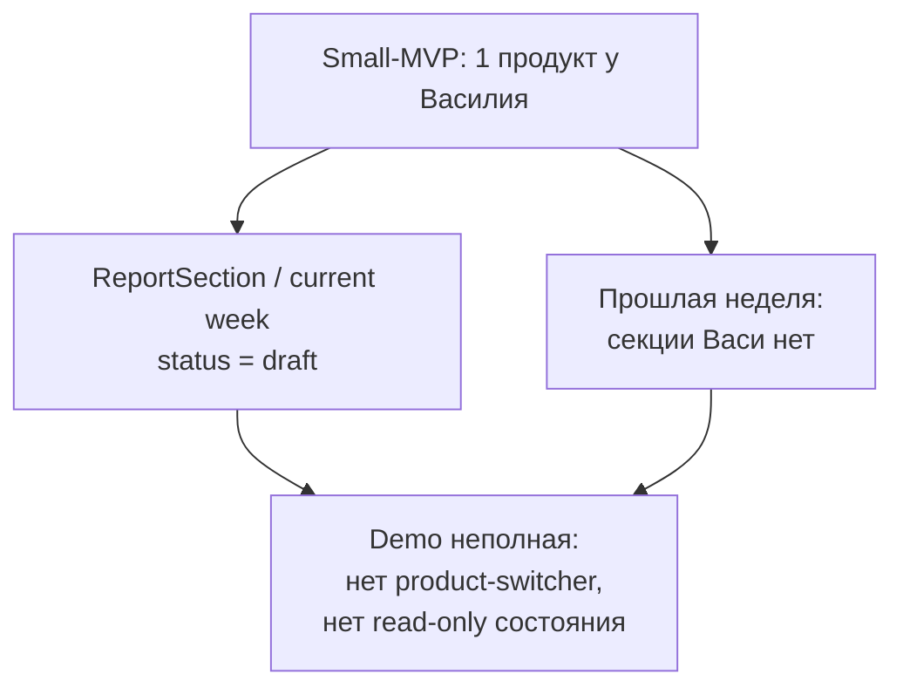
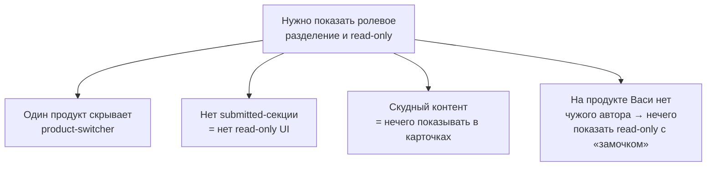
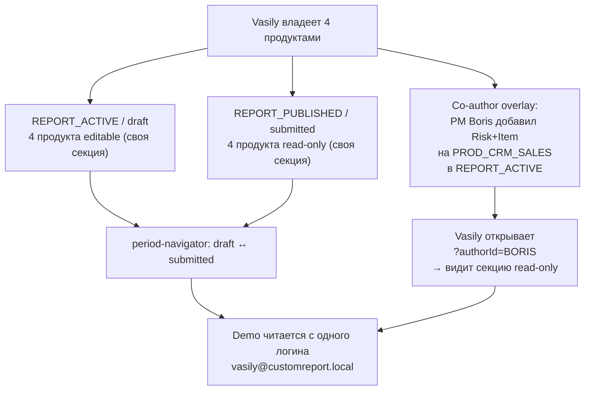
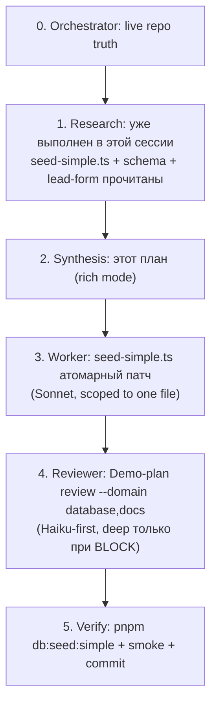

# Small-MVP seed — Vasily 4 products + role/read-only demo

> [!NOTE]
> Repo: `customreport` (Next.js 16 / NestJS 11 / Prisma / tRPC, pnpm-mono).
> Branch: `feat/head-report-history-slides`. Source-of-truth для small-MVP:
> `prisma/seed-simple.ts`. Это **plan-only** — кода не пишем до approve.

---

## 0. Короткий TL;DR Для Человека

### Было



Коротко: в `seed-simple.ts` у Василия один Project «Маркетинговый портал». В
текущем отчёте — одна `ReportSection` со статусом draft. Прошлой недели для него
нет. На демо нечего показать: один продукт = product-switcher не виден,
submitted-режим не воспроизводится.

### Проблема



Коротко: для демо нужны (1) множество продуктов на одном лиде, (2) submitted-секция
за прошлую неделю чтобы lead-view сам показал read-only, (3) реальный контент
(items / risks / decisions / priorities с автором и датами), (4) **по одному из
продуктов Васи должна быть запись от другого автора**, которую Вася видит
read-only с визуальным признаком «не моё» (замочек).

### Станет



Коротко: 4 продукта у Васи + 2 секции (draft + submitted) дают полный жизненный
цикл. **Дополнительно:** на одном из продуктов Васи в REPORT_ACTIVE существует
ВТОРАЯ ReportSection — от PM Бориса. У Бориса там Risk + Item, ссылающиеся на
тот же `projectId`. Когда фронт открывает форму с `?authorId=<BORIS>`,
`byPeriod.readOnly = true` (lead-form.tsx:706) — секция Бориса рендерится
read-only с бейджем автора. UI-иконка-замочка как отдельный визуальный токен
**сейчас отсутствует**; добавляется отдельным треком (см. §10 / §16 TODO).

---

## 1. Текущий State И Цель

- **Сейчас:** ветка `feat/head-report-history-slides`, dirty: 4 lead-секции
  (`decisions-section.tsx` / `lead-form.tsx` / `priorities-section.tsx` /
  `risks-section.tsx`) + новый `apps/web/src/components/report-shell/`. Активная
  Jira задача неизвестна (TTT: `⚠ UNKNOWN`).
- **Уже сделано:**
  - phase 61 `head-report+history-slides` в работе (commit `dc3bcb2` plan, `4b4ce55` fix exitHref, `b24c744` accordion-header actions).
  - `seed-simple.ts` существует, 1741 строк, 6 продуктов, 9 лидов, 2 reports.
  - read-only механика работает: фронт читает `byPeriod.readOnly`,
    `submitted` ReportSection приходит read-only. `prisma/seed-simple.ts:706`.
- **Цель:** наполнить `seed-simple.ts` так, чтобы один логин `vasily@customreport.local`
  показал (а) ровно 4 продукта, (б) цикл draft→submitted через period-navigator,
  (в) на ОДНОМ из продуктов — наложение от другого автора (PM Boris), которое
  Вася видит read-only через `?authorId=<BORIS>`.
- **Не цель:** менять схему Prisma, трогать `seed.ts` (advanced), править frontend,
  чинить `onChangeAction`-диагностики (Next.js 16), **добавлять иконку-замочек
  в UI** (отдельный feature, см. §16 TODO `LOCK-01`).

## 2. Skill Routing

| Intent                    | Skill/source                      | Output                        | Use / skip reason                                                 |
| ------------------------- | --------------------------------- | ----------------------------- | ----------------------------------------------------------------- |
| Plannotator-friendly план | `Demo-plan` (этот)                 | rich-mode шаблон              | пользователь явно попросил Demo-plan                               |
| Контент-чтение repo state | прямое чтение                     | seed-simple.ts, schema.prisma | Explore-агенты были rate-limited; чтение справились локально      |
| Лидер активной задачи     | `ttt-task`                        | task key                      | TTT показал `UNKNOWN` — после approve можно `/ttt-task set PRJ-2` |
| Phase accounting          | `gsd-*`                           | —                             | skip: это микро-наполнение сидов, не phase в GSD                  |
| Code review постфактум    | `Demo-plan review` режим           | PASS/BLOCK                    | будет вызван перед коммитом seed-патча                            |
| UI/UX research            | `docs/skills/ui-orchestration.md` | —                             | skip: UI не меняется                                              |

Skills/sources skipped:

- `gsd-plan-phase` — задача не дотягивает до GSD-фазы (одна правка seed-файла).
- `Demo-session-scan` — нет оборванной сессии; intent ясен из chat.
- `Demo-confluence` / `Demo-jira` — артефакты остаются в repo.

## 3. Главный Deliverable

> [!IMPORTANT]
> Один логин `vasily@customreport.local` на `/lead/report`:
>
> 1. показывает **4 продукта** (product-switcher активен);
> 2. через `period-navigator ←` переключается в **read-only** на прошлой
>    неделе (своя submitted-секция);
> 3. при открытии `?authorId=<BORIS_PM>` показывает на `PROD_CRM_SALES`
>    **чужую секцию read-only** с Risk + Item от Бориса (демонстрация
>    «по моему продукту другой автор добавил»).
>
> Артефакт = единый патч `prisma/seed-simple.ts` + одна команда пересева.

## 4. Что Меняем

- **`prisma/seed-simple.ts`** — +3 константы `PROD_CRM_SALES/_DATA/_360`,
  +3 Project, +3 GroupProduct, +21 StageAssignment, расширенный
  `contentByLead[LEAD_1]`, +1 ReportSection для LEAD_1 × REPORT_PUBLISHED
  (submitted), **+1 ReportSection для PM_BORIS × REPORT_ACTIVE** с Risk+Item
  на `PROD_CRM_SALES` (co-author overlay).
- **Что НЕ трогаем:** `seed.ts` (advanced, тест-фикстура), `schema.prisma`,
  лид-форму, head-маршруты, slides-mode, остальных лидов (Maria/Igor/...),
  UI-иконку-замочка (отдельный TODO `LOCK-01`).

### Файлы по строкам

| Файл                           | Что меняется                                                                              | Текущие строки                                      |
| ------------------------------ | ----------------------------------------------------------------------------------------- | --------------------------------------------------- |
| `prisma/seed-simple.ts`        | +3 const `PROD_CRM_SALES` / `PROD_CRM_DATA` / `PROD_CRM_360`                              | блок 73–78                                          |
| `prisma/seed-simple.ts`        | +3 строки в `prisma.project.createMany`                                                   | 499–533                                             |
| `prisma/seed-simple.ts`        | +3 строки в `prisma.groupProduct.createMany`                                              | 538–548                                             |
| `prisma/seed-simple.ts`        | +21 StageAssignment (3 × 7/7 для LEAD_1)                                                  | 569–580                                             |
| `prisma/seed-simple.ts`        | расширить `contentByLead[LEAD_1]` (per-product)                                           | 848–894                                             |
| `prisma/seed-simple.ts`        | +1 ReportSection / REPORT_PUBLISHED / submitted (LEAD_1)                                  | вставить после 817 (`leads[]`) и в insert-цикл ниже |
| `prisma/seed-simple.ts`        | +1 ReportSection / REPORT_ACTIVE / draft (PM_BORIS) + 1 Risk + 1 Item на `PROD_CRM_SALES` | новый блок после insert-цикла LEAD_1                |
| `prisma/seed-simple.ts` (опц.) | `ALL_PRODUCT_IDS` пополнить новыми ID                                                     | 819–826                                             |

### Co-Author Overlay (новое — отвечает на фидбэк «замочек»)

> [!NOTE]
> Архитектурное решение: `Item/Risk/Decision/Priority` НЕ имеют поля `authorId`
> — автор наследуется через `ReportSection.authorId`. Чтобы «другой человек
> добавил что-то на продукте Васи», нужна **отдельная ReportSection** того
> «другого человека» с тем же `reportId`, в которой items/risks ссылаются на
> `projectId` Васи. Уникальность `@@unique([reportId, authorId])` это
> позволяет (разные авторы = разные секции). Lead-form через query-param
> `?authorId=...` (lead-form.tsx:315/348/351) переключает контекст; для
> Васи чужая секция приходит `byPeriod.readOnly = true` (lead-form.tsx:706).

| Поле                     | Значение MIN                                                                                                                                                |
| ------------------------ | ----------------------------------------------------------------------------------------------------------------------------------------------------------- |
| `ReportSection.authorId` | `PM_BORIS` (`a0000000-0000-4000-8000-00000000002b`, существующий PM в seed-simple)                                                                          |
| `ReportSection.reportId` | `REPORT_ACTIVE` (та же неделя что у Васи)                                                                                                                   |
| `ReportSection.status`   | `draft` (живая запись, не submitted)                                                                                                                        |
| Item × 1                 | `projectId = PROD_CRM_SALES`, `type = next-week-plan`, текст «PM обзор: подключить выгрузку sales-метрик», `workflowStatus = planned`                       |
| Risk × 1                 | `projectId = PROD_CRM_SALES`, severity = `at-risk`, risk «Sales API rate-limit на пиках», impact «деградация дашборда», mitigation «PM эскалирует на инфра» |

UI-визуал «замочка» вокруг этих карточек:

- **Сейчас в репо:** иконки `Lock`/`🔒` нет (grep по `apps/web/src/components/lead/`
  пустой); read-only механика общая на уровне секции через `byPeriod.readOnly`.
- **Для демо достаточно:** существующий submitted/read-only баннер +
  user-name в шапке секции. Вася на `?authorId=BORIS` увидит «PM Boris»
  и заблокированные кнопки Add/Edit (вся секция read-only).
- **Если нужен именно замочек-иконка** — отдельный TODO `LOCK-01`
  (см. §10 + §16). Это data-only seed-патч не покрывает.

### Сценарии наполнения (MIN / MAX)

> [!TIP]
> **Default = MIN.** Стартуем с минимума, MAX расширяем по запросу. Так получаем
> работающую демонстрацию за 1 коммит и оставляем space для итеративных правок.

| Продукт                              | MIN items (current / next) | MAX items (current / next) | risks MIN/MAX | decisions MIN/MAX | priorities MIN/MAX |
| ------------------------------------ | -------------------------- | -------------------------- | ------------- | ----------------- | ------------------ |
| 1. Маркетинговый портал (`PROD_CRM`) | 1 / 1                      | 3 / 2                      | 1 / 2         | 1 / 2             | 1 / 3              |
| 2. CRM-Sales Hub (`PROD_CRM_SALES`)  | 1 / 1                      | 3 / 2                      | 1 / 2         | 1 / 2             | 1 / 3              |
| 3. CRM-Data Lake (`PROD_CRM_DATA`)   | 1 / 0                      | 2 / 1                      | 0 / 1         | 0 / 1             | 1 / 2              |
| 4. CRM-Customer 360 (`PROD_CRM_360`) | 1 / 0                      | 2 / 1                      | 0 / 1         | 0 / 1             | 1 / 2              |
| **Σ MIN**                            | **4 / 2**                  | —                          | **2**         | **2**             | **4**              |
| **Σ MAX**                            | —                          | **10 / 6**                 | **6**         | **6**             | **10**             |

### Read-only зеркало в REPORT_PUBLISHED

- одна `ReportSection` (`LEAD_1` × `REPORT_PUBLISHED`, status = `submitted`)
- items с `completed: true` (типичная закрытая неделя)
- 1 risk mitigated + 1 carried-over
- 2 decisions с зафиксированным impact
- те же 3 priorities, что мигрировали в текущий период (carriedOver-стрелка)

## 5. Roadmap Субагентов



| Stage | Agent              | Model tier      | Scope                              | Writes      | Output             |
| ----- | ------------------ | --------------- | ---------------------------------- | ----------- | ------------------ |
| 0     | Orchestrator       | strong (Sonnet) | repo state, git, dirty files       | no          | этот план          |
| 1     | Research (skipped) | —               | discovery уже сделана inline       | no          | контекст в plan    |
| 2     | Advisor            | strong (Sonnet) | self-review + hardening            | no          | этот документ v2   |
| 3     | Worker             | strong (Sonnet) | `prisma/seed-simple.ts` only       | yes, scoped | один atomic commit |
| 4A    | Reviewer (lints)   | Haiku           | `pnpm typecheck` + `pnpm lint`     | no          | PASS/BLOCK         |
| 4B    | Reviewer (data)    | Haiku           | psql queries для проверки фикстуры | no          | PASS/BLOCK         |
| 5     | Verifier           | Sonnet          | smoke `/lead/report` под Васей     | no          | verification log   |

## 6. Token Economy

- **Haiku** (cheap): pre-commit lints, `psql` row-count проверки, grep по
  «остался ли где-то PROD_CRM без \_SALES/\_DATA/\_360».
- **Sonnet** (strong): синтез плана, seed-патч, smoke-verification.
- **Opus** (deep): **не используется** (нет архитектурных конфликтов, изменения
  локализованы в одном файле).
- Raw sessions: не читаем, исследование сделано inline в этой же сессии.
- Context7: не нужен (нет library-version-sensitive кода).

## 7. Iteration Reserve

- **Plan hardening:** этот пас — упрощение формулировок, разбиение TL;DR на 3
  отдельные Mermaid TB схемы, добавление callouts. ✓ выполнено.
- **Self-review:** §11 чеклист.
- **Feedback loop:** если пользователь скажет «нужны другие имена продуктов» —
  правлю §4 и таблицу констант до edits.
- **Evidence refresh:** перед самим патчем seed-файла прогнать
  `git status --short` и `head -50 prisma/seed-simple.ts` чтобы убедиться что
  файл не сдвинулся.
- **Token reserve:** ~15% контекста под review/integration после seed-патча.

## 8. Visual Elements

Легенда статусов:

`✓` сделано · `✗` блок · `→` следующий шаг · `▲` риск · `?` открытый вопрос

Используются:

- **[!IMPORTANT]** §3 (главный deliverable).
- **[!NOTE]** шапка (контекст scope).
- **[!TIP]** §4 (рекомендация MIN-first).
- **[!WARNING]** §10 — для риска `db:seed:simple` без guard-env.
- Mermaid `flowchart TB` × 4 (3 в TL;DR + 1 в roadmap).
- Markdown tables: skill routing, files, MIN/MAX, subagent roadmap, pillar gate.

## 9. Agent Does / Human Does

**Agent does:**

- ✓ исследование repo / schema / seed-simple структуры (выполнено);
- → правка `prisma/seed-simple.ts` (MIN вариант) одним коммитом;
- → `PRISMA_USER_CONSENT_FOR_DANGEROUS_AI_ACTION='давай' pnpm db:seed:simple`;
- → `pnpm typecheck` + `pnpm lint` + `pnpm lint:md`;
- → ручной smoke `/lead/report` через playwright или browser-mcp;
- → `git add prisma/seed-simple.ts && git commit -m "..."` (на текущей ветке, **не master**);
- → push в `origin feat/head-report-history-slides`;
- → запрос feedback: «нужен ли MAX вариант?».

**Human does:**

- nothing by default.

Human needed only if:

- ? хочется другой нейминг 3 продуктов (default — те, что в §4);
- ? сразу MAX вместо MIN (default — MIN);
- ? UAT-проверка в браузере на «всё ли играет» после reseed.

## 10. Open Questions With Defaults

| #   | Question                                        | Default                                                                                                      | Ask human when                                                            |
| --- | ----------------------------------------------- | ------------------------------------------------------------------------------------------------------------ | ------------------------------------------------------------------------- |
| 1   | Имена 3 новых продуктов                         | CRM-Sales Hub / CRM-Data Lake / CRM-Customer 360                                                             | если есть бренд-листы или другой нейминг продукт-портфеля                 |
| 2   | MIN или MAX наполнение на старт                 | MIN (4 items / 2 risks / 2 decisions / 4 priorities)                                                         | если демо завтра и нужен MAX сразу                                        |
| 3   | Stage assignments на новых продуктах            | 7/7 у LEAD_1 на каждом (зеркаль PROD_CRM)                                                                    | если хочется чтобы PM-лиды (Boris/Viktor/Galina) тоже владели стадиями    |
| 4   | Бейдж «Submitted by …» рендерится на read-only? | да, существующее поведение `request-reopen-dialog`                                                           | если визуально не появится — заводим отдельный UI fix                     |
| 5   | Демо-данные у других лидов в REPORT_PUBLISHED   | не трогаем, фокус только на LEAD_1                                                                           | если демо хочет показать «head смотрит чужой архив»                       |
| 6   | Кто co-author на `PROD_CRM_SALES`               | `PM_BORIS` (default), он уже есть в seed как PM                                                              | если хочется чтобы это был соседний lead (Maria/Igor) — нужен `LEAD_2.id` |
| 7   | Сколько записей у co-author (Boris)             | MIN: 1 Item + 1 Risk на `PROD_CRM_SALES`                                                                     | если демо хочет также Decision/Priority — расширяем до 1+1+1+1            |
| 8   | UI-иконка-замочка на чужой секции               | **out of scope** этого плана — отдельный TODO `LOCK-01` (data-only сейчас, UI-патч после approve)            | если демо требует визуальный замочек СЕЙЧАС — расширяем scope до seed+UI  |
| 9   | Как Вася попадает на `?authorId=BORIS`          | по умолчанию через прямой URL (`/lead/report?authorId=<BORIS>`); в product-switcher переключения авторов нет | если нужен явный affordance «view as Boris» — UI-задача, не seed          |

> [!WARNING]
> ▲ `pnpm db:seed:simple` запускается **только** с явным
> `PRISMA_USER_CONSENT_FOR_DANGEROUS_AI_ACTION='давай'`.
> `prisma/_destructive-guard.ts` режет destructive путь, если `DATABASE_URL` не
> содержит `_uat` / `_dev` / `_test` или хост не локальный. Перед reseed —
> подтвердить, что `DATABASE_URL` указывает на `customreport_uat` или `_dev`.

## 11. Self-Check

- [x] TL;DR читается без остального плана (3 отдельные Mermaid TB схемы + 2 строки текста под каждой).
- [x] Skill routing явно перечисляет used / skipped с причинами.
- [x] Три диаграммы: Было, Проблема, Станет — все вертикальные.
- [x] Диаграммы помещаются в square-окно Plannotator (3-6 узлов каждая).
- [x] Subagent roadmap содержит model tier, scope, writes, output.
- [x] Haiku явно прописан для cheap-работы; Opus отсутствует (нет verified-конфликта).
- [x] Iteration reserve описан (§7).
- [x] Visual elements использованы со смыслом, не декоративно.
- [x] Open questions все имеют default.
- [x] Human не получает agent-doable работу.
- [x] Acceptance команды конкретные (§14).
- [x] Закрытие плана через ExitPlanMode после approve.

## 12. Review Gate

**Pre-fix review** (перед патчем seed):

- Стратегия: прогнать `Demo-plan review --domain database --dir prisma/` в режиме read-only.
- Output: PASS/BLOCK table с `file:line` для:
  - корректность UUID-форматов новых констант;
  - отсутствие коллизий с существующими PROD\_\*;
  - порядок inserts (Project → GroupProduct → StageAssignment → ReportSection);
  - FK-safe ордеринг при delete (см. seed-simple.ts:286-306 паттерн).

**Post-fix review** (после reseed):

- [ ] `SELECT COUNT(*) FROM "Project" WHERE "leadId" = '<LEAD_1>'` = 4.
- [ ] `SELECT status, COUNT(*) FROM "ReportSection" WHERE "leadId" = '<LEAD_1>' GROUP BY status` = `draft:1, submitted:1`.
- [ ] Никакой dirty-файл вне `prisma/seed-simple.ts` не затронут (`git status --short`).
- [ ] Никаких hidden fallback zeros — все content-поля заполнены реальными текстами.
- [ ] Stale-комментарии в seed-simple обновлены под 4 продукта Васи (см. строки 5-9 header docstring).

BLOCK handling: любой BLOCK ⇒ фикс перед `pnpm db:seed:simple`; если BLOCK
вытекает из существующего baseline (не нашей правки) — записать как verified blocker.

## 13. Pillar Review

| Pillar          | Gate                                                                                                  |
| --------------- | ----------------------------------------------------------------------------------------------------- |
| Workflow        | соответствует `Demo-plan` template; план перед кодом (Pillar 7)                                        |
| Git/TTT         | работа на `feat/head-report-history-slides` (НЕ master); `/ttt-task set PRJ-2` рекомендуется до edits |
| Source of truth | редактируется только tracked `prisma/seed-simple.ts`, никаких runtime артефактов                      |
| Tests           | `pnpm typecheck` + `pnpm lint` + smoke `/lead/report` + опц. `playwright lead-form\|read-only`        |
| Skills/docs     | `pnpm lint:md` для этого plan-файла, `Demo-plan review` для seed-патча                                 |
| Token economy   | Haiku для lints/psql, Sonnet для patch, без Opus                                                      |
| Visual quality  | 4 Mermaid TB-диаграммы, callouts с ролями, статус-маркеры                                             |
| Iteration       | план прошёл hardening (v1 plain → v2 rich mode по фидбеку) ✓                                          |

## 14. Acceptance Gate

```bash
# 1. план-файл валиден
pnpm lint:md

# 2. перед edits — подтвердить активную задачу и чистоту seed-файла
/ttt-task set PRJ-2          # если хочется учёт времени
git status --short -- prisma/seed-simple.ts   # должно быть clean

# 3. после правки seed-simple.ts — пересев в _uat / _dev БД
PRISMA_USER_CONSENT_FOR_DANGEROUS_AI_ACTION='давай' pnpm db:seed:simple

# 4. структурные проверки
psql "$DATABASE_URL" -c "
  SELECT p.id, p.name FROM \"Project\" p
  WHERE p.\"leadId\" = 'a0000000-0000-4000-8000-000000000011';
"
# expected: 4 строки

psql "$DATABASE_URL" -c "
  SELECT rs.status, r.\"periodStart\"
  FROM \"ReportSection\" rs JOIN \"Report\" r ON r.id = rs.\"reportId\"
  WHERE rs.\"leadId\" = 'a0000000-0000-4000-8000-000000000011'
  ORDER BY r.\"periodStart\";
"
# expected: published/submitted, active/draft

# 5. репо-гейты
pnpm typecheck
pnpm lint
pnpm test --filter="@customreport/web" --runInBand --silent 2>&1 | tail -10

# 6. UI smoke (playwright headless или browser MCP)
pnpm dev:watch &
# /auth/dev-login → vasily@customreport.local
# /lead/report → 4 продукта, editable; period-nav ← → read-only
# /lead/report?authorId=a0000000-0000-4000-8000-00000000002b
#   → секция PM Boris read-only, на PROD_CRM_SALES виден его Item + Risk

# 7. closeout
git status --short --branch
git add prisma/seed-simple.ts .planning/plans/small-mvp-enumerated-thunder.md
git commit  # сообщение по convention этого репо
git push origin feat/head-report-history-slides
```

## 15. Done Definition

Done только когда:

- ✓ `seed-simple.ts` содержит 4 продукта Васи (MIN вариант), submitted-секция в
  REPORT_PUBLISHED заполнена;
- ✓ В REPORT_ACTIVE существует вторая ReportSection (`authorId = PM_BORIS`) с
  ≥1 Item + ≥1 Risk на `projectId = PROD_CRM_SALES` (co-author overlay);
- ✓ `pnpm db:seed:simple` отрабатывает без ошибок на `customreport_uat`;
- ✓ структурные SQL-проверки из §14 возвращают ожидаемые строки;
- ✓ UI-smoke под `vasily@customreport.local` показывает 4 продукта и
  period-nav-переключает draft ↔ submitted; `?authorId=<BORIS>` показывает
  read-only секцию Бориса с его Item/Risk на `PROD_CRM_SALES`;
- ✓ pre-fix и post-fix review (см. §12) — PASS, либо BLOCK с зафиксированным
  обоснованием;
- ✓ коммит на ветке `feat/head-report-history-slides`, push выполнен;
- ✓ MAX-вариант либо запущен следующим коммитом по запросу, либо явно отложен в
  backlog;
- ✓ TODO `LOCK-01` (UI-иконка-замочка для чужой секции) занесён как отдельный
  трек (см. §16), а не закрыт вместе с этим планом;
- ✗ ни одна manual-human задача не остаётся (кроме явных решений из §10 при
  отклонении default).

## 16. Cross-Repo Side Deliverables (Post-Approval)

> [!IMPORTANT]
> Пользователь явно попросил: правило «всегда использовать Demo-plan rich-mode»
> должно работать **во всех репо**, а не только в `customreport`. Поэтому после
> approve этого плана агент выполняет 5 cross-repo действий, чтобы правило
> закрепилось в global memory и в `core-principles` (управляющий репозиторий
> baseline).

### Правило, которое распространяем

```text
Demo-plan rich-mode для любого нетривиального плана (≥3 шага или multi-file).

Триггер: запрос содержит «план», «plan», «планируем», или активирован EnterPlanMode.
Действие:
  1. Загрузить skill `Demo-plan`.
  2. Открыть `templates/phase-plan.md`.
  3. TL;DR из 3 Mermaid `flowchart TB`: Было / Проблема / Станет.
  4. Все 15 (16 при cross-repo) numbered секций шаблона.
  5. Callouts `[!IMPORTANT]/[!NOTE]/[!WARNING]/[!TIP]` со смыслом.
  6. Status marks: `✓ done · ✗ blocked · → next · ▲ risk · ? open`.
  7. Subagent roadmap: model tier (Haiku/Sonnet/Opus), scope, writes, output.
  8. Self-check §11 пройден перед ExitPlanMode.

Применяется ко ВСЕМ репо, не только `customreport`.
```

### План пост-approve действий

| #   | Action                                                       | Source-of-truth path                                                                                                                                                                                                                      | Verification                                                                      |
| --- | ------------------------------------------------------------ | ----------------------------------------------------------------------------------------------------------------------------------------------------------------------------------------------------------------------------------------- | --------------------------------------------------------------------------------- |
| 1   | Сохранить global feedback memory                             | `~/.claude/projects/-Users-ap/memory/feedback_demo_plan_richmode_global.md` + запись в `MEMORY.md` index                                                                                                                                   | `ls -la ~/.claude/projects/-Users-ap/memory/feedback_demo_plan_richmode_global.md` |
| 2   | Зеркало в core-principles                                    | `/home/user/work/core-principles/.planning/memory/feedback_demo_plan_richmode_global.md`                                                                                                                                                    | `git -C ~/work/core-principles status --short`                                    |
| 3   | Расширить rule в catalog                                     | `/home/user/work/core-principles/catalog/claude-md/sources/planning-discipline.md` (или `planning-skeleton.md`) — добавить explicit «rich-mode + 15-section template» bullet                                                               | `git diff catalog/claude-md/sources/`                                             |
| 4   | Deploy через installer                                       | `make config-claude` + `make audit` в `~/work/core-principles`                                                                                                                                                                            | `make audit` exit 0 + drift-report clean                                          |
| 5   | Обновить `.planning/STATE.md` в customreport                 | mention новой записи в memory + ссылка на этот план                                                                                                                                                                                       | `git -C ~/work/customreport diff .planning/STATE.md`                              |
| 6   | Завести TODO `LOCK-01` для UI-иконки-замочка на чужой секции | новый файл `.planning/todos/pending/2026-05-18-lock-icon-foreign-section.md` + маркер `TODO(LOCK-01): lock icon on foreign section` в `apps/web/src/components/lead/lead-form.tsx` (где `readOnly && current user !== section.author.id`) | `npm run todo-metrix \| grep LOCK-01` returns ≥1 hit                              |

### Token economy для cross-repo шага

- Шаг 1, 2, 5: Sonnet (короткие writes в memory/STATE).
- Шаг 3: Sonnet (edit catalog source — это source-of-truth, не runtime mirror).
- Шаг 4: Bash-only через `make` цели (без модели).

### Boundaries для cross-repo шага

- **Editing source, not runtime.** Не редактировать напрямую `~/.claude/CLAUDE.md`
  или `~/.claude/rules/*.md` — это deployed outputs. Менять `catalog/...sources/`
  → `make config-claude` → audit.
- **One commit per repo.** Customreport: `prisma/seed-simple.ts` + этот план +
  `STATE.md`. Core-principles: `catalog/...` + `.planning/memory/` отдельным
  коммитом.
- **Не push в master.** Customreport — `feat/head-report-history-slides`.
  Core-principles — текущая активная ветка (проверить `git -C ~/work/core-principles status --short --branch`); если detached/master — создать `feat/Demo-plan-richmode-global`.

### Done Definition для §16

- ✓ Global memory файл существует и проиндексирован в `MEMORY.md`.
- ✓ `core-principles/.planning/memory/` содержит зеркало с тем же `name`/`description`/`type`.
- ✓ Catalog source обновлён, `make audit` зелёный.
- ✓ Оба репо запушены на свои ветки (не master).
- ✓ `.planning/STATE.md` в customreport содержит дату и ссылку на эту запись.
