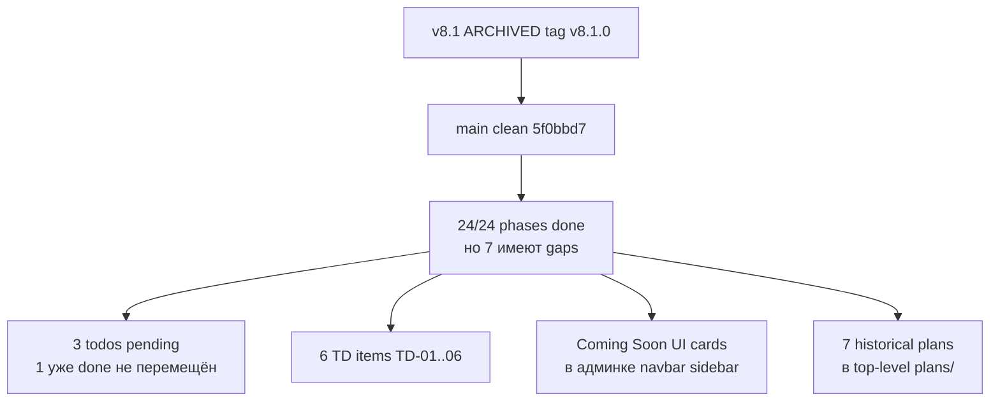
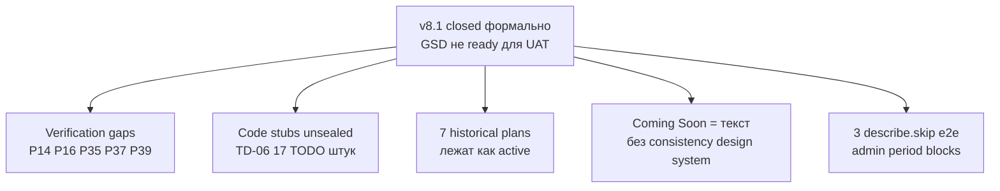
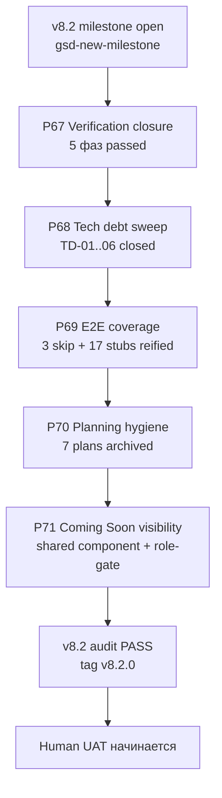
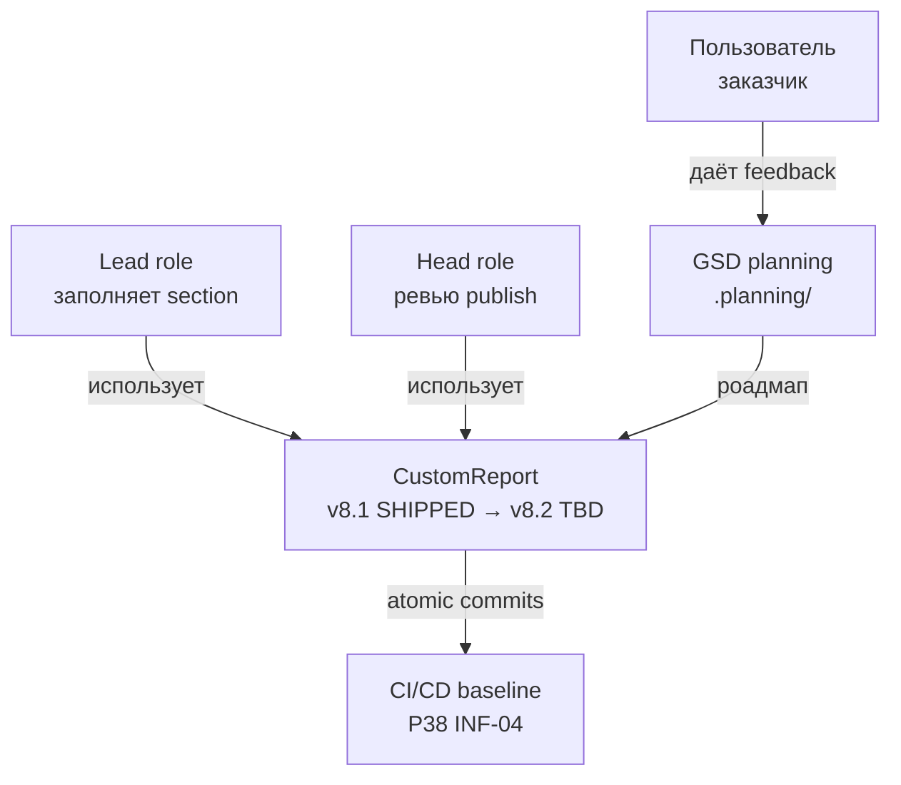
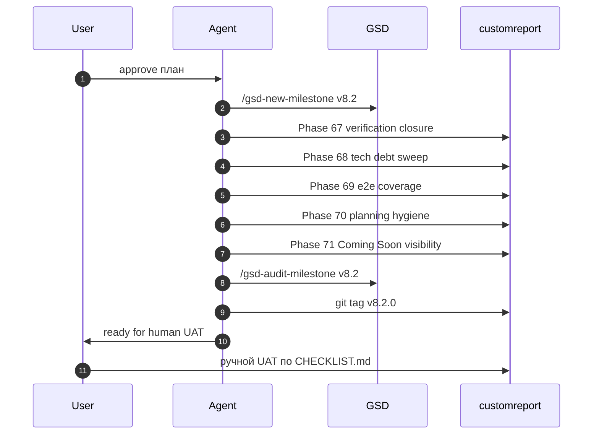
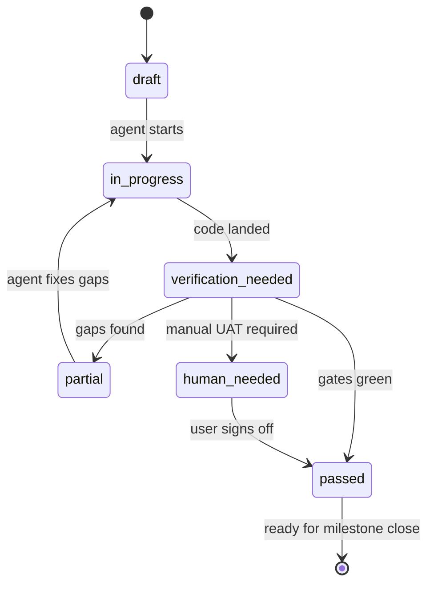
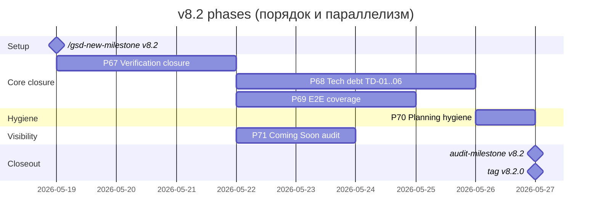
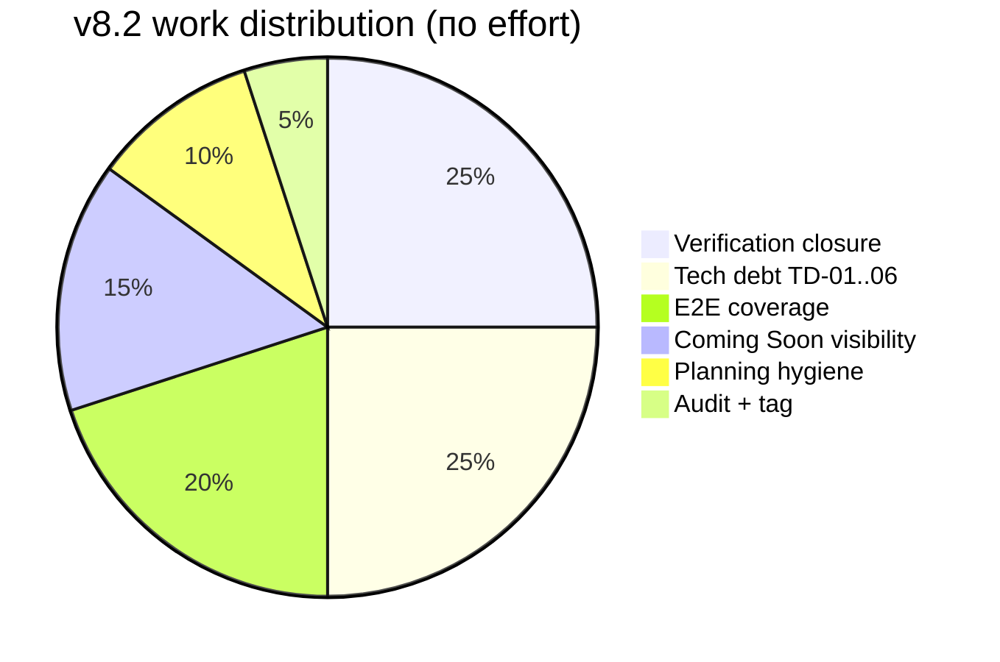
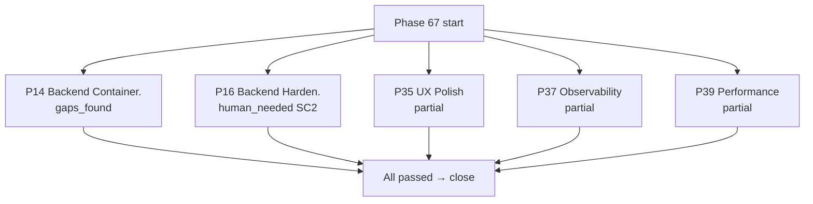
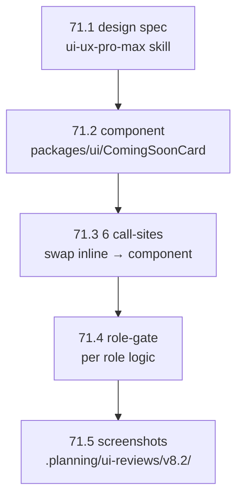

> [!IMPORTANT]
> Двойной артефакт:
>
> 1. **Refresh-format** предыдущего pure-mist (rich-mode + ≥3 Mermaid TB + C4 Context + sequence + state + gantt).
> 2. **Полный roadmap** «доделать всё, что осталось, кроме Coming Soon» → закрыть GSD milestone v8.2 → пользователь начинает ручной UAT.
> 3. **Coming Soon visibility audit** — НЕ продающие redesign, а консистентные placeholder-«заплатки» для руководства (будущий бюджет).

---

## 0. TL;DR — что было, что не так, что станет

### 0.1 Glossary терминов (пояснения от user feedback)

| Термин                | Что имеется ввиду                                                                                                                                                                           |
| --------------------- | ------------------------------------------------------------------------------------------------------------------------------------------------------------------------------------------- |
| **Coming Soon**       | UI-«заплатка» (placeholder badge/card), визуально видна, чтобы руководство знало про планируемую фичу → выделило бюджет в следующий milestone. **НЕ продающий маркетинг**.                  |
| **CSP/k8s deploy**    | Cloud Service Provider deploy с Kubernetes (бывший «cloud deploy P53») — оркестрация в облаке, отложено                                                                                     |
| **CI/CD расширения**  | За пределы baseline (Phase 38 INF-04, 6 jobs shipped). Имеется ввиду auto-deploy в k8s, GitOps Flux, matrix builds, full release pipeline. Уточнено: если user не имел этого ввиду — убрать |
| **Presentation mode** | НЕ deferred — это слайды, реализованы в Phase 61 (head/lead slides mode). Убрано из exclude                                                                                                 |

### 0.2 Было (Mermaid TB)



### 0.3 Проблема (Mermaid TB)



### 0.4 Станет (Mermaid TB)



### 0.5 C4 Level 1 — Context (planning workflow в репо)



### 0.6 Phase execution sequence (Mermaid)



### 0.7 State machine — что значит «фаза закрыта»



### 0.8 Gantt — порядок и параллелизм фаз



### 0.9 Pie — распределение work types



---

## 1. Context

После закрытия v8.1 (tag `v8.1.0`, 24/24 phases, 472/472 tests) в `.planning/v8.1-MILESTONE-AUDIT.md` зафиксированы verification gaps + TD-01..06. Пользователь явно хочет:

- **(a)** Полное закрытие GSD — фазы и milestone, чтобы ручной UAT шёл по 100%-готовому состоянию.
- **(b)** Refresh-format плана — rich-mode (Mermaid TB ×3 + дополнительные C4/sequence/state/gantt/pie).
- **(c)** **Coming Soon как заплатка для будущего бюджета** — не sales pitch, а visible+consistent+role-gated placeholders. Руководство видит «вот эти фичи запланированы» → выделит бюджет в v9.0+.

Pure-mist именует артефакт; он закрывает обратную связь по `/lead/report` и более широкий closure-цикл.

> [!TIP]
> Research foundation (см. §17 bibliography): Mermaid для GitHub-rendered docs побеждает PlantUML (native render). C4 model — стандарт 2026 для архитектурных слоёв. Coming Soon UI 2026 = personality + role-gate + consistent design-system component, НЕ продающий маркетинг.

---

## 2. Stakeholder map

| Stakeholder           | Что им нужно от плана                                   | Где смотреть                                          |
| --------------------- | ------------------------------------------------------- | ----------------------------------------------------- |
| User (продакт-owner)  | Понимание «что осталось», approve plan, ручной UAT гейт | TL;DR §0.2-0.4 + §11 Agent/Human + §13 Open questions |
| Next agent session    | Resumable execution с checkpoint-ами                    | §7 phase details + §10 token economy                  |
| Руководство заказчика | Видимый roadmap → бюджет на v9.0                        | Phase 71 deliverables (Coming Soon visibility)        |
| GSD/audit-milestone   | Verifiable closure criteria                             | §14 Verification + per-phase PASS criteria            |

---

## 3. Сейчас (state snapshot)

| Что          | Значение                                                                        |
| ------------ | ------------------------------------------------------------------------------- |
| Ветка        | `main` (synced с origin)                                                        |
| HEAD         | `5f0bbd7 chore: archive v8.1 milestone — SHIPPED 2026-05-18`                    |
| Tag          | `v8.1.0` запушен                                                                |
| STATE.md     | `milestone: v8.2`, `status: between_milestones`, `progress: 24/24 phases, 100%` |
| Working tree | ~30 untracked `.png` + `session-report-*.html` (UAT artefacts из P61)           |
| Tests        | 472/472 pass, typecheck/lint clean                                              |
| Open phases  | 0 формально, но 5 имеют verification gaps                                       |

> [!WARNING]
> .png artefacts в корне — accidental commit риск. Phase 70 обязана их переместить либо в `.planning/ui-reviews/2026-05-17-18/`, либо удалить.

---

## 4. Scope

### 4.1 Входит (5 фаз v8.2)

```
Phase 67  Verification closure       (P14 P16 P35 P37 P39 → passed)
Phase 68  Tech debt sweep            (TD-01..06)
Phase 69  E2E coverage               (3 describe.skip + 17 TODO stubs + foreign-author verify)
Phase 70  Planning hygiene           (7 plans → done/, .png artefacts, MEMORY.md drift)
Phase 71  Coming Soon visibility     (role-gate + shared component + consistency)
```

### 4.2 Не входит (Coming Soon — оставляем как «заплатки»)

| Что                                     | Фаза   | Почему отложено                                            | Где placeholder в UI                        |
| --------------------------------------- | ------ | ---------------------------------------------------------- | ------------------------------------------- |
| AI / RAG                                | P54    | Бюджет, LLM выбор                                          | `settings-tab.tsx:1140` AI Integration card |
| Telegram bot                            | P55    | Бот identity, auth binding                                 | `settings-tab.tsx:1033,1071` Telegram cards |
| Dark mode / rebrand                     | P40    | UX research, brand decisions                               | `nav-bar.tsx:191` Theme toggle parked       |
| AI eval                                 | P41    | Зависит от P54                                             | (нет UI пока)                               |
| Mobile sign-off                         | P42    | Native app решение                                         | (нет UI пока)                               |
| **CSP/k8s deploy** (бывш. cloud deploy) | P53    | Infra cost, k8s ops                                        | (нет UI, инфраструктура)                    |
| Multi-org hierarchy                     | P59    | BU model, tenancy routing                                  | `organization.service.ts:36` TODO           |
| i18n / переключение языков              | parked | Translation lane, RU↔EN                                    | `nav-bar.tsx:184` Language parked           |
| **CI/CD расширения**                    | TBD    | auto-deploy/GitOps/matrix builds (за пределы P38 baseline) | (нет UI, infra)                             |
| Slack integration                       | parked | Slack app reg                                              | `settings-tab.tsx:1114` Slack card          |
| Draft version history sidebar           | parked | UX design                                                  | `lead-history-sidebar.tsx:128,157`          |

> [!NOTE]
> **Presentation mode (P60) НЕ deferred** — это слайды, реализованы Phase 61 (head + lead slides mode, /lead/report?mode=slides + /head/history?mode=slides). Убран из exclude list.

> [!IMPORTANT]
> Если user не имел ввиду «CI/CD расширения» — спросить (Open Question §13.Q9). По умолчанию оставляем deferred как у user в feedback.

### 4.3 Не входит (не запрашивалось user)

- Keycloak SSO + JWT refresh (HANDOFF candidate, не для v8.2)
- Real archive contract refactor

---

## 5. Skill routing + Research lane

> [!TIP]
> Усилено per user feedback: «используй ресерчи, контекст-семь, любые ресерчи, скиллы UI/UX по максимуму».

| Skill / source                                                   | Зачем                                   | Модель / уровень | Output                           |
| ---------------------------------------------------------------- | --------------------------------------- | ---------------- | -------------------------------- |
| `Demo-plan` (текущий)                                             | Структура rich-mode                     | Sonnet           | Этот документ                    |
| `Demo-session-scan`                                               | User requests inventory                 | Haiku batch      | См. §6 (выполнено)               |
| `Demo-review`                                                     | Critical-path findings                  | Sonnet           | Findings + risks per Phase       |
| `Demo-retro`                                                      | Closeout каждой фазы                    | Sonnet           | Retro + NEXT-ACTIONS             |
| `gsd-new-milestone v8.2`                                         | Open milestone                          | Sonnet           | REQUIREMENTS + ROADMAP           |
| `gsd-plan-phase 67..71`                                          | Per-phase planning                      | Sonnet           | PHASE-CONTEXT + PLAN             |
| `gsd-execute-phase`                                              | Атомарные коммиты                       | Sonnet           | Executed phase                   |
| `gsd-audit-milestone v8.2`                                       | Pre-close audit                         | Sonnet           | Coverage report                  |
| `gsd-complete-milestone v8.2`                                    | Archive + tag                           | Sonnet           | Archive + tag                    |
| **`design`** + **`ui-ux-pro-max`** + **`web-design-guidelines`** | Phase 71 — Coming Soon component design | Sonnet           | `<ComingSoonCard>` spec          |
| **`typography`** + **`composition-patterns`**                    | Phase 71 — consistent visual style      | Haiku            | Style audit                      |
| **WebSearch**                                                    | Best practices research                 | (tool)           | Внешние best practices (см. §17) |
| **Context7 MCP**                                                 | Library API (если нужно для component)  | (tool)           | shadcn/ui badge patterns         |
| **`gsd-add-tests`**                                              | Phase 69 — e2e расширение               | Sonnet           | Spec files                       |

### 5.1 Research lane (новое)

Per user feedback «используй research по максимуму»:

```
[Phase plan started]
    │
    ├─ WebSearch best practice query (актуальный YEAR)
    │   → выписать в RESEARCH.md «existing solutions evaluated»
    │
    ├─ Context7 query (если library/SDK задействован)
    │   → версия + API surface
    │
    ├─ Skill loading: design / ui-ux-pro-max / typography
    │   → applicable patterns
    │
    └─ Synthesis → Plan refined
```

---

## 6. Recovered intent — что user просил, что осталось

> [!NOTE]
> Полный inventory recovered intent по 7 сессиям (2026-05-16..18) и `.planning/memory/` собран. Здесь только `[OPEN]` items.

### 6.1 LEAD report UI (открыто)

| #   | Запрос                                      | Источник            | Куда                                      |
| --- | ------------------------------------------- | ------------------- | ----------------------------------------- |
| 1   | Add Owner/Author column в section           | sess 72454e03       | Phase 71 (UX consistency)                 |
| 2   | Add stage chips в section header            | sess 72454e03       | Phase 71                                  |
| 3   | FM-style button слева от FM                 | sess 3f705bf7       | Phase 71                                  |
| 4   | Show-archived в lead area                   | sess 3f705bf7       | Phase 70/71 (UX decision)                 |
| 5   | Q6a: убрать standalone `/lead/slides` route | sess 3f705bf7       | Phase 70 (cleanup)                        |
| 6   | Draft Panel: Coming Soon decision lock      | todo fit2-v7-uat V2 | Phase 71 (CS visibility)                  |
| 7   | Toolbar Q1: «равномерно увеличить»          | sess 3f705bf7       | UNCLEAR — нужен screenshot. Open Q §13.Q8 |

### 6.2 Остаток todos

```
.planning/todos/pending/
├── 2026-05-14-future-ui-telemetry-coming-soon.md   ← оставить (это CS-дамп)
├── 2026-05-16-fit2-v7-uat-verify-items.md          ← Phase 67/69/71 (V1..V5)
└── 2026-05-18-lock-icon-foreign-section.md         ← Phase 70 (move → done/)
```

V1..V5 split:

| V   | Что                                         | Куда                |
| --- | ------------------------------------------- | ------------------- |
| V1  | Skeleton/right-rail smoke                   | Phase 67            |
| V2  | Draft side panel Coming Soon decision       | Phase 71            |
| V3  | DevRoleSwitcher prod guard verify           | Phase 67            |
| V4  | E2E mandatory-scenarios doc `e2e/README.md` | Phase 69            |
| V5  | Admin group-period wipe/preview UX decision | Phase 67 (decision) |

### 6.3 NEXT-ACTIONS.md остаток

| Item                                                | Статус                | Куда                   |
| --------------------------------------------------- | --------------------- | ---------------------- |
| AGENT #3 TD-06 PolicyApplicator → period.service.ts | OPEN                  | Phase 68               |
| AGENT #4 e2e foreign-author spec                    | EXISTS, verify hooked | Phase 69               |
| HUMAN #2 UAT `/lead/report?authorId=<BORIS>`        | OPEN                  | Manual UAT (post-v8.2) |

---

## 7. Phases detail

### 7.1 Phase 67 — Verification closure

> [!IMPORTANT]
> Цель: 5 фаз с verification-несоответствием → все `passed`. Без этого audit-milestone v8.2 не пройдёт.



**Закрытие per phase**:

| Phase | Файл                                                                     | Что нужно                                                                         |
| ----- | ------------------------------------------------------------------------ | --------------------------------------------------------------------------------- |
| 14    | `.planning/phases/14-backend-hardening-containerization/VERIFICATION.md` | Закрыть gaps из отчёта                                                            |
| 16    | `.planning/phases/16-backend-hardening/16-VERIFICATION.md:4`             | SC2 PDF runtime — либо retire (UAT через ручной PDF flow), либо live UAT evidence |
| 35    | `.planning/phases/35-ux-polish/35-VERIFICATION.md:1-5`                   | Hover geometry + activity drill-down regression                                   |
| 37    | `.planning/phases/37-observability/37-VALIDATION.md`                     | Metrics/traces validation evidence                                                |
| 39    | `.planning/phases/39-performance/39-VALIDATION.md`                       | k6/perf benchmarks evidence                                                       |

Плюс todos V1 (skeleton smoke), V3 (DevRoleSwitcher prod guard), V5 (admin wipe UX decision).

**Closure protocol per phase**:

1. Read VERIFICATION.md → list gaps
2. Implement или retire (обоснование в SUMMARY.md)
3. Update status → `passed`
4. Atomic commit `chore(phase-N): close verification — <gap>`

### 7.2 Phase 68 — Tech debt sweep

| TD    | Файл                                                                            | Действие                                                                                                              |
| ----- | ------------------------------------------------------------------------------- | --------------------------------------------------------------------------------------------------------------------- |
| TD-01 | 46-05 audit emit                                                                | Wire `scopeDenied` event                                                                                              |
| TD-02 | 46-05 integration matrix                                                        | Add Prisma cross-group test                                                                                           |
| TD-03 | `apps/api/src/modules/search/search.service.ts:63`                              | Refactor к `groupScopeFilter` helper                                                                                  |
| TD-04 | Phase 44 e2e ReminderPolicy editor                                              | Playwright spec                                                                                                       |
| TD-05 | Phase 47 perf PolicyApplicator fan-out                                          | k6 / vitest perf test                                                                                                 |
| TD-06 | `apps/api/src/modules/period/period.service.ts` + `period-creator.scheduler.ts` | Inject `PolicyApplicatorService`, вызвать `.applyToPeriod()` после `prisma.report.create(...)` (line 119 в scheduler) |

Дополнительно: `scopeAccessed` audit envelope в `weekly-report.prisma-repository.ts:71` (зависит от TD-01).

### 7.3 Phase 69 — E2E coverage

**Большие e2e gaps** (3 `describe.skip`):

```
apps/web/e2e/admin-advanced.spec.ts:358   describe.skip  SC-227 Create New Period
apps/web/e2e/admin-advanced.spec.ts:422   describe.skip  SC-228 Period Date Entry
apps/web/e2e/admin-panel.spec.ts:118      describe.skip  Admin Panel — Periods Tab
```

**Малые TODO stubs (17 шт)**:

| Файл                             | Lines                                       | Стабов                        |
| -------------------------------- | ------------------------------------------- | ----------------------------- |
| `publish-revoke.spec.ts`         | 239,255,269,288,300,312,324,336,348,360,372 | 11 (Reopen+Revoke)            |
| `a11y-advanced.spec.ts`          | 55,70,247,290,337,610,631                   | 7 (page-title/Esc/focus-trap) |
| `dashboard-advanced.spec.ts`     | 165                                         | 1 (Send Reminder)             |
| `weekly-report-advanced.spec.ts` | 69                                          | 1 (handleToggleAll)           |

Плюс:

- Verify `lead-form-foreign-author.spec.ts` (есть на диске, 87 строк — запустить + убедиться, что в regression config)
- Создать `e2e/README.md` (V4 todo) — mandatory vs advisory scenarios

### 7.4 Phase 70 — Planning hygiene

**Архивация historical plans → `.planning/plans/done/`** (7 шт):

```
ethereal-growing-brooks.md          PRJ-2 v8 hotfix pack
image-1-velvet-pixel.md             Slides V2 refactor (P61b)
merry-zooming-blanket.md            v8.1 sprint plan
retro-done-composed-swan.md         PRJ-2 UAT v7 consolidation
robust-baking-aurora.md             Head report+history+slides (P61)
small-mvp-enumerated-thunder.md     Boris overlay seed
2026-05-15-report-domain-data-parity-sweep.md   Domain parity sweep
```

**Hygiene items**:

- Move `.planning/todos/pending/2026-05-18-lock-icon-foreign-section.md` → `done/`
- Fix MEMORY.md drift: добавить `project_small_mvp_boris_overlay_2026_05_18.md`
- Refresh `NEXT-ACTIONS.md` (timestamp устарел)
- Move `.png` artefacts из корня в `.planning/ui-reviews/2026-05-17-18/`
- Decision по `TODO(HEAD-CONSOLIDATE-01)`: redirect `/head/slides → /head/history?mode=slides` (preserve bookmarks)
- `TODO(UFB-061)` — version surfacing в login footer (build-time inject через `NEXT_PUBLIC_APP_VERSION`)
- Phase 43 GAP-01: создать `.planning/phases/43-tooling-leaf-fix-sweep/` retroactive с SUMMARY.md

### 7.5 Phase 71 — Coming Soon visibility audit

> [!IMPORTANT]
> Reframed per user feedback: **НЕ продающие redesign**, а **placeholder-«заплатки», визуально видны для руководства**, чтобы оно выделило бюджет в v9.0. Цель — consistency + visibility + role-gate.

#### 7.5.1 Что есть сейчас

```
apps/web/src/components/admin/settings-tab.tsx:1033    Telegram card
apps/web/src/components/admin/settings-tab.tsx:1071    Telegram-2 card
apps/web/src/components/admin/settings-tab.tsx:1114    Slack card
apps/web/src/components/admin/settings-tab.tsx:1140    AI Integration card
apps/web/src/components/lead/lead-history-sidebar.tsx:128,157   Draft version history
apps/web/src/components/navigation/nav-bar.tsx:184,211          Language + Theme parked
```

#### 7.5.2 Audit dimensions (5-pillar consistency)

Per research findings (SaaS B2B 2026 best practices, см. §17):

| Pillar                     | Текущее состояние                     | Целевое                                                                     |
| -------------------------- | ------------------------------------- | --------------------------------------------------------------------------- |
| **Consistency**            | 4 card-стиля + inline parked → разные | 1 shared `<ComingSoonCard>` компонент в `packages/ui`                       |
| **Role-gate**              | Все cards видны всем ролям            | `<ComingSoonCard role="admin\|head\|lead">` — показ только релевантной роли |
| **Visibility**             | Цена/значение фичи не видна           | 1 строка «что заказчик получит» — не sales pitch, а fact statement          |
| **No core-workflow block** | OK уже                                | Сохранить — placeholder не должен мешать                                    |
| **Micro-personality**      | «Coming Soon» текст                   | Тонкая иконка + 1 строка контекста, без агрессии                            |

#### 7.5.3 Deliverable — `<ComingSoonCard>` spec

```tsx
<ComingSoonCard
  feature="ai-summary"
  role={["admin", "head"]}
  icon={<SparklesIcon />}
  title="AI summary отчёта"
  description="Авто-резюме статусов за 5 секунд вместо чтения 30 минут"
  status="planned-v9"
  // НЕ sales pitch, не «notify me» форма — просто видимая «заплатка»
/>
```

#### 7.5.4 Content draft (6 cards) — фактический tone

| Card                  | Title                     | Description (одна строка факта)          | Roles       | Status         |
| --------------------- | ------------------------- | ---------------------------------------- | ----------- | -------------- |
| AI summary            | AI summary отчёта         | Auto-resume чтения статусов              | admin, head | `planned-v9`   |
| Telegram bot          | Telegram-бот напоминаний  | Push-уведомления + быстрый ответ из чата | admin, lead | `planned-v9`   |
| Slack integration     | Slack integration         | Daily digest канала команды              | admin       | `planned-v9.1` |
| Dark mode             | Dark mode                 | Eye-care тема для поздних публикаций     | all         | `planned-v9`   |
| Language switcher     | Bilingual reports en/ru   | Доступ международным stakeholders        | all         | `planned-v9.2` |
| Draft history sidebar | Версионирование черновика | Восстановление потерянного контекста     | lead        | `planned-v8.3` |

> [!NOTE]
> «status» = просто метка milestone, на которую запланирована фича. Это **видимый roadmap для руководства**, не маркетинг.

#### 7.5.5 Phase 71 sub-phases



---

## 8. Risk register

| #   | Risk                                                 | Severity | Mitigation                                                                        |
| --- | ---------------------------------------------------- | -------- | --------------------------------------------------------------------------------- |
| R1  | P16 SC2 PDF runtime не закрыть                       | ▲ high   | Retire requirement в P67, обоснование в SUMMARY.md                                |
| R2  | TD-06 wire ломает period scheduler tests             | ▲ high   | Test-first: написать failing test в scheduler, потом DI                           |
| R3  | Phase 69 17 stubs — слишком много                    | ▼ medium | Critical-path only (Reopen+Revoke, page-title, Send Reminder); rest defer to v8.3 |
| R4  | Phase 71 Coming Soon copy — субъективна              | ▼ medium | Iteration reserve 20%, advisor (Opus) review                                      |
| R5  | .png artefacts случайно commit                       | ▼ low    | Phase 70 first — clear before Phase 67/68                                         |
| R6  | `/gsd-new-milestone v8.2` не подхватит закрытый v8.1 | ▼ low    | Verify ROADMAP.md state перед запуском                                            |

---

## 9. Decision log (locked)

| #   | Decision                                                   | Date       | Source                                 |
| --- | ---------------------------------------------------------- | ---------- | -------------------------------------- |
| D1  | v8.2 — новый milestone, не reopen v8.1                     | 2026-05-18 | User implicit (archived v8.1.0 tagged) |
| D2  | Coming Soon = visible placeholders, НЕ sales pitch         | 2026-05-18 | User feedback iteration                |
| D3  | Presentation mode (P60) НЕ deferred — это P61 slides       | 2026-05-18 | User feedback iteration                |
| D4  | CSP/k8s deploy — переименовано из «cloud deploy P53»       | 2026-05-18 | User feedback iteration                |
| D5  | Mermaid > PlantUML для этого репо (markdown native render) | 2026-05-18 | Research finding §17                   |
| D6  | C4 Context-level включить в TL;DR                          | 2026-05-18 | Research finding §17                   |
| D7  | Research lane — обязательная для каждой фазы               | 2026-05-18 | User feedback «по максимуму research»  |

---

## 10. Token economy

| Work type                               | Codex / Claude tier          | Writes        |
| --------------------------------------- | ---------------------------- | ------------- |
| grep, scan, classify verification gaps  | Haiku                        | no            |
| Read VERIFICATION.md, выписать gaps     | Haiku                        | no            |
| Phase 71 component design + spec        | Sonnet + ui-ux-pro-max skill | yes (scoped)  |
| Phase 68 TD-06 wiring (DI + tests)      | Sonnet                       | yes (scoped)  |
| audit-milestone v8.2 final              | Sonnet                       | no by default |
| Advisor on Coming Soon copy + design    | Opus 4.7 (если user wants)   | no            |
| WebSearch / Context7 research per phase | (tool, no model)             | no            |

---

## 11. Agent does / Human does

```
─────────────────────────────────────
✓ Я ДЕЛАЮ САМ (тебе ничего не нужно)
─────────────────────────────────────
  ├── /gsd-new-milestone v8.2 → REQUIREMENTS.md + ROADMAP.md
  ├── Phase 67: закрыть verification gaps (5 фаз)
  ├── Phase 68: реализовать TD-01..06
  ├── Phase 69: 3 describe.skip + critical-path TODO stubs + verify foreign-author
  ├── Phase 70: архив 7 plans + .png artefacts + MEMORY.md drift + HEAD-CONSOLIDATE-01
  ├── Phase 71: 71.1-71.5 (design → component → swap → role-gate → screenshots)
  ├── /gsd-audit-milestone v8.2 + /gsd-complete-milestone v8.2
  ├── атомарные коммиты + push + tag v8.2.0
  └── Research per фазе (WebSearch + Context7 + skills)

─────────────────────────────────────
▲ ОТ ТЕБЯ
─────────────────────────────────────
  ├── Approve этого плана (ExitPlanMode → ты говоришь go/no-go)
  ├── Q8 toolbar Q1 — нужен screenshot, чтобы понять «равномерно увеличить»
  ├── Q9 CI/CD расширения — действительно deferred или другое?
  ├── Approve Coming Soon copy (6 cards) после Phase 71.1 draft
  ├── Ручной UAT после Phase 71 — финальный gate перед tag v8.2.0
  └── Approve финального audit-milestone отчёта
```

---

## 12. Open questions

| #   | Вопрос                                                     | Default                                                   | Когда эскалировать                |
| --- | ---------------------------------------------------------- | --------------------------------------------------------- | --------------------------------- |
| Q1  | v8.2 как новый milestone или продление v8.1?               | Новый milestone                                           | если user явно reopen             |
| Q2  | Phase 67 retire P16 SC2 (PDF live) или реализовать?        | Retire — низкий ROI vs ручная PDF                         | если user хочет реальный PDF flow |
| Q3  | Phase 69 — все 17 stubs или critical-path?                 | Critical-path: Reopen+Revoke + page-title + Send Reminder | если user хочет 100% e2e          |
| Q4  | Phase 71 — shared `<ComingSoonCard>` или per-card?         | Shared в `packages/ui`                                    | если cards радикально разные      |
| Q5  | UFB-061 version — build-time inject или runtime?           | Build-time `NEXT_PUBLIC_APP_VERSION`                      | если multi-version concern        |
| Q6  | HEAD-CONSOLIDATE-01 — redirect или удалить standalone?     | Redirect (preserve bookmarks)                             | если user явно «удалить»          |
| Q7  | Phase 71 «notify me» форма — нужна?                        | НЕТ (это placeholder, не lead-gen)                        | если user хочет email collection  |
| Q8  | Toolbar Q1 «равномерно увеличить» — что это?               | UNCLEAR, спросить со скриншотом                           | сразу при exit plan mode          |
| Q9  | CI/CD расширения — это auto-deploy/GitOps/k8s, или другое? | По умолчанию — auto-deploy/GitOps/matrix builds           | сразу                             |

---

## 13. Verification

```bash
pnpm typecheck                         # 5/5 successful
pnpm lint                              # 0 errors
pnpm lint:md                           # 0 errors
pnpm test                              # 472/472 → expected +N (Phase 69 spec count)
pnpm --filter @customreport/web exec playwright test \
  --config=e2e/regression/playwright.regression.config.ts
# Verify all VERIFICATIONs passed:
ls .planning/phases/*/VERIFICATION.md | xargs grep -L 'status: passed' | wc -l   # 0
# Verify Coming Soon component used:
git grep -c "ComingSoonCard" apps/web/src/                                       # ≥ 6
# Verify clean .planning/plans/ top-level:
ls .planning/plans/*.md | wc -l                                                  # ≤ 1 (этот файл)
# Verify tag:
git tag --list 'v8.2*'                                                           # v8.2.0
# Verify GSD audit:
gsd-sdk query audit-open                                                         # 0 open items
```

### 13.1 PASS criteria per pillar

| Pillar       | Gate                                                                                     |
| ------------ | ---------------------------------------------------------------------------------------- |
| Verification | 0 фаз с status ≠ passed                                                                  |
| Tech debt    | TD-01..06 — каждое имеет commit + test                                                   |
| E2E          | 3 describe.skip resolved, critical-path TODO stubs реифицированы                         |
| Planning     | Top-level `.planning/plans/` ≤ 1 файл                                                    |
| Coming Soon  | 6 cards используют shared `<ComingSoonCard>`, screenshots в `.planning/ui-reviews/v8.2/` |
| Milestone    | `git tag v8.2.0` exists, archived в `.planning/milestones/v8.2-ROADMAP.md`               |

---

## 14. Iteration reserve

```
[plan written v2]
   → [user review/feedback]
        → [self-review checklist]
             → [adjust + start Phase 67]
                  → [advisor-loop after Phase 71 (Opus 4.7 на копию + дизайн)]
                       → [audit-milestone]
                            → [tag v8.2.0]
```

Резерв ~20% времени фазы 71 (Coming Soon) на iteration по visual style + copy.

---

## 15. Demo Review Gate

| Stage           | Что проверять                                       | Кто                  |
| --------------- | --------------------------------------------------- | -------------------- |
| Pre-Phase-67    | gap inventory vs implementation plan                | self                 |
| Post-Phase-68   | TD-06 wired (read scheduler.ts + period.service.ts) | self + Sonnet review |
| Post-Phase-69   | e2e регресс green, foreign-author spec runs         | self                 |
| Post-Phase-71.1 | Component design review (ui-ux-pro-max)             | advisor + user       |
| Post-Phase-71.5 | Screenshots review                                  | user                 |
| Pre-v8.2-tag    | `/gsd-audit-milestone v8.2` PASS                    | gsd                  |

---

## 16. Self-check

- [x] TL;DR с **3 Mermaid TB** (Было / Проблема / Станет)
- [x] **C4 Context** диаграмма
- [x] **Sequence** диаграмма (phase execution)
- [x] **State machine** (phase transitions)
- [x] **Gantt** (порядок и параллелизм)
- [x] **Pie** (work distribution)
- [x] Glossary терминов из user feedback (CSP/k8s, CI/CD, Coming Soon, Presentation)
- [x] Stakeholder map (новое)
- [x] Skill routing с research lane
- [x] Recovered intent ссылается на сессии
- [x] Phase split — 5 фаз с per-phase closure protocol
- [x] Phase 71 reframed (visibility, не sales pitch)
- [x] Risk register (новое)
- [x] Decision log с locked decisions
- [x] Agent does / Human does — две группы
- [x] Open questions — 9 с default + escalation trigger
- [x] Coming Soon — отдельная фаза с 5-pillar consistency audit
- [x] Token economy
- [x] Verification commands конкретные
- [x] Pipe-tables вместо wide ASCII
- [x] Iteration reserve
- [x] Research bibliography §17
- [ ] Ждёт sign-off

---

## 17. Research bibliography

> [!TIP]
> Эта секция отвечает на user feedback «по best-practices, используй ресерчи по максимуму».

### 17.1 Coming Soon / placeholder UX best practices (2026)

- Progressive disclosure over feature dumping ([Onething Design](https://www.onething.design/post/b2b-saas-ux-design))
- Empty states must drive value, not dead ends ([Mouseflow](https://mouseflow.com/blog/saas-ux-design-best-practices/))
- Emotional design / personality в placeholder ([Orbix Studio](https://www.orbix.studio/blogs/saas-product-design-trends))
- Role-based visibility 2026 ([Equal Design](https://www.equal.design/blog/saas-ux-best-practices-b2b-us))
- Cognitive load limit — не более 2-3 placeholder одновременно ([WildnetEdge](https://www.wildnetedge.com/blogs/saas-ui-ux-strategies-for-b2b-user-onboarding-enterprise-software-ux))
- Time-to-value sacred — placeholder на периферии ([SaaSUI Blog](https://www.saasui.design/blog/7-saas-ui-design-trends-2026))
- Standardize в design system ([What If Design](https://feeds.whatifdesign.co/blog/saassolar-branding-ui-guidelines))

### 17.2 Diagram tooling — Mermaid vs PlantUML 2026

- **Verdict**: Mermaid native в GitHub/Notion/Obsidian/VS Code — побеждает для markdown-документов ([Mermaid Editor blog](https://mermaideditor.com/blog/mermaid-vs-plantuml-2026), [findutils.com](https://findutils.com/blog/plantuml-vs-mermaid-which-diagram-tool-should-you-use/))
- PlantUML лучше для serious C4 + branded theming (40+ themes) ([Gleek.io](https://www.gleek.io/blog/mermaid-vs-plantuml))
- Mermaid types использованные в этом плане: `flowchart TB`, `sequenceDiagram`, `stateDiagram-v2`, `gantt`, `pie` — все 5 поддерживаются native в GitHub-rendered markdown

### 17.3 Technical planning visual diagrams

- C4 model = стандарт 2026 (4 уровня: Context / Container / Component / Code) ([Cloudairy](https://cloudairy.com/blog/c4-diagrams-software-engineering))
- Maintain visual consistency — стандартизованные стили/цвета ([vFunction](https://vfunction.com/blog/architecture-diagram-guide/))
- Tailor detail level to audience ([Atlassian](https://www.atlassian.com/work-management/project-management/architecture-diagram))
- Annotate non-obvious decisions ([Archbee](https://www.archbee.com/blog/diagrams-in-developer-documentation))

### 17.4 Internal sources

- `~/.claude/skills/Demo-plan/templates/phase-plan.md` — rich-mode template
- `~/.claude/skills/Demo-plan/examples/good-plan-rich.md` — reference style
- `.planning/v8.1-MILESTONE-AUDIT.md` — TD-01..06 origin
- `.planning/session-retros/NEXT-ACTIONS.md` — AGENT остаток
- `~/.claude/projects/-Users-ap-work-customreport/memory/` — feedback memories (10 файлов)
- 7 Claude Code sessions 2026-05-16..18 (см. session-scan output)

---

## 18. Связанные документы

- `.planning/STATE.md` — текущее состояние (обновится при close)
- `.planning/ROADMAP.md` — обновится `/gsd-new-milestone v8.2`
- `.planning/v8.1-MILESTONE-AUDIT.md` — источник TD-01..06
- `.planning/session-retros/NEXT-ACTIONS.md` — AGENT остаток (refresh в Phase 70)
- `.planning/todos/pending/2026-05-16-fit2-v7-uat-verify-items.md` — V1..V5
- `.planning/memory/MEMORY.md` — index drift (fix в Phase 70)
- `~/.claude/projects/-Users-ap-work-customreport/memory/` — feedback memories
