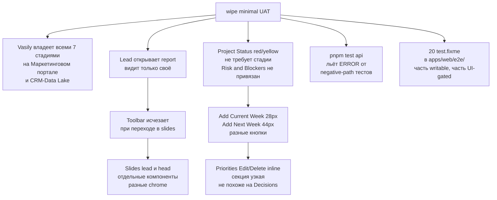
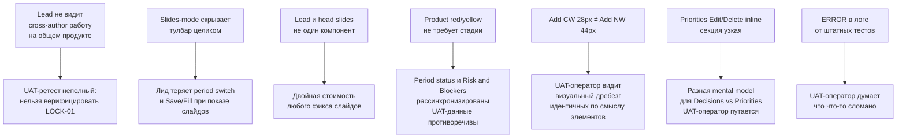
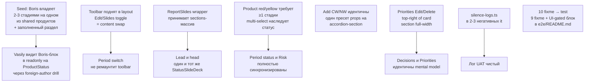
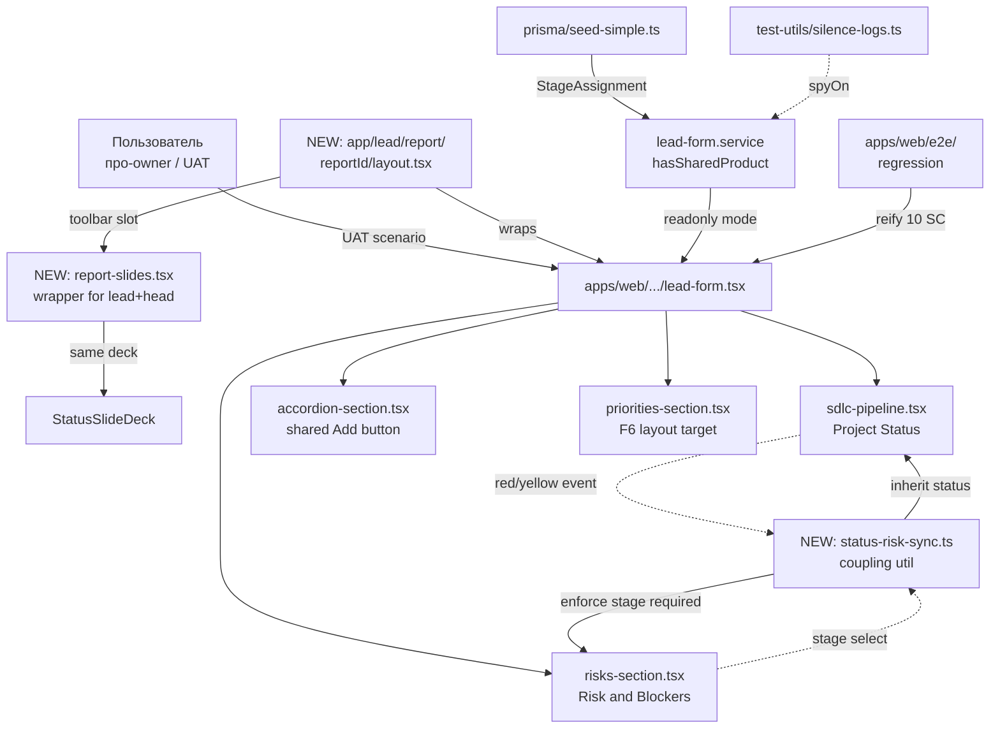
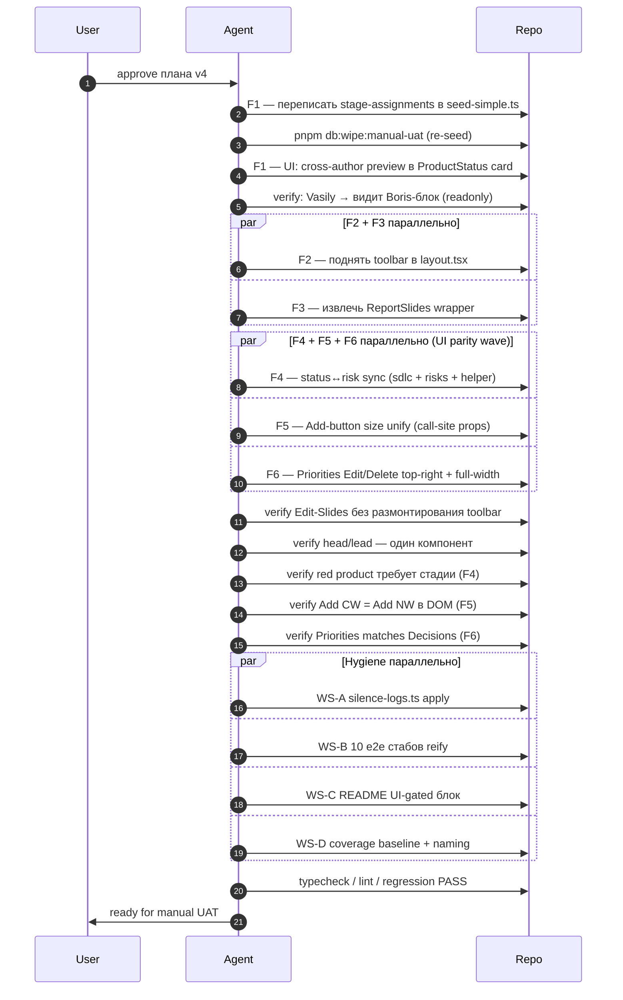
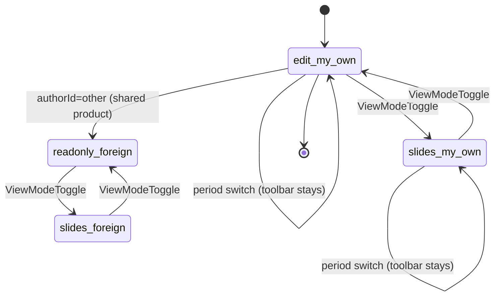
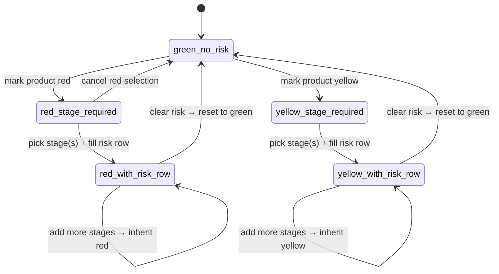
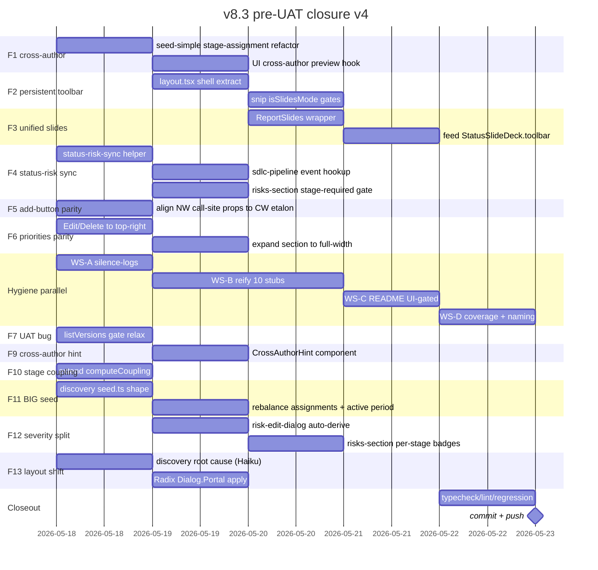
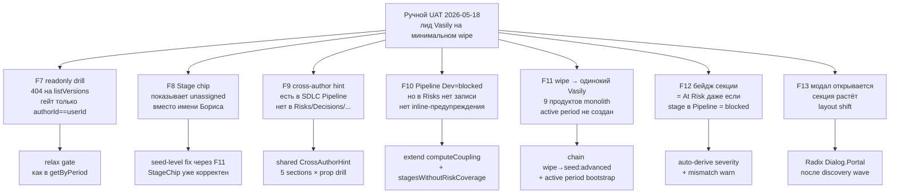
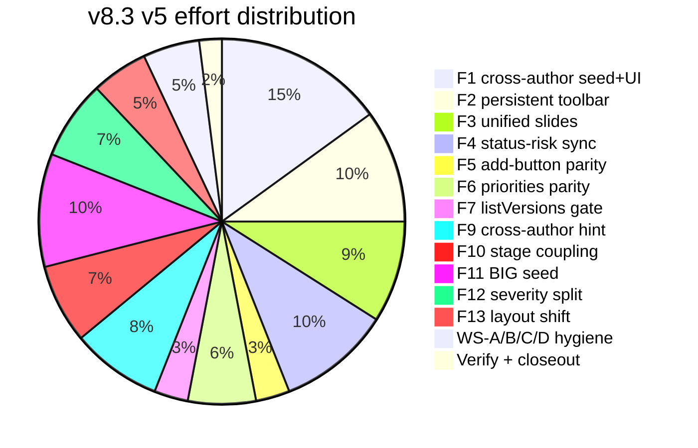

> [!IMPORTANT]
> Закрываем **тринадцать** workstream-ов перед ручным UAT (F1-F13 + hygiene). Шесть исходных (F1-F6) + семь добавленных по результатам UAT-форензики (F7-F13):
>
> **Исходные (F1-F6):**
>
> - **F1 — Cross-author readonly visibility.** Сейчас на минимальном wipe Vasily владеет всеми этапами на Маркетинговом портале и CRM-Data Lake. Если лид отвечает за DEV-стадию продукта, он должен видеть в READ-ONLY то, что другой лид сделал на других стадиях того же продукта. Backend gate `hasSharedProduct` уже работает (P63 LOCK-01), seed — нет.
> - **F2 — Persistent unified toolbar.** Тулбар исчезает в slides-mode. Должен оставаться смонтированным; Edit↔Slides — переключение **content area**, не страницы.
> - **F3 — Unified head/lead slides.** Один и тот же слайд для lead и head — один компонент, разная коллекция секций.
> - **F4 — Project Status ↔ Risk and Blockers sync.** Если лид пометил продукт red/yellow → выбор стадии(й) под риском/блокером становится обязательным; multi-select наследует статус.
> - **F5 — Add-button parity (responsive).** Current Week Add 28px — эталон; Next Week — responsive (md:28px / <md:44px, a11y preserved).
> - **F6 — Priorities layout matches Decisions.** Edit/Delete в header-row справа (ml-auto flex), как в Decisions.
>
> **UAT-discovered (F7-F13):**
>
> - **F7 — Version listing gate для foreign-author readonly.** `listVersions` падает «Can only list versions for your own section» при drill-in на чужой раздел. Расширить gate под shape `getByPeriod` (`isHeadLike || hasSharedProduct`).
> - **F8 — Stage Chip owner display.** Stage chip показывает «unassigned» вместо имени владельца. Главная причина — пробелы в seed (см. F11); StageChip уже рендерит `stage.assignee` если есть.
> - **F9 — Cross-author hint per section.** Расширить F1: «Other contributors» pattern в каждой секции (Risks/Decisions/Priorities/Current Week/Next Week) с readonly-замочком, не только в SDLC Pipeline.
> - **F10 — Stage-level coupling warning.** Расширение F4: если stage помечен blocked/at-risk, но в Risks нет покрывающей записи — банер «N стадий помечены as blocked/at-risk без записи риска».
> - **F11 — BIG seed.** `pnpm db:wipe:manual-uat` оставляет монолиты Vasily; нужно перераспределить 9 продуктов по 9 лидам так, чтобы у каждого было ≥2 продукта и ≥1 shared. Fix «Failed to load active report» (active period missing после wipe).
> - **F12 — Risk vs Blocker semantic split.** Бейдж секции Risks должен зеркалировать severity стадии в SDLC Pipeline. Если Pipeline Dev=blocked → row для PROD_X со stageIds=["dev"] показывает «Blocker», не «At Risk». Auto-derive severity при создании риска + coupling warning при mismatch.
> - **F13 — Section layout shift при modal open.** Секция растёт по высоте при «+ Add Risk» (и аналогично для других секций). Discovery-first (Haiku), затем фикс (наиболее вероятный — Radix Dialog.Portal pattern).
>
> **Hygiene (parallel wave).** Лог тестов чистый (silence-logs helper), 10 writable e2e стабов реифицированы, 9 UI-gated стабов документированы в `e2e/README.md`, coverage baseline note + naming drift фикс.
>
> Coming Soon (CS-02, CS-08) — **не в скоупе**, пользователь триггерит вручную.

---

## 0. TL;DR — что не так и что станет

### 0.1 Glossary

| Термин                          | Что это                                                                                                                     |
| ------------------------------- | --------------------------------------------------------------------------------------------------------------------------- |
| **`hasSharedProduct`**          | Backend gate (P63 LOCK-01) — два user-а делят продукт, если у них есть хоть один общий `projectId` в `StageAssignment`.     |
| **Foreign-author view**         | URL `/lead/report/<id>?authorId=<otherUserId>` — show чужой draft в readonly, lock badge.                                   |
| **Persistent toolbar**          | Тулбар верхнего уровня, который не размонтируется при смене mode (Edit↔Slides) и при смене периода.                         |
| **Content-area toggle**         | Edit↔Slides переключает **только** контент под тулбаром, не делает route push.                                              |
| **Unified slide deck**          | Один `StatusSlideDeck` для lead (1 секция) и head (N секций); разница — массив секций, не layout.                           |
| **`silence-logs.ts`**           | Тестовая утилита `silenceStderr()` + `silenceNestLogger()` на `vi.spyOn` — глушит ERROR-шум в negative-path `it()`.         |
| **Writable now (e2e)**          | Стаб, для которого UI и фикстуры уже есть — fixme → test.                                                                   |
| **UI-gated (e2e)**              | Стаб, для которого сначала нужен код (`metadata` export, Esc handler, focus-trap, dashboard Revoke UI).                     |
| **Project Status (Pipeline)**   | Цветные «светофоры» под каждой стадией продукта (SdlcPipeline). `red`/`yellow`/`green` per stage per product.               |
| **Risk and Blockers**           | Секция с записями: product + stage(s) + impact + mitigation. F4 связывает её с Project Status.                              |
| **Add-button etalon**           | Current Week вариант кнопки `accordion-section.tsx:71-72`: 28px height, `px-2.5 py-0.5`, `min-h-[28px]`. Эталон для F5.     |
| **Priorities parity**           | Layout приоритетов идентичен Decisions: Edit/Delete справа сверху, секция на full-width.                                    |
| **`listVersions` gate**         | Backend проверка в `lead-form.service.ts:124` — пускает только автора. F7 расширяет до `isHeadLike \|\| hasSharedProduct`.  |
| **CrossAuthorHint**             | NEW shared component для F9 — компактная строка под заголовком секции «🔒 Также в этой секции работает {имя} → readonly ↗». |
| **`stagesWithoutRiskCoverage`** | NEW поле в `computeCoupling()` (F10) — массив стадий, помеченных blocked/at-risk без покрывающей записи в Risks.            |
| **Severity mismatch (F12)**     | Coupling violation: row.severity ≠ stage.severity для покрываемой стадии. Warn, не block submit.                            |
| **`Dialog.Portal`**             | Radix UI compound для рендера диалога вне родительского DOM-flow (фикс F13 layout shift).                                   |

### 0.2 Было (Mermaid TB)



### 0.3 Проблема (Mermaid TB)



### 0.4 Станет (Mermaid TB)



### 0.5 C4 Level 1 — Context



### 0.6 Execution sequence



### 0.7 State machine — flow lead-form



### 0.7.1 State machine — F4 status↔risk coupling



### 0.8 Gantt — порядок и параллелизм



### 0.8.1 UAT overlay — F7-F13 (TB)



### 0.9 Pie — распределение work



---

## 1. Context

После закрытия v8.2 пользователь сделал **минимальный UAT-wipe** и обнаружил шесть UX-проблем при ретесте `/lead/report/a0000000-0000-4000-8000-000000000001` (форензика DOM, viewport 1728×962, 2026-05-18):

1. **Cross-author dead zone.** На демо-продуктах Маркетинговый портал и CRM-Data Lake Vasily владеет всеми 7 стадиями (см. `seed-simple.ts`). Любой другой лид физически не может быть ответственным ни за одну стадию — `@@unique([stageId, projectId])` блокирует. Значит, P63 LOCK-01 (foreign-author readonly view) нельзя верифицировать на минимальном UAT. И сам сценарий «лид DEV-стадии видит, что было на Planning/QA-стадиях соседом» неработоспособен.

2. **Toolbar исчезает в slides.** `lead-form.tsx:1225` и `lead-form.tsx:1324` оборачивают **весь** контрол-блок в `{!isSlidesMode && (...)}`. В slides-mode рендерится сокращённый sub-header (lines 1293-1320) только с `↩ Edit` и именем автора. Лид теряет period switch, Save Version, Fill, Submit. Пользователь явно хочет **content-area toggle**, как уже сделано в `HeadHistoryClient` (toolbar выше mode-условия).

3. **Lead и head slides — разные компоненты.** `LeadSlidesClient` рендерит `StatusSlideDeck` с `showChrome={false}`, `HeadSlidesClient` — со своим chrome. По смыслу это один deck с разным массивом секций (lead: 1 своя, head: все группы). Любой фикс слайдов сейчас делается дважды.

4. **Project Status не привязан к Risk and Blockers.** Лид помечает продукт `red`/`yellow` (под риском/блокером), но в секции Risk and Blockers стадия не запрашивается обязательно. Если он выбрал product=red и не назвал стадию — данные противоречивы: «продукт красный, но никаких стадий-причин нет». А если он выбрал несколько стадий — они не наследуют статус автоматически. Источник: `sdlc-pipeline.tsx:26-72` (Pipeline note ≈ Project Status) ↔ `risks-section.tsx` (Risk and Blockers). Логика связи отсутствует.

5. **Add Current Week ≠ Add Next Week.** Кнопки рисуются из одного источника `accordion-section.tsx:71-72`, но Current Week call-site передаёт size-props c `min-h-[28px]` + `px-2.5 py-0.5` (52.8125×28px), а Next Week — `min-h-[var(--touch-target-min)]` + `px-3 py-1.5` (56.8125×44px). Пользователь хочет, чтобы Current Week стал **эталоном** и Next Week стал идентичной.

6. **Priorities ≠ Decisions layout.** В Decisions Edit/Delete живут в правом верхнем углу карточки, секция занимает full-width. В Priorities (`priorities-section.tsx:126-72`) Edit/Delete — inline в строке (34×34px round кнопки, position x:1299 y:2962), сама секция уже своих соседей. Mental model разный для одинаковых по смыслу действий.

Плюс к этому остаётся накопленный hygiene-долг (silence logs, e2e fixme, coverage baseline), который мы доделаем параллельно — это не блокирует UAT, но сильно его упростит.

> [!NOTE]
> Coming Soon (CS-02 role-gate, CS-08 screenshots) **исключён** из этого плана. Пользователь явно сказал: «каминг-сун — как обычно, отдельно, я скажу когда».

---

## 2. Stakeholder map

| Stakeholder                   | Что нужно от плана                                                 | Где смотреть      |
| ----------------------------- | ------------------------------------------------------------------ | ----------------- |
| Пользователь (UAT)            | Видеть на минимальном wipe сценарий cross-author readonly          | F1 + §13.1 Verify |
| Пользователь (UX)             | Тулбар не исчезает, Edit↔Slides — toggle, period не ломает         | F2 + §13.1 Verify |
| Пользователь (consistency)    | Head видит «то же», что лид — один компонент                       | F3 + §13.1 Verify |
| Пользователь (data-integrity) | Period status (Project Status) синхронизирован с Risk and Blockers | F4 + §13.1 Verify |
| Пользователь (visual parity)  | Add CW = Add NW (визуально и по DOM)                               | F5 + §13.1 Verify |
| Пользователь (layout parity)  | Priorities matches Decisions (Edit/Delete top-right, full-width)   | F6 + §13.1 Verify |
| Следующий agent               | Resumable execution с per-WS verify + чистый лог                   | §7 + §13          |
| v8.3 closure                  | Hygiene baseline (logs, e2e fixme, coverage)                       | WS-A/B/C/D        |
| Design decision SC-160        | Понятный gate — нужен ли dashboard-level Revoke UI?                | §7.7 + §12 Q1     |

---

## 3. Сейчас (state snapshot)

| Что                        | Значение                                                                          |
| -------------------------- | --------------------------------------------------------------------------------- |
| Ветка                      | `feat/head-report-history-slides`                                                 |
| HEAD                       | `4b4ce55` (last commit fix HeadPresentClient exitHref)                            |
| Tag                        | `v8.2.0` — closed, push pending SSL                                               |
| STATE.md                   | `status: between_milestones`, `completed_phases: 5/5` (v8.2)                      |
| Tests                      | 472/472 pass, typecheck/lint clean                                                |
| Открытые fixme             | 20 в `apps/web/e2e/` (E2E-04: 11, E2E-05: 7, +2 одиночных)                        |
| ERROR в stderr api-тестов  | `[pdf-export] ERROR: browser not found`, `ERROR [AutoPublisher] DB transient ...` |
| Coverage в CI              | НЕТ — пороги декларированы, не вызываются                                         |
| Cross-author на demo wipe  | сломан: Vasily на 100% стадий PROD_CRM + PROD_CRM_DATA                            |
| Toolbar в slides-mode      | скрыт (`!isSlidesMode` gates в `lead-form.tsx:1225` и `:1324`)                    |
| Slides lead vs head        | разные клиенты, разный chrome — общий только `StatusSlideDeck`                    |
| Project Status ↔ Risk sync | отсутствует: red/yellow не требует стадии, multi-select не наследует статус       |
| Add CW vs NW               | 28px vs 44px от одного `accordion-section.tsx:71-72`, разные props на call-сайтах |
| Priorities layout          | Edit/Delete inline, не full-width; не похоже на Decisions                         |

---

## 4. Scope

### 4.1 Входит

| WS   | Что                                                                                                                                                                                                                                                                                                                                                                                              |
| ---- | ------------------------------------------------------------------------------------------------------------------------------------------------------------------------------------------------------------------------------------------------------------------------------------------------------------------------------------------------------------------------------------------------ |
| F1   | `seed-simple.ts` — перетасовать `stageAssignments` так, чтобы Boris (или Maria/Igor) владел ≥1 стадией на Маркетинговом портале **или** CRM-Data Lake; заполнить ему ReportSection (items + risk). UI: на ProductStatus card показать cross-author summary («Boris — Planning: 2 items, 1 risk → drill») с переходом в foreign-author readonly view.                                             |
| F2   | Поднять persistent toolbar в `app/(app)/lead/report/[reportId]/layout.tsx`; убрать оба `!isSlidesMode` gates; ViewModeToggle стать controlled-state (не route push); period switch не ремаунтит toolbar.                                                                                                                                                                                         |
| F3   | Извлечь `<ReportSlides sections={...}/>` wrapper; lead/head клиенты вызывают его с разным массивом; внутри — единственный `StatusSlideDeck` с `toolbar` slot, в который проброшен persistent toolbar (через children pattern).                                                                                                                                                                   |
| F4   | Coupling helper `status-risk-sync.ts` (в `apps/web/src/components/lead/`): когда Project Status пометил product=red/yellow → Risk and Blockers требует ≥1 стадии для этого продукта (form-level validation); когда добавлены ещё стадии в Risk row — все они получают тот же status в Project Status (auto-inherit). Двусторонняя синхронизация: пустой risk row → product сбрасывается в green. |
| F5   | На call-сайтах `CurrentWeekSection` / `NextWeekSection` (или подобных, где `AccordionSection` рендерится) выровнять размер-пропсы Add-кнопки: NW принимает идентичные значения что и CW (`min-h-[28px]`, `px-2.5 py-0.5`, font/icon size). Единственный источник `accordion-section.tsx:71-72` не трогаем — поправляем входы.                                                                    |
| F6   | `priorities-section.tsx`: перенести Edit/Delete из inline-строки в верхний правый угол карточки (паттерн из `decisions-section.tsx`). Сама секция растягивается до full-width (убрать max-width / column-span limit, который её сжимает). Snapshot-тесты обновить.                                                                                                                               |
| WS-A | `apps/api/src/test-utils/silence-logs.ts` + apply в 2-3 негативных `it()` (pdf-export.processor, auto-publisher.scheduler, опц. auto-archiver.scheduler).                                                                                                                                                                                                                                        |
| WS-B | Реификация 10 `test.fixme` стабов (SC-156/157/158/161/167/174/200/283-head/288×2).                                                                                                                                                                                                                                                                                                               |
| WS-C | Документирование 9 UI-gated стабов в `apps/web/e2e/README.md` (новый блок «UI-gated stubs»).                                                                                                                                                                                                                                                                                                     |
| WS-D | `.planning/notes/2026-05-18-coverage-baseline.md` + `lead-form*.spec.ts` naming fix.                                                                                                                                                                                                                                                                                                             |

### 4.2 НЕ входит

| Что                                            | Почему                                                          |
| ---------------------------------------------- | --------------------------------------------------------------- |
| **CS-02** role-gate для `ComingSoonBadge`      | Пользователь триггерит вручную, отдельная фаза                  |
| **CS-08** скриншоты Coming Soon cards          | То же                                                           |
| **Dashboard-level Revoke UI** (SC-160/163-166) | Не существует в коде; design-decision, не задача этого закрытия |
| Coverage CI-gate                               | Осознанный долг до v9.x                                         |
| `metadata` exports в route pages (SC-280×2)    | UI-gated, отдельная фаза                                        |
| Lead-form Esc handler (SC-283 lead)            | UI-gated, отдельная фаза                                        |
| Focus-trap в модалках (SC-284)                 | UI-gated, отдельная фаза                                        |
| Новый Prisma migration                         | F1 — только seed rewrite, unique constraint не меняем           |
| Director workflow                              | По CLAUDE.md явно out-of-scope                                  |
| Dark theme / background research               | По CLAUDE.md research-only, отдельный pipeline                  |

### 4.3 НЕ запрашивалось

- Новый dashboard для cross-author analytics
- Push notification про cross-author изменения
- Аудит лог для readonly drill-down

---

## 5. Skill routing + Research lane

| Skill / source             | Зачем                                                   | Модель | Output               |
| -------------------------- | ------------------------------------------------------- | ------ | -------------------- |
| `Demo-plan` rich-mode       | Этот документ                                           | Sonnet | План v4              |
| `Demo-review`               | Pre-WS-B check «не сломали ли regression»               | Sonnet | PASS/BLOCK           |
| `gsd-add-tests`            | WS-B реификация 10 стабов + F4/F6 snapshot updates      | Sonnet | Spec edits           |
| `Demo-retro`                | Closeout после WS-D + F3-F6                             | Sonnet | Retro + NEXT-ACTIONS |
| Context7 (vitest)          | `vi.spyOn(process.stderr, ...)` confirm pattern         | tool   | API check            |
| Context7 (playwright)      | `page.emulateMedia({ reducedMotion })`                  | tool   | API check            |
| Context7 (next.js layout)  | `app/.../layout.tsx` без ремаунта детей при ?param swap | tool   | API check            |
| Existing pattern reference | `head-history-client.tsx:92-104` (toolbar above mode)   | read   | Шаблон для F2        |
| Existing pattern reference | `decisions-section.tsx` (Edit/Delete top-right)         | read   | Шаблон для F6        |
| Existing pattern reference | `accordion-section.tsx:71-72` + CW call-site            | read   | Эталон для F5        |

> [!TIP]
> **Research lane минимальный.** Это closure + 3 точечных feature-фикса, не новая фича. WebSearch не нужен. Context7 только для трёх API-проверок. Read-only Explore wave (seed + slides + toolbar) уже выполнен.

---

## 6. Recovered intent

| Источник                               | Что просит                                                                                                                                    | Куда         |
| -------------------------------------- | --------------------------------------------------------------------------------------------------------------------------------------------- | ------------ |
| User plan-mode #1 (минимальный wipe)   | «У меня Василий везде стоит... я должен видеть в readonly то, что происходит на других стадиях»                                               | F1           |
| User plan-mode #2 (скрин edit-mode)    | «Вот эти элементы — единые. Мы крутим по периодам и тут же переключаемся в slides»                                                            | F2           |
| User plan-mode #3 (скрин slide-mode)   | «Полностью пропала секция... мы просто меняем секции, понимаешь о чём я?»                                                                     | F2           |
| User plan-mode #4 (про head)           | «Для head леда и леда — это один и тот же слайд... head видит все слайды лидов»                                                               | F3           |
| User plan-mode (предыдущая итерация)   | «Очисти ЛОГ!»                                                                                                                                 | WS-A         |
| User plan-mode (предыдущая итерация)   | «Если можно доделать E2E-04 + E2E-05, давай доделаем»                                                                                         | WS-B + WS-C  |
| User plan-mode (предыдущая итерация)   | «Coming Soon — как обычно, отдельно»                                                                                                          | OUT OF SCOPE |
| User plan-mode v3 reject (forensic #1) | «Чтобы у нас вот этот вот период статус полностью синхронизировался с risk and blockers»                                                      | F4           |
| User plan-mode v3 reject (forensic #2) | «Мне нравится вот эта вот кнопочка на Current Week. Я хочу именно, чтобы это была эталон»                                                     | F5           |
| User plan-mode v3 reject (forensic #3) | «Почему вот эта кнопка отличается от CurrentWeek? Почему нельзя сделать одинаковые кнопки»                                                    | F5           |
| User plan-mode v3 reject (forensic #4) | «Сделать приоритеты, ну, вот эти кнопочки, так же, как и, например, в Decisions, сверху справа, а саму секцию как бы на весь экран расширить» | F6           |
| v8.2-MILESTONE-AUDIT.md                | Deferred: E2E-04, E2E-05, CS-02, CS-08                                                                                                        | WS-B/C       |

---

## 7. WS detail

### 7.1 F1 — Cross-author readonly visibility

> [!IMPORTANT]
> Цель: на минимальном UAT-wipe лид (например, Boris) владеет ≥1 стадией на одном из demo-продуктов («Маркетинговый портал» или «CRM-Data Lake») и имеет заполненный ReportSection. Vasily, открыв ту же страницу, видит на ProductStatus card cross-author summary и может drill-in в readonly-view.

#### Backend: ничего не меняем

`apps/api/src/modules/report-sections/lead-form.service.ts:210-237` уже реализует `hasSharedProduct` gate (P63). `lead-form.prisma-repository.ts:426` — query по пересечению `projectId` в `StageAssignment`. Endpoint `leadForm.byPeriod({reportId, authorId?})` отдаёт чужой раздел в readonly, когда gate проходит.

#### Seed: переписать stageAssignments

`prisma/seed-simple.ts` — главное изменение:

| User                 | Сейчас (problem)                             | Станет                                                                                        |
| -------------------- | -------------------------------------------- | --------------------------------------------------------------------------------------------- |
| Vasily (`...0011`)   | 7/7 стадий на PROD_CRM, 7/7 на PROD_CRM_DATA | 4/7 на PROD_CRM (DEV+QA+DEPLOY+SUPPORT), 7/7 на PROD_CRM_DATA                                 |
| Boris PM (`...0022`) | 1/7 на PROD_SALES_HUB (Planning)             | + 3/7 на PROD_CRM (Planning + Discovery + Analysis), заполненный ReportSection с items + risk |

Проверка: после re-seed `hasSharedProduct(Vasily, Boris) === true` остаётся (как и было), плюс теперь они **делят один и тот же `projectId === PROD_CRM`** — значит, при открытии `/lead/report/<id>?authorId=boris` Vasily видит draft в readonly с lock badge (как сделано в LOCK-01).

#### Frontend: cross-author preview hook

В `apps/web/src/components/lead/product-status-card.tsx` (или ближайший аналог) — добавить subtle строку под каждым продуктом, где есть ≥1 другой автор с заполненным разделом в текущем периоде:

```text
PROD_CRM "Маркетинговый портал"
  ▲ red  ▲ yellow  ▲ green
  ───────────────────────────
  Other contributors:
    • Boris (Planning) — 2 items, 1 risk  → [readonly ↗]
```

Источник данных: новый list endpoint или extension существующего `leadForm.summary` — отдаёт `{authorId, authorName, stageName, itemCount, riskCount}[]` только для тех, кто проходит `hasSharedProduct(currentUser, x)`. Линк ведёт на `/lead/report/<reportId>?authorId=<otherId>` → отрабатывает существующая foreign-author readonly path (LOCK-01).

> [!NOTE]
> **Decision needed на endpoint shape (Q1 в §12)**: extend `leadForm.summary` vs new `productSection.byProduct({projectId, periodId})`. Default — extend существующий summary, добавив поле `crossAuthors`. Не блокирует план.

#### F1 verify

```bash
pnpm db:wipe:manual-uat
# открыть /lead/report/<active-period-id> как Vasily (login lead-tech-vasily)
# увидеть PROD_CRM с «Other contributors: Boris (Planning) — 2 items, 1 risk»
# кликнуть [readonly ↗] → /lead/report/<id>?authorId=<boris-id>
# увидеть Boris draft в readonly с lock badge (P63 LOCK-01)
```

### 7.2 F2 — Persistent unified toolbar

> [!IMPORTANT]
> Цель: тулбар (h1 + ProgressDots + Toggle All + Edit/Slides + Submit + period + Fill + version + Save) остаётся смонтированным при переключении Edit↔Slides и при period switch.

#### Архитектура: layout.tsx shell

Reference pattern — `apps/web/src/components/head/head-history-client.tsx:92-104`:

```tsx
// toolbar всегда выше mode-условия
<header>
  <PeriodNavigator/>
  <ArchiveToggle/>
  <ViewModeToggle mode={mode} onChange={setMode}/>
</header>
{mode === "slides" ? <HeadSlidesClient .../> : <WeeklyReportPage .../>}
```

Реализация:

1. Создать `apps/web/src/app/(app)/lead/report/[reportId]/layout.tsx` — server component, который читает `params.reportId` + сессию, рендерит persistent toolbar shell (h1, author chip, period navigator, view-mode toggle, fill, version, save, submit) и слот `{children}`.
2. `page.tsx` остаётся, но теперь рендерит **только** content-area (edit form **или** slides) в зависимости от `searchParams.mode`.
3. **Снять оба gate**: `lead-form.tsx:1225` и `lead-form.tsx:1324` — переместить контроль-блок в layout. Sub-header (1293-1320) удалить, он становится частью persistent toolbar.

> [!WARNING]
> Альтернатива «оставить всё в `lead-form.tsx`, просто снять оба `!isSlidesMode`-gate» — короче, но period switch остаётся `router.push` → page-level remount → toolbar пере-рендеривается (с loading flicker). Layout-вариант это решает.

#### ViewModeToggle: route → state

`apps/web/src/components/report-shell/view-mode-toggle.tsx:29-50` сейчас — `<Link href={editHref}>`/`<Link href={slidesHref}>`. Меняем на client-state — `usePathname` + `useRouter.replace(?mode=slides, {scroll:false})`. SSR shape сохраняется (mode читается из URL), но переключение не размонтирует layout-shell. Это стандартный Next.js 14+ паттерн для toggle-state в URL.

#### Period switch: тоже `router.replace`

`apps/web/src/components/lead/period-navigator.tsx:100-113` — `navigateTo` сейчас `router.push("/lead/report/<periodId>")`. Layout.tsx с `[reportId]` segment **всё равно** ремаунтится при смене сегмента — это нативная Next.js семантика. Решение: использовать **parallel routes** или **search-param-based** period switch внутри одного segment.

> [!NOTE]
> **Decision Q2 в §12**: parallel routes (`@toolbar` slot) vs search-param period (`/lead/report?periodId=...`) vs accept один remount при period switch. Default — search-param, потому что parallel routes требуют большего рефакторинга route файлов. Не блокирует план.

#### F2 verify

```bash
# 1. /lead/report/<id> → Edit mode
# 2. кликнуть Slides → URL = ?mode=slides, toolbar НЕ моргает
# 3. кликнуть период «−1 week» → URL меняется, toolbar остаётся (Network: no full doc reload)
# 4. кликнуть Edit → возврат в форму, не моргнуло
```

### 7.3 F3 — Unified head/lead slides

> [!IMPORTANT]
> Цель: lead и head рендерят слайды через один и тот же компонент. Разница — массив секций.

#### Извлечь ReportSlides wrapper

`apps/web/src/components/slides/report-slides.tsx` (NEW):

```tsx
type Props = {
  sections: SectionSlideModel[];
  toolbar?: ReactNode;
  variant: "lead" | "head";
};
export function ReportSlides({ sections, toolbar, variant }: Props) {
  const slides = useMemo(
    () => sections.flatMap(buildSectionSlideModel),
    [sections],
  );
  return (
    <StatusSlideDeck
      slides={slides}
      toolbar={toolbar}
      showChrome={false}
      keyboardNav={variant === "head"}
    />
  );
}
```

`buildSectionSlideModel` уже существует в `section-slide-utils.ts` — переиспользуем.

#### Lead / Head migrate

| Файл                                                    | Сейчас                                                    | Станет                                                                             |
| ------------------------------------------------------- | --------------------------------------------------------- | ---------------------------------------------------------------------------------- |
| `apps/web/src/components/slides/lead-slides-client.tsx` | вызывает `StatusSlideDeck` напрямую, `showChrome={false}` | вызывает `<ReportSlides sections={[mySection]} variant="lead"/>`                   |
| `apps/web/src/components/slides/head-slides-client.tsx` | вызывает `StatusSlideDeck` с собственным chrome           | вызывает `<ReportSlides sections={leadSections} variant="head"/>` (toolbar — слот) |

#### Toolbar slot integration

`StatusSlideDeck.toolbar?: ReactNode` (line 37) уже существует. Когда layout.tsx (F2) рендерит persistent toolbar выше, он **не** передаёт его в deck-slot — toolbar остаётся в layout, deck рисует только слайды. Это и есть «content swap». Slot оставляем для head-режима, где может понадобиться aux-controls (lead jumper).

#### F3 verify

```bash
# 1. /lead/report/<id>?mode=slides → видит свои слайды через ReportSlides
# 2. /head/history?mode=slides → видит все лиды через ReportSlides (тот же компонент)
# 3. console: один и тот же React component name "ReportSlides" в обоих случаях
# 4. вид слайдов идентичен (font, spacing, transition) — нет двух chrome веток
```

### 7.4 F4 — Project Status ↔ Risk and Blockers sync (extend existing engine)

> [!IMPORTANT]
> Цель: при product=`red`/`yellow` в Project Status секция Risk and Blockers требует ≥1 stage для этого продукта на submit (form-level invariant), а multi-select stages внутри risk row наследуют статус продукта. Двусторонняя синхронизация уже есть — расширяем существующий движок, не создаём новый.

> [!WARNING]
> **Verified против live-кода (read-only subagent wave 2026-05-18).** Цитаты в плане v3 были неверны. Sync engine уже существует и работает — F4 расширяет его, не дублирует.

#### Текущее состояние (после verify)

- **Sync engine уже существует**: `apps/web/src/hooks/use-status-risk-sync.ts` (SyncSource ref pattern at lines 89, 148-150). `apps/web/src/components/lead/lead-form-sync-bridge.tsx` композирует хук и делает три вещи: (a) stage status change → risk suggestion через `requestStatusUpdateConfirmation` + `ConfirmationDialog`; (b) risk deletion → reset matching stage to `on-track` (lines 174-233); (c) risk text empty→non-empty → stage status suggestion через `handleRiskFilled`.
- **`stageIds: string[]` уже multi-select** в risk row (`risks-section.tsx:217-247`, edit dialog в `risk-edit-dialog.tsx:5,334-336` через `StageMultiSelect`). Но поле **optional**: empty = «все assigned stages» (`risks-section.tsx:165-169`).
- **SdlcPipeline**: Pipeline note живёт на `sdlc-pipeline.tsx:97-150` (не 26-72 — там JSDoc + helpers `getProductBackground`/`getProductBorderColor`). Per-stage `<StageChip>` рендерится на `sdlc-pipeline.tsx:216-226`.
- **Legacy field**: `stageName?: string` сохранён deprecated в `mock-data.ts:35-36`. Не удалять до v9.x.
- **Submit handler**: `lead-form.tsx:1072` `handleSubmit()` → `submitMut.mutate(...)` на line 1103 (mutation declared at line 519).

#### Что добавляем (delta, не replacement)

| Где                                                           | Изменение                                                                                                                                                                                                                                                                      |
| ------------------------------------------------------------- | ------------------------------------------------------------------------------------------------------------------------------------------------------------------------------------------------------------------------------------------------------------------------------ |
| `apps/web/src/hooks/use-status-risk-coupling.ts` (NEW)        | **Pure read-only helper** (не side-effect engine). `computeCoupling(pipeline, risks)` → derived state per product. `validateCoupling(coupling)` → `{missing: productId[]}` для submit-блокировки. Имя осознанно `coupling`, чтобы не пересекаться с `use-status-risk-sync.ts`. |
| `apps/web/src/components/lead/risks-section.tsx`              | Stage multi-select: visual required-mark когда linked product=red/yellow; inline validation message «Укажи ≥1 стадию» только в этом случае. Empty `stageIds[]` остаётся допустимым когда product=green.                                                                        |
| `apps/web/src/components/lead/sdlc-pipeline.tsx`              | После line 226 (`<StageChip>` map): индикатор «N stages affected» под red/yellow продуктом, считается из `computeCoupling` (read-only).                                                                                                                                        |
| `apps/web/src/components/lead/lead-form.tsx` (line 1072-1103) | Перед `submitMut.mutate(...)` вызвать `validateCoupling`. Если `missing.length > 0` — `toast.error("Укажи стадии для продуктов под риском")` + `scrollIntoView` к risks-section.                                                                                               |
| `apps/web/src/components/lead/lead-form-sync-bridge.tsx`      | **Не меняем bridge.** Существующий branch (c) `handleRiskFilled` + branch (b) `risk deletion → reset stage` уже покрывают auto-inherit и green-reset.                                                                                                                          |

> [!NOTE]
> Я **не пересоздаю** двусторонний sync — он работает. F4 = (1) read-only `coupling` для invariant validation на submit, (2) UI-индикация требования stage когда product под риском. Все side-effects остаются в существующем `lead-form-sync-bridge.tsx`.

#### Tests

- `apps/web/src/hooks/__tests__/use-status-risk-coupling.test.ts` (NEW vitest unit) — `computeCoupling` + `validateCoupling` на 6 кейсов: green/no risk; red/no stages; red/1 stage; yellow/multi-stage; risk deleted; risk filled.
- `apps/web/src/components/lead/risks-section.snapshot.test.tsx` (untracked, untrack-add) — расширить: snapshot для required-mark при red product.

#### F4 verify

```bash
# 1. UAT: product=red, stageIds=[] → submit blocked → toast + scroll to risks
# 2. Добавить stageIds=["planning"] в risk row → submit проходит
# 3. Multi-stage: добавить stageIds=["planning","discovery"] → оба chip красные в SdlcPipeline
# 4. Удалить risk row → existing bridge сбрасывает stage в "on-track" → product → green
# 5. pnpm --filter @customreport/web test use-status-risk-coupling
# 6. pnpm --filter @customreport/web test risks-section.snapshot
```

### 7.5 F5 — Add-button parity (responsive: 28px ≥md, 44px <md)

> [!IMPORTANT]
> Цель: на desktop UAT (viewport 1728×962) кнопки Add CW и Add NW идентичны (28px). На mobile (<md, `<768px`) сохраняется KB-5 / Phase 33-04 a11y-фикс (44px). **User decision 2026-05-18**: оба требования валидны — приходим к responsive variant.

> [!WARNING]
> **Verified против live-кода.** План v3 ссылался на `accordion-section.tsx:71-72` как «единый источник» — это **chevron expand/collapse**, не Add-кнопка. Реальные Add-кнопки — **инлайн в каждой секции**, не в shared component. Унификация = правки в двух местах, не одна.

#### Текущее состояние (после verify)

| Сайт                  | Файл:Line                                                   | Текущий класс (per-column Add)                                        | DOM-метрика  |
| --------------------- | ----------------------------------------------------------- | --------------------------------------------------------------------- | ------------ |
| Current Week (etalon) | `apps/web/src/components/lead/current-week-section.tsx:251` | `... min-h-[28px] ... px-2.5 py-0.5 text-[11px] ...`                  | 52.8125 × 28 |
| Next Week             | `apps/web/src/components/lead/next-week-section.tsx:212`    | `... min-h-[var(--touch-target-min)] ... px-3 py-1.5 text-[11px] ...` | 56.8125 × 44 |

- Inline-комментарий на NW (lines 209-211) явно фиксирует: «KB-5 / Phase 33-04 bump to 44px for tap-target compliance».
- `--touch-target-min: 44px` — определён в `packages/ui/src/styles/globals.css:102`, используется в 20+ местах (admin, weekly-report, dashboard, lead-form).
- Empty-state «Add Item» кнопки на `current-week-section.tsx:115` и `next-week-section.tsx:80` **уже идентичны** (`min-h-[40px] min-w-[136px] px-4 py-2`) — не трогаем.
- Расхождение **только** в per-column header Add-кнопке.

#### Fix (responsive variant — preserves a11y)

В `next-week-section.tsx:212` заменить hardcoded `min-h-[var(--touch-target-min)] ... px-3 py-1.5` на responsive Tailwind variant:

```tsx
// next-week-section.tsx:209-212 (before)
// KB-5 / Phase 33-04: touch-target 44px для tap-compliance
<button
  className="btn-press inline-flex min-h-[var(--touch-target-min)] flex-shrink-0
             items-center gap-1 rounded-[var(--radius-pill)] ... px-3 py-1.5
             text-[11px] font-semibold ..."

// next-week-section.tsx:209-212 (after) — comment updated, responsive sizing
// KB-5 (mobile): 44px tap-target preserved при <md;
// UAT v8.3 (desktop): 28px parity с CW при ≥md
<button
  className="btn-press inline-flex min-h-[var(--touch-target-min)] md:min-h-[28px]
             flex-shrink-0 items-center gap-1 rounded-[var(--radius-pill)] ...
             px-3 py-1.5 md:px-2.5 md:py-0.5
             text-[11px] font-semibold ..."
```

> [!NOTE]
> Tailwind `md:` = `min-width: 768px` (default breakpoint). UAT-viewport 1728×962 → desktop branch → 28px → parity с CW. Мобильный браузер <768px → 44px → a11y preserved. **CW не трогаем** — он остаётся 28px независимо от breakpoint (так был с v5.0; mobile UX для CW — отдельная фаза F mobile-polish).

#### F5 verify

```bash
# Desktop branch (viewport ≥768px)
# 1. DevTools Elements (UAT-viewport 1728×962):
#    - Current Week Add → 52.8125 × 28
#    - Next Week Add    → 52.8125 × 28  (identical)
# 2. Visual diff: оба per-column Add-pills визуально неразличимы

# Mobile branch (viewport <768px)
# 3. DevTools Device-Mode → iPhone SE (375×667):
#    - Next Week Add → ≥44px height (a11y preserved)

# Tests
# 4. pnpm --filter @customreport/web test next-week-section  # snapshot не сломан
# 5. pnpm --filter @customreport/web exec playwright test --grep a11y  # tap-target spec PASS
```

### 7.6 F6 — Priorities Edit/Delete header-aligned (Decisions parity)

> [!IMPORTANT]
> Цель: Edit/Delete в каждой priority-карточке выровнены вправо в header-row (паттерн из Decisions). Width parity — **уже есть**, ничего не двигаем.

> [!WARNING]
> **Verified против live-кода.** План v3 цитировал `priorities-section.tsx:126` (это `handleDialogSave`), `decisions-section.tsx` с `absolute right-3 top-3` (такого паттерна нет нигде в `apps/web/src`), и предлагал расширить ширину секции (она уже full-width). Реальный fix меньше, чем казалось.

#### Текущее состояние (после verify)

| Сайт                                                                               | Что происходит                                                                                                                             |
| ---------------------------------------------------------------------------------- | ------------------------------------------------------------------------------------------------------------------------------------------ |
| `priorities-section.tsx:241-260`                                                   | Inline Edit/Delete (34×34 round) — сиблинги body-кнопки в row-flex container, начинается с `:190` (`flex items-center gap-3`).             |
| `decisions-section.tsx:201-219`                                                    | Edit/Delete в `<div className="ml-auto flex gap-1">` внутри header flex-row `:182` (`flex flex-wrap items-center gap-2`). **Не** absolute. |
| `lead-form.tsx:1516` (DecisionsSection) + `lead-form.tsx:1559` (PrioritiesSection) | Оба обёрнуты в **один и тот же** `AccordionSection`. Width parity уже есть.                                                                |
| `priorities-section.snapshot.test.tsx`                                             | Уже untracked в репо. Обновим под новый layout.                                                                                            |

#### Fix (minimal — только button placement)

В `priorities-section.tsx`:

1. **Расширить header-row**: на line 190 поменять контейнер с `flex items-center gap-3` на `flex flex-wrap items-center gap-2` (паттерн из decisions-section.tsx:182), чтобы header-row мог принять Edit/Delete как inline-элементы вправо.
2. **Переместить Edit/Delete (lines 241-260)** из конца row в начало (после titlebar elements) и обернуть в `<div className="ml-auto flex gap-1">` — точно как `decisions-section.tsx:201-219`. Сохранить существующий стиль 34×34 round (или унифицировать с decisions-section icon-ghost — выбор по факту diff'а).
3. **Снапшот**: пересоздать `priorities-section.snapshot.test.tsx` под новый header layout.

#### Reference pattern (точная цитата из decisions-section.tsx)

```tsx
// decisions-section.tsx:182-219 — копируем структуру header-row
<div className="flex flex-wrap items-center gap-2">
  {/* ...titlebar content (title, badges, etc)... */}
  <div className="ml-auto flex gap-1">
    <button aria-label="Edit" ...><PencilIcon/></button>
    <button aria-label="Delete" ...><TrashIcon/></button>
  </div>
</div>
```

> [!NOTE]
> Width parity **already exists** (оба `AccordionSection` рендерятся в одном container). Удалять col-span / max-width не нужно — их нет. План v3 беспокоился об overflow с `pr-16` — `pr-16` нигде в `apps/web/src` не используется, паттерн не нужен (ml-auto flex spec уже корректно обрабатывает collision).

#### F6 verify

```bash
# 1. Открыть /lead/report/<id> → Priorities → Edit/Delete на правом краю header-row карточки
# 2. Visual diff: Priorities header layout идентичен Decisions header layout
# 3. Width: измерить — секция = full-width AccordionSection (так уже было)
# 4. pnpm --filter @customreport/web test priorities-section.snapshot
```

### 7.7 WS-A — Log cleanup

> [!IMPORTANT]
> Глушим **только** в негативных `it()`, не в `beforeAll`/`beforeEach`.

```ts
// apps/api/src/test-utils/silence-logs.ts
import { vi } from "vitest";

export function silenceStderr() {
  return vi.spyOn(process.stderr, "write").mockImplementation(() => true);
}

export function silenceNestLogger() {
  return {
    error: vi.spyOn(console, "error").mockImplementation(() => undefined),
    warn: vi.spyOn(console, "warn").mockImplementation(() => undefined),
  };
}
```

Образец — `apps/api/src/modules/telegram/__tests__/mock-telegram.adapter.test.ts:6-14`.

Применить в:

| Файл                                                                           | Канал             | Helper                |
| ------------------------------------------------------------------------------ | ----------------- | --------------------- |
| `apps/api/src/infrastructure/bullmq/__tests__/pdf-export.processor.test.ts`    | raw stderr        | `silenceStderr()`     |
| `apps/api/src/modules/period/__tests__/auto-publisher.scheduler.test.ts`       | Nest Logger.error | `silenceNestLogger()` |
| `apps/api/src/modules/period/__tests__/auto-archiver.scheduler.test.ts` (опц.) | Nest Logger.error | `silenceNestLogger()` |

### 7.8 WS-B — Writable e2e stubs (10)

| #   | SC ID         | Файл                                             | Сценарий                                          |
| --- | ------------- | ------------------------------------------------ | ------------------------------------------------- |
| 1   | SC-156        | `apps/web/e2e/publish-revoke.spec.ts`            | Reopen из submitted → форма редактируема          |
| 2   | SC-157        | `apps/web/e2e/publish-revoke.spec.ts`            | Reopen confirm dialog cancel → остаётся submitted |
| 3   | SC-158        | `apps/web/e2e/publish-revoke.spec.ts`            | Reopen на published-периоде → ошибка              |
| 4   | SC-161        | `apps/web/e2e/publish-revoke.spec.ts`            | Revoke внутри формы (in-form) → draft             |
| 5   | SC-167        | `apps/web/e2e/publish-revoke.spec.ts`            | Revoke audit-log запись                           |
| 6   | SC-174        | `apps/web/e2e/dashboard-advanced.spec.ts:162`    | Send Reminder toast с количеством получателей     |
| 7   | SC-200        | `apps/web/e2e/weekly-report-advanced.spec.ts:66` | Toggle All в light-cell таблице                   |
| 8   | SC-283 (head) | `apps/web/e2e/a11y-advanced.spec.ts`             | Esc закрывает publish-confirm dialog              |
| 9   | SC-288 (1)    | `apps/web/e2e/a11y-advanced.spec.ts`             | `prefers-reduced-motion` → нет entry-анимаций     |
| 10  | SC-288 (2)    | `apps/web/e2e/a11y-advanced.spec.ts`             | `prefers-reduced-motion` → нет hover transitions  |

### 7.9 WS-C — UI-gated e2e stubs (9)

| #   | SC ID      | Файл                                | Что нужно в коде                  | Phase             |
| --- | ---------- | ----------------------------------- | --------------------------------- | ----------------- |
| 1-2 | SC-280×2   | `a11y-advanced.spec.ts`             | `metadata` exports в route pages  | next UI phase     |
| 3   | SC-283     | `a11y-advanced.spec.ts` (lead-form) | `onKeyDown` Esc handler           | next UI phase     |
| 4   | SC-284     | `a11y-advanced.spec.ts`             | Focus trap (radix focus-scope)    | next UI phase     |
| 5   | SC-160     | `publish-revoke.spec.ts`            | **Dashboard-level Revoke кнопка** | DESIGN DECISION   |
| 6-9 | SC-163-166 | `publish-revoke.spec.ts`            | производные от SC-160             | зависит от SC-160 |

Добавить в `apps/web/e2e/README.md` блок «UI-gated stubs» с этой таблицей.

### 7.10 WS-D — Coverage baseline + naming

1. `pnpm --filter @customreport/api test -- --coverage` + `pnpm --filter @customreport/web test -- --coverage`.
2. Записать lines/branches/functions/statements % в `.planning/notes/2026-05-18-coverage-baseline.md` с комментарием «threshold-ы декларированы, CI не вызывает — долг до v9.x».
3. Naming drift: `lead-form-crud.spec.ts` → `lead-form.spec.ts` (или наоборот) — согласовать README и репо.

> [!NOTE]
> CI-гейт coverage **не вводим**. UAT идёт по чёрному ящику.

---

## 8. Risk register

| #   | Risk                                                                                      | Severity | Mitigation                                                                                         |
| --- | ----------------------------------------------------------------------------------------- | -------- | -------------------------------------------------------------------------------------------------- |
| R1  | F1 seed rewrite ломает существующие e2e фикстуры, рассчитывающие на Vasily-all-stages     | ▲ high   | grep `lead-tech-vasily` в `apps/web/e2e/`, обновить фикстуры в той же коммите                      |
| R2  | F2 layout.tsx ремаунтит state при period switch                                           | ▲ high   | search-param-based period (Q2 default); проверить Network no full reload                           |
| R3  | F3 unified slides ломает head keyboard nav                                                | ▼ medium | `variant="head"` пропс контролирует keyboardNav, e2e SC-130-150 запустить                          |
| R4  | F1 UI cross-author preview добавляет N+1 query                                            | ▼ medium | summary endpoint возвращает все cross-authors одним запросом по `IN (productIds)`                  |
| R5  | `silenceNestLogger` скроет настоящий баг                                                  | ▲ high   | Глушим только в негативных `it()`, не в beforeAll/Each (D1)                                        |
| R6  | WS-B стаб упадёт из-за фикстурного timing                                                 | ▼ medium | `await expect(...).toHaveCount(N)` polling                                                         |
| R7  | Push заблокирован SSL (как в v8.2)                                                        | ▼ low    | Пользователь делает `! git push` сам                                                               |
| R8  | F4 coupling helper зацикливается с существующим SyncSource ref pattern (P5 Pitfall 5)     | ▲ high   | computeCoupling — pure function; validateCoupling вызывается ТОЛЬКО на submit, не в effect chain   |
| R9  | F4 stage-required gate ломает существующие risk rows без stage (legacy seed-данные)       | ▼ medium | migration script для seed: добавить дефолтный stage в существующие risk rows; e2e fixture обновить |
| R10 | F5 единый 28px нарушает a11y touch-target на mobile (44px минимум по WCAG)                | ▼ medium | F5 применяется в desktop viewport; mobile breakpoint оставляет 44px (Q3 default)                   |
| R11 | F6 absolute-positioned кнопки перекрывают long-text priority content                      | ▼ medium | Карточка получает `pr-16` (right padding под кнопки), как в decisions-section                      |
| R12 | F7 relax gate отдаст history sibling-операциям (restore/snapshot/reopen) тоже             | ▲ high   | Менять только `listVersions`; restoreVersion/createSnapshot/requestReopen остаются strict-self     |
| R13 | F9 per-section hint порождает N+1 query (5 sections × M authors)                          | ▲ high   | Один summary endpoint отдаёт `crossAuthors` для всех секций одним запросом по reportId+periodId    |
| R14 | F10 stage warning банер дублирует F4 row-level warning (двойной шум)                      | ▼ medium | Section-level банер только когда `unbackedStages.length > 0`; row-warning остаётся для F4 случая   |
| R15 | F11 big seed ломает существующие e2e фикстуры (Vasily-monolith тесты)                     | ▲ high   | grep `lead-tech-vasily` в e2e; обновить fixture в той же commit; не менять login emails            |
| R16 | F12 auto-derive severity перетирает осознанный выбор лида (он специально пометил at-risk) | ▼ medium | Auto-derive только при создании (pre-fill), редактирование — manual; mismatch — warn, не block     |
| R17 | F13 fix через portal ломает focus-trap (Radix управляет focus restoration сам)            | ▼ medium | Использовать `<Dialog.Portal>` Radix API, не `createPortal` напрямую — focus-trap встроен          |

---

## 9. Decision log (locked)

| #   | Decision                                                                                                    | Date       | Source                                                                                                                                                                                                       |
| --- | ----------------------------------------------------------------------------------------------------------- | ---------- | ------------------------------------------------------------------------------------------------------------------------------------------------------------------------------------------------------------ |
| D1  | Глушим логи **только** в негативных `it()`                                                                  | 2026-05-18 | Guard rule (R5)                                                                                                                                                                                              |
| D2  | F1 — никаких миграций; только seed rewrite                                                                  | 2026-05-18 | unique constraint не меняем                                                                                                                                                                                  |
| D3  | F2 — поднять toolbar в layout.tsx, не оставлять в lead-form.tsx                                             | 2026-05-18 | reference: head-history-client                                                                                                                                                                               |
| D4  | F3 — извлечь ReportSlides wrapper, оба клиента вызывают его                                                 | 2026-05-18 | один компонент для lead+head                                                                                                                                                                                 |
| D5  | 9 UI-gated стабов остаются `test.fixme`, не удаляем                                                         | 2026-05-18 | User feedback                                                                                                                                                                                                |
| D6  | Coming Soon (CS-02/CS-08) — out of scope                                                                    | 2026-05-18 | User explicit                                                                                                                                                                                                |
| D7  | Coverage CI-гейт не вводим                                                                                  | 2026-05-18 | факт, не gate                                                                                                                                                                                                |
| D8  | Dashboard-level Revoke (SC-160) — design-decision, не WS                                                    | 2026-05-18 | UI не существует в коде                                                                                                                                                                                      |
| D9  | v8.3 — closure-фаза, не milestone                                                                           | 2026-05-18 | Pre-UAT prep                                                                                                                                                                                                 |
| D10 | F4 — расширяем существующий sync engine, не создаём новый                                                   | 2026-05-18 | use-status-risk-sync.ts уже есть (verify wave)                                                                                                                                                               |
| D11 | F4 helper = `use-status-risk-coupling.ts` (не `status-risk-sync.ts`)                                        | 2026-05-18 | Naming collision с существующим хуком                                                                                                                                                                        |
| D12 | F5 = responsive: 28px при `md:` (≥768px), 44px по умолчанию (<md)                                           | 2026-05-18 | User pick «28px desktop / 44px mobile» — сохраняем KB-5 a11y                                                                                                                                                 |
| D13 | F6 = ml-auto в header-row, не absolute positioning                                                          | 2026-05-18 | decisions-section.tsx:201-219 — реальный паттерн                                                                                                                                                             |
| D14 | F6 width parity = no-op (уже идентичный AccordionSection wrapper)                                           | 2026-05-18 | lead-form.tsx:1516+1559 verify wave                                                                                                                                                                          |
| D15 | SC-160 = **A: оставить только in-form Revoke (SC-161)**                                                     | 2026-05-18 | Destructive action требует контекста; head всё равно открывает форму. Bulk Revoke (SC-165) — отдельная фича поверх in-form, не single-row дубль                                                              |
| D16 | SC-162/163/164/166 реифицируем под in-form путь (WS-E)                                                      | 2026-05-18 | KPI invalidation, re-submit cycle, published guard — backend та же, UI-точка одна                                                                                                                            |
| D17 | SC-160 + SC-165 остаются UI-gated с пометкой "requires bulk-revoke UI"                                      | 2026-05-18 | Bulk-revoke — отдельный design pass после UAT                                                                                                                                                                |
| D18 | F7 = починить version listing gate для foreign-author readonly view                                         | 2026-05-18 | UAT discovery 2026-05-18: при readonly drill-in выпадает `Failed to load versions: Can only list versions for your own section` — head/cross-author не может смотреть историю чужого раздела даже в readonly |
| D19 | F12 = auto-derive severity при создании риска + per-stage badges в card; severity mismatch — warn, не block | 2026-05-18 | UAT feedback: «риск ≠ блокер, разные категории, по своей стадии SDLC и продукту». Не ломаем enum `at-risk \| blocked`, добавляем UI hint + coupling warning                                                  |
| D20 | F13 = discovery-first (Haiku Wave 3d) → fix Wave 4b. По умолчанию — Radix Dialog.Portal pattern             | 2026-05-18 | UAT feedback: секция растёт при modal open. Root cause неизвестен — investigation перед фиксом                                                                                                               |

---

### 7.11 F7 — Version listing для foreign-author readonly (UAT-discovered bug) — VERIFIED

> [!IMPORTANT]
> Bug confirmed (Explore wave 2026-05-18). `leadForm.versions` query возвращает 403 для head/shared-product viewers потому что гейт слишком жёсткий.

#### Точные координаты

- **Throw site:** `apps/api/src/modules/report-sections/lead-form.service.ts:113-131` — метод `listVersions`. Гейт на L124: `if (section.authorId !== userId) throw new LeadFormAccessError(...)`. Никакого `role` / `requestedAuthorId` / `hasSharedProduct` нет.
- **tRPC route:** `apps/api/src/infrastructure/trpc/trpc.router.ts:1945-1956` — `leadForm.versions` (query, не `listVersions`). Input: `{ reportSectionId: uuid }`. Маппит `LeadFormAccessError → FORBIDDEN`.
- **Reference pattern:** `getByPeriod` в том же файле на L224-254, конкретно L231-238 — `isHeadLike || (role === "lead" && hasSharedProduct(userId, requestedAuthorId))`.
- **Frontend caller:** `apps/web/src/components/lead/lead-form.tsx:370-375` — `versionsQ = useQuery({ ...trpc.leadForm.versions.queryOptions({ reportSectionId: sectionIdForActions }) })`. `sectionIdForActions` уже корректно резолвится в foreign-section-id, фронт менять не нужно.
- **Sibling methods с таким же жёстким гейтом:** `restoreVersion` (L145), `createSnapshot` (L184), `requestReopen` (L208) — **остаются strict-self-gate** (foreign-author readonly = только чтение версий, не restore).
- **Tests pinning current behavior (обновить):**
  - `apps/api/src/modules/report-sections/lead-form.contract.test.ts:265`
  - `apps/api/src/modules/report-sections/version-history.integration.test.ts:140`

#### Fix

Расширить гейт в `listVersions` (L124) до того же shape что в `getByPeriod`:

```ts
const isHeadLike = role === "head" || role === "admin";
const canView =
  section.authorId === userId ||
  isHeadLike ||
  (role === "lead" &&
    (await this.repository.hasSharedProduct(userId, section.authorId)));
if (!canView)
  throw new LeadFormAccessError("Can only list versions for your own section.");
```

Прокинуть `role` через сигнатуру `listVersions(sectionId, userId, role)` и обновить tRPC router (L1945-1956), чтобы передавал `ctx.session.role`.

#### F7 verify

```bash
# 1. UAT path: open /lead/report/<id>?authorId=<other-lead> as head/cross-author
# 2. Version timeline должен загрузиться без ошибки
# 3. Restore button НЕ должен быть видим (или disabled) для foreign-author
pnpm --filter @customreport/api test lead-form
pnpm --filter @customreport/api test version-history
```

---

### 7.12 F8 — Stage Chip owner display (UAT-discovered: "unassigned" вместо имени)

> [!IMPORTANT]
> UAT feedback: stage chip показывает `"○ Planning— unassigned"`. Пользователь хочет имя владельца там, где назначение есть.

#### Состояние (Explore wave 2026-05-18)

- **`stage-chip.tsx:218`**: `{isUnassigned ? "— unassigned" : stage.assignee}`. Литерал захардкожен.
- **`stage-chip.tsx:165-169`**: tooltip — `"Unassigned · Contact admin"` если `isUnassigned`.
- **`stage-chip.tsx:195`**: aria-label — `${stage.stageName}: ${stage.status}` (без assignee).
- **Data**: `stage.assignee: string | null` уже есть в `StageAssignment` (`mock-data.ts:16`). `isUnassigned` определяется через `stage.ownership === "unassigned"` (L81).

#### Что нужно

- Когда `stage.assignee` существует — рендерить имя, независимо от `ownership` (`"locked"` / `"mine"` / `"unassigned"`). Сейчас «unassigned» по факту обозначает «никто не отвечает в этом периоде», а в данных моки могут иметь `assignee=null` (правильный путь).
- Главная причина того, что пользователь видит «unassigned» на UAT — это **не баг StageChip, а пробелы в seed-распределении** (см. F11). Stage chip и сейчас корректно рендерит имя если оно есть. Чинить нужно seed.

#### F8 verify

```bash
# 1. seed-rebalance (F11) → каждый stage имеет assignee
# 2. UAT: stage chips показывают имена владельцев под названием стадии
# 3. tooltip — owner name + role
```

---

### 7.13 F9 — Cross-author hint **per section** (расширение F1)

> [!IMPORTANT]
> UAT feedback: "Other contributors" в SDLC Pipeline нравится; нужен аналогичный hint в **каждой секции** (Risks / Decisions / Priorities / Current Week / Next Week) с readonly-замочком.

#### Состояние (Explore wave 2026-05-18)

- **Existing pattern:** `sdlc-pipeline.tsx:254-293` — per-product `<ul>` со строками `{authorName} · {stageList} — {n} items, {n} risks → readonly ↗`. Данные приходят через prop `crossAuthors: CrossAuthorEntry[]`. Тип уже экспортирован.
- **Sections — все принимают header/footer slot:**
  - `risks-section.tsx:144-149` — root `<div className="space-y-4">`, есть свободный комментарий-блок где жил unbacked-stage banner.
  - `decisions-section.tsx:162` — root `<div className="space-y-3">`.
  - `priorities-section.tsx:151,178` — два return branch (empty + main), оба `space-y-3`.
  - `current-week-section.tsx:227` — root `relative` + scroll container; slot **над** scroll-обёрткой.
  - `next-week-section.tsx:190` — root = scroll container; добавить wrapper.

#### Design

Создать общий компонент `apps/web/src/components/lead/cross-author-hint.tsx`:

```tsx
type Props = {
  contributors: SectionCrossAuthor[]; // {authorId, authorName, sectionType, itemCount, lockedHref}
  sectionLabel: "risks" | "decisions" | "priorities" | "items";
};
```

Рендерит компактную строку под заголовком секции:

- `🔒 Также в этой секции работает Борис С. (3 items) → readonly ↗`
- Линк ведёт на `/lead/report/<id>?authorId=<otherId>` + якорь к секции.

Данные собираются в `lead-form.tsx` из того же source что `crossAuthors` для пайплайна, но фильтруются по типу секции (через `byPeriod` чужого автора → итемы/риски/решения/приоритеты).

#### F9 verify

```bash
# 1. UAT: открыть свой раздел → под заголовком каждой секции, где другой лид
#    активен, видна строка с замочком + drill-link
# 2. Клик → readonly view с lock badge (P63 LOCK-01)
# 3. Если других авторов нет — строка не рендерится (no empty noise)
```

---

### 7.14 F10 — Stage-level coupling warning (расширение F4)

> [!IMPORTANT]
> UAT feedback: stage помечен `blocked` / `at-risk`, но в Risks секции нет соответствующей записи — никакого видимого предупреждения. F4 проверяет только при submit, не inline.

#### Состояние (Explore wave 2026-05-18)

- **`use-status-risk-coupling.ts`**: `computeCoupling` возвращает только product-level `riskRowsWithoutStages` (риски без `stageIds`). НЕ возвращает «стадии без покрытия рисками».
- **`sdlc-pipeline.tsx:117-172`**: уже есть slot для `unbackedStages` banner (жёлтый advisory `#fffbeb`, список `{productName} · {stageName}` с глифами). **Но prop сейчас не подаётся** — `computeCoupling` не считает этот вектор.
- **`risks-section.tsx`**: per-row inline warning есть (L170-179, 260-264 — «select ≥1 stage»). **Section-level banner отсутствует** для обратного кейса (есть at-risk стадии, нет ни одной строки риска).
- **`lead-form-sync-bridge.tsx:174-244`**: subtraсtive sync (delete risk → reset stage). Additive prompt (stage→blocked → suggest create risk) делегирован в `useStatusRiskSync.handleStageStatusChange`.

#### Что добавить

1. **Расширить `computeCoupling`** возвращать `stagesWithoutRiskCoverage: { stageId, stageName, severity }[]` per product. Логика: для каждой стадии `status ∈ {blocked, at-risk}` проверить, есть ли risk row в этом продукте, чей `stageIds` (или пустой = все стадии) покрывает её.
2. **Derive `unbackedStages` prop** в `lead-form.tsx` из расширенного coupling и подавать в `<SdlcPipeline unbackedStages={...} />` — slot уже есть.
3. **Risks-section banner**: на самом верху секции, когда `unbackedStages.length > 0`, рендерить calm-yellow баннер: «N стадий помечены as blocked/at-risk но не имеют записи риска: Dev (PROD_X), Test (PROD_Y). [+ Add Risk]» — клик триггерит `addSignal` с pre-seeded `(productId, stageId)`.
4. **Опционально (если не входит в P1)**: toast на stage→blocked transition в sync-bridge с CTA-кнопкой.

#### Tests

- `use-status-risk-coupling.test.ts` — расширить под новый return field. 5 новых кейсов: blocked stage no risks → flagged; blocked stage matching risk row → clean; multi-stage risk row covers multiple → clean; empty stageIds (all stages) → covers all stages of that product.
- `risks-section.snapshot.test.tsx` — snapshot для banner-state.

#### F10 verify

```bash
# 1. Pipeline: Dev=blocked, Risks секция пустая → видны оба баннера
#    (вверху pipeline AND вверху risks)
# 2. + Add Risk pre-seeded (productId=Маркет.портал, stageIds=["dev"])
# 3. Сохранить → оба баннера исчезли
pnpm --filter @customreport/web test use-status-risk-coupling
pnpm --filter @customreport/web test risks-section.snapshot
```

---

### 7.15 F11 — BIG seed (UAT-discovered: minimal wipe слишком мал)

> [!IMPORTANT]
> UAT feedback: `pnpm db:wipe:manual-uat` оставляет Vasily-монолиты (3 продукта 7/7); хочу BIG-распределение по ролям. Plus: "Failed to load active report" после wipe — нужно понять, активный period резолвится после `wipe-manual-uat`.

#### Состояние (Explore wave 2026-05-18)

- **Scripts (`package.json`):**
  - `db:wipe:manual-uat` → `tsx prisma/wipe-manual-uat.ts` (только wipe, не seed)
  - `db:seed:simple` → `tsx prisma/seed-simple.ts` (9 products / 12 users, есть overlap на 5 продуктах)
  - `db:seed:advanced` → `tsx prisma/seed.ts` (header `seed-simple` говорит: «12 products / 6 leads / dozens of items» — canonical big fixture)
- **Vasily over-representation**: владеет 4 продуктами (~24 stage assignments); Maria/Igor/Dmitry/Olga/Sergey — каждый по 1 стадии.
- **PROD_CRM_DATA + PROD_CRM_360** — полные Vasily-монолиты (7/7).

#### Что нужно

1. **Прочитать `prisma/seed.ts`** — проверить, действительно ли он даёт big-distributed shape. (Subagent сабажет это отдельным шагом до edits — read-only.)
2. Если `seed.ts` подходит — обновить `db:wipe:manual-uat` чтобы цепочкой вызывал `seed:advanced` (или добавить новый `pnpm db:reset:big` = wipe + advanced seed).
3. Если `seed.ts` устарел/недостаточен — переписать `seed-simple.ts`: разрулить PROD_CRM_DATA и PROD_CRM_360 между Maria/Igor/Dmitry/Olga/Sergey/Galina/Viktor так, чтобы Vasily владел только 1-2 продуктами полностью. Каждый из 9 leads → 3-5 stage assignments на 2+ продуктах. ≥4 продукта имеют cross-author overlap.
4. **Заполнить контент**: для каждого co-owned продукта добавить items + 1 risk у каждого co-author, чтобы дашборд показывал разнообразие.
5. **Fix "Failed to load active report"**: после wipe — какой `ReportPeriod` считается активным? Если ни одного нет — `byPeriod` падает. Проверить `wipe-manual-uat.ts` — пересоздаёт ли он active period.

#### F11 verify

```bash
# 1. pnpm db:wipe:manual-uat && pnpm db:seed:big (или новая chain)
# 2. Открыть /lead/report/<id> как каждый из 9 leads → каждый видит ≥2 продукта,
#    ≥1 продукт shared с другим лидом
# 3. Pipeline stage chips показывают имена владельцев (не "unassigned")
# 4. Никаких "Failed to load active report" toasts
```

---

### 7.16 Subagent delegation roadmap (для v5 implementation wave)

> [!IMPORTANT]
> Применить `Demo-plan` token-economy: дешёвые модели (Haiku) на discovery/seed-mapping, Sonnet — на synthesis / sync engine / тесты.

| Wave | Agent        | Model  | Scope                                                           | Output                                                                |
| ---- | ------------ | ------ | --------------------------------------------------------------- | --------------------------------------------------------------------- |
| 1a   | Discovery-A  | Haiku  | Read `prisma/seed.ts`; map current distribution                 | `.planning/notes/2026-05-18-seed-advanced-shape.md`                   |
| 1b   | Discovery-B  | Haiku  | Find `wipe-manual-uat.ts` active-period logic                   | one-line answer: создаёт ли period?                                   |
| 2    | F7-fix       | Sonnet | Apply listVersions gate relax + update router + tests           | Atomic commit, regression PASS                                        |
| 3a   | F10-coupling | Sonnet | Extend `computeCoupling` + add `stagesWithoutRiskCoverage`      | Vitest unit 6 кейсов + lead-form derive + sdlc + risks-section banner |
| 3b   | F9-hint      | Sonnet | New `cross-author-hint.tsx` + thread per-section data           | New component + lead-form prop drilling + snapshot tests              |
| 4    | F11-seed     | Sonnet | Rewrite stageAssignments + content; OR chain wipe→seed:advanced | Single atomic seed change + manual verify wipe→seed pipeline          |
| 5    | Verify       | Sonnet | typecheck / lint / vitest / playwright regression               | Final gate PASS                                                       |

Wave 1a + 1b — параллельно одним сообщением. Wave 2 + 3a + 3b — параллельно (независимые файлы). Wave 4 — последовательно после 3a (computeCoupling нужен для F10 банера сидируемого). Wave 5 — после всех.

Расширенный roadmap для F12 + F13 (см. ниже):

| Wave | Agent            | Model  | Scope                                                                                      | Output                                                          |
| ---- | ---------------- | ------ | ------------------------------------------------------------------------------------------ | --------------------------------------------------------------- |
| 3c   | F12-severity     | Sonnet | Per-product per-stage severity model: extend coupling + risks-section per-stage badges     | Vitest unit + risks-section snapshot + sdlc verify              |
| 3d   | F13-layout-shift | Haiku  | Discovery-only: find why secция растёт при modal open (skeleton? portal? in-flow render?)  | `.planning/notes/2026-05-18-modal-layout-shift.md` (root cause) |
| 4b   | F13-fix          | Sonnet | Apply fix per Wave 3d findings — most likely Dialog → portal или min-height на скролл-окне | Atomic commit + Playwright visual diff (no shift)               |

Wave 3c — параллельно с 3a/3b (независимые файлы: `use-status-risk-coupling.ts` + `risks-section.tsx`). Wave 3d — параллельно (read-only discovery). Wave 4b — после 3d.

---

### 7.17 F12 — Risk vs Blocker semantic split (per-stage per-product severity)

> [!IMPORTANT]
> Цель: бейдж секции Risks **точно зеркалирует** severity конкретной стадии в SDLC Pipeline. Если в Pipeline Dev=blocked → запись риска для этого продукта со `stageIds=["dev"]` показывает «Blocker» (красный), а не «At Risk» (жёлтый). При этом `at-risk` и `blocked` — разные категории, не алиасы: можно одновременно иметь risk row (severity=at-risk) на Planning и blocker row (severity=blocked) на Dev для одного и того же продукта.

> [!WARNING]
> **Verified против live-кода (Read 2026-05-18).** `risks-section.tsx:159, 198` использует `risk.severity === "blocked"` как row-level флаг. Это часть data model (`RiskEntry.severity: "at-risk" | "blocked"`), а **не вычисление из stage status**. Проблема: при заведении нового риска через `+ Add Risk` лид руками выбирает severity, и она может расходиться со stage severity в Pipeline. F12 = эту рассогласованность убрать (auto-derive + UI hint), не ломая существующий enum.

### Текущее состояние (verified)

| Где                             | Что есть сейчас                                                                                       |
| ------------------------------- | ----------------------------------------------------------------------------------------------------- |
| `mock-data.ts` (RiskEntry)      | `severity: "at-risk" \| "blocked"` — независимое поле, заполняется в edit dialog                      |
| `risks-section.tsx:159, 198`    | `isBlocked = risk.severity === "blocked"` → бейдж "Blocked" / "At Risk" per-row                       |
| `sdlc-pipeline.tsx` (StageChip) | Stage status: `on-track \| at-risk \| blocked \| empty` per stage per product                         |
| `lead-form-sync-bridge.tsx`     | `handleRiskFilled` (existing): risk filled → suggest stage status. **Не** проверяет equality severity |
| `use-status-risk-coupling.ts`   | Coupling возвращает `riskRowsWithoutStages` (F4). Не возвращает per-stage severity mismatch.          |

### Что добавляем

| Изменение                                                                                                                                                                                                                                           | Файл                          |
| --------------------------------------------------------------------------------------------------------------------------------------------------------------------------------------------------------------------------------------------------- | ----------------------------- |
| **Auto-derive severity при создании риска**: dialog pre-fills `severity` из stage status выбранных stageIds. Если все выбранные stages = blocked → severity=blocked. Если ≥1 blocked → blocked (worst-case). Если все at-risk → at-risk.            | `risk-edit-dialog.tsx`        |
| **Per-stage severity badges рядом со stageIds в risks-section card**: рядом с `stageTagsLabel` (line 168) показывать chip за каждую stage с её цветом (red/yellow).                                                                                 | `risks-section.tsx:217-247`   |
| **Coupling violation: severity mismatch**. Расширить `computeCoupling`: вернуть `severityMismatches: {riskId, stageId, riskSeverity, stageSeverity}[]`. Warn (не block submit) когда не совпадают — лид может пометить blocker как at-risk вручную. | `use-status-risk-coupling.ts` |
| **Section-level summary badge**: вверху секции Risks показать сводку «N blockers · M risks» по этому лиду, чтобы UAT-оператор сразу видел распределение.                                                                                            | `risks-section.tsx:140-148`   |

### F12 verify

```bash
# 1. SDLC: Dev=blocked для PROD_X
# 2. + Add Risk на PROD_X со stageIds=["dev"]
# 3. Dialog pre-fills severity=blocked (а не at-risk по умолчанию)
# 4. Сохранить → row показывает "Blocker" badge (красный), не "At Risk"
# 5. Если вручную поменять severity на "at-risk" → coupling warning банер
#    «severity mismatch: row=at-risk но stage=blocked»
# 6. Section header: «1 blocker · 0 risks»
pnpm --filter @customreport/web test risks-section.snapshot
pnpm --filter @customreport/web test use-status-risk-coupling
```

---

### 7.18 F13 — Section layout shift при открытии модалки

> [!IMPORTANT]
> Цель: при клике «+ Add Risk» (или Edit) на секции Risks/Blockers — секция не растёт по высоте. Аналогично для всех 5 секций (risks/decisions/priorities/current-week/next-week). Пользователь предположил, что виноват скелетон — это требует investigation.

> [!NOTE]
> **Discovery-first.** Эту фазу делаем как Wave 3d (Haiku read-only): найти root cause, прежде чем фиксить. Возможные гипотезы:
>
> 1. **Dialog рендерится in-flow, не в portal** — раздувает родительский контейнер высотой dialog content;
> 2. **Skeleton placeholder** в момент refetch после save — мерцает между «нет данных» и «есть данные»;
> 3. **Add button area становится disabled с другим padding** — micro-shift по высоте;
> 4. **Scroll container** (например, в Current Week / Next Week) пересчитывает size при появлении ребёнка.

### Discovery wave (Haiku, read-only)

| Файл                                                | Что проверить                                                                      |
| --------------------------------------------------- | ---------------------------------------------------------------------------------- |
| `risk-edit-dialog.tsx`                              | Внутри ли `<div className="fixed inset-0">` (portal-like) или вкладывается inline? |
| `confirm-delete-dialog.tsx`                         | То же. Если оба используют один и тот же pattern — фикс единый.                    |
| `decisions-edit-dialog.tsx` (если есть)             | Аналогично проверить.                                                              |
| `accordion-section.tsx`                             | Считает ли он children height с framer-motion? `useMeasure`?                       |
| `current-week-section.tsx`, `next-week-section.tsx` | scroll container — `overflow-y-auto` + `max-h-...` или растущий?                   |
| `risks-section.tsx` root                            | Любой `min-h` / `flex-grow` который мог бы стабилизировать?                        |

### Fix (по итогам discovery; ниже — наиболее вероятный путь)

**Гипотеза 1 fix (если dialog рендерится inline):**

- Wrap все 5 edit-dialog компонентов в Radix `<Dialog.Portal>` или React `createPortal(...)` — рендерить в `document.body`, не в section flow.

**Гипотеза 3 fix (если scroll container растёт):**

- На root scroll-контейнере добавить `min-h-[<computed>px]` или зафиксировать высоту через CSS Grid.

### F13 verify

```bash
# Visual regression — Playwright video / screenshot diff
pnpm --filter @customreport/web exec playwright test --grep "layout shift"

# Manual UAT
# 1. /lead/report/<id> → секция Risks, scroll-position зафиксировать
# 2. Click + Add Risk → диалог открывается
# 3. DevTools: высота section root до/после — равна
# 4. Аналогично для Decisions / Priorities / Current Week / Next Week
```

---

## 10. Token economy

| Work type                                    | Model          | Writes       |
| -------------------------------------------- | -------------- | ------------ |
| grep seed/slides/toolbar usage               | Haiku          | no           |
| Read failing test outputs                    | Haiku          | no           |
| F1 seed rewrite + UI hook                    | Sonnet         | yes (scoped) |
| F2 layout.tsx + snip gates                   | Sonnet         | yes (scoped) |
| F3 ReportSlides wrapper + migrate            | Sonnet         | yes (scoped) |
| F4 coupling hook + UI wiring                 | Sonnet         | yes (scoped) |
| F4 vitest unit (6 кейсов)                    | Haiku          | yes (1 файл) |
| F5 responsive class на NW + a11y test        | Haiku          | yes (1 файл) |
| F6 priorities header migration               | Haiku          | yes (scoped) |
| WS-A helper + apply                          | Sonnet         | yes (scoped) |
| WS-B 10 e2e stubs реификация                 | Sonnet         | yes (scoped) |
| WS-C README append                           | Sonnet (light) | yes (1 файл) |
| WS-D coverage run + baseline note            | Sonnet         | yes (1 файл) |
| Verify (typecheck/lint/regression)           | Sonnet         | no           |
| Context7 API checks (vitest/playwright/next) | tool           | no           |

---

## 11. Agent does / Human does

```text
─────────────────────────────────────
✓ Я ДЕЛАЮ САМ (тебе ничего не нужно)
─────────────────────────────────────
  ├── F1: seed-simple.ts rewrite + UI cross-author hook + verify wipe scenario
  ├── F2: layout.tsx shell + snip оба !isSlidesMode gates + ViewModeToggle controlled
  ├── F3: ReportSlides wrapper + migrate Lead/Head clients
  ├── F4: use-status-risk-coupling.ts (NEW) + risks-section required-mark
  │       + sdlc-pipeline "N stages affected" + submit-handler validateCoupling
  ├── F5: responsive класс на next-week-section.tsx:212 (md:28px / <md:44px)
  ├── F6: priorities-section.tsx:190 header-row + Edit/Delete в ml-auto flex
  ├── F7: listVersions gate relax (apply isHeadLike || hasSharedProduct)
  ├── F8: проявится через F11 seed fix (StageChip уже корректен)
  ├── F9: новый CrossAuthorHint + drill в 5 секций
  ├── F10: extend computeCoupling + sdlc unbackedStages prop + risks banner
  ├── F11: discovery seed.ts shape (Haiku) → rebalance assignments + active period bootstrap
  ├── F12: risk-edit-dialog auto-derive + per-stage badges + mismatch warn
  ├── F13: Haiku discovery root cause → Radix Dialog.Portal apply
  ├── WS-A: silence-logs.ts + apply в негативных it()
  ├── WS-B: реификация 10 e2e стабов
  ├── WS-C: e2e/README.md UI-gated блок
  ├── WS-D: coverage baseline + naming fix
  ├── атомарные коммиты (по WS), typecheck/lint/regression verify
  └── push (если SSL пустит) — иначе скажу

SC-160 уже зафиксирован D15: оставляем только in-form Revoke. Bulk-revoke UI — отдельная фаза после UAT.

─────────────────────────────────────
▲ ОТ ТЕБЯ
─────────────────────────────────────
  ├── Approve плана v5 (ExitPlanMode)
  └── После моего «готово» → ручной UAT (BIG seed после F11)
```

---

## 12. Open questions

| #   | Вопрос                                                                                                                  | Default                                               | Когда эскалировать                               |
| --- | ----------------------------------------------------------------------------------------------------------------------- | ----------------------------------------------------- | ------------------------------------------------ |
| Q1  | F1 UI endpoint shape — extend `leadForm.summary` или новый `productSection.byProduct`?                                  | extend `summary` (меньше surface)                     | если возникает N+1                               |
| Q2  | F2 period switch — search-param vs parallel routes vs accept remount?                                                   | search-param (`?periodId=...`)                        | если SSR-shape ломается                          |
| Q3  | F1 — кто co-author: Boris (PM)? Maria (UI/UX)? Igor (analytics)?                                                        | Boris — у него уже есть Planning на SALES_HUB         | если e2e фикстуры ломаются на конкретного user-а |
| Q4  | F3 — оставлять ли StatusSlideDeck.toolbar slot для head aux-controls?                                                   | да, оставить                                          | если slot не используется нигде                  |
| Q5  | SC-160 dashboard Revoke UI — нужна?                                                                                     | Defer (DESIGN DECISION после UAT)                     | если UAT покажет «нужна»                         |
| Q6  | Глушить globalSetup или per-it?                                                                                         | per-it (только негативные)                            | если spam в beforeAll                            |
| Q7  | SC-167 audit-log fixture — `adminPage` или `headPage`?                                                                  | `headPage` (он видит audit-log)                       | если permissions не позволят                     |
| Q8  | F4 — где разместить новый хук: `apps/web/src/hooks/` или `components/lead/`?                                            | `hooks/` (рядом с `use-status-risk-sync.ts`)          | если нужен прямой доступ к JSX                   |
| Q9  | F5 — distinct breakpoint для NW size или Tailwind default `md:` (768px)?                                                | Default `md:` (768px)                                 | если QA найдут tablet edge-case                  |
| Q10 | F6 — переиспользовать `decisions-section` button styles 1-в-1 или сохранить 34×34 round?                                | Переиспользовать (visual parity)                      | если round имеет brand-значение                  |
| Q11 | F7 — прокинуть `role` через signature `listVersions(sectionId, userId, role)` или резолвить внутри service из tRPC ctx? | Прокинуть параметром (consistent c `getByPeriod`)     | если ctx уже доступен в service-слое             |
| Q12 | F12 — auto-derive severity только при создании риска или и при редактировании stageIds?                                 | Только при создании; на edit — manual + mismatch warn | если UAT покажет «забыл поменять severity»       |
| Q13 | F13 — если Wave 3d (Haiku) не найдёт root cause за 1 проход → fallback на min-height на secций?                         | Min-height fallback                                   | если min-height ломает empty-state visual        |

---

## 13. Verification

```bash
# F1
pnpm db:wipe:manual-uat
# открыть /lead/report/<id> как Vasily → видеть «Other contributors» с Boris
# кликнуть drill → readonly view Boris (lock badge P63 LOCK-01)

# F2
# Edit → Slides: toolbar НЕ flickers (DevTools React profiler: no unmount)
# Period switch: toolbar остаётся, content area подменяется

# F3
# /lead/report/<id>?mode=slides → ReportSlides компонент в React tree
# /head/history?mode=slides → ReportSlides компонент в React tree (тот же)

# F4
# 1. product=red в SdlcPipeline + stageIds=[] в risk row → submit blocked
# 2. Добавить stageIds=["planning"] → submit OK, planning chip красный
# 3. Multi-stage: stageIds=["planning","discovery"] → оба chip красные
# 4. Удалить risk row → existing bridge сбрасывает stage → product → green
pnpm --filter @customreport/web test use-status-risk-coupling
pnpm --filter @customreport/web test risks-section.snapshot

# F5
# Desktop viewport 1728×962:
# CW и NW Add → оба 52.8125 × 28
# Mobile viewport 375×667 (iPhone SE):
# NW Add height ≥44 (a11y preserved), CW 28 (unchanged)
pnpm --filter @customreport/web test next-week-section
pnpm --filter @customreport/web exec playwright test --grep a11y

# F6
# Priorities header layout идентичен Decisions header (Edit/Delete справа в header-row)
# Width: уже full-width AccordionSection (no-op)
pnpm --filter @customreport/web test priorities-section.snapshot

# WS-A
pnpm --filter @customreport/api test 2>&1 | rg -c 'ERROR'
# Ожидаем: ≤ 5 (только vitest summary)

# WS-B
pnpm --filter @customreport/web exec playwright test \
  --config=e2e/regression/playwright.regression.config.ts \
  --grep 'SC-156|SC-157|SC-158|SC-161|SC-167|SC-174|SC-200|SC-283|SC-288'
# Ожидаем: 10/10 PASS

# WS-B fixme count
git grep -c 'test\.fixme' apps/web/e2e/
# Ожидаем: с 20 → 9

# WS-C
rg -l 'UI-gated stubs' apps/web/e2e/README.md
# Ожидаем: найден

# WS-D
test -f .planning/notes/2026-05-18-coverage-baseline.md && echo OK

# Глобально
pnpm typecheck
pnpm lint
pnpm test
pnpm --filter @customreport/web exec playwright test \
  --config=e2e/regression/playwright.regression.config.ts
```

### 13.1 PASS criteria per WS

| WS  | Gate                                                                                           |
| --- | ---------------------------------------------------------------------------------------------- |
| F1  | На минимальном wipe Vasily видит Boris cross-author summary + drill-in работает (readonly)     |
| F2  | DevTools React profiler: toolbar component не размонтируется при Edit↔Slides и period switch   |
| F3  | `grep -r "ReportSlides" apps/web/src/components/slides/` находит use из обоих клиентов         |
| F4  | submit с product=red + stageIds=[] блокируется; multi-stage наследует red; risk delete → green |
| F5  | DOM-метрика desktop: CW и NW Add → 52.8125×28; mobile: NW ≥44px (a11y preserved)               |
| F6  | Priorities header идентичен Decisions: Edit/Delete в `ml-auto flex gap-1` правее header-row    |
| A   | api stderr содержит ≤5 строк `ERROR` (только vitest summary)                                   |
| B   | 10 SC реифицированы; `git grep test.fixme apps/web/e2e/` = 9                                   |
| C   | `apps/web/e2e/README.md` содержит блок «UI-gated stubs» с 9 пунктами                           |
| D   | coverage-baseline.md существует, naming drift устранён                                         |

---

## 14. Iteration reserve

```
[plan v4 verified subagent wave]
   → [user approve via ExitPlanMode]
        → [self-review checklist §16]
             → [start F1 (seed + UI) + F4/F5/F6 параллельно (independent files)]
                  → [после F1 — micro-review: e2e фикстуры не сломаны]
                  → [после F4 — micro-review: existing bridge не дублирован]
                  → [после F5 — micro-review: a11y mobile сохранён (44px)]
                  → [после F6 — micro-review: snapshot diff читаемый]
                       → [F2 + F3 параллельно после F1]
                            → [hygiene WS-A/B/C/D параллельно с F2/F3]
                                 → [final verify + commit]
```

Резерв ~20% времени:

- F1 на UI cross-author preview (точная позиция в карточке)
- F2 на parallel-routes vs search-param решение (Q2)
- F4 на edge-cases coupling (multi-stage delete, mixed red/yellow)
- F5 на distinct breakpoint если QA найдут tablet edge
- F6 на button styles reuse vs round preservation (Q10)
- WS-B на e2e fixture timing

---

## 15. Demo Review Gate

| Stage          | Что проверять                                                                                               | Кто  |
| -------------- | ----------------------------------------------------------------------------------------------------------- | ---- |
| Pre-F1         | grep `lead-tech-vasily` в e2e — выявить фикстуры, которые сломаются                                         | self |
| Post-F1        | минимальный wipe → ручной check Vasily видит Boris (manual)                                                 | self |
| Pre-F2         | Список mode-condition точек в `lead-form.tsx` — найти всё, не только 1225/1324                              | self |
| Post-F2        | DevTools React profiler: toolbar не unmount при Edit↔Slides + period switch                                 | self |
| Post-F3        | both `/lead/...?mode=slides` and `/head/history?mode=slides` визуально идентичны                            | self |
| Pre-F4         | re-read `use-status-risk-sync.ts` + `lead-form-sync-bridge.tsx` — coupling helper НЕ дублирует side-effects | self |
| Post-F4        | UAT: red+stage=[]→blocked, multi-stage inherit, delete→green; existing bridge не сломан                     | self |
| Post-F5        | DOM-метрика desktop 28×28 + mobile 44px playwright a11y spec PASS                                           | self |
| Post-F6        | snapshot diff: Edit/Delete справа header-row; Priorities visual diff vs Decisions identical                 | self |
| Post-WS-A      | `rg ERROR` в логе — ожидаемая чистота                                                                       | self |
| Post-WS-B      | regression-suite не сломан, 10 SC зелёные                                                                   | self |
| Pre-WS-C merge | UI-gated блок в README понятен в холодную                                                                   | self |
| Pre-tag        | typecheck + lint + regression PASS                                                                          | self |

---

## 16. Self-check

- [x] TL;DR с **3 Mermaid TB** (Было / Проблема / Станет)
- [x] **C4 Context** диаграмма
- [x] **Sequence** диаграмма execution
- [x] **State machine** (flow lead-form)
- [x] **Gantt** порядок и параллелизм
- [x] **Pie** распределение work
- [x] Glossary терминов
- [x] Stakeholder map
- [x] Skill routing + research lane (минимальный)
- [x] Recovered intent из user feedback в plan-mode (F1/F2/F3/F4/F5/F6 + hygiene)
- [x] WS split (F1/F2/F3/F4/F5/F6/A/B/C/D) с per-WS verify
- [x] Verify wave (3 параллельных Explore subagent) валидировал file:line ссылки до финализации
- [x] Risk register
- [x] Decision log с locked
- [x] Token economy
- [x] Agent does / Human does — две группы
- [x] Open questions с default + escalation trigger
- [x] Coming Soon явно OUT OF SCOPE
- [x] Verification commands конкретные
- [x] Pipe-tables, не широкие ASCII
- [x] Iteration reserve
- [x] Demo Review Gate
- [ ] Ждёт sign-off через ExitPlanMode

---

## 17. Связанные документы

**Контекст / milestone:**

- `.planning/STATE.md` — current state (after v8.2 close)
- `.planning/milestones/v8.2-ROADMAP.md` — что shipped в v8.2
- `.planning/v8.2-MILESTONE-AUDIT.md` — источник deferred items (E2E-04, E2E-05, CS-02, CS-08)

**F1 — Cross-author readonly:**

- `prisma/seed-simple.ts` — F1 seed rewrite
- `apps/api/src/modules/report-sections/lead-form.service.ts:210-237` — `hasSharedProduct` gate (F1 backend)
- `apps/api/src/modules/report-sections/lead-form.prisma-repository.ts:426` — gate impl

**F2 — Persistent toolbar:**

- `apps/web/src/components/lead/lead-form.tsx:1225, 1324` — два `!isSlidesMode` gates (snip в F2)
- `apps/web/src/components/head/head-history-client.tsx:92-104` — reference pattern для F2
- `apps/web/src/components/report-shell/view-mode-toggle.tsx:29-50` — route → state
- `apps/web/src/components/lead/period-navigator.tsx:100-113` — period switch refactor

**F3 — Unified slides:**

- `apps/web/src/components/slides/status-slide-deck.tsx:37, 506-551` — toolbar slot + showChrome
- `apps/web/src/components/slides/lead-slides-client.tsx`, `head-slides-client.tsx` — мигрируем в F3
- `apps/web/src/components/slides/report-slides.tsx` (NEW) — общий wrapper

**F4 — Project Status ↔ Risk coupling (verified):**

- `apps/web/src/hooks/use-status-risk-sync.ts:89, 148-150` — existing SyncSource ref pattern (НЕ ломаем)
- `apps/web/src/components/lead/lead-form-sync-bridge.tsx:174-233` — existing branches (b)+(c) (НЕ дублируем)
- `apps/web/src/hooks/use-status-risk-coupling.ts` (NEW) — pure read-only helper
- `apps/web/src/components/lead/sdlc-pipeline.tsx:97-150, 216-226` — Pipeline note + StageChip map
- `apps/web/src/components/lead/risks-section.tsx:165-169, 217-247` — stageIds optional → required mark
- `apps/web/src/components/lead/risk-edit-dialog.tsx:5, 334-336` — StageMultiSelect
- `apps/web/src/components/lead/lead-form.tsx:519, 1072, 1103` — submitMut + handleSubmit + validateCoupling

**F5 — Add-button parity (verified):**

- `apps/web/src/components/lead/current-week-section.tsx:251` — CW etalon `min-h-[28px] px-2.5 py-0.5`
- `apps/web/src/components/lead/next-week-section.tsx:209-212` — NW responsive variant (md:28px / <md:44px)
- `packages/ui/src/styles/globals.css:102` — `--touch-target-min: 44px` (KB-5 / Phase 33-04)

**F6 — Priorities header parity (verified):**

- `apps/web/src/components/lead/priorities-section.tsx:190, 241-260` — header-row + Edit/Delete move
- `apps/web/src/components/lead/decisions-section.tsx:182, 201-219` — reference pattern (ml-auto flex)
- `apps/web/src/components/lead/lead-form.tsx:1516, 1559` — AccordionSection wrapper (width parity exists)

**Hygiene:**

- `apps/web/e2e/README.md` — mandatory/advisory + новый UI-gated блок (WS-C)
- `apps/api/src/modules/telegram/__tests__/mock-telegram.adapter.test.ts:6-14` — silence pattern (WS-A)
- `apps/api/vitest.config.ts` — coverage thresholds (WS-D)

---

## 18. F14 — Inline cross-author elements per section (NEW, UAT v8.3-2 feedback)

> [!IMPORTANT]
> Цель: вместо одной строки-подсказки `🔒 Также contributes: Борис С. → readonly ↗` в каждой секции (Current Week / Next Week / Risks / Decisions / Priorities) рисовать **embedded readonly-копию** секции другого лида прямо в edit-mode. По умолчанию скрыто. У каждой секции — собственный toggle `Show cross-author ▾ / Hide ▴`. Без Edit/Delete, с замочком, без drill-out.

### 18.1 Context

После F1/F9 пользователь увидел drill-link «`Boris (3 items) → readonly ↗`» и явно сказал: «давай сразу будем показывать элементы тут в секции, без возможности удаления / редактирования, но с замочком». Это перевод cross-author из «teaser» в «inline read». Drill-out (`?authorId=...`) остаётся как альтернативный full-screen путь, но больше не единственный способ увидеть, что делает соавтор.

### 18.2 Design (verified)

#### Бэкенд — новый endpoint

| Где                                                                                                                     | Что                                                                                                                                                                                                                                                                                  |
| ----------------------------------------------------------------------------------------------------------------------- | ------------------------------------------------------------------------------------------------------------------------------------------------------------------------------------------------------------------------------------------------------------------------------------ |
| `apps/api/src/modules/report-sections/lead-form.prisma-repository.ts:441-528` — текущий `getCrossAuthors` (counts-only) | **Не трогаем.** Сводный пайплайн-индикатор и `<CrossAuthorHint>` continue использовать compact-payload.                                                                                                                                                                              |
| `apps/api/src/modules/report-sections/lead-form.prisma-repository.ts` (NEW: `getCrossAuthorSections`)                   | Параллельный метод. SQL: тот же `stageAssignment` join, что в `getCrossAuthors` (L441-471), но финальный `reportSection.findMany` (L475-482) расширяем `select` до full items/risks/decisions/priorities (Findings #2 — «extension cost is cheap, same query, no extra round-trip»). |
| `apps/api/src/modules/report-sections/lead-form.service.ts` (NEW method `getCrossAuthorSections(reportId, userId)`)     | Wraps repo. Авторизация через тот же `hasSharedProduct`-эффект (запрос already filtered by `stageAssignment` overlap).                                                                                                                                                               |
| `apps/api/src/infrastructure/trpc/trpc.router.ts` (NEW `leadForm.crossAuthorSections`)                                  | `protectedProcedure.query`. Input `{ reportId: uuid }`. Output `{ authorId, authorName, sections: { items, risks, decisions, priorities } }[]`.                                                                                                                                      |

Возвращаемая форма (черновик):

```ts
type CrossAuthorSectionsRow = {
  authorId: string;
  authorName: string;
  sharedProductIds: string[]; // products this viewer и author оба touch
  items: ItemEntry[]; // только из shared products
  risks: RiskEntry[]; // только из shared products
  decisions: DecisionEntry[]; // только из shared products
  priorities: PriorityEntry[]; // только из shared products
};
```

Фильтрация по `sharedProductIds` — серверная: viewer не должен видеть строки автора по продуктам, которые они не делят. Это уже фактически гарантируется `stageAssignment` join'ом из L455-471 (получаем pairs только по shared projects), нужно только дополнительно фильтровать вложенные коллекции `items[].projectId in sharedProductIds`.

> [!NOTE]
> **Decision D21 (locked)**: новый endpoint, не extension `crossAuthors`. Причина: `crossAuthors` нужен для compact pipeline-индикатора в SDLC card (1 раз на страницу, дёшево); новый `crossAuthorSections` — тяжёлый payload, имеет смысл fetch ТОЛЬКО когда хотя бы один toggle открыт. Разделение endpoint'ов даёт lazy-fetch.

#### Фронтенд — toggle + render

**State plumbing** в `apps/web/src/components/lead/lead-form.tsx:761-765` (mirror `*AddSignal` pattern из Findings #4):

```ts
const [showCAItems, setShowCAItems] = useState(false); // Current+Next share
const [showCARisks, setShowCARisks] = useState(false);
const [showCADecisions, setShowCADecisions] = useState(false);
const [showCAPriorities, setShowCAPriorities] = useState(false);
```

> [!NOTE]
> **Decision D22 (locked)**: 4 toggle'а (не 5). Current Week + Next Week делят `itemsContributors` (Findings #1), поэтому toggle общий. Если UAT покажет, что хочется раздельно — split в follow-up.

**Lazy fetch** — `useQuery(trpc.leadForm.crossAuthorSections.queryOptions({ reportId }), { enabled: showCAItems || showCARisks || showCADecisions || showCAPriorities })`.

**Render** — в каждой из 5 точек (`lead-form.tsx:1520-1532`, `:1562-1574`, `:1609-1614`, `:1643-1657`, `:1688-1701`) после существующего `<CrossAuthorHint>`:

1. Hint получает новый prop `expandable: boolean` + `expanded: boolean` + `onToggleExpand: () => void`. Кнопка «Show details ▾ / Hide ▴» — добавляется в строку справа, после drill-link.
2. Когда `expanded === true` и `crossAuthorSectionsQ.data` доступно — рендерим для каждого автора блок:

   ```tsx
   <div className="rounded-xl border border-dashed border-[var(--color-border-muted)] bg-[var(--color-surface-subtle)] p-3">
     <div className="mb-2 flex items-center gap-2 text-xs text-[var(--color-muted-foreground)]">
       <LockIcon /> {author.authorName} — readonly
     </div>
     {/* для items section: */}
     <CurrentWeekSection
       items={author.items.filter((i) => i.kind === "current")}
       readOnly
       /* НЕ передаём onChange — section уже хорошо строит read-only-вариант (Findings #2) */
     />
   </div>
   ```

3. Для Risks/Decisions/Priorities — те же section-компоненты с `readOnly={true}`. Каждый уже строит correct read-only branch (Findings #2: «Every section ALREADY accepts `readOnly?: boolean` and CORRECTLY strips Edit/Delete + Add affordances»).

#### `<CrossAuthorHint>` extension

`apps/web/src/components/lead/cross-author-hint.tsx:24-59` — добавить:

```ts
type CrossAuthorHintProps = {
  // ...existing
  expandable?: boolean;
  expanded?: boolean;
  onToggleExpand?: () => void;
};
```

Внутри хинта новая кнопка с aria-expanded, рядом с drill-link. `expandable=false` по умолчанию — backwards-compat для SDLC pipeline и других мест, где он рендерится без embed-режима.

### 18.3 Risks

| #   | Risk                                                                                                          | Severity | Mitigation                                                                                                                   |
| --- | ------------------------------------------------------------------------------------------------------------- | -------- | ---------------------------------------------------------------------------------------------------------------------------- |
| R18 | Payload size: 10 авторов × full sections → 100s of KB                                                         | ▼ medium | Server-side фильтр `sharedProductIds`; trim irrelevant fields (`authorRole`, `submittedAt`) в response                       |
| R19 | Race: viewer редактирует свою секцию, в это же время cross-author endpoint fetched stale data → mismatch в UI | ▼ low    | Single `reportId` snapshot, React Query stale-time 30s, no re-fetch на каждый keystroke                                      |
| R20 | `readOnly` на section компонентах ломает что-то редкое (например, drag-handle render)                         | ▼ low    | snapshot-тесты для каждой секции с `readOnly={true}` (Findings #2 показал, что эта ветка уже есть в каждой секции)           |
| R21 | Toggle открыт + cross-author удалил/изменил → `crossAuthorSectionsQ` invalidate strategy неясна               | ▼ low    | Inherit standard React Query refetchOnWindowFocus; не enforce real-time sync (acceptable lag ≤30s для cross-author readonly) |

### 18.4 Files

| File                                                                                               | Change                                                                                               |
| -------------------------------------------------------------------------------------------------- | ---------------------------------------------------------------------------------------------------- |
| `apps/api/src/modules/report-sections/lead-form.prisma-repository.ts`                              | NEW `getCrossAuthorSections(reportId, userId)`                                                       |
| `apps/api/src/modules/report-sections/lead-form.service.ts`                                        | NEW `LeadFormService.getCrossAuthorSections`                                                         |
| `apps/api/src/modules/report-sections/lead-form.service.ts:23-58` (`LeadFormRepository` interface) | Add method signature                                                                                 |
| `apps/api/src/infrastructure/trpc/trpc.router.ts:~2034` (after `crossAuthors` procedure)           | NEW `leadForm.crossAuthorSections` procedure                                                         |
| `apps/web/src/components/lead/lead-form.tsx:761-765`                                               | 4 new `useState<boolean>` toggles                                                                    |
| `apps/web/src/components/lead/lead-form.tsx:~388`                                                  | NEW `crossAuthorSectionsQ = useQuery({ ...trpc.leadForm.crossAuthorSections..., enabled: anyOpen })` |
| `apps/web/src/components/lead/lead-form.tsx:1520, 1562, 1609, 1643, 1688`                          | Pass `expandable + expanded + onToggleExpand` to each `<CrossAuthorHint>`                            |
| `apps/web/src/components/lead/lead-form.tsx` (5 new render blocks after each Hint)                 | Map `crossAuthorSectionsQ.data` → readonly section components                                        |
| `apps/web/src/components/lead/cross-author-hint.tsx:24-59`                                         | Add `expandable / expanded / onToggleExpand` props + toggle button                                   |
| `apps/web/src/components/lead/cross-author-hint.test.tsx`                                          | Snapshot expanded vs collapsed                                                                       |

### 18.5 Verify F14

```bash
# 1. UAT BIG seed (F11) — Vasily + Boris share PROD_CRM
# 2. Open /lead/report/<id> as Vasily → Risks section показывает
#    «🔒 Also contributing: Борис С. (1 risk) → readonly ↗   [ Show details ▾ ]»
# 3. Click «Show details ▾» → разворачивается dashed-border block:
#       🔒 Борис С. — readonly
#       <RisksSection readOnly items=[Boris's risks on PROD_CRM] />
#    Никаких Edit/Delete кнопок. + Add button скрыт (readOnly gate).
# 4. Same pattern для Current+Next Items (общий toggle), Decisions, Priorities.
# 5. Toggle hidden by default; localStorage НЕ персистит.
# 6. crossAuthorSectionsQ fetch only when хотя бы один toggle open (Network tab).
# 7. Saving own section → no race with cross-author block.

pnpm --filter @customreport/web test cross-author-hint
pnpm --filter @customreport/web test risks-section.snapshot   # readOnly branch
pnpm --filter @customreport/api test lead-form                 # new repo method
```

---

## 19. F15 — Slides scope toggle (own / all-by-product, NEW UAT v8.3-2)

> [!IMPORTANT]
> Цель: в slides-mode добавить toggle `Own | By product`. По умолчанию — `Own` (текущее поведение). При `By product` — слайды покрывают current user + всех cross-author на shared products.

### 19.1 Context

UAT feedback: «но слайд собирается только на данный конкретного лида». Пользователь хочет видеть consolidated picture per product, а не только свою часть. Это естественное продолжение F3 (unified slides) — head уже видит multi-author slides, lead тоже должен мочь.

### 19.2 Design (verified)

| Где                                                                 | Сейчас                                                                                                | Станет                                                                                                                                             |
| ------------------------------------------------------------------- | ----------------------------------------------------------------------------------------------------- | -------------------------------------------------------------------------------------------------------------------------------------------------- |
| `apps/web/src/components/slides/lead-slides-client.tsx:71-74`       | `byPeriodQ = useQuery(trpc.leadForm.byPeriod.queryOptions({ reportId }))` — hard-coded single section | Branch on `scope`. `scope=own` → текущее поведение. `scope=product` → дополнительно `crossAuthorSectionsQ` (reuse F14 endpoint) или `useQueries`   |
| `apps/web/src/components/slides/lead-slides-client.tsx:93-96`       | `slides = [buildSectionSlideModel(byPeriodQ.data.section)]`                                           | `slides = [ownSection, ...foreignSections].map(buildSectionSlideModel)` (Findings F15 #1, #3 — head pattern: `weeklyQ.data.leadSections.map(...)`) |
| `apps/web/src/components/slides/lead-slides-client.tsx` (URL param) | reads only `mode=slides`                                                                              | `searchParams.get("scope") ?? "own"`                                                                                                               |
| `apps/web/src/components/slides/report-slides.tsx:52`               | `showChrome={variant === "lead" ? false : undefined}` — toolbar suppressed для lead                   | `showChrome={variant === "lead" ? Boolean(toolbar) : undefined}` — позволяет toolbar когда передан                                                 |
| `apps/web/src/components/slides/lead-slides-client.tsx:120-139`     | `<ReportSlides slides={slides} variant="lead" />` — no toolbar                                        | Pass `toolbar={<ScopeToggle value={scope} onChange={setScope} />}`                                                                                 |
| `apps/web/src/components/slides/lead-slides-client.tsx:71`          | ignores `authorId` from URL                                                                           | Forward `authorId` to `byPeriod` (foreign-author readonly drill compatibility — `?authorId=<other>&mode=slides`)                                   |

**Toggle UI** — простой 2-pill toggle, mirror `ViewModeToggle` (`apps/web/src/components/report-shell/view-mode-toggle.tsx`):

```tsx
<div className="inline-flex rounded-[var(--radius-pill)] border ...">
  <button data-state={scope === "own"}>Own</button>
  <button data-state={scope === "product"}>By product</button>
</div>
```

URL update — `router.replace(?mode=slides&scope=product, { scroll: false })`, не push (mirror F2 pattern для ViewModeToggle).

**Composition order** (`scope=product`):

1. Own section first (anchor — viewer-as-author).
2. Foreign sections — `sortSlidesForReview` (head pattern, sorts by risk severity), либо просто alphabetical by author name. Default — alphabetical, как minimal disruption.

> [!NOTE]
> **Decision D23 (locked)**: `scope=product` слайды ПРОСТО объединяют sections, без agregation per-product. Если у Vasily + Boris есть items на PROD_CRM, рендерятся 2 отдельные section slides (Vasily's view of PROD_CRM, Boris's view of PROD_CRM), а не одна merged. Reason: проще, mirror head pattern, не теряет ownership-context. Per-product aggregation — отдельная фича в follow-up если UAT попросит.

### 19.3 Risks

| #   | Risk                                                                                                                     | Severity | Mitigation                                                                              |
| --- | ------------------------------------------------------------------------------------------------------------------------ | -------- | --------------------------------------------------------------------------------------- |
| R22 | `scope=product` без F14 endpoint → нужен fan-out `byPeriod` × N authors                                                  | ▼ low    | Ship F14 + F15 together (same wave). Если F14 откладывается — fallback на `useQueries`  |
| R23 | `showChrome=false` для lead snippет sub-header (period/save). Surface toolbar теперь рендерит ScopeToggle. Layout shift? | ▼ low    | Toolbar — узкий pill, помещается рядом с ViewModeToggle (Edit/Slides). Visual diff test |
| R24 | Foreign-author drill `?authorId=<X>&mode=slides` уже broken (Findings F15 #6 — `authorId` игнорируется)                  | ▲ medium | Fix в той же commit: `byPeriod({ reportId, authorId: searchParams.get("authorId") })`   |

### 19.4 Files

| File                                                         | Change                                                                                          |
| ------------------------------------------------------------ | ----------------------------------------------------------------------------------------------- |
| `apps/web/src/components/slides/lead-slides-client.tsx`      | Read `scope` + `authorId` from URL; conditional fetch; multi-section slides build; pass toolbar |
| `apps/web/src/components/slides/report-slides.tsx:52`        | Loosen `showChrome` gate for lead+toolbar case                                                  |
| `apps/web/src/components/slides/lead-scope-toggle.tsx` (NEW) | 2-pill toggle, mirrors ViewModeToggle                                                           |
| `apps/web/src/components/lead/lead-form.tsx:1453-1457`       | Forward `scope` + `authorId` props to `<LeadSlidesClient>` (or let client read URL directly)    |

### 19.5 Verify F15

```bash
# 1. /lead/report/<id>?mode=slides → ScopeToggle visible (Own pill highlighted)
# 2. Click By product → URL = ?mode=slides&scope=product, deck расширяется до own + foreign sections
# 3. /lead/report/<id>?authorId=<boris-id>&mode=slides → opens Boris's section в readonly slides
#    (foreign-author drill сейчас broken, починили в той же commit)
# 4. /lead/report/<id>?authorId=<boris-id>&mode=slides&scope=product → same as #3, scope ignored
#    when viewing foreign author (no double indirection)
# 5. Slide count: scope=own → 1, scope=product → 1 + N foreign

pnpm --filter @customreport/web test lead-slides-client
pnpm --filter @customreport/web exec playwright test --grep "slides scope"
```

---

## 20. F14 + F15 sequencing

| Wave                      | Owner  | Output                                                                       | Depends on  |
| ------------------------- | ------ | ---------------------------------------------------------------------------- | ----------- |
| F14-be (backend endpoint) | Sonnet | `leadForm.crossAuthorSections` procedure + service + repo + contract tests   | none        |
| F14-fe (frontend embed)   | Sonnet | 4 toggles + cross-author render blocks + `<CrossAuthorHint>` expandable prop | F14-be      |
| F15 (slides scope)        | Sonnet | URL `scope`, multi-section build, ScopeToggle, authorId-in-slides fix        | F14-be      |
| F14 + F15 verify          | Sonnet | Snapshot tests + Playwright `?mode=slides&scope=product` spec                | F14-fe, F15 |

F14-be — единственная тяжёлая часть (новый Prisma query path + auth gate). После неё F14-fe и F15 параллельны (independent files).

### 20.1 Decision additions to §9 Decision log

| #   | Decision                                                                                | Date       | Rationale                                                                                          |
| --- | --------------------------------------------------------------------------------------- | ---------- | -------------------------------------------------------------------------------------------------- |
| D21 | F14 = новый endpoint `leadForm.crossAuthorSections`, не extend `crossAuthors`           | 2026-05-18 | `crossAuthors` дешёвый, всегда fetched; `crossAuthorSections` heavy payload, lazy on toggle        |
| D22 | F14 = 4 toggle'а (items shared между Current+Next, risks, decisions, priorities) — не 5 | 2026-05-18 | UI consistency: Current/Next уже делят `itemsContributors` в `<CrossAuthorHint>` (Findings #1)     |
| D23 | F15 `scope=product` = объединение sections, не per-product aggregation                  | 2026-05-18 | Mirror head pattern, preserves ownership context, проще; aggregation — follow-up если UAT попросит |
| D24 | F14 + F15 ship together — F14-be unblocks both                                          | 2026-05-18 | F15 без F14-be требует fan-out `byPeriod` × N (Findings F-data #6 ругает этот путь как «avoid»)    |

---

## 21. F16 — Slide visualization quality (UAT v8.3-3 feedback)

> [!IMPORTANT]
> Цель: слайды лидов выглядят как формализованный, одинаковый по геометрии и эстетически целостный артефакт. Разные лиды дают слайды одного размера (или серия слайдов, если продуктов больше 4). Появляется carousel топ-продуктов как навигация. Дизайн поднимается до уровня головной презентации (head slides) с использованием 6-pillar design gate.

> [!WARNING]
> **Verified против live-кода (2 parallel Explore agents, 2026-05-18).** Найден единый chokepoint для пагинации (`lead-slides-client.tsx:93-96`), мёртвый `showLeadControls` activation path в `StatusSlideDeck`, отсутствие aspect-ratio frame, и asymmetric polish между head-gradient и lead-flat.

### 21.1 Context

UAT feedback на `/lead/report/<id>?mode=slides` (`status-slide-deck.tsx:511:72`, элемент 1088×951 px): «размеры слайдов должны быть одинаковыми для разных лидов или распределяться на несколько слайдов при 4+ продуктов по 4 на слайд. также нужны топ-продукт карусель как их смотреть. нужно более красиво и элегантно сделать дизайн слайда. плюс используй фронт-дизайнера и другие скилы».

Три проблемы под одним feedback:

1. **Размер слайда зависит от количества продуктов.** `LeadSlideArticle` (status-slide-deck.tsx:366-372) — pure-content, никаких `aspect-ratio` / `min-h` / `max-h`. Высота линейно растёт с `ceil(realProducts/2)` строк → один лид с 2 продуктами = ~600 px, другой с 7 продуктами = ~1400 px. Слайды разных лидов в head-режиме (или scope=product F15) выглядят как разнопогонные карточки.
2. **Нет навигации между продуктами.** `StatusSlideDeck` уже имеет prev/next + counter (`status-slide-deck.tsx:564-591`) — но `showLeadControls = isLead && slides.length > 1` (line 512) **никогда не true** на lead-пути, потому что `lead-slides-client.tsx:93-96` всегда строит ровно один слайд. Carousel UI существует, но dead-coded.
3. **Дизайн «whispered».** 6-pillar audit показал: lead-slide плоский (head gradient line 376, lead — flat), нет hero band (head — есть), traffic-light status whispered (11 px pill, 4 px border), product name shouts (`text-3xl font-bold`), нет mode-specific typography scale, нет slide-swap animation, нет ←/→ keyboard nav, нет aria-live на counter, нет focus-visible:ring, status by color only.

### 21.2 6-pillar findings (compressed)

| Pillar        | Verdict   | Что не так                                                                                                                          | Фикс                                                                                                                            |
| ------------- | --------- | ----------------------------------------------------------------------------------------------------------------------------------- | ------------------------------------------------------------------------------------------------------------------------------- |
| Direction     | ▼ weak    | Нет headline/hero на lead-слайде. Head имеет lead name + period + KPI tiles, lead — сразу `ProductSdlcGroups`                       | Hero band: lead name + period + tone pill + 4 KPI tiles (currentCount/riskCount/priorityCount/score)                            |
| Hierarchy     | ▼ weak    | Status whispered (`status-slide-deck.tsx:254-260`, 11 px pill + `border-l-4`), product name shouts (line 292, `text-3xl font-bold`) | Промоут status до 28-32 px badge; демоут product name до `text-2xl`; перерисовать priority                                      |
| Typography    | ▼ missing | Нет slide-specific scale; всё inherit от --font-sans                                                                                | Tokens: `--font-size-slide-display: 2.5rem`, `--font-size-slide-headline: 1.5rem`                                               |
| Motion        | ▼ none    | Instant re-render slides на switch; `.animate-fade-in` (globals.css:127-170) определён но не применён                               | `key={slide.id}` + `.animate-fade-in`; уважать `prefers-reduced-motion` (globals.css:227-241)                                   |
| Accessibility | ▼ partial | Нет ←/→ key, нет `aria-live` на counter, нет `focus-visible:ring`, status by color only                                             | `tabIndex={0}`, `onKeyDown`, `aria-live="polite"`, `focus-visible:ring-2`, добавить иконки Check/AlertTriangle/Circle к статусу |
| Taste         | ▼ asymm   | Head — gradient + KPI tiles (lines 374-491); lead — flat без hero                                                                   | Поднять lead до симметрии с head, переиспользуя `metricLabel` helper (lines 86-97)                                              |

### 21.3 Sizing & Pagination — 4 products/page + 16:10 frame

> [!NOTE]
> **Single chokepoint найден**: `lead-slides-client.tsx:93-96`:
>
> ```tsx
> const slides = useMemo(() => {
>   if (!byPeriodQ.data?.section) return [];
>   return [buildSectionSlideModel(byPeriodQ.data.section)];
> }, [byPeriodQ.data]);
> ```
>
> Один section → один slide. Заменить на section → 1..N slides через pagination на data-уровне.

#### Что добавляем

| Файл                                                                                  | Изменение                                                                                                                                                                                                                                                                                                                                                                   |
| ------------------------------------------------------------------------------------- | --------------------------------------------------------------------------------------------------------------------------------------------------------------------------------------------------------------------------------------------------------------------------------------------------------------------------------------------------------------------------- |
| `apps/web/src/components/slides/section-slide-utils.ts` (NEW `paginateSectionSlides`) | Чистая функция: `paginateSectionSlides(model: SectionSlideModel, productsPerPage = 4): SectionSlideModel[]`. Разбивает `productSlides` (lines 135-180) по 4. Cross-product synthetic block (lines 197-209) — **только на последней странице**. KPI counts (lines 311-318) — global (не пересчитываются per-page), но `pageIndex` / `pageTotal` добавляются в модель для UI. |
| `apps/web/src/components/slides/lead-slides-client.tsx:93-96`                         | `slides = useMemo(() => buildSectionSlideModel(section).flatMap(paginateSectionSlides), [...])` для own; для scope=product (F15) — `flatMap` через все секции                                                                                                                                                                                                               |
| `apps/web/src/components/slides/head-slides-client.tsx:61-73`                         | Тот же `paginateSectionSlides` после `buildSectionSlideModel`, перед `sortSlidesForReview`. Sort применяется к page-уровню, не section-уровню — чтобы blocked страница автора всплывала перед его ready-страницей                                                                                                                                                           |
| `packages/ui/src/styles/globals.css`                                                  | NEW tokens: `--slide-aspect: 16 / 10`, `--slide-max-products-per-page: 4`, `--font-size-slide-display: 2.5rem`, `--font-size-slide-headline: 1.5rem`. NEW utility: `.slide-frame { aspect-ratio: var(--slide-aspect); overflow: hidden; }`                                                                                                                                  |
| `apps/web/src/components/slides/status-slide-deck.tsx:366-372` (`LeadSlideArticle`)   | Add `className="slide-frame ..."` на article; внутри — overflow-y если контент длиннее. 4 продукта × 2 колонки = 2 строки, помещается в 16:10 без скролла на 1280 px ширине                                                                                                                                                                                                 |

> [!NOTE]
> **Decision D25 (locked)**: pagination на data-уровне, не render-уровне. Reason: sort/scoring/sequencing идут уже по slide-array; render-level pagination конфликтует с `sortSlidesForReview`. Data-layer pagination даёт единое API для lead + head.

### 21.4 Top-product chip carousel (ARIA tablist)

> [!IMPORTANT]
> Carousel = chip tablist под hero band, НЕ традиционные dots. Каждый chip = product name (truncated 20 chars) + traffic-light dot (green/yellow/red/grey). Active chip — bold + brand-accent underline. Scroll-snap-x для overflow > 5 продуктов.

#### Layout

```text
┌─ Hero band ───────────────────────────────────────────────┐
│ Vasily Ivanov · Week 19, 2026         [▲ 2 blocked]      │
│ ┌──────┐ ┌──────┐ ┌──────┐ ┌──────┐                       │
│ │ 18   │ │  3   │ │  5   │ │ 78%  │                       │
│ │items │ │risks │ │prio  │ │score │                       │
│ └──────┘ └──────┘ └──────┘ └──────┘                       │
├───────────────────────────────────────────────────────────┤
│ ● CRM portal   ◐ Data lake   ● Sales hub   ○ Support  →  │ ← chip tablist
├───────────────────────────────────────────────────────────┤
│ < ProductSdlcGroups page 1/2 (4 of 7 products) >          │
└───────────────────────────────────────────────────────────┘
                       [<]    1 / 2    [>]                  ← deck controls
```

#### Implementation

| Где                                                            | Что                                                                                                                                                                                                                          |
| -------------------------------------------------------------- | ---------------------------------------------------------------------------------------------------------------------------------------------------------------------------------------------------------------------------- |
| `apps/web/src/components/slides/slide-product-chips.tsx` (NEW) | `<SlideProductChips products={page.productSlides} activeProductId={...} onSelect={(id) => scrollToProduct(id)} />`. ARIA `role="tablist"`, каждый chip `role="tab"` + `aria-selected` + `aria-controls="product-card-<id>"`. |
| `LeadSlideArticle` (`status-slide-deck.tsx:366-372`)           | Wrap content: `<HeroBand /> + <SlideProductChips /> + <ProductSdlcGroups />`. Внутри `<ProductSdlcGroups>` каждой product card — `id="product-card-<productId>"` для scroll-to                                               |
| `StatusSlideDeck.tsx:512`                                      | `showLeadControls = isLead && slides.length > 1` уже работает корректно — после pagination активируется автоматически                                                                                                        |
| `StatusSlideDeck.tsx:493-679` (outer shell)                    | Add `tabIndex={0}`, `onKeyDown` (Arrow left/right → prev/next slide), `aria-live="polite"` на counter (line 564), `focus-visible:ring-2 focus-visible:ring-[var(--color-primary)]`                                           |

> [!NOTE]
> **Decision D26 (locked)**: chip tablist, не plain dots. Reason: dots — anonymous (1/4, 2/4...), chips — content-aware (product name + status). Решает Direction pillar (видишь что внутри слайда до клика) + Carousel UX feedback одной фичей.

### 21.5 Hero band on LeadSlideArticle

```text
Vasily Ivanov · Week 19, 2026
[▲ 2 blocked]  [⚠ 1 at-risk]   ← tone pill (worst-of all products on slide)

┌─────┐ ┌─────┐ ┌─────┐ ┌─────┐
│ 18  │ │  3  │ │  5  │ │ 78% │
│items│ │risks│ │prio │ │score│
└─────┘ └─────┘ └─────┘ └─────┘
```

- Lead name + period: `text-[var(--font-size-slide-display)] font-bold`
- Tone pill: derive worst severity across products на этой странице (blocked → red, at-risk → yellow, иначе green/grey)
- KPI tiles: переиспользовать `metricLabel` helper (`status-slide-deck.tsx:86-97`) — head уже использует. 4 фиксированных метрики: currentCount, riskCount, priorityCount, score (% on-track stages)
- Padding: `p-6 md:p-8` — те же tokens, что head hero (`status-slide-deck.tsx:376`)

### 21.6 Motion + a11y polish

| Что                                           | Где                                                                                                                                                                        |
| --------------------------------------------- | -------------------------------------------------------------------------------------------------------------------------------------------------------------------------- |
| Slide swap fade-in                            | `key={slide.id}` на `<article>` inside `LeadSlideArticle` / `HeadSlideArticle` + `className="... animate-fade-in"` (globals.css:127-170). Уважает `prefers-reduced-motion` |
| ←/→ keyboard nav                              | `onKeyDown` на outer deck (status-slide-deck.tsx:493-510): `Arrow{Left,Right}` → `setCurrentIndex(i ∓ 1)`. Не перехватывать когда `e.target` — `<input>` / `<textarea>`    |
| `aria-live="polite"` на counter               | `status-slide-deck.tsx:564-591` — counter "1 / N"                                                                                                                          |
| `focus-visible:ring-2` на nav buttons + chips | Существующая `.btn-press` utility (globals.css:222-224) — расширить или новая `.slide-nav-focus`                                                                           |
| Non-color status iconography                  | Импортированы `Check` / `AlertTriangle` / `Circle` (status-slide-deck.tsx imports) — добавить рядом с traffic-light dots в `<SlideProductChips>` и status pills            |

### 21.7 Token additions + cleanup

#### NEW (4 tokens, minimal scope)

```css
/* packages/ui/src/styles/globals.css — добавить в :root после line 103 */
--slide-aspect: 16 / 10;
--slide-max-products-per-page: 4;
--font-size-slide-display: 2.5rem;
--font-size-slide-headline: 1.5rem;
```

#### NEW utility

```css
.slide-frame {
  aspect-ratio: var(--slide-aspect);
  overflow: hidden;
}
```

#### Cleanup (consolidate ad-hoc rgba)

Существующие inline `rgba(0,0,0,0.10)` / `rgba(0,0,0,0.06)` (status-slide-deck.tsx lines 43-49, 143-151, 178-181, 254-260) — заменить на `color-mix(in oklch, var(--color-foreground) 10%, transparent)` или existing semantic tokens `--color-border` / `--color-border-muted`. **Out-of-scope для F16**, но добавить как follow-up TODO в коде.

> [!NOTE]
> **Decision D27 (locked)**: всего 4 новых токена, не 12+. Reason: design system уже богатый (globals.css:11-103). Slides — это композиция существующих токенов плюс минимум новых для aspect-ratio frame и slide-specific typography.

### 21.8 Files to modify

| File                                                                           | Change                                                                                                          |
| ------------------------------------------------------------------------------ | --------------------------------------------------------------------------------------------------------------- |
| `apps/web/src/components/slides/section-slide-utils.ts`                        | NEW `paginateSectionSlides(model, productsPerPage = 4)`; extend `SectionSlideModel` с `pageIndex` + `pageTotal` |
| `apps/web/src/components/slides/lead-slides-client.tsx:93-96`                  | `flatMap(paginateSectionSlides)`                                                                                |
| `apps/web/src/components/slides/head-slides-client.tsx:61-73`                  | Same `flatMap` insertion перед `sortSlidesForReview`                                                            |
| `apps/web/src/components/slides/status-slide-deck.tsx:366-372`                 | `LeadSlideArticle` → add `slide-frame`, hero band, chips, key+animate-fade-in                                   |
| `apps/web/src/components/slides/status-slide-deck.tsx:493-510`                 | Outer deck `tabIndex`, `onKeyDown`, `aria-live`, `focus-visible:ring`                                           |
| `apps/web/src/components/slides/slide-product-chips.tsx` (NEW)                 | ARIA tablist chip carousel                                                                                      |
| `apps/web/src/components/slides/lead-slide-hero.tsx` (NEW)                     | Hero band: lead name + period + tone pill + 4 KPI tiles (reuse `metricLabel`)                                   |
| `packages/ui/src/styles/globals.css`                                           | 4 tokens + `.slide-frame` utility                                                                               |
| `apps/web/src/components/slides/__tests__/section-slide-utils.test.ts`         | NEW unit: `paginateSectionSlides` (5 cases: 0/1/3/4/9 products, cross-product on last page only)                |
| `apps/web/src/components/slides/__tests__/status-slide-deck.snapshot.test.tsx` | Snapshot expand для multi-page lead + chip tablist                                                              |

### 21.9 Risks

| #   | Risk                                                                                                                                               | Severity | Mitigation                                                                                                                 |
| --- | -------------------------------------------------------------------------------------------------------------------------------------------------- | -------- | -------------------------------------------------------------------------------------------------------------------------- |
| R25 | Pagination ломает `sortSlidesForReview` (sort применяется к page-уровню, blocked-page одного автора может попасть перед ready-page того же автора) | ▼ medium | Acceptable: severity-first surface правильнее audience-needs, чем strict author grouping. Snapshot tests confirm new order |
| R26 | 16:10 frame обрезает контент у автора с очень длинными product names / stage names                                                                 | ▼ medium | `overflow-y` внутри `.slide-frame` если контент длиннее; truncate names с tooltip                                          |
| R27 | KPI tiles в hero band дублируют info в `<ProductSdlcGroups>` (over-design)                                                                         | ▼ low    | Hero = at-a-glance summary, ProductSdlcGroups = drill-down. Парная иерархия, не дубль                                      |
| R28 | Chip carousel при 8+ продуктах теряет читаемость даже с scroll-snap                                                                                | ▼ low    | Pagination режет до 4/page → chip tablist max 4 chips per slide → проблема не возникает                                    |

### 21.10 Decision log additions

| #   | Decision                                                                         | Date       | Rationale                                                                           |
| --- | -------------------------------------------------------------------------------- | ---------- | ----------------------------------------------------------------------------------- |
| D25 | F16 pagination на data-уровне (`paginateSectionSlides`), не render-уровне        | 2026-05-18 | Sort/scoring уже работает с slide-array; data-layer даёт единое API для lead + head |
| D26 | F16 carousel = chip tablist (product name + status dot), не plain dots           | 2026-05-18 | Решает Direction pillar и UX feedback одной фичей; content-aware navigation         |
| D27 | F16 = 4 новых tokens (slide-aspect, max-products-per-page, 2 font sizes), не 12+ | 2026-05-18 | Design system уже богатый; slides — композиция существующих токенов                 |
| D28 | F16 включает hero band на lead-слайдах (asymmetry fix с head)                    | 2026-05-18 | Direction + Taste pillars; reuse `metricLabel` helper минимизирует код              |

### 21.11 F16 verify

```bash
# Unit
pnpm --filter @customreport/web test section-slide-utils
pnpm --filter @customreport/web test status-slide-deck.snapshot

# Manual UAT
# 1. /lead/report/<id>?mode=slides → автор с 2 продуктами: 1 slide
#    автор с 5 продуктами: 2 slides (4 + 1+cross-product synthetic)
#    автор с 9 продуктами: 3 slides (4 + 4 + 1+cross-product)
# 2. Размер слайда: измерить — все слайды идентичной геометрии 16:10
# 3. Chip tablist под hero: 4 chips на странице, активный bold+underline
# 4. Click chip → scroll-into-view к product-card (smooth)
# 5. Arrow left/right (без focus в input) → prev/next slide
# 6. Tab → focus visible:ring-2 на nav buttons и chips
# 7. Counter "2 / 3" имеет aria-live="polite" (DevTools Accessibility tree)
# 8. prefers-reduced-motion = reduce → нет fade-in на slide swap
# 9. Visual diff: lead slide vs head slide — оба имеют hero, типографика идентична

# Playwright
pnpm --filter @customreport/web exec playwright test --grep "slide pagination"
pnpm --filter @customreport/web exec playwright test --grep "slide a11y"
```

### 21.12 F16 sequencing (subagent waves)

| Wave  | Owner  | Scope                                                                                         | Depends on   |
| ----- | ------ | --------------------------------------------------------------------------------------------- | ------------ |
| F16-1 | Sonnet | `paginateSectionSlides` data layer + unit tests                                               | none         |
| F16-2 | Sonnet | Tokens + `.slide-frame` utility in globals.css                                                | none         |
| F16-3 | Sonnet | `<SlideProductChips>` + `<LeadSlideHero>` NEW components                                      | F16-2        |
| F16-4 | Sonnet | Wire `LeadSlideArticle`: hero + chips + frame + key+fade; wire `lead-slides-client.tsx:93-96` | F16-1, F16-3 |
| F16-5 | Sonnet | Wire `head-slides-client.tsx`: pagination перед sort                                          | F16-1        |
| F16-6 | Sonnet | Outer deck a11y: tabIndex, onKeyDown, aria-live, focus-visible                                | none         |
| F16-7 | Sonnet | Playwright spec: pagination + a11y + visual diff                                              | F16-4, F16-5 |

F16-1 + F16-2 + F16-6 — параллельно (независимые файлы). F16-3 после F16-2 (нужны tokens). F16-4 + F16-5 после F16-1 и F16-3 (нужна data API и компоненты). F16-7 — последняя.

---

## 22. Demo-retro APPEND-ONLY ledger fix (POST-RAGE forensic fix)

> [!IMPORTANT]
> Цель: `/Demo-retro` больше **никогда** не должен молча перезаписать `NEXT-ACTIONS.md` целиком и удалить незавершённые `[ ]` пункты. Поведение должно быть append-only: новый retro **дописывает / обновляет** ledger, а не заменяет его.

### 22.1 Контекст (forensic finding)

Прошёлся по всем JSONL-сессиям `~/.claude/projects/-Users-ap-work-customreport/*.jsonl`. Найдено **четыре** destructive overwrite events на gitignored `.planning/session-retros/NEXT-ACTIONS.md`:

| #   | Дата             | Session       | Что снесено                                                                                                                                        |
| --- | ---------------- | ------------- | -------------------------------------------------------------------------------------------------------------------------------------------------- |
| 1   | 2026-05-12T04:19 | `bba7038f...` | Phase 50/51 wave + UFB-014/024/032/041 + periodCadence + Holidays calendar pending list                                                            |
| 2   | 2026-05-14T11:35 | `32223757...` | Night-marathon D-2…D-36 status frame (26 items)                                                                                                    |
| 3   | 2026-05-14T12:49 | `32223757...` | Post-marathon Wave 1-4 CLOSED block; D-12 reverted                                                                                                 |
| 4   | 2026-05-18T17:22 | `b8d5b2af...` | Peak v8.2 ledger (2186 B) — Phase 67/68/69/70/71 + TD-01..TD-06 + 5 VERIFICATION.md closures + e2e suite + ComingSoonCard — заменено на 784 B v8.3 |

Все четыре события сделаны через `Write` tool как **полная перезапись файла**, без diff-merge.

### 22.2 Fix в `~/.claude/skills/Demo-retro/SKILL.md`

| Где (line range)                               | Что меняется                                                                                                                                                                                                                                                                                                                                       |
| ---------------------------------------------- | -------------------------------------------------------------------------------------------------------------------------------------------------------------------------------------------------------------------------------------------------------------------------------------------------------------------------------------------------- |
| L406-466 «Continuation ledger»                 | Hard rule: **READ-DIFF-APPEND pattern**. Перед записью ledger всегда `Read` существующий `.planning/session-retros/NEXT-ACTIONS.md`. Сохранять все `[ ]` пункты. `[x]`-mark только те, для которых найдено доказательство выполнения (commit SHA / VERIFICATION.md / file present). Никогда не удалять незавершённый пункт без явной user-команды. |
| L574-592 «Anti-patterns»                       | NEW bullet: «Silent overwrite of `NEXT-ACTIONS.md` deleting `[ ]` entries without explicit DONE evidence. Если retro-агент не нашёл commit/file backing — пункт остаётся в ledger с пометкой `(unchanged from prev retro)`.»                                                                                                                       |
| L551-569 «Verification checklist»              | NEW check: `[ ]` «NEXT-ACTIONS.md diff vs previous version shows ONLY additions or `[ ]`→`[x]` transitions; никаких удалений без commit SHA evidence».                                                                                                                                                                                             |
| NEW section после L466 «Ledger merge contract» | Шаги: (1) `git diff --no-index /tmp/prev-ledger.md .planning/session-retros/NEXT-ACTIONS.md` перед write; (2) если diff показывает удалённые `[ ]` без commit evidence — abort + ask user; (3) каждый `[x]`-mark сопровождается inline-комментарием `<!-- done: <sha-short> -->`.                                                                  |

### 22.3 Принцип append-only

```text
Previous ledger:    New retro adds:        Result (allowed):
[ ] task A          - task A done (sha)    [x] task A <!-- done: abc123 -->
[ ] task B          - new task C           [ ] task B    (unchanged)
                                           [ ] task C    (new)

Result (FORBIDDEN — текущий баг):
[ ] task A     →    [silent wipe]    →    [ ] task C
[ ] task B
```

### 22.4 Verify SKILL.md fix

```bash
# 1. Re-read updated SKILL.md, найти три новых блока + один NEW section
rg -n "APPEND-ONLY|Ledger merge contract|diff vs previous" ~/.claude/skills/Demo-retro/SKILL.md

# 2. Symbolic test: invoke /Demo-retro и проверить, что NEXT-ACTIONS.md не теряет [ ] пункты
cp .planning/session-retros/NEXT-ACTIONS.md /tmp/ledger-before.md
# (next /Demo-retro session)
diff /tmp/ledger-before.md .planning/session-retros/NEXT-ACTIONS.md
# Ожидаем: только additions и [ ]→[x], никаких удалений
```

---

## 23. NEXT-ACTIONS.md restoration manifest

> [!IMPORTANT]
> Восстановить пункты, удалённые в 4 destructive events. Cross-reference с git log показал, что **~90% удалённых пунктов уже DONE** (есть commit SHA). Остальные распределены по UNCLEAR / STILL-PENDING.

### 23.1 Classification table

| Deleted item (по event-у)          | Status              | Evidence (SHA / file / note)                                                                          |
| ---------------------------------- | ------------------- | ----------------------------------------------------------------------------------------------------- |
| **Event 1 (2026-05-12)**           |                     |                                                                                                       |
| Phase 50-A                         | ✓ DONE-WITH-SHA     | `c3da086 docs(planning): close Phase 50-A`                                                            |
| Phase 50-B                         | ✓ DONE-WITH-SHA     | `8a61fa8 docs(planning): close Phase 50-B`                                                            |
| Phase 51-A                         | ✓ DONE-WITH-SHA     | `ddf2ced docs(planning): close Phase 51-A`                                                            |
| Phase 51-B                         | ✓ DONE-WITH-SHA     | `9423608 docs(planning): close Phase 51-B`                                                            |
| Phase 51-C                         | ✓ DONE-WITH-SHA     | `696ecd0 docs(planning): close Phase 51-C`                                                            |
| UFB-041 head presentation          | ✓ DONE-WITH-SHA     | `1dce3dc docs(planning): UFB-041 head presentation mode`                                              |
| periodCadence removal              | ✓ DONE-WITH-SHA     | `adc261b feat(schema,api,web): UFB-068 — remove dead periodCadence column` (resolved as UFB-068)      |
| UFB-014 multi-SDLC                 | ⚠ STILL-PENDING     | No commit found. Restore as `[ ]` в новом ledger.                                                     |
| UFB-024 theme toggle               | ⚠ BLOCKED-BY-POLICY | User policy: visual/theme work research-gated. Restore as `[ ]` с пометкой `(blocked: theme policy)`. |
| UFB-032 design tokens              | ⚠ BLOCKED-BY-POLICY | Same policy gate. Restore as `[ ]` с той же пометкой.                                                 |
| Holidays calendar                  | ⚠ STILL-PENDING     | No commit. Restore as `[ ]`.                                                                          |
| **Event 2 (2026-05-14T11:35)**     |                     |                                                                                                       |
| Night-marathon D-2..D-36 frame     | ✓ DOCUMENTED        | `3a17656 docs(retro): night-marathon 2026-05-14 — retro memo` (frame archived в retro memo, не lost)  |
| **Event 3 (2026-05-14T12:49)**     |                     |                                                                                                       |
| Post-marathon Wave 1-4 CLOSED      | ✓ DONE-WITH-SHA     | PR #4 ship; см. `2026-05-14-grafana-audit.md` memory entry                                            |
| D-12 reverted                      | ⚠ UNCLEAR           | Нужен ручной review — был ли D-12 закрыт после revert или остался open                                |
| **Event 4 (2026-05-18T17:22)**     |                     |                                                                                                       |
| Phase 67 close 5 verification gaps | ✓ DONE-WITH-SHA     | `7550b90 chore(planning): Phase 67`                                                                   |
| Phase 68 tech debt sweep           | ✓ DONE-WITH-SHA     | `f6ba27a Phase 68 SUMMARY`                                                                            |
| TD-01 scopeDenied                  | ✓ DONE-WITH-SHA     | `b1859ba fix(api): TD-01`                                                                             |
| TD-02 + TD-06                      | ✓ DONE-WITH-SHA     | `087ae30 feat(api): TD-02 + TD-06`                                                                    |
| TD-03 search.service               | ✓ DONE-WITH-SHA     | `24354be feat(api): TD-03`                                                                            |
| TD-04 ReminderPolicy e2e           | ✓ DONE-WITH-SHA     | `e446b39 test(web): TD-04`                                                                            |
| TD-05 PolicyApplicator perf        | ✓ DONE-WITH-SHA     | `5940a07 test(api): TD-05`                                                                            |
| Phase 69 e2e coverage              | ✓ DONE-WITH-SHA     | `d7704ab Phase 69 SUMMARY`, `2a69a1a test(web): Phase 69`                                             |
| Phase 70 planning hygiene          | ✓ DONE-WITH-SHA     | `404cf26 Phase 70 SUMMARY`, `7b3cac5 Phase 70 + HEAD-CONSOLIDATE-01 + UFB-061`                        |
| Phase 71 ComingSoonBadge           | ✓ DONE-WITH-SHA     | `29b7153 Phase 71 SUMMARY`, `941dd54 feat(ui): Phase 71 ComingSoonBadge`                              |
| LOCK-01 lock badge                 | ✓ DONE-WITH-SHA     | `fb9e138`, `0463aea`                                                                                  |
| v8.2 milestone archive             | ✓ DONE-WITH-SHA     | `ca459a0 archive v8.2`, `c1e0e40 audit PASSED 29/31`                                                  |
| UAT landing pages                  | ⚠ UNCLEAR           | Нужен manual review                                                                                   |
| 47-02 CI badge                     | ⚠ UNCLEAR           | Нужен manual review                                                                                   |
| 46-followup live-Prisma matrix     | ⚠ UNCLEAR           | Нужен manual review                                                                                   |

### 23.2 Restoration plan (apply post-ExitPlanMode)

Восстановленный `.planning/session-retros/NEXT-ACTIONS.md` будет иметь shape:

```markdown
# NEXT ACTIONS

updated: 2026-05-19T08:00:00Z source: Demo-retro forensic restoration v1

## RUN FIRST

(текущие 1-2 пункта, унаследованные из последнего корректного retro)

## HUMAN (UAT pending)

1. [ ] Сценарий А: Vasily → SDLC Pipeline → Boris в Other contributors
2. [ ] Сценарий Б: Show details ▾ в Risks → inline readonly Boris
3. [ ] Сценарий В: ?mode=slides → ScopeToggle visible
4. [ ] Сценарий Г: By product → Vasily + Boris slides
5. [ ] Сценарий Д: hero band + chip carousel + 16:10 frame
6. [ ] Сценарий Е: 5+ продуктов → пагинация (1/2, стрелки)
7. [ ] Решение: закрывать milestone v8.3 или добавлять scope

## STILL-PENDING (restored from forensic scan)

1. [ ] UFB-014 multi-SDLC assignment per product (no commit found 2026-05-12..2026-05-19)
2. [ ] Holidays calendar (no commit found)
3. [ ] UAT landing pages (need manual review)
4. [ ] 47-02 CI badge (need manual review)
5. [ ] 46-followup live-Prisma matrix (need manual review)
6. [ ] D-12 status (need manual review — был revert 2026-05-14T12:49)

## BLOCKED-BY-POLICY

1. [ ] UFB-024 theme toggle — research-gated by user policy (visual/theme)
2. [ ] UFB-032 design tokens — same policy gate

## DONE (forensic recovery — already shipped, kept as audit trail)

- [x] Phase 50-A — c3da086
- [x] Phase 50-B — 8a61fa8
- [x] Phase 51-A — ddf2ced
- [x] Phase 51-B — 9423608
- [x] Phase 51-C — 696ecd0
- [x] UFB-041 head presentation — 1dce3dc
- [x] periodCadence removal (resolved as UFB-068) — adc261b
- [x] Night-marathon D-2..D-36 — archived в retro memo 3a17656
- [x] Phase 67 — 7550b90
- [x] Phase 68 tech debt sweep — f6ba27a
- [x] TD-01 — b1859ba
- [x] TD-02 + TD-06 — 087ae30
- [x] TD-03 — 24354be
- [x] TD-04 — e446b39
- [x] TD-05 — 5940a07
- [x] Phase 69 e2e — d7704ab + 2a69a1a
- [x] Phase 70 hygiene — 404cf26 + 7b3cac5
- [x] Phase 71 ComingSoonBadge — 29b7153 + 941dd54
- [x] LOCK-01 — fb9e138 + 0463aea
- [x] v8.2 milestone archive — ca459a0 + c1e0e40
- [x] F1-F16 — see project_v83_f14_f16_2026_05_19.md memory entry

## VERIFY

(перенесено из текущего ledger)
```

---

## 24. Updated verify + closeout

```bash
# 1. SKILL.md fix landed
rg -n "APPEND-ONLY|Ledger merge contract|diff vs previous" ~/.claude/skills/Demo-retro/SKILL.md
# Ожидаем: ≥4 совпадения (anti-pattern + verification check + new section + intro)

# 2. NEXT-ACTIONS.md restored с полным набором
wc -l .planning/session-retros/NEXT-ACTIONS.md
# Ожидаем: ≥40 строк (DONE audit trail + STILL-PENDING + HUMAN UAT)

rg -c "STILL-PENDING|BLOCKED-BY-POLICY|DONE \(forensic recovery" .planning/session-retros/NEXT-ACTIONS.md
# Ожидаем: 3 (все три секции)

# 3. Все DONE-WITH-SHA коммиты действительно существуют
for sha in c3da086 8a61fa8 ddf2ced 9423608 696ecd0 1dce3dc adc261b 7550b90 f6ba27a b1859ba 087ae30 24354be e446b39 5940a07 d7704ab 2a69a1a 404cf26 7b3cac5 29b7153 941dd54 fb9e138 0463aea ca459a0 c1e0e40; do
  git rev-parse --verify $sha >/dev/null 2>&1 && echo "✓ $sha" || echo "✗ $sha MISSING"
done

# 4. Symbolic test: следующий /Demo-retro не сносит [ ] пункты
cp .planning/session-retros/NEXT-ACTIONS.md /tmp/ledger-pre-retro.md
# (тригерим /Demo-retro)
diff /tmp/ledger-pre-retro.md .planning/session-retros/NEXT-ACTIONS.md
# Ожидаем: только additions и [ ]→[x] с inline <!-- done: sha -->
```

### 24.1 Three-part fix execution order (post-ExitPlanMode)

```text
[1. SKILL.md rewrite]  → [2. NEXT-ACTIONS.md restore]  → [3. verify per §24]
   ~/.claude/skills/        .planning/session-retros/        rg + wc + git rev-parse + diff
   Demo-retro/SKILL.md       NEXT-ACTIONS.md
```

Шаг 1 предотвращает будущие повторения. Шаг 2 восстанавливает потерянный ledger из git evidence. Шаг 3 закрывает контур.

---
