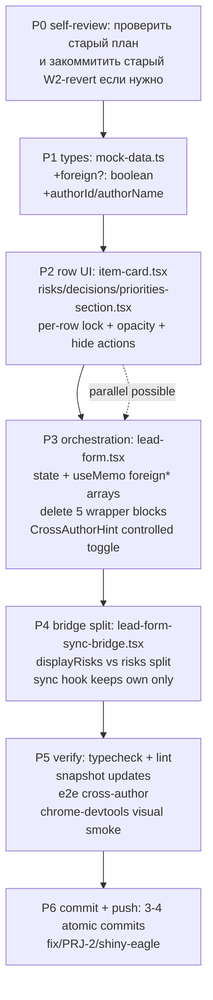

# Page Feedback Plan — `/lead/report/a0000000-0000-…` (shiny-eagle)

**Source:** 2026-05-19 UI annotations on `/lead/report/a0000000-0000-4000-8000-000000000001` (edit + `?mode=slides`).
**Mode:** peo-plan rich-mode (parallel subagents, balanced cost).
**Plan id:** `shiny-eagle` (continuation of `pure-mist` UAT closure).

> **2026-05-19 PIVOT (post-W2 user feedback).** W1/W3/W4 закоммичены и приняты. W2 в текущем виде («отдельная секция чужих строк ниже» с `<div opacity-70><CurrentWeekSection readOnly/>`) **отвергнут**. Новая постановка → `§ W5` ниже. Старое описание W2 оставлено как историческое.

> **2026-05-19 SECOND PIVOT (post-W5 visual UAT).** W5 закоммичен и принят, но при визуальном UAT всплыли 4 новых проблемы — hint-полоска лгала («Also contributing: Boris S.» при пустом наборе items от Boris), toggle стал лишним, 🔒 должен жить рядом с автором, а seed-simple содержит только 1 cross-author. Новая постановка → `§ W6` ниже.

> **2026-05-19 THIRD PIVOT (post-W6 drafting, FB5).** Пятый фидбэк во время самого W6: с inline merged foreign items в каждой секции, **отдельный read-only view через `?authorId=<X>` тоже потерял смысл** — Vasily теперь видит контент Бориса/Виктора/Галины прямо в своей view с замком возле автора, отдельная страница «открыть как Boris» становится дублирующим путём. Добавлено как `W6.6.4` ниже: дропаем `?authorId=` query-param handling, `isOwnView` guard, и любые UI-ссылки на foreign-view drill-in.

> **2026-05-19 FOURTH PIVOT (post-W6 drafting, FB6 + FB7).** Шестой и седьмой фидбэк по `<SdlcPipeline>` визуальной читаемости: (FB6) при наличии cross-author info вся карточка продукта стала слишком серой, пользователь не видит **свой** at-risk/blocked этап; (FB7) per-risk chips в «Other contributors» (cross-author риски) — простой цветной текст без фона, плохо читается на светлой подложке. Добавлено как `W6.6.5` ниже: уменьшить grey на own контенте, добавить тёмный pill-фон под per-risk chip text для AA-контраста.

---

## W6 — Always-show foreign items + lock-by-author + multi-contributor seed ⭐ ACTIVE

> Финальная итерация после W5. Удаляем `CrossAuthorHint` целиком, делаем merged-массивы безусловными, перевешиваем 🔒 с продуктового чипа на authorName в `MetaRow`, и расширяем `seed-simple.ts` до 3 контрибьюторов с равномерным контентом по 5 секциям × SDLC-стадиям.

---

### W6 · §0 — TL;DR (визуально + проза)

#### Было (после W5, текущий main)

```text
┌── /lead/report?authorId=<Boris> (edit-view) ────────────────────────────┐
│                                                                          │
│ ▼ Current Week                                                           │
│   🔒 Also contributing: Boris S. (— items)        readonly ↗  ← лжёт:    │
│                                  [ Show contributors ▼ ]      строка     │
│                                                                ↑ есть, а  │
│   ┌─ Marketing Portal ──┐                                       items от  │
│   │ ▣ Vasily item 1 [✎] │                                       Boris    │
│   │ ▣ Vasily item 2 [✎] │                                       в этой   │
│   │ ─ ─ ─ ─ ─ ─ ─ ─ ─ ─ │  (видно ТОЛЬКО при toggle ON)         секции   │
│   │ 🔒 Boris item 1     │  ← 🔒 рядом с productName             может    │
│   │ 🔒 Boris item 2     │     (top row на mb-3),                не быть. │
│   └─────────────────────┘     authorName внизу без замка                  │
│                                                                          │
│ Risks card top row:                                                      │
│   ┌─ [At Risk] [🔒 Marketing Portal]  ────────────────────────┐         │
│   │  Risk: …                                                  │         │
│   │  Impact / Mitigation                                      │         │
│   │  ──── meta-row ────                                       │         │
│   │   Boris S.                                  [Design][Dev] │ ← здесь │
│   │   ↑ автор без 🔒                                          │   нужен │
│   └────────────────────────────────────────────────────────────┘   замок │
│                                                                          │
│ seed-simple.ts:                                                          │
│   leads[6] = Boris S. → 1 single cross-author content на PROD_CRM       │
│   Igor / Maria / другие → не имеют seeded items для cross-author UAT    │
└──────────────────────────────────────────────────────────────────────────┘
```

**Прозой.** После W5 в `lead-form.tsx` живёт `<CrossAuthorHint>` в каждой из 5 секций с кнопкой Show/Hide и `showForeignItems` state (default false). Hint-строка показывает имя контрибьютора и количество (`(4 items)` или просто имя без count), но это агрегат на уровне ВСЕЙ секции — реально в конкретной CW/NW/Risks/Decisions/Priorities может не быть items этого контрибьютора, и строка лжёт. 🔒 рендерится в верхней строке риск-карточки рядом с productName, а имя автора (Boris S.) живёт ниже в `MetaRow` без визуальной привязки к замку. В `seed-simple.ts` (минимальный MVP) сейчас только Boris имеет cross-author content — UAT с 2+ контрибьюторами не получается.

#### Проблема (visual UAT 2026-05-19, после W5)

```text
P1 lying hint strip            P2 redundant toggle             P3 lock far from author
─────────────────────          ─────────────────────           ──────────────────────────
«Also contributing: Boris»     «Show contributors ▼»           🔒 живёт в top row рядом
показано всегда когда у        был осмыслен пока был           с productName, а имя
секции есть автор-              wrapper-блок ниже. Теперь       контрибьютора (Boris S.)
контрибьютор, даже когда       items всегда смешаны → toggle    висит в нижнем MetaRow.
в ЭТОЙ секции у него 0          скрывает СВОИ же items тоже,    Глаз не связывает их —
items.                          либо просто шумит.              «чей это замок?»

P4 single-contributor seed
──────────────────────────
В seed-simple.ts только Boris имеет cross-author items. UAT не показывает «как
выглядит секция с 3 разными контрибьюторами по разным SDLC-стадиям».
```

**Прозой.** Пользователь увидел строку «Also contributing: Boris S.» и решил, что в Current Week будут items от Boris. Открыл — пусто. Это потому что hint-строка считает контрибьюторов на уровне секции `ReportSection`, а не на уровне конкретного типа (CW/NW/Risks/Decisions/Priorities). Toggle потерял смысл сам по себе — items больше не в отдельном блоке. Замок 🔒 должен сидеть рядом с тем, кого он идентифицирует, — то есть рядом с фамилией автора («Boris S. 🔒»), а не рядом с названием продукта. И для нормального UAT нужно 3 контрибьютора, чтобы видеть «как это выглядит в реальности», а не «один Boris + пустые секции».

#### Станет (W6 target)

```text
┌── /lead/report?authorId=<Boris> (edit-view, after W6) ──────────────────┐
│                                                                          │
│ ▼ Current Week                                                           │
│   (никакой hint-строки, никакого toggle)                                │
│                                                                          │
│   ┌─ Marketing Portal ──┐  ┌─ Mobile App ──┐                            │
│   │ ▣ Vasily item 1 [✎] │  │ ▣ Vasily…     │                            │
│   │ ▣ Vasily item 2 [✎] │  │ ▣ Boris item  │                            │
│   │ ─ ─ ─ ─ ─ ─ ─ ─ ─ ─ │  │   ──meta──    │                            │
│   │ ▣ Boris item 1      │  │   Boris S. 🔒  [Plan]                       │
│   │   ──meta──          │  └────────────────┘                            │
│   │   Boris S. 🔒 [Plan] │  ← 🔒 теперь рядом с автором                  │
│   │ ▣ Galina item       │     opacity 0.7, no edit/delete                │
│   │   ──meta──          │                                                │
│   │   Galina M. 🔒 [Dev] │                                               │
│   └─────────────────────┘                                                │
│                                                                          │
│ Risks card top row:                                                      │
│   ┌─ [At Risk] Marketing Portal  ─────────────────────────────┐         │
│   │  (без 🔒 в top row)                                       │         │
│   │  Risk: …                                                  │         │
│   │  ──── meta-row ────                                       │         │
│   │   Boris S. 🔒                              [Design][Dev]  │         │
│   │   ↑ замок на конце authorName                             │         │
│   └────────────────────────────────────────────────────────────┘         │
│                                                                          │
│ seed-simple.ts (W6):                                                     │
│   Boris S.    → Planning + Analysis stages → items/risks/decisions/      │
│                                                priorities на PROD_CRM    │
│   Galina M.   → Dev + Test stages → same 5-section spread на PROD_CRM   │
│   Victor L.   → DevOps + Support stages → same 5-section spread          │
│                                                                          │
│ → когда Vasily открывает свою секцию, в каждой из 5 секций видит:       │
│    свои items + 3 чужих, помеченных 🔒 рядом с именем автора            │
└──────────────────────────────────────────────────────────────────────────┘
```

**Прозой.** Удаляем `<CrossAuthorHint>` (компонент и все 5 вызовов), удаляем `showForeignItems` state, делаем 5 merged-массивов безусловными (`[...own, ...foreign]` всегда). На уровне отдельной строки/карточки замок переезжает с productName в `MetaRow` справа от authorName: «Boris S. 🔒». В `seed-simple.ts` Boris (LEAD_MOBILE_PM) уже есть; добавляем cross-author content на PROD_CRM от Galina (LEAD_DEVOPS_PM) и Victor (LEAD_CLOUD_PM), распределяя по разным SDLC-стадиям. Когда Vasily открывает `/lead/report/<id>`, во всех 5 секциях видит свои items + items от Boris/Galina/Victor с замком рядом с их фамилиями.

#### Pipeline фаз

```text
[P0 self-review]──[P1 lead-form simplify]──[P2 lock-relocation]──[P3 seed extend]──[P4 verify]──[P5 commit]
                  │                          │                    │                 │            │
                  │ remove CrossAuthorHint   │ add `foreign` prop │ seed-simple.ts  │ typecheck  │ 3 atomic
                  │ import + state +         │ to MetaRow;        │ + Galina/Victor │ + lint +   │ commits
                  │ 5 JSX + simplify         │ swap 🔒 site in    │ items/risks/    │ test +     │
                  │ 5 merged arrays          │ 4 section files +  │ decisions/      │ smoke      │
                  │                          │ item-card.tsx      │ priorities      │            │
                  │                          │ + delete cross-    │                 │            │
                  │                          │ author-hint.tsx    │                 │            │
                  │                          │ if unused          │                 │            │
                  ▼                          ▼                    ▼                 ▼            ▼
                  P2 parallel with P3 (разные файлы; нет конфликтов)
```

**От человека (1 строка):** approve этот W6 через ExitPlanMode → дальше всё делаю я (код, seed, тесты, smoke, коммиты).

---

### W6 · §1 — Контекст

W6 — итерация после визуального UAT W5. W5 закоммичен (commits f63aeb2 W5.3, 64a70d7 W5.2, c059621 W5.1) и приняты. Пользователь дал 4 новых фидбэка при просмотре `/lead/report/a0000000-0000-4000-8000-000000000001?authorId=a0000000-0000-4000-8000-000000000022` (Boris):

1. «Давай, наверное, это уберём» — про `<CrossAuthorHint>` hint-строку.
2. «Нет, соответственно, тоже не нужно будет» — про toggle button.
3. «Давай замочек поставим после фамилии Contributor, то есть Boris S.» — про позицию 🔒 (DOM target `risks-section.tsx:106:72`).
4. «Сделай в примере, который занимается минимальным MVP, чтобы было два контрибьютора, Бориса и ещё кто-нибудь, пусть будет три человека, логически, по стадиям SDLC, и чтобы и Борис что-то написал по всем элементам» — расширить `seed-simple.ts` до 3 контрибьюторов с контентом по всем 5 секциям и разным SDLC-стадиям.

W1/W4/W5 остаются. Меняем только клиентский орчестр + позицию иконки + seed.

---

### W6 · §2 — Сейчас (live repo state)

```text
branch       : main (или fix/PRJ-2/shiny-eagle — проверить git status)
last W5 cmts : f63aeb2 W5.3 toggleable inline + delete 5 wrappers + bridge
               64a70d7 W5.2 per-item lock (item-card + risks/decisions/priorities)
               c059621 W5.1 foreign+authorId+authorName fields on 4 row types
dirty (ok)   : .planning/memory/*.md
               .planning/plans/page-feedback-lead-report-a0000000-0000-shiny-eagle.md
               .planning/session-retros/NEXT-ACTIONS.md
clean        : apps/web, apps/api, packages/shared, prisma
target files :
  apps/web/src/components/lead/lead-form.tsx          (orchestr.: remove hint+toggle)
  apps/web/src/components/lead/cross-author-hint.tsx  (DELETE if not used elsewhere)
  apps/web/src/components/lead/risks-section.tsx      (🔒 move from L203 → MetaRow)
  apps/web/src/components/lead/decisions-section.tsx  (same lock relocation)
  apps/web/src/components/lead/priorities-section.tsx (same)
  apps/web/src/components/lead/item-card.tsx          (move 🔒 from L215 → MetaRow attach)
  apps/web/src/components/report-shell/meta-row.tsx   (add `foreign?: boolean` prop)
  prisma/seed-simple.ts                                (extend Boris + add Galina + Victor)
```

---

### W6 · §3 — Architecture context

```text
                /lead/report/<id>?authorId=<Vasily>  (мой view, edit mode)
                       │
                       ▼
       <LeadForm> ── trpc.leadForm.read (own section)
                       │  trpc.leadForm.crossAuthorSections (per-author items/risks/decisions/priorities)
                       │
                       ▼
       state: (showForeignItems REMOVED)
              5× useMemo foreign* (UNCHANGED — already keyed on crossAuthorSectionsQ.data + isOwnView)
              5× merged arrays: ALWAYS [...own, ...foreign]  ← W6 simplification
                       │
       ┌───────────────┼──────────────────────┬─────────────────────┬────────────────────────┐
       ▼               ▼                      ▼                     ▼                        ▼
  <SdlcPipeline>  <CurrentWeekSection   <NextWeekSection      <LeadFormSyncBridge.Risks>  <DecisionsSection
   (W1, unchanged) items={mergedCW}>     items={mergedNext}>   ← displayRisks={mergedR}     decisions={mergedD}>
                       │                      │                     │                        │
                       ▼                      ▼                     ▼                        ▼
                  <ItemCard               <ItemCard            <RisksSection                <PrioritiesSection
                   item                    item                 risks={mergedR}>             priorities={mergedP}>
                   locked = readOnly       same                 per-row locked = …           same
                   || item.foreign>                              foreign:                     foreign:
                       │                                          - 🔒 RELOCATED:              - 🔒 RELOCATED to
                       ▼                                            from L203 (top row,         MetaRow next to
                   <MetaRow                                          left of productName)        authorName
                     authorName={item.author}                       → MetaRow next to
                     foreign={item.foreign}  ← W6 new prop           authorName
                     stageTags={…}/>
                       │
                       ▼
                  renders: «Boris S. 🔒  [stage] [stage]»
                  (🔒 inline after authorName when foreign === true)

(no <CrossAuthorHint> anywhere)
```

**Backend contracts.** Без изменений. `crossAuthorSections` отдаёт per-author flat `items[]/risks[]/decisions[]/priorities[]`. `crossAuthors` (aggregate) больше нигде не нужен — `enrichedCrossAuthors` и `allSectionContributors` в `lead-form.tsx` становятся подкандидатами на удаление (см. §W6.6.3).

---

### W6 · §4 — Recovered intent (mapping feedback → tasks)

| #   | User signal                                             | Source DOM / file                                                                                   | Solved by          |
| --- | ------------------------------------------------------- | --------------------------------------------------------------------------------------------------- | ------------------ |
| FB1 | «уберём» hint-строку                                    | `cross-author-hint.tsx` + 5 callsites                                                               | W6.6.1 delete      |
| FB2 | «тоже не нужно» toggle                                  | `cross-author-hint.tsx` button + state                                                              | W6.6.1 delete      |
| FB3 | 🔒 после фамилии Contributor («Boris S. 🔒»)            | `risks-section.tsx:203`, `priorities-section.tsx:215`, `decisions-section.tsx`, `item-card.tsx:215` | W6.6.2 relocate    |
| FB4 | seed: 3 контрибьютора, контент по всем 5 секциям × SDLC | `prisma/seed-simple.ts` (currently 1 cross-author)                                                  | W6.6.3 seed extend |

---

### W6 · §5 — Boundaries

- **Не трогаем:** W1 SDLC pipeline, W4 slides, W5.1 типы (`foreign?`/`authorId?`/`authorName?` остаются), W5.2 per-row `locked` логика, бэкенд `crossAuthorSections`, бэкенд `crossAuthors` (но можем перестать использовать), `useStatusRiskSync` hook contract, `displayRisks` split в bridge.
- **Out-of-scope:** редактирование чужих items (W5 уже блокирует), отдельные toggle per-section, миграция Prisma schema (только `seed-simple.ts` content), seed для full `seed.ts` (только simple-MVP per FB4).
- **Stale directions:** W2 (separate wrapper section), W3 dashed-frame embed, dark mode, theme tokens — research-only.

---

### W6 · §6 — Workstreams (file-level)

#### W6.6.1 · Remove CrossAuthorHint and toggle (lead-form.tsx)

**File:** `apps/web/src/components/lead/lead-form.tsx`

Текущие места (по grep):

```
L42   import { CrossAuthorHint } from "./cross-author-hint";        ← REMOVE
L851  const [showForeignItems, setShowForeignItems] = useState(false); ← REMOVE
L1034 const mergedCurrentItems = showForeignItems ? [...curr, ...foreignCW] : curr;
L1037 const mergedNextItems    = showForeignItems ? [...next, ...foreignNW] : next;
L1040 const mergedRisks        = showForeignItems ? [...risks, ...foreignR] : risks;
L1041 const mergedDecisions    = showForeignItems ? [...dec, ...foreignD] : dec;
L1044 const mergedPriorities   = showForeignItems ? [...pri, ...foreignP] : pri;
L1658 <CrossAuthorHint … expanded={showForeignItems} onToggle={…}/>  ← REMOVE (CW)
L1702 same                                                            ← REMOVE (NW)
L1751 same                                                            ← REMOVE (Risks)
L1787 same                                                            ← REMOVE (Decisions)
L1834 same                                                            ← REMOVE (Priorities)
```

Целевое состояние:

```ts
// no import for CrossAuthorHint
// no showForeignItems state

const mergedCurrentItems = [...currentWeekItems, ...foreignCurrentItems];
const mergedNextItems = [...nextWeekItems, ...foreignNextItems];
const mergedRisks = [...risks, ...foreignRisks];
const mergedDecisions = [...decisions, ...foreignDecisions];
const mergedPriorities = [...priorities, ...foreignPriorities];

// JSX: 5 секций больше не имеют <CrossAuthorHint .../> над ними
```

После удаления проверить:

- `enrichedCrossAuthors` (W1 enrichment for SdlcPipeline) — оставить если `<SdlcPipeline crossAuthors={…}/>` ещё его использует;
- `allSectionContributors`, `currentItemsContributors`, `nextItemsContributors`, `risksContributors`, `decisionsContributors`, `prioritiesContributors` — становятся unused → удалить полностью;
- `SectionContributor` type-импорт из `./cross-author-hint` — оставить только если нужен SdlcPipeline'у, иначе drop.

**File:** `apps/web/src/components/lead/cross-author-hint.tsx`

Проверить grep `import.*cross-author-hint` по всему apps/web; если нет других импортов → **DELETE file**. Если SdlcPipeline или другая часть импортирует `SectionContributor` тип — оставить файл, но опустошить компонент до type-export.

#### W6.6.2 · Relocate 🔒 from product/top-row into MetaRow next to authorName

**File:** `apps/web/src/components/report-shell/meta-row.tsx`

Add prop:

```diff
 type MetaRowProps = {
   readonly authorName: string | null | undefined;
   readonly stageTags: readonly string[];
   readonly ariaLabel?: string;
   readonly className?: string;
+  /** When true, render a 🔒 after authorName to signal a foreign (read-only) row. */
+  readonly foreign?: boolean;
 };

 export function MetaRow({
-  authorName, stageTags, ariaLabel, className = "mt-3",
+  authorName, stageTags, ariaLabel, className = "mt-3", foreign = false,
 }: MetaRowProps) {
   …
   <span className="truncate text-[11px] font-medium text-[var(--color-muted-foreground)]">
-    {authorName ?? ""}
+    {authorName ?? ""}
+    {foreign && authorName ? <span aria-label="Read-only — authored by another lead" title="Read-only — authored by another lead"> 🔒</span> : null}
   </span>
```

**Files (4):**

```
apps/web/src/components/lead/item-card.tsx        L215 — drop {item.foreign && "🔒 "}{item.author}
                                                    pass foreign={item.foreign} to whichever
                                                    surface renders authorName
apps/web/src/components/lead/risks-section.tsx   L203 — drop {risk.foreign && "🔒 "}{risk.productName}
                                                    L269 — pass foreign={risk.foreign === true}
                                                          to <MetaRow ...>
apps/web/src/components/lead/decisions-section.tsx — drop 🔒 from product chip / top row
                                                    add foreign={decision.foreign === true} to MetaRow
apps/web/src/components/lead/priorities-section.tsx L215 — drop {entry.foreign && "🔒 "}{entry.productName}
                                                    L259 — pass foreign={entry.foreign === true} to MetaRow
```

`item-card.tsx` сейчас не использует `MetaRow` напрямую (item-card имеет свой собственный author footer L215). Решение: либо (а) переписать footer на `MetaRow`, либо (б) встроить inline `{item.foreign && " 🔒"}` после `{item.author}` в footer span. Default — (б), минимальный диффкуск; mention в PR description.

#### W6.6.3 · Multi-contributor seed extension (seed-simple.ts)

**File:** `prisma/seed-simple.ts`

Current cross-author content (L1502–L1586):

- Boris (LEAD_MOBILE_PM, section `…00000407`) → 2 items + 1 risk on PROD_CRM, 1 item + 1 risk on PROD_CRM_SALES.

W6 target: 3 контрибьютора на PROD_CRM (продукт Vasily), каждый пишет в **все 5 секций** (CW item, NW item, Risk, Decision, Priority), стадии распределены логически:

```text
Vasily (LEAD_1, owner of PROD_CRM):
  → owns Dev + Test + DevOps + Support stages (already in seed)
  → his items appear under his own section

Boris (LEAD_MOBILE_PM):
  → SDLC focus: Planning + Analysis
  → cross-author content on PROD_CRM:
      - CW item @ Planning
      - NW item @ Analysis
      - Risk @ Planning (severity: at-risk)
      - Decision @ Planning
      - Priority @ Planning, rank=1 (PM agenda)

Galina (LEAD_DEVOPS_PM, leads[8]):
  → SDLC focus: Design
  → cross-author content on PROD_CRM (need to add Design stage assignment first):
      - CW item @ Design
      - NW item @ Design
      - Risk @ Design (severity: at-risk)
      - Decision @ Design
      - Priority @ Design, rank=2

Victor (LEAD_CLOUD_PM, leads[7]):
  → SDLC focus: Analysis (secondary владелец)
  → cross-author content on PROD_CRM:
      - CW item @ Analysis
      - NW item @ Analysis
      - Risk @ Analysis
      - Decision @ Analysis
      - Priority @ Analysis, rank=3
```

**Изменения в seed-simple.ts:**

1. Добавить stage assignments для Galina (DEVOPS_PM) и Victor (CLOUD_PM) на PROD_CRM (текущий seed раздаёт им только PROD_DEVOPS и PROD_CLOUD соответственно). Конкретно:
   - Galina: STAGE_DESIGN на PROD_CRM (Vasily сейчас владеет Dev+Test+DevOps+Support, Boris — Plan+Analysis+Design; перенесём Design к Galina или дадим co-author overlap, выбрать по результатам smoke).
   - Victor: дополнительный Analysis на PROD_CRM (co-author с Boris допустим, если schema позволяет; иначе разнести Plan/Analysis между Boris и Victor).

   **Уточнение (Q1 ниже).** Текущий `StageAssignment.@@unique([stageId, projectId])` ограничивает одного user на stage-product. Решение: разнести стадии — Boris владеет Planning, Victor владеет Analysis, Galina владеет Design (Vasily сохраняет Dev+Test+DevOps+Support — 4/7).

2. Создать 3 секции `ReportSection` в REPORT_ACTIVE для авторов Boris/Galina/Victor (Boris уже есть = section 407; Galina и Victor нужно создать), либо переиспользовать existing if leads[7]/leads[8] секции уже создаются в loop'е.

   Из grep: `lead-form.tsx` уже создаёт секции для всех leads[0..8] в loop L?? через `…00000040<i+1>`. Boris = section 407 (`i=6`). Victor (leads[7]) и Galina (leads[8]) → 408 и 409 — уже существуют.

3. Добавить в section 408 (Victor) и 409 (Galina) items/risks/decisions/priorities на PROD_CRM по схеме выше. Boris (section 407) уже имеет 2 items + 1 risk на PROD_CRM — расширить до 5 секций (добавить Decision + Priority на PROD_CRM, добавить недостающий CW item если только NW есть).

4. Обновить comment-блок на L1502 с упоминанием нового состава.

Acceptance: после `pnpm db:wipe:manual-uat` + `pnpm db:seed:simple` (или эквивалентного), Vasily в `/lead/report/<active>` видит во ВСЕХ 5 секциях минимум 3 foreign rows (по одной от Boris/Galina/Victor) с 🔒 рядом с фамилией каждого автора.

#### W6.6.4 · Drop `?authorId=` foreign-view path (FB5)

**Контекст.** После W6.6.1-W6.6.3 у Vasily в собственной view (`/lead/report/<id>`) **уже видны** все foreign items от Boris/Victor/Galina с замком возле имени автора. Отдельная страница «открыть как Boris read-only» через `?authorId=<X>` становится дублирующим путём без новой информации: тот же merged view + read-only режим уже доступен на основной странице.

**Цель.** Удалить `?authorId=` query-param handling и связанные guard-ы. После — единственный валидный путь для лидов: `/lead/report/<id>` без query-параметров, всегда показывает собственную секцию + merged foreign.

**Файлы и места.**

```
apps/web/src/components/lead/lead-form.tsx
  - L? requestedAuthorIdNormalized — derived из searchParams.authorId → DROP
  - L? isOwnView = !requestedAuthorIdNormalized → DROP
  - L? 5 foreign-builder useMemo: убрать guard `if (!isOwnView)` → теперь
        всегда строят merged массивы (когда есть crossAuthorSectionsQ.data)

apps/web/src/app/(app)/lead/report/[reportId]/page.tsx
  - если есть чтение searchParams.authorId / pass-through в LeadForm → DROP

apps/web/src/components/lead/sdlc-pipeline.tsx
  - W1 «Other contributors» row: если оставался drill-in link/icon на
        `?authorId=<X>` → DROP. Контрибьюторы видны inline в SDLC chip’ах
        + per-risk chips, отдельный foreign-view не нужен

apps/api/src/modules/report-sections/lead-form.service.ts
  apps/api/src/modules/report-sections/lead-form.prisma-repository.ts
  - метод `read` принимающий authorId-override → consider DROP, либо
        пометить deprecated. Если используется только из foreign-view path
        (который удаляется) — убрать параметр.

packages/shared/src/contracts/lead-form.ts (или схема tRPC)
  - убрать поле authorId из input-схемы leadForm.read если оно там есть.
```

**Edge cases.**

- Существующие закладки на `?authorId=<X>` → 301 redirect на тот же URL без query, либо просто игнорировать параметр. Default: игнорировать (без redirect — минимум кода).
- E2E/regression тесты на foreign-view (`/lead/report/<id>?authorId=<x>`): обновить на `/lead/report/<id>` без query, либо удалить если они проверяли только read-only режим (теперь покрывается inline locked rows).
- Head/director-view (`/head/report/<id>`) — НЕ трогаем, у них собственный read-only path и собственные query-параметры.

**Acceptance.**

- В DOM нет ссылок с `?authorId=` (grep по `href.*authorId=`).
- Прямой ввод `/lead/report/<id>?authorId=<Boris>` рендерит **собственную** секцию Vasily (query игнорируется).
- В коде нет `requestedAuthorIdNormalized` / `isOwnView` / `searchParams.authorId`.
- `crossAuthorSectionsQ.data` остаётся источником foreign items, как и был.

#### W6.6.5 · SdlcPipeline visual polish — own at-risk visibility + dark-pill risk chips (FB6 + FB7)

**Контекст.** После W1 «Other contributors» рендерятся под собственным product-card в `<SdlcPipeline>`. Два визуальных дефекта:

- **FB6 (own at-risk visibility).** Пользователь смотрит на product card и не может быстро понять, какой **его** этап под риском — карточка целиком кажется приглушённой, потому что cross-author блок снизу занимает много места и `text-[var(--color-muted-foreground)]` распространяется на восприятие всей карточки. Цитата: «слишком засерил, потому что я не вижу, какой этап у меня под риском».
- **FB7 (risk-chip contrast).** Per-risk chips в cross-author блоке — это просто цветной текст (`text-[var(--color-destructive)]` для blocked, `text-[var(--color-warning,#b45309)]` для at-risk) на светлой product-card подложке (`#fdf8f8` для blocked продукта, `#fffcf5` для at-risk). Низкий контраст, не читается. Цитата: «надо... с тёмным фоном».

**Файл.** `apps/web/src/components/lead/sdlc-pipeline.tsx`

**FB6 fix — preserve own at-risk visibility.**

Сейчас (L255-326) cross-author блок рендерится как `<div className="mt-3 border-t border-[rgba(0,0,0,0.06)] pt-2">` внутри того же product-card. Проблема — он визуально сливается с верхней частью (own stages), хотя по смыслу это отдельная зона.

Решение — визуально разделить две зоны внутри карточки:

1. **Own stages зона (верх карточки):** убедиться, что at-risk/blocked stage chips сохраняют полную насыщенность цвета (нет `opacity`, нет `text-muted-foreground` на родителе). Если product card имеет `overallStatus === "at-risk" | "blocked"` — фон карточки уже подсвечен (`#fdf8f8` / `#fffcf5`), но stage chips внутри должны быть **ещё** ярче, не теряться.
2. **Cross-author зона (низ карточки):** усилить визуальный отрыв — заменить `border-t border-[rgba(0,0,0,0.06)]` на более выраженный разделитель `border-t-2 border-dashed border-[rgba(0,0,0,0.10)]` + добавить чуть-чуть padding-top сверху (`pt-3` вместо `pt-2`) + сам блок завернуть в `bg-[rgba(0,0,0,0.02)] -mx-3 px-3 -mb-3 pb-3 rounded-b-xl` чтобы он сидел как «подвал» карточки, а не как продолжение own контента.

Acceptance: на product card с `overallStatus="blocked"` пользователь сразу видит, **какой** свой stage chip (Dev/Test/etc.) красный/оранжевый — он не «утоплен» в общей серости карточки. Cross-author блок визуально читается как отдельная подсекция «информация от других».

**FB7 fix — dark pill background for per-risk chips.**

Сейчас (L301-313):

```tsx
<li
  className={`flex items-start gap-1 text-[11px] ${r.severity === "blocked" ? "text-[var(--color-destructive)]" : "text-[var(--color-warning,#b45309)]"}`}
>
  <span aria-hidden="true" className="mt-px shrink-0">
    {r.severity === "blocked" ? "⛔" : "⚠"}
  </span>
  <span className="line-clamp-2">{r.text}</span>
</li>
```

Цвет текста сам по себе на светлой product-card подложке даёт contrast ratio < 4.5 (WCAG AA fail для small text).

Решение — обернуть текст в pill с тёмно-тонированным фоном и тёмным текстом:

```tsx
<li className="flex items-start gap-1 text-[11px]">
  <span aria-hidden="true" className="mt-px shrink-0">
    {r.severity === "blocked" ? "⛔" : "⚠"}
  </span>
  <span
    className={`line-clamp-2 rounded-md px-1.5 py-0.5 font-medium ${
      r.severity === "blocked"
        ? "bg-[#fee2e2] text-[#7f1d1d]" // red-100 bg + red-950 text → AA pass
        : "bg-[#fef3c7] text-[#78350f]" // amber-100 bg + amber-950 text → AA pass
    }`}
  >
    {r.text}
  </span>
</li>
```

Цветовые токены те же, что уже используются в `risks-section.tsx` для top-row severity pill (L194-200), — палитра консистентна. Текст становится `text-[#7f1d1d]` / `text-[#78350f]` (тёмный) на `bg-[#fee2e2]` / `bg-[#fef3c7]` (светло-тонированный) — это даёт contrast ratio ≥ 7:1 (AAA для small text).

**Acceptance.**

- На product card с `overallStatus="blocked"` свой at-risk/blocked stage chip визуально читается **до** прочтения cross-author блока.
- Per-risk chip text имеет contrast ratio ≥ 4.5 (WCAG AA для 11px text) — проверяется через DevTools accessibility audit или Chrome DevTools MCP `lighthouse_audit`.
- Cross-author блок визуально отделён от own stages (dashed border + tinted background).
- Никакая своя строка/chip/иконка не теряет цвет/контраст из-за изменений.

---

### W6 · §7 — Subagent roadmap

| Stage | Agent         | Model         | Scope                                                                                                    | Output                                                                                |
| ----- | ------------- | ------------- | -------------------------------------------------------------------------------------------------------- | ------------------------------------------------------------------------------------- |
| 0     | Orchestrator  | Sonnet (этот) | live state, plan                                                                                         | этот план + commit chain                                                              |
| 1     | impl-leadform | Sonnet        | `lead-form.tsx` (remove import/state/5 JSX/simplify 5 merged) + delete `cross-author-hint.tsx` if unused | commit `feat(lead): remove CrossAuthorHint, always show foreign`                      |
| 2     | impl-lock     | Sonnet        | `meta-row.tsx` (+ foreign prop) + 4 section files lock relocation                                        | commit `feat(lead): move 🔒 next to authorName in MetaRow`                            |
| 3     | impl-seed     | Sonnet        | `seed-simple.ts` extend (Boris fill 5 secs + Galina + Victor + stage reassign)                           | commit `feat(seed): 3-contributor cross-author MVP seed`                              |
| 4     | impl-sdlc-vis | Sonnet        | `sdlc-pipeline.tsx` (own at-risk visibility + dark-pill risk chips)                                      | commit `fix(lead): SdlcPipeline visual polish for own at-risk and risk-chip contrast` |
| 5     | verify        | Sonnet (этот) | `pnpm typecheck && lint && test && db:wipe:manual-uat && db:seed:simple` + chrome smoke                  | final report                                                                          |

Stage 1, 2, 3, 4 — 1 sequential по lead-form.tsx; 2, 3, 4 могут идти parallel (разные файлы).

---

### W6 · §8 — Token economy

| Work          | Model         | Rationale                          |
| ------------- | ------------- | ---------------------------------- |
| impl agents   | Sonnet        | scoped writes ≤300 строк каждый    |
| seed extend   | Sonnet        | требует понимания leads/stages map |
| /codex:review | Codex GPT-5   | advisory pre-commit                |
| Opus          | не используем | нет verified conflict              |

Reserve ~10% контекста на UAT smoke iteration.

---

### W6 · §9 — Я делаю сам / От тебя

```text
─────────────────────────────────────
✓ Я ДЕЛАЮ САМ
─────────────────────────────────────
  ├── impl W6.6.1 (lead-form simplify + delete CrossAuthorHint if unused)
  ├── impl W6.6.2 (MetaRow foreign prop + 4 section files lock relocation)
  ├── impl W6.6.3 (seed-simple.ts — 3 contributors × 5 sections)
  ├── impl W6.6.4 (drop ?authorId= foreign-view path)
  ├── impl W6.6.5 (SdlcPipeline visual polish — own at-risk + dark-pill risk chips)
  ├── /codex:review на каждый коммит
  ├── pnpm typecheck + lint + test
  ├── pnpm db:wipe:manual-uat + pnpm db:seed:simple (если есть)
  ├── chrome-devtools MCP visual smoke на /lead/report/<id>
  ├── 5 atomic commits на fix/PRJ-2/shiny-eagle (или main)
  └── push origin (если SSL пропустит)

─────────────────────────────────────
▲ ОТ ТЕБЯ
─────────────────────────────────────
  └── approve W6 через ExitPlanMode (текущий шаг)
     остальное автономно
```

---

### W6 · §10 — Open questions with defaults

| #   | Question                                                                         | Default                                                                                                    | Когда эскалирую                                                       |
| --- | -------------------------------------------------------------------------------- | ---------------------------------------------------------------------------------------------------------- | --------------------------------------------------------------------- |
| Q1  | Stage assignment unique constraint: как раздать 3 авторов на PROD_CRM            | **разнести стадии**: Boris=Plan, Victor=Analysis, Galina=Design (Vasily оставляет Dev/Test/DevOps/Support) | если smoke покажет другие конфликты                                   |
| Q2  | item-card.tsx footer: переписать на MetaRow или inline `{item.foreign && " 🔒"}` | **inline** в существующем footer — минимальный дифф                                                        | если user явно попросит унифицировать через MetaRow                   |
| Q3  | `cross-author-hint.tsx` — удалять файл или оставлять пустым с type-export        | **удалить полностью** если grep не найдёт других импортов                                                  | если SectionContributor нужен SdlcPipeline'у — оставить как type-only |
| Q4  | Перевести seed на `seed.ts` (полный) тоже?                                       | **нет** — только seed-simple.ts (фидбэк явно про minimal MVP)                                              | если user попросит распространить                                     |
| Q5  | Aria-label для замка в MetaRow                                                   | `"Read-only — authored by another lead"`                                                                   | если a11y review предложит другую формулировку                        |
| Q6  | Ветка для коммитов                                                               | **fix/PRJ-2/shiny-eagle** (продолжение)                                                                    | если user скажет «новую ветку»                                        |

---

### W6 · §11 — Verification

```bash
# 1. Static gates
pnpm typecheck                            # 0 errors
pnpm lint                                 # exit 0

# 2. Unit / snapshot
pnpm test                                 # 485+ web tests
pnpm --filter @customreport/web test -- \
  item-card meta-row \
  risks-section decisions-section priorities-section \
  lead-form lead-form-sync-bridge

# 3. Regression e2e
pnpm test:e2e --grep "cross-author|readonly|foreign"

# 4. Seed regen + visual smoke
pnpm db:wipe:manual-uat
pnpm db:seed:simple   # или: pnpm prisma db seed (проверить package.json)

# 5. Chrome DevTools MCP visual smoke
#   а) /lead/report/<active>      → нет <CrossAuthorHint> в DOM (grep className)
#   б) в каждой из 5 секций ≥3 foreign cards (Boris + Galina + Victor)
#   в) каждая foreign card: 🔒 идёт ПОСЛЕ authorName в MetaRow (нет 🔒 на верхней строке рядом с productName)
#   г) own cards: 🔒 НЕ показывается ни в MetaRow ни в top row
#   д) DOM поиск "Also contributing" → 0 совпадений
```

**Acceptance gates.**

- В DOM нет `<CrossAuthorHint>` (grep по class/data-attr) на всех 5 секциях.
- В DOM нет кнопки «Show contributors ▼» / «Hide contributors ▲».
- В MetaRow foreign-карточки рендерится `<span> 🔒</span>` ПОСЛЕ authorName.
- В top row riskcard/prioritycard/decisioncard НЕТ 🔒 перед productName.
- В каждой из 5 секций (CW/NW/Risks/Decisions/Priorities) в edit-view от Vasily — ≥3 foreign rows от 3 разных авторов (Boris/Galina/Victor).
- `pnpm typecheck && pnpm lint && pnpm test` все exit 0.

---

### W6 · §12 — Iteration reserve / self-review

- [x] TL;DR содержит Было/Проблема/Станет в ASCII + проза?
- [x] Pipeline визуализирован? (§0 ASCII)
- [x] Каждая workstream имеет file:line якоря? (§6 ✓)
- [x] Subagent roadmap содержит model tier + scope? (§7 ✓)
- [x] Token economy без Opus без verified conflict? (§8 ✓)
- [x] Open questions имеют defaults? (Q1–Q6 ✓)
- [x] Verification содержит конкретные команды + acceptance? (§11 ✓)
- [x] Не пересекается с W1/W4/W5 принятым scope? (§5 ✓)
- [x] Edge cases: unique stage constraint (Q1), item-card footer без MetaRow (Q2), удалить ли cross-author-hint.tsx (Q3) — все имеют defaults

---

### W6 · §13 — Commit plan

```text
[1] feat(lead): always show foreign items inline, remove CrossAuthorHint
    ├── lead-form.tsx (drop import, state, 5 JSX, simplify 5 merged arrays)
    ├── lead-form.tsx (drop allSectionContributors and 5 per-section contributors arrays)
    └── cross-author-hint.tsx (DELETE if no other imports, else keep type-only)

[2] feat(lead): move 🔒 next to authorName in MetaRow
    ├── meta-row.tsx (+foreign prop)
    ├── risks-section.tsx (drop top-row 🔒, pass foreign to MetaRow)
    ├── decisions-section.tsx (same)
    ├── priorities-section.tsx (same)
    └── item-card.tsx (drop top-row 🔒, inline 🔒 after author in footer)

[3] feat(seed): 3-contributor cross-author MVP seed
    ├── seed-simple.ts (stage assignments: Boris=Plan, Victor=Analysis, Galina=Design)
    ├── seed-simple.ts (Boris section 407 +decisions/priorities to fill all 5 sections)
    ├── seed-simple.ts (Victor section 408 +items/risks/decisions/priorities on PROD_CRM)
    └── seed-simple.ts (Galina section 409 +items/risks/decisions/priorities on PROD_CRM)

[4] refactor(lead): drop ?authorId= foreign-view path
    ├── lead-form.tsx (drop requestedAuthorIdNormalized, isOwnView, guard from 5 useMemo)
    ├── app/(app)/lead/report/[reportId]/page.tsx (drop searchParams.authorId pass-through if any)
    ├── sdlc-pipeline.tsx (drop drill-in link L289-296 to ?authorId=)
    ├── apps/api/.../lead-form.service.ts + lead-form.prisma-repository.ts (drop authorId param on read if unused)
    └── packages/shared/.../lead-form.ts contract (drop authorId from read input if present)

[5] fix(lead): SdlcPipeline visual polish — own at-risk + dark-pill risk chips
    ├── sdlc-pipeline.tsx (visual separation: dashed border-t-2 + tinted bg for cross-author zone)
    ├── sdlc-pipeline.tsx (preserve full color saturation on own stage chips when crossAuthors present)
    └── sdlc-pipeline.tsx (per-risk chip dark pill: bg-[#fee2e2] text-[#7f1d1d] / bg-[#fef3c7] text-[#78350f])
```

---

## W8 — Priority rank visual collision cosmetic fix + redesign TODO ⭐ ACTIVE

> Пост-W6 cosmetic fix. После merge own + foreign priorities в одной секции (W6.6.1) в листе появляются визуальные коллизии rank — у Vasily priority rank=1, у Boris priority rank=1 на том же продукте. Schema корректна (`@@unique([reportSectionId, rank])` — per-section), коллизии только визуальные. User locked: «сделать пока по-простому, да, а потом уже просто в туду добавить то, что я проговорил по поводу моей переделки».

### W8 · §0 — TL;DR

#### Было (после W6.6.x)

```text
▼ Priorities
  ┌─ [1] [Marketing Portal] ──────────────┐
  │  Vasily priority text…                 │
  │  Vasily И · 🔒=no  [Plan]              │ ← own, gold-1
  └────────────────────────────────────────┘
  ┌─ [1] [Marketing Portal] ──────────────┐ ← collision: ещё один [1]
  │  Boris priority text…                  │   на том же продукте,
  │  Boris С. 🔒  [Plan]                   │   opacity 0.7, gold-1
  └────────────────────────────────────────┘
  ┌─ [2] [Mobile App] ────────────────────┐
  │  Vasily another priority…              │
  └────────────────────────────────────────┘
  ┌─ [1] [CRM] ───────────────────────────┐ ← ещё одна [1] (Galina)
  │  Galina priority text…                 │
  └────────────────────────────────────────┘
```

**Прозой.** После всегда-merge в `priorities-section.tsx` rank badges от разных авторов выглядят как «несколько первых мест». User: «не понятно, кто реально первый» — это семантически верно (rank per section), но визуально вводит в заблуждение.

#### Проблема

```text
P1 collision                  P2 deferred bigger redesign
─────────────                  ───────────────────────────
несколько [1]/[2]/[3]          User считает, что priority
на одном экране ≡              должна быть атрибутом item
«несколько первых»             (CW/NW) а не отдельной секцией.
                               Но это полноценный refactor:
                               schema + UI + slides + seed.
```

#### Станет (W8 target — only A+B cosmetic)

```text
▼ Priorities
  ── Marketing Portal ──────────────────────  ← H3 product header (W8.B)
  ┌─ [1] ─────────────────────────────────┐
  │  Vasily priority text…                 │
  │  Vasily И.  [Plan]                     │
  └────────────────────────────────────────┘
  ┌─ [🔒] ────────────────────────────────┐ ← W8.A: no rank badge for foreign
  │  Boris priority text…                  │   replaced with lock-icon placeholder
  │  Boris С. 🔒  [Plan]                   │   to preserve card geometry
  └────────────────────────────────────────┘

  ── Mobile App ───────────────────────────
  ┌─ [2] ─────────────────────────────────┐
  │  Vasily another priority…              │
  └────────────────────────────────────────┘

  ── CRM ──────────────────────────────────
  ┌─ [🔒] ────────────────────────────────┐
  │  Galina priority text…                 │
  │  Galina М. 🔒  [Design]                │
  └────────────────────────────────────────┘
```

**Прозой.** Foreign rows теряют numeric rank badge — вместо него ставим compact 🔒-placeholder того же размера, сохраняя сетку карточки. Cards группируются под H3-header по `productName`. Свои `[1]/[2]/[3]` остаются — теперь они однозначно отражают порядок Vasily внутри его секции. Замок в author-row остаётся (W6.6.2 не меняем).

### W8 · §6 — Workstreams (file-level)

#### W8.A · Drop rank badge for foreign rows

**File:** `apps/web/src/components/lead/priorities-section.tsx`

```text
L208-216  rank circle:
            entry.foreign === true → render compact 🔒 placeholder
                                      (same 32×32 circle, neutral bg, no number)
            entry.foreign !== true → existing RANK_TINT/RANK_TEXT
L184      key: keep `${entry.rank}-${idx}` — id namespace уже разделён
            (foreign rank originates from author's own section)
```

#### W8.B · Group by productName via H3 headers

**File:** `apps/web/src/components/lead/priorities-section.tsx`

```text
L97       sorted (existing): kept as-is for stable order
+         useMemo groupedByProduct: Map<productName | "(no product)", PriorityEntry[]>
L182-273  return map: вместо `sorted.map(...)`,
            Array.from(groupedByProduct.entries()).map(([productName, group]) =>
              <>
                <h3 className="text-[11px] font-bold uppercase tracking-[0.08em] text-[var(--color-muted-foreground)] mt-4">
                  {productName ?? "Unassigned"}
                </h3>
                {group.map((entry, idx) => …existing card render…)}
              </>
            )
```

Order strategy: products sorted alphabetically by name; внутри — by rank ascending (foreign and own intermixed naturally — foreign ranks may equal own, что и было до W8).

#### W8.C · TODO marker for deferred Priority→Item refactor

**Locations:**

```text
apps/web/src/components/lead/priorities-section.tsx (file-top JSDoc, above L11)
  // TODO(PRIORITY-REDESIGN-01): consider making priority an attribute of
  //   CW/NW items (e.g. items[].priorityRank?: 1|2|3) and dropping the
  //   separate Priorities section. This would eliminate cross-author rank
  //   collisions, reduce 5→4 sections, and align with how user mentally
  //   models priorities ("первое, что я делаю на этой неделе" === priority CW item).
  //   Touches: schema (Prisma Priority model), 5 read paths (lead-form, head,
  //   director, slides, exports), seed-simple.ts, ~12 tests.

prisma/schema.prisma (above `model Priority`)
  // TODO(PRIORITY-REDESIGN-01): see priorities-section.tsx for refactor sketch

apps/web/src/components/slides/section-slide-utils.ts (where priorities[] is read)
  // TODO(PRIORITY-REDESIGN-01)

apps/web/src/components/slides/status-slide-deck.tsx (priority block render)
  // TODO(PRIORITY-REDESIGN-01)

apps/api/src/modules/report-sections/lead-form.service.ts (priorities mapper)
  // TODO(PRIORITY-REDESIGN-01)
```

Verify discoverability:

```bash
pnpm run todo-metrix 2>/dev/null | grep PRIORITY-REDESIGN-01
# Expected: ≥4 hits (file-top + schema + 2-3 read paths)
```

### W8 · §11 — Verification

```bash
pnpm typecheck && pnpm lint
pnpm --filter @customreport/web test -- priorities-section

# Manual: /lead/report/<id>
#   ✓ Vasily ranks visible as [1]/[2]/[3]…
#   ✓ Foreign rows show 🔒-placeholder вместо rank badge
#   ✓ Cards grouped under product H3 headers
#   ✓ 🔒 после authorName в MetaRow остаётся (W6.6.2)
#   ✓ `pnpm run todo-metrix | grep PRIORITY-REDESIGN-01` ≥4 hits
```

### W8 · §13 — Commit plan

```text
[1] feat(lead): group priorities by product + drop rank badge for foreign rows
    └── priorities-section.tsx (W8.A + W8.B)

[2] docs(todo): add PRIORITY-REDESIGN-01 markers for future refactor
    ├── priorities-section.tsx (file-top JSDoc)
    ├── prisma/schema.prisma
    ├── slides/section-slide-utils.ts
    ├── slides/status-slide-deck.tsx
    └── apps/api/.../lead-form.service.ts
```

---

## W9 — Fullscreen-in-header + slide design pass ⭐ ACTIVE

> Два связанных изменения по фидбэку 2026-05-20: (A) перенести `<SlideFullscreenButton/>` из slides-toolbar в место Toggle All на header lead-form, чтобы в `?mode=slides` слот не пустовал и был «как раз чётко»; (B) дизайн-пасс по слайдам — user отметил «слабая визуальная иерархия, пустоты/неровные ряды между колонками, цвет/контраст/типографика».

### W9 · §0 — TL;DR

#### Было

```text
/lead/report (edit mode header):
  [Report period: ▼]    [Toggle All ▼] [Edit | Slides]
                          ↑ visible
                          when !isSlidesMode

/lead/report?mode=slides:
  [Report period: ▼]    (пусто)         [Edit | Slides]
                          ↑ Toggle All
                          скрыт, слот
                          ничего не показывает

(внизу, в slides toolbar:)
  [ScopeToggle (only outside /lead/report)]  [⛶ Fullscreen]
                                                ↑ currently здесь
```

#### Проблема (визуальные дефекты слайдов)

```text
D1 hierarchy           D2 alignment           D3 typography/contrast
──────────────         ─────────────          ──────────────────────
title/body/section-    Product columns не     body 13/15/16 hops;
header — все смотрят   выровнены по строкам;  severity chips на
почти одного веса;     CURRENT/NEXT/RISKS у   светлой подложке —
glance scan тяжёл      разных продуктов не    contrast < AA;
                       начинаются на одной    section-header в
                       horizontal линии       lower-case = weak signal
```

#### Станет

```text
/lead/report (edit mode header):
  [Period ▼]   [Toggle All ▼]            [Edit | Slides]

/lead/report?mode=slides header:
  [Period ▼]   [⛶ Fullscreen]            [Edit | Slides]
                ↑ та же позиция,
                одинаковые footprints

(slides toolbar внизу — без Fullscreen, только ScopeToggle когда применимо)

slide design pass:
  ┌─ Marketing Portal ──────────┐  ┌─ Mobile App ────────────┐
  │ NAME           28/600        │  │ NAME           28/600    │ ← title row
  │ Plan→Dev→Test (stage chips)  │  │ Plan→Dev→Test            │ ← stage row
  │ ▲▲▲ 2 blocked · 1 at-risk    │  │ ✓ on-track               │ ← KPI chip row
  │ ────────────────────────     │  │ ────────────────────     │
  │ CURRENT WEEK  11/700 UPPER   │  │ CURRENT WEEK             │ ← aligned row
  │ • item 1  (13px)             │  │ • item 1                 │
  │ • item 2                     │  │ — empty                  │
  │ ────────────────────────     │  │ ────────────────────     │
  │ NEXT WEEK                    │  │ NEXT WEEK                │ ← aligned row
  │ …                            │  │ …                        │
  │ ────────────────────────     │  │ ────────────────────     │
  │ RISKS (dark-pill chips)      │  │ RISKS                    │ ← aligned row
  │ ⛔ Blocked: API down         │  │ — none                   │
  │ ⚠  At-risk: load test miss   │  │                          │
  │ ────────────────────────     │  │ ────────────────────     │
  │ PRIORITIES                   │  │ PRIORITIES               │
  │ [1] item · [2] item          │  │ — none                   │
  │ ────────────────────────     │  │ ────────────────────     │
  │ DECISIONS                    │  │ DECISIONS                │
  │ • decided X                  │  │ — none                   │
  └──────────────────────────────┘  └──────────────────────────┘
   ↑ grid-template-rows: named rows гарантируют выравнивание
```

#### Pipeline

```text
[scan slide DOM]──[design audit]──[W9.A header relocate]──[W9.B grid+typo]──[smoke]──[commit]
                   ↑ chrome-devtools                       ↑ status-slide-deck.tsx
                     screenshot                              + globals.css tokens
```

### W9 · §6.A — Fullscreen relocate

**Files:**

```text
apps/web/src/components/slides/lead-slides-client.tsx
  L150          deckRef remains (used by SlideFullscreenButton internally)
  L255-268      toolbar prop: REMOVE <SlideFullscreenButton/>
                keep LeadScopeToggle conditional (когда !inReportMode)
  prop drill    expose deckRef upward OR keep button in this file but
                portal/render into parent slot via context.
                Decision: simpler — lift fullscreen into a небольшой
                shared hook useSlideFullscreen() и mount кнопку
                в lead-form.tsx header. Hook owns ref creation + state.

apps/web/src/components/slides/slide-fullscreen-button.tsx
  Component unchanged; accepts `targetRef` prop. Will be mounted from
  lead-form.tsx (passing the same deck root ref that LeadSlidesClient uses).

apps/web/src/components/lead/lead-form.tsx
  L1387 area:
    {!isSlidesMode ? (
       <ToggleAllButton .../>
    ) : (
       <SlideFullscreenButton targetRef={…} />
    )}
  Ref source: lead-form renders LeadSlidesClient (либо siblings); add
  a shared ref through new hook/context OR query DOM:
    document.querySelector('[data-slide-deck-root]')
  Default: новый `useRef<HTMLElement>(null)` в lead-form, передаётся в
  LeadSlidesClient как prop (LeadSlidesClient applies ref to deck div),
  и тот же ref передаётся в SlideFullscreenButton в header.
```

### W9 · §6.B — Slide design pass

**File:** `apps/web/src/components/slides/status-slide-deck.tsx`

```text
1. Typography ramp (replace ad-hoc text-* with tokens):
   product name H2     → text-[28px] font-semibold tracking-tight leading-[1.1]
   stage chip row      → text-[12px] font-medium tracking-[0.02em]
   KPI summary chip    → text-[11px] font-semibold uppercase tracking-[0.08em]
   section header      → text-[11px] font-bold uppercase tracking-[0.08em]
                          + accent color var(--color-starbucks-accent) для own,
                            muted для empty состояния
   body item           → text-[13px] leading-snug
   empty state         → text-[12px] italic muted-foreground

2. Grid alignment (named rows):
   ProductSdlcGroups container:
     display: grid
     grid-template-columns: repeat(<N>, minmax(0, 1fr))
     grid-template-rows:
       [title] auto
       [stages] auto
       [kpi] auto
       [current] minmax(72px, auto)
       [next] minmax(72px, auto)
       [risks] minmax(72px, auto)
       [priorities] minmax(72px, auto)
       [decisions] minmax(72px, auto)
   Each product column places its sub-blocks in the matching named row →
   CURRENT всех колонок начинается на одной y-координате.
   Empty section renders `— none` placeholder того же row-height.

3. Severity chip contrast (carry-over from W6.6.5 — extend to slides):
   blocked  → bg-[#fee2e2] text-[#7f1d1d] (red-100 / red-900) — AA pass
   at-risk  → bg-[#fef3c7] text-[#78350f] (amber-100 / amber-900) — AA pass
   on-track → bg-[var(--color-success)] text-[var(--color-starbucks-accent)]

4. Visual hierarchy:
   product card outer:
     borderTop: 4px solid <accent-by-overall-status>
        blocked → red-500
        at-risk → amber-500
        ready   → starbucks accent (green)
   что даёт быстрый glance: «у Marketing Portal красная полоса сверху».

5. Whitespace + dividers:
   between sections (CURRENT/NEXT/RISKS/PRIORITIES/DECISIONS): 1px var(--color-border)
   between products: 24px column gap (responsive: 16px на <1280px)
```

**File:** `apps/web/src/app/globals.css`

```css
:root {
  --slide-pad: 24px;
  --slide-row-min: 72px;
  --slide-title-size: 28px;
  --slide-body-size: 13px;
  --slide-section-header-size: 11px;
}
```

### W9 · §10 — Open questions with defaults

| #   | Question                                     | Default                                                                       |
| --- | -------------------------------------------- | ----------------------------------------------------------------------------- |
| Q1  | Ref-передача fullscreen                      | `useRef` в `lead-form.tsx` → prop to LeadSlidesClient + SlideFullscreenButton |
| Q2  | Border-top accent on `overallStatus="ready"` | `var(--color-starbucks-accent)` 4px                                           |
| Q3  | Empty section placeholder copy               | `— none` (italic muted, 12px)                                                 |
| Q4  | KPI chip строка обязательна?                 | да, всегда — даже если нет blocked/at-risk: `✓ on-track`                      |

### W9 · §11 — Verification

```bash
pnpm typecheck && pnpm lint
pnpm --filter @customreport/web test -- status-slide-deck lead-slides-client lead-form

# Manual (chrome-devtools MCP):
# 1. /lead/report/<id>?mode=slides
#    ✓ header: [Period] [⛶] [Edit|Slides]  (Toggle All hidden)
#    ✓ slides toolbar: no fullscreen button
#    ✓ keyboard `f` toggles fullscreen
# 2. /lead/report/<id> (edit mode)
#    ✓ header: [Period] [Toggle All] [Edit|Slides]
# 3. Visual smoke:
#    ✓ CURRENT/NEXT/RISKS у двух колонок на одной y-координате (getBoundingClientRect)
#    ✓ Severity chip text-color contrast > 4.5:1 (Lighthouse)
#    ✓ product card has border-top 4px accent
```

### W9 · §13 — Commit plan

```text
[1] refactor(slides): lift fullscreen button into lead-form header
    ├── lead-slides-client.tsx (remove from toolbar, accept ref prop)
    ├── lead-form.tsx (mount button in Toggle All slot when isSlidesMode)
    └── slide-fullscreen-button.tsx (no change or minimal prop tweak)

[2] feat(slides): grid-aligned product columns + typography ramp
    ├── status-slide-deck.tsx (CSS Grid named rows, typography tokens)
    ├── globals.css (slide-* tokens)
    └── section-slide-utils.ts (empty-placeholder helper if needed)
```

---

## W10 — SDLC cross-author stages: render real status color ⭐ ACTIVE

> Feedback 2026-05-20 (image annotation на SdlcPipeline cross-author row): «Этапы, которые с SDLC, которые контрибутит другой человек, грубо говоря, они сейчас просто засерены, а может быть мы всё-таки будем их показывать, окрашивание реально». То есть: stage chips от Boris/Victor/Galina в блоке «Other contributors» рендерятся neutral grey (out-of-view статуса), а нужно показывать их **реальный** статус — on-track / at-risk / blocked — теми же цветами, что и собственные stage chips.

### W10 · §0 — TL;DR

#### Было

```text
┌── Marketing Portal (product card) ─────────────────────┐
│ own stages: [● Plan blocked] [● Dev at-risk] [○ Test]  │ ← полноцветные
│ ─ ─ ─ ─ ─ ─ ─ ─ ─ ─ ─ ─ ─ ─ ─ ─ ─ ─ ─ ─ ─ ─ ─ ─ ─ ─    │
│ Other contributors (W1 row):                           │
│   ( O Planning ) → ( O Analysis ) → ( O Design )       │ ← all grey
│      Борис С.       Виктор Л.         Галина М.        │   (status lost)
└────────────────────────────────────────────────────────┘
```

**Прозой.** Backend `getCrossAuthors` уже отдаёт per-stage статус (W1 enrichment), но визуальный рендер в `sdlc-pipeline.tsx` стилизует cross-author chips как neutral (`opacity 0.5`, `bg-muted`), игнорируя status. Пользователь хочет: чужие stage chips окрашиваются по статусу так же, как свои, чтобы glance-pattern «red bar поперёк продукта» работал кроссавторно.

#### Проблема

```text
P1 status invisible        P2 false read «всё ок»        P3 inconsistent with risks
───────────────────        ──────────────────────        ─────────────────────────
Boris's blocked stage      Vasily смотрит на свой        cross-author RISKS уже
выглядит так же как        Marketing Portal: own         показываются полноцветно
on-track — серый pill      Plan blocked (красный),       (W6.6.5 dark-pill chips),
                           Boris Planning тоже           но сами stages — grey.
                           blocked, но в UI грей →       Asymmetric → confusing.
                           пользователь думает «у
                           Boris всё нормально».
```

#### Станет

```text
┌── Marketing Portal (after W10) ────────────────────────┐
│ own:    [● Plan blocked] [● Dev at-risk] [○ Test]      │
│ ─ ─ ─ ─ ─ ─ ─ ─ ─ ─ ─ ─ ─ ─ ─ ─ ─ ─ ─ ─ ─ ─ ─ ─ ─ ─    │
│ Other contributors:                                     │
│   [● Plan blocked]🔒 → [⚠ Analysis at-risk]🔒 → [○ Design ready]🔒 │
│     Борис С.            Виктор Л.                Галина М.         │
└────────────────────────────────────────────────────────┘
                                                ↑ полноцветные status chips,
                                                  с inline lock-icon (🔒)
                                                  чтобы visual ≠ confusable
                                                  с own ownership
```

**Прозой.** Cross-author stage chips теряют грей-overlay, рендерятся теми же `STATUS_TINT`/`STATUS_TEXT` токенами, что и own stages. Чтобы не путать ownership, добавляем маленький 🔒 (12px) **в углу** chip-а или после stage name — visual marker «не моё, но я вижу настоящий статус». Это согласовано с W6.6.2 lock-pattern (🔒 после authorName).

#### Pipeline

```text
[read getCrossAuthors shape]──[verify status in payload]──[impl chip color]──[add lock corner]──[smoke]──[commit]
                                ↑ W1 уже расширил                ↑ sdlc-pipeline.tsx
                                  shape, но проверить              cross-author block
                                  что status передаётся
```

### W10 · §6 — Workstreams (file-level)

#### W10.A · Verify backend shape

**File:** `apps/api/src/modules/report-sections/lead-form.prisma-repository.ts:444-531`

```text
Confirm `getCrossAuthors` payload includes per-stage status:
  CrossAuthorEntry {
    authorId, authorName,
    stages: [{ stageName, status: "on-track"|"at-risk"|"blocked"|"" }]
  }
W1 уже расширил shape под risks per-chip; нужно убедиться что stages
также имеют `status`, а не только `stageName`. Если нет — добавить
в include + return shape.
```

#### W10.B · Render cross-author chips with real status

**File:** `apps/web/src/components/lead/sdlc-pipeline.tsx`

```text
Locate the cross-author block (W6.6.5 region — currently uses
border-t-2 dashed + tinted bg для визуального отделения).

Inside each contributor row, where stage chips render:
  before:
    <span className="bg-muted text-muted-foreground opacity-50">
      ○ {stage.stageName}
    </span>

  after:
    const STATUS_TINT = { /* shared with own chips */ }
    const STATUS_TEXT = { /* shared */ }
    <span
      className="…pill base classes…"
      style={{ background: STATUS_TINT[stage.status], color: STATUS_TEXT[stage.status] }}
    >
      <StatusIcon status={stage.status} />  ← ● ⚠ ○ etc.
      {stage.stageName}
      <Lock className="ml-1 inline h-2.5 w-2.5 opacity-60" aria-hidden="true" />
    </span>

Extract STATUS_TINT/STATUS_TEXT into module-scope const (or shared file
если уже есть own-stage equivalent) и переиспользовать.
```

#### W10.C · Disambiguate ownership

Lock-icon inside chip (12px, position end of label, opacity 0.6). Aria-label на chip: `${stage.stageName} — ${stage.status} — locked, authored by ${authorName}`.

Tooltip on hover: `Authored by ${authorName} — read-only`.

### W10 · §10 — Open questions with defaults

| #   | Question                             | Default                                               |
| --- | ------------------------------------ | ----------------------------------------------------- |
| Q1  | Lock-icon position в chip            | inline в конце label, 12px, opacity 0.6               |
| Q2  | Visual diff от own chips — нужен ли? | да: lock-icon достаточно; не уменьшать saturation     |
| Q3  | `status === ""` (no data)            | render как `○` outline + neutral border, без fill     |
| Q4  | Migration with W9.B grid pass        | независимы: W10 — внутри sdlc-pipeline, W9.B — slides |

### W10 · §11 — Verification

```bash
pnpm typecheck && pnpm lint
pnpm --filter @customreport/web test -- sdlc-pipeline

# Manual:
# /lead/report/<id>
# ✓ Marketing Portal cross-author row:
#     [● Plan blocked]🔒 → [⚠ Analysis at-risk]🔒 → [○ Design ready]🔒
# ✓ Lock-icon visible на каждом cross-author chip
# ✓ Hover показывает «Authored by <name>»
# ✓ Tab/keyboard focus: aria-label включает author + status
# ✓ Contrast: at-risk/blocked AA pass (Lighthouse audit)
```

### W10 · §13 — Commit plan

```text
[1] feat(lead): render cross-author SDLC stage chips with real status color
    ├── sdlc-pipeline.tsx (cross-author block: drop grey, apply STATUS_TINT/TEXT)
    └── sdlc-pipeline.tsx (inline lock-icon at chip end, aria-label, tooltip)

[2] (conditional) feat(api): include stage.status in getCrossAuthors payload
    └── only if W10.A reveals missing field
        ├── lead-form.prisma-repository.ts
        └── lead-form.service.ts
```

---

## W11 — Slide header button style + Priorities double-lock cleanup ⭐ ACTIVE

> Постфидбэк UAT 2026-05-20 на `?mode=slides`. Два косметических, но bite-sized дефекта: (A) `<SlideFullscreenButton>` после W9.A висит в header lead-form рядом с Toggle All, но стиль рассинхронизирован — другая высота, другие классы, другая семантика hover-цвета. User указал на Toggle All как референс: «вот тут хороший дизайн … сделай стиль аналогичный». (B) В Priorities после W6.6.2 (🔒 после authorName в MetaRow) + W8.A (foreign rank placeholder с literal 🔒 внутри) получается **два замка на одной строке** — один в rank-плейсхолдере слева, второй после имени автора в MetaRow внизу. User: «два замка получается, может просто какой-то, просто, не знаю, без символов, просто кругляшок».

---

### W11 · §0 — TL;DR

#### Было

```text
header lead-form (?mode=slides):
  [Period ▼]  [Toggle All ▼ ──pill, h≈36, btn-press, hover bg]   [⛶ Fullscreen ── pill, h≈32, no btn-press, hover text-color]   [Edit | Slides]
                ↑ референс                                          ↑ рассинхрон: ниже, легче, hover меняет цвет текста
                                                                       вместо hover bg

Priorities (W6.6.2 + W8.A):
  ┌─ [🔒] ─────────────────────────────┐   ← W8.A: foreign rank placeholder
  │   ↑ literal lock-emoji в 32×32      │
  │      muted-circle (left)            │
  │  Boris priority text…               │
  │  Boris С. 🔒  [Plan]                │   ← W6.6.2: lock после authorName
  └─────────────────────────────────────┘   = два замка на одну строку
```

#### Проблема

```text
P1 fullscreen button style drift     P2 priorities double-lock
─────────────────────────────        ──────────────────────────────
- h≈32 vs Toggle All h≈36           - W8.A ставил 🔒 как «no-rank»
- text-xs vs text-sm                  маркер до того, как W6.6.2
- no btn-press (no active anim)       перевесил замок к authorName
- no min-h touch-target               - после W6.6.2 второй 🔒
- hover меняет text color,            избыточен, путает читателя
  Toggle All меняет bg                — «что-то заблокировано
- font без --font-sans family         дважды?»
```

#### Станет

```text
header lead-form (?mode=slides):
  [Period ▼]   [⛶ Fullscreen ──pill, h≥var(--touch-target-min), btn-press,    [Edit | Slides]
                font-sans, hover bg-[var(--color-surface-hover)]]
                ↑ одинаковая геометрия и hover-семантика с Toggle All

Priorities:
  ┌─ ( · ) ────────────────────────────┐   ← W8.A: empty muted-circle
  │     ↑ 32×32 muted bg, no glyph,    │     (no glyph), aria-label сохранён
  │        aria-label="Foreign         │
  │        priority — authored by      │
  │        another lead"               │
  │  Boris priority text…              │
  │  Boris С. 🔒  [Plan]               │   ← единственный 🔒 в строке
  └────────────────────────────────────┘
```

---

### W11 · §6 — Workstreams (file-level)

#### W11.A · Restyle SlideFullscreenButton to mirror Toggle All

**File:** `apps/web/src/components/slides/slide-fullscreen-button.tsx:49`

Reference: Toggle All chip в `apps/web/src/components/lead/lead-form.tsx:1397-1405`.

```text
Current (slide-fullscreen-button.tsx:49):
  inline-flex items-center gap-1 rounded-[var(--radius-pill)]
  border border-[rgba(0,0,0,0.2)] px-3 py-1.5 text-xs font-semibold
  text-[var(--color-muted-foreground)]
  transition-colors hover:text-[var(--color-foreground)]

Target (mirror Toggle All):
  btn-press inline-flex items-center gap-1
  min-h-[var(--touch-target-min)]
  rounded-[var(--radius-pill)]
  border border-[rgba(0,0,0,0.2)] bg-transparent
  px-4 py-1.5 text-sm font-semibold
  font-[family-name:var(--font-sans)]
  text-[var(--color-foreground)]
  transition-colors hover:bg-[var(--color-surface-hover)]
```

Changes (6 deltas):

1. - `btn-press` (active-state press animation token)
2. - `min-h-[var(--touch-target-min)]` (a11y touch target)
3. - `bg-transparent` (явный фон вместо implicit)
4. - `font-[family-name:var(--font-sans)]` (унификация шрифта)
5. `px-3` → `px-4` ; `text-xs` → `text-sm` (геометрия Toggle All)
6. `text-muted-foreground` → `text-foreground` ; `hover:text-…` → `hover:bg-[var(--color-surface-hover)]` (hover-семантика Toggle All — меняем bg, не color)

Icon size остаётся `h-3.5 w-3.5`; label «Fullscreen / Exit fullscreen» без изменений.

#### W11.B · Drop literal 🔒 from W8.A foreign rank placeholder

**File:** `apps/web/src/components/lead/priorities-section.tsx:245-251`

```diff
- {entry.foreign ? (
-   <span
-     className="flex h-8 w-8 flex-shrink-0 items-center justify-center rounded-full bg-[var(--color-muted)] text-sm text-[var(--color-muted-foreground)]"
-     aria-label="Foreign priority — authored by another lead"
-   >
-     🔒
-   </span>
- ) : (
+ {entry.foreign ? (
+   <span
+     className="flex h-8 w-8 flex-shrink-0 items-center justify-center rounded-full bg-[var(--color-muted)]"
+     aria-label="Foreign priority — authored by another lead"
+   />
+ ) : (
```

Изменения:

- Drop literal `🔒` content (was line 250).
- Drop `text-sm text-[var(--color-muted-foreground)]` (нечего раскрашивать без glyph).
- Convert to self-closing `<span ... />`.
- Keep 32×32 muted-circle (gridding/выравнивание не плывёт).
- Keep `aria-label` — screen-reader-у нужен явный маркер «foreign».

---

### W11 · §10 — Open questions with defaults

| #   | Question                                            | Default                                         |
| --- | --------------------------------------------------- | ----------------------------------------------- |
| Q1  | Заменить empty-circle на dot (·) или оставить пусто | **пусто** — visual «вес» без noise              |
| Q2  | Удалить muted-circle полностью                      | **нет** — нужен для grid stability (32×32 slot) |

---

### W11 · §11 — Verification

```bash
pnpm typecheck && pnpm lint
pnpm --filter @customreport/web test -- slide-fullscreen-button priorities-section

# Manual smoke:
# 1. /lead/report/<id>?mode=slides → header кнопка ⛶ имеет ту же высоту, что Toggle All в edit-mode
# 2. hover на ⛶ → меняется bg, не text-color
# 3. /lead/report/<id> → в Priorities у foreign row слева пустой muted-кружок,
#    справа в MetaRow — единственный 🔒 после authorName
# 4. screen-reader (VoiceOver) → "Foreign priority — authored by another lead" озвучивается
```

---

### W11 · §13 — Commit plan

```text
[1] fix(slides): restyle SlideFullscreenButton to match Toggle All
    └── slide-fullscreen-button.tsx (6 className deltas)

[2] fix(lead): drop redundant 🔒 from foreign priority rank placeholder
    └── priorities-section.tsx (empty muted-circle, aria-label preserved)
```

---

## W13 — Slide overflow fix + fullscreen exit visibility ⭐ ACTIVE

> Post-W12 visual UAT (2026-05-20, chrome-devtools MCP, viewport 1728×871).
> Два дефекта на `?mode=slides`:
> (D1) После Full Replace на `LeadUnifiedSlide` секция **Decisions** не помещается
> на слайде — `.slide-frame` имеет `aspect-ratio: 16/10 + overflow: hidden`,
> и контент молча обрезается. User: «Почему десижнсы не поместились на слайде?»
> (D2) Кнопка ⛶ Fullscreen после W9.A смонтирована в **header** lead-form (вне
> `deckRef`). При `requestFullscreen()` на `deckRef.current` оверлей
> показывает ТОЛЬКО subtree deckRef → header пропадает из видимой зоны →
> кнопка Exit fullscreen невидима. User: «Как мне из слайда, режим
> фуллскрин, выйти из слайда?» (приходится жать Esc, но это не очевидно).

---

### W13 · §0 — TL;DR

#### Было (после W12, текущий main)

```text
?mode=slides @ 1728×871 (normal):

  header lead-form: [Period ▼]  [⛶ Fullscreen]   [Edit | Slides]
                                  ↑ единственная кнопка
                                    (mounted in header, outside deckRef)

  ┌── .slide-frame (16:10, overflow:hidden) ───────────────────┐
  │ CURRENT WEEK                                                │
  │  • item A   [Marketing · Plan]                              │
  │  • item B   [Mobile · Dev]                                  │
  │  — empty for: CRM                                           │
  │ NEXT WEEK                                                   │
  │  • item C   …                                               │
  │ RISKS & BLOCKERS                                            │
  │  ⛔ blocker  …                                              │
  │ PRIORITIES                                                  │
  │  [1] item   …                                               │
  │ DECISIONS                                                   │ ← header виден
  │  • decided  …                                               │ ← первая строка
  └─────────────────────────────────────────────────────────────┘
  ╳ DECISIONS второй item   ← обрезано: за пределами .slide-frame, overflow:hidden
  ╳ + ещё items                  ничего не подсвечивает что обрезано

?mode=slides → ⛶ click → fullscreen overlay:

  ┌──── overlay (subtree of deckRef ONLY) ─────────────────────┐
  │ ReportSlides content                                        │
  │  (CURRENT/NEXT/RISKS/PRIORITIES/DECISIONS …)                │
  │                                                             │
  │  (НЕТ кнопки ⛶ Exit — она физически в header lead-form,   │
  │   header не входит в deckRef subtree → невидим в overlay)   │
  └─────────────────────────────────────────────────────────────┘
  exit only via keyboard Esc — user doesn't know
```

#### Проблема

```text
D1 silent content clipping            D2 exit button DOM-scope mismatch
─────────────────────────             ──────────────────────────────────
LeadUnifiedSlide.SectionBlock         deckRef.current = только <ReportSlides>
рендерит ВСЕ items секции             wrapper (lead-slides-client.tsx:250)
без cap. `.slide-frame` имеет         SlideFullscreenButton mounted в
fixed 16:10 + overflow:hidden →       header lead-form (sibling, не child)
если сумма строк превышает            requestFullscreen(deckRef) показывает
height — последние секции просто      ТОЛЬКО subtree deckRef → header
обрезаются без визуального            пропадает → exit-кнопка невидима
сигнала пользователю                  → user не знает как выйти из
                                       fullscreen (Esc не подсказан)

W9.A inviolable: «fullscreen          W9.A intent: button next to Toggle All
button in lead-form header»           location — нельзя просто унести
                                       единственную кнопку внутрь deckRef
```

#### Станет (W13 target)

```text
?mode=slides normal:

  header: [Period ▼]  [⛶ Fullscreen]   [Edit | Slides]   ← без изменений (W9.A)

  ┌── .slide-frame ────────────────────────────────────────────┐
  │ CURRENT WEEK                                                │
  │  • item A   • item B   • item C   • item D                  │
  │  +2 more in: Marketing, Mobile        ← per-section cap=4   │
  │ NEXT WEEK …                            with overflow band   │
  │ RISKS & BLOCKERS …                                          │
  │ PRIORITIES …                                                │
  │ DECISIONS                                                   │
  │  • decided A   • decided B   • decided C   • decided D      │
  │  +1 more                                                    │ ← виден band
  └─────────────────────────────────────────────────────────────┘

?mode=slides → ⛶ click → fullscreen overlay:

  ┌──── overlay ──────────────────────────────── [⛶ Exit] ─────┐
  │                                                ↑ floating  │
  │ ReportSlides content                            top-right  │
  │                                                 visible    │
  │  CURRENT / NEXT / RISKS / PRIORITIES / DECISIONS           │
  │                                                             │
  └─────────────────────────────────────────────────────────────┘
  ↑ второй экземпляр SlideFullscreenButton с variant="floating"
    mounted ВНУТРИ deckRef div, виден только когда isFullscreen===true
```

#### Pipeline

```text
[W13.A cap items per section]──[W13.B variant prop + floating mount]──[smoke]──[2 commits]
   ↑ lead-unified-slide.tsx       ↑ slide-fullscreen-button.tsx +
     items.slice(0,4) + band         lead-slides-client.tsx +mount
```

---

### W13 · §6 — Workstreams (file-level)

#### W13.A · Cap items per section + overflow band

**File:** `apps/web/src/components/slides/lead-unified-slide.tsx:54-88`

Текущий `SectionBlock` рендерит `items.map(...)` без cap. Меняем на:

```tsx
const MAX_ITEMS_PER_SECTION = 4;
const shown = items.slice(0, MAX_ITEMS_PER_SECTION);
const overflowCount = items.length - shown.length;
// …
<ul className="mt-2 space-y-1.5">
  {shown.map((row, idx) => ( /* existing row render */ ))}
</ul>
{overflowCount > 0 ? (
  <p className="mt-1 text-[12px] italic text-[var(--color-muted-foreground)]">
    +{overflowCount} more
  </p>
) : null}
{emptyForBand(emptyNames)}
```

Cap = **4** (Q1 default ниже): typical 5-секционный слайд @ 16:10 на 1728×871
поместит 4 items × 5 секций + headers без переполнения. «+N more» сохраняет
информированность пользователя что контент обрезан (в отличие от silent
`overflow:hidden`).

#### W13.B · Floating fullscreen-exit button inside deckRef

**File 1:** `apps/web/src/components/slides/slide-fullscreen-button.tsx`

Добавить optional `variant` prop:

```tsx
type SlideFullscreenButtonProps = {
  readonly targetRef: React.RefObject<HTMLElement | null>;
  readonly variant?: "default" | "floating";
};
```

Логика рендера по variant:

- `variant === "default"` (existing W9.A path): рендер как сейчас — кнопка
  всегда видна (normal или fullscreen), live в header lead-form.
- `variant === "floating"`: рендер ТОЛЬКО когда `isFullscreen === true`,
  c позиционированием `fixed top-4 right-4 z-50` + slight bg для AA-контраста
  поверх любого слайда:

```tsx
if (variant === "floating" && !isFullscreen) return null;

const positionClass =
  variant === "floating"
    ? "fixed top-4 right-4 z-50 bg-[var(--color-card)] shadow-lg"
    : "";

return (
  <button
    type="button"
    onClick={toggle}
    aria-label={isFullscreen ? "Exit fullscreen" : "Enter fullscreen"}
    className={`btn-press inline-flex min-h-[var(--touch-target-min)] items-center gap-1 rounded-[var(--radius-pill)] border border-[rgba(0,0,0,0.2)] bg-transparent px-4 py-1.5 font-[family-name:var(--font-sans)] text-sm font-semibold text-[var(--color-foreground)] transition-colors hover:bg-[var(--color-surface-hover)] ${positionClass}`}
  >
    {/* existing icon+label */}
  </button>
);
```

**File 2:** `apps/web/src/components/slides/lead-slides-client.tsx:249-285`

Внутри `<div ref={deckRef}>` (L250) смонтировать ВТОРОЙ экземпляр кнопки c
`variant="floating"`:

```tsx
return (
  <div ref={deckRef}>
    <SlideFullscreenButton targetRef={deckRef} variant="floating" />
    <ReportSlides … />
  </div>
);
```

Header-кнопка (L280, `{!inReportMode && <SlideFullscreenButton targetRef={deckRef} />}`)
**остаётся как есть** — это W9.A инвариант. Floating-вариант скрыт по
`isFullscreen === false`, поэтому в normal режиме видна одна кнопка (в header),
в fullscreen — одна кнопка (плавающая в top-right overlay).

---

### W13 · §10 — Open questions with defaults

| #   | Question                                     | Default                                                                    |
| --- | -------------------------------------------- | -------------------------------------------------------------------------- |
| Q1  | Cap items per section                        | **4** (помещается @ 1728×871 16:10)                                        |
| Q2  | Floating exit-button position                | **fixed top-4 right-4 z-50**                                               |
| Q3  | Floating button visible in normal mode тоже? | **нет** — только при `isFullscreen===true`; header-кнопка покрывает normal |
| Q4  | Показывать «+1 more» когда items.length===5? | **да** — единый pattern, без edge-case                                     |
| Q5  | Уменьшить cap до 3 для compact density mode  | **нет в этой итерации** — сначала smoke с cap=4                            |

---

### W13 · §11 — Verification

```bash
pnpm typecheck && pnpm lint
pnpm --filter @customreport/web test -- lead-unified-slide slide-fullscreen-button

# Manual smoke (chrome-devtools MCP):
# 1. /lead/report/<id>?mode=slides @ 1728×871
#    ✓ DECISIONS секция полностью видна
#    ✓ если items > 4 — видна строка «+N more» italic muted
# 2. Click ⛶ в header → fullscreen overlay
#    ✓ в top-right overlay видна floating-кнопка ⛶ Exit fullscreen
#    ✓ click on it → выход из fullscreen
#    ✓ после выхода floating-кнопка исчезает, header-кнопка снова актуальна
# 3. Keyboard `f`/`F` toggles — без регрессии (existing W9.A behavior)
# 4. Esc exit → floating-кнопка исчезает синхронно с fullscreenchange event
```

---

### W13 · §13 — Commit plan

```text
[1] fix(slides): cap items per section + overflow band to prevent silent clipping
    └── lead-unified-slide.tsx (MAX_ITEMS_PER_SECTION=4, slice+«+N more» band)

[2] fix(slides): floating fullscreen-exit button visible in fullscreen overlay
    ├── slide-fullscreen-button.tsx (+variant?: "default"|"floating"
    │                                 floating renders only when isFullscreen===true
    │                                 positioned fixed top-4 right-4 z-50)
    └── lead-slides-client.tsx (mount second instance with variant="floating"
                                 inside <div ref={deckRef}>; header button untouched)
```

---

## W12 — Slide unified by-section layout (Full Replace) ⭐ ACTIVE

> UAT 2026-05-20T09:36 на `?mode=slides`, viewport 1728×871, 4 продукта в одной странице. Три связанные жалобы: (F1) «Не все помещается» — body items в карточке продукта 201 наезжают на нижний край (y:880, h:90px); (F2 + F3) row drift — в product 211 секция Risks на y:804, в product 201 та же Risks на y:780 (Δ24px). Несмотря на W9.B comment «all products use identical min-h rows so bands align horizontally», по факту лента сдвигается, потому что `gridTemplateRows` сидит на per-product grid, а не cross-product. Четвёртая жалоба (F4) — крупный пивот UX: «может подумать, все просто сделать, все как бы объединить для слайда … если 4 продукта, ну пусть эти 4 продукта будут просто не делать, например, пустоту типа NextFocus, но NextFocus, да, то есть как-то это сгруппировать … но при этом обозначались продукты, по которым возникает эта проблема, дальняя проблема, этап sdlc».
>
> **LOCKED decision (user 2026-05-20):** Full Replace — только «By section». Per-product columns удаляются целиком; единственный layout — unified, где первичная ось `CURRENT/NEXT/RISKS/PRIORITIES/DECISIONS`, а product становится chip-атрибутом на item-row. Это автоматически решает (F2/F3) row drift (рядов больше нет — секции вертикально стэкаются) и (F1) overflow (единый column wide enough для 13px body), а также (F4) — пустые продукты схлопываются в «— empty for: …» строку.

---

### W12 · §0 — TL;DR

#### Было (W9.B target intent vs реальность)

```text
status-slide-deck.tsx:254-377  (по факту):

  ┌─ outer grid (productGridClass) ── columns only ───────────────┐
  │ <div className="grid gap-6 grid-cols-2">                       │
  │                                                                 │
  │   ┌── <section product 201> ──┐    ┌── <section product 211> ──┐ │
  │   │ header (own height)       │    │ header (own height)       │ │
  │   │ ────── inner grid ──────  │    │ ────── inner grid ──────  │ │
  │   │ [current] minmax(min,a)   │    │ [current] minmax(min,a)   │ │
  │   │ [next]    minmax(min,a)   │    │ [next]    minmax(min,a)   │ │
  │   │ [risks]   minmax(min,a)   │ ←  │ [risks]   minmax(min,a)   │ │ ← rows
  │   │ [priorit] minmax(min,a)   │   /│ [priorit] minmax(min,a)   │ │   независимы:
  │   │ [decis]   minmax(min,a)   │  / │ [decis]   minmax(min,a)   │ │   y(risks)
  │   └───────────────────────────┘ /  └───────────────────────────┘ │   201≠211
  │                                /                                   │
  │                          24px Δ на Risks (UAT y:780 vs y:804)      │
  └────────────────────────────────────────────────────────────────────┘
```

Comment L322-325 утверждает «all products use identical min-h rows so bands align horizontally across columns at every breakpoint». Это **ложь**: `gridTemplateRows` сидит на **внутреннем per-product** grid (L326), а не на внешнем cross-product (L254/L264). Каждая колонка растёт независимо.

#### Проблема

```text
P1 row alignment defect         P2 content overflow             P3 layout cardinality
─────────────────────────        ──────────────────────          ──────────────────────
- named grid-rows на             - body items 13px без          - per-product columns
  per-product grid, не на          line-clamp                     не масштабируются
  cross-product → каждая         - текущий --slide-row-min       - 4 продукта = 4 узких
  колонка растёт независимо        достаточен для 1-2 items,     колонки; 6+ продуктов
- Δ24px на Risks в UAT             но переполняется на 4-5       — overflow / pagination
- comment лжёт, что rows           item rows                     - user: «может всё
  одинаковые                                                       объединить»
```

#### Станет (Full Replace target)

```text
═══════════════════════════════════════════════════════════════════
Single unified slide — section primary axis, product as chip
═══════════════════════════════════════════════════════════════════

header: [Period ▼]  [Toggle All / ⛶]                  [Edit | Slides]
        ↑ NO layout toggle — by-section is the only mode

┌─ CURRENT WEEK ────────────────────────────────────────────────┐
│ • item text                          [Marketing Portal · Plan] │
│ • item text                          [Mobile App · Dev]        │
│ • item text                          [Marketing Portal · Test] │
│ — empty for: CRM, Reports                                      │
├─ NEXT WEEK ───────────────────────────────────────────────────┤
│ • item text                          [Marketing Portal · Plan] │
│ — empty for: Mobile App, CRM, Reports                          │
├─ RISKS & BLOCKERS ────────────────────────────────────────────┤
│ ⛔ blocked: «API down»               [Marketing Portal · Dev]  │
│ ⚠ at-risk: «load test miss»          [Mobile App · Test]       │
├─ PRIORITIES ──────────────────────────────────────────────────┤
│ [1] item                             [Marketing Portal]        │
│ [🔒] item                            [Mobile App · Boris S.]   │
├─ DECISIONS ───────────────────────────────────────────────────┤
│ • decided: rollback v2               [CRM]                     │
└────────────────────────────────────────────────────────────────┘
  ↑ ось = section. Product = chip-атрибут справа на каждой строке.
  ↑ Пустые продукты не получают отдельной карточки — попадают в
    «— empty for: …» строку под секцией (truncate до 3 + «+N more»).
  ↑ Решает F1 (overflow → широкая колонка вертикального стэка),
    F2/F3 (row drift → секции — отдельные блоки, не grid-row),
    F4 (4 продукта в 4 узких колонках → единый поток).
```

#### Pipeline

```text
[buildUnifiedSlideModel]──[<LeadUnifiedSlide>]──[mount swap in lead-slides-client]──[delete ProductSdlcGroups path]──[line-clamp body items]──[smoke]──[2 commits]
   ↑ section-slide-utils.ts    ↑ NEW component       ↑ замена в одном        ↑ status-slide-deck.tsx       ↑ globals.css
     helper: own + foreign       читает model,         месте — без            ProductSdlcGroups (L254-377)    --slide-line-clamp
     по 5 секциям, чипы          рендерит секции +     toggle, без            становится мертвым кодом,       token
     product/stage, empty list   product chips +       state, без URL         удаляется в том же коммите
                                 empty bands           param
```

---

### W12 · §6 — Workstreams (file-level)

#### W12.A · Build unified slide model + render component

**New files:**

- `apps/web/src/components/slides/section-slide-utils.ts` — добавить `buildUnifiedSlideModel(sections: SectionSlideModel[]): UnifiedSlideModel` helper.
- `apps/web/src/components/slides/lead-unified-slide.tsx` — новый компонент. Единственный layout для `<LeadSlideArticle>`.

**UnifiedSlideModel shape:**

```ts
type UnifiedSlideModel = {
  current: Array<{ text: string; productName: string; stageName?: string }>;
  next: Array<{ text: string; productName: string; stageName?: string }>;
  risks: Array<{
    severity: "blocked" | "at-risk";
    text: string;
    productName: string;
    stageName?: string;
  }>;
  priorities: Array<{
    rank: number | null;
    foreign: boolean;
    text: string;
    productName: string;
  }>;
  decisions: Array<{ text: string; productName: string }>;
  emptyProducts: {
    current: string[];
    next: string[];
    risks: string[];
    priorities: string[];
    decisions: string[];
  };
};
```

**`<LeadUnifiedSlide>` render contract:**

- 5 section headers stacked vertically: `CURRENT WEEK / NEXT WEEK / RISKS & BLOCKERS / PRIORITIES / DECISIONS`.
- Each row = item text (line-clamped, см. W12.B) + right-aligned product chip.
- Product-attribution chip markup:

  ```tsx
  <span className="ml-2 inline-flex items-center gap-1 rounded-[var(--radius-pill)] bg-[var(--color-muted)] px-2 py-0.5 text-[10px] font-medium text-[var(--color-muted-foreground)]">
    {productName}
    {stageName && (
      <>
        <span aria-hidden="true">·</span>
        <span>{stageName}</span>
      </>
    )}
  </span>
  ```

- Empty-products band под секцией: «— empty for: A, B, C» (truncate до 3 имён + `+N more`). Если ВСЕ продукты пустые — секция целиком схлопывается в `— none`.
- Sort order: items внутри секции — alpha по `productName`, затем по SDLC stage order.

#### W12.B · Replace per-product layout in mount point + delete dead code

**File:** `apps/web/src/components/slides/lead-slides-client.tsx`

```text
- import { ProductSdlcGroups } from "./status-slide-deck" (или путь до component)
+ import { LeadUnifiedSlide } from "./lead-unified-slide"

  В месте рендера слайда:
- <ProductSdlcGroups products={...} ... />
+ <LeadUnifiedSlide model={buildUnifiedSlideModel(sections)} />
```

**File:** `apps/web/src/components/slides/status-slide-deck.tsx`

Полностью удалить `ProductSdlcGroups` (текущие L254-377): per-product columns больше не рендерятся. Helpers, использовавшиеся ТОЛЬКО внутри `ProductSdlcGroups` (`productGridClass`, per-product `productStoryList` калеры, density-grid math) — удаляются вместе. Helpers, переиспользуемые в head/director surfaces (если есть) — оставить, не трогать.

После удаления `pnpm typecheck` должен сразу подсветить любые забытые callers — это и есть страховка от перехода (нет dual-path drift'а).

#### W12.C · Body content fit (line-clamp)

**Files:**

- `apps/web/src/components/slides/lead-unified-slide.tsx` — item-row span (W12.A)
- `apps/web/src/app/globals.css` — добавить `--slide-line-clamp: 3` token (compact: 2)

```text
body item span:
  className="line-clamp-3 text-[13px] leading-snug"
  (densityMode === "compact" → "line-clamp-2 text-[12px]")
```

Empty state остаётся «— none» italic muted 12px.

---

### W12 · §10 — Open questions with defaults

| #   | Question                                                                        | Default                                                                         |
| --- | ------------------------------------------------------------------------------- | ------------------------------------------------------------------------------- |
| Q1  | line-clamp при densityMode === "compact"                                        | **clamp-2** (одна-две строки на item; всё что не помещается → tooltip on hover) |
| Q2  | empty-products row показывать всегда или скрывать когда `length===productCount` | **скрывать когда ВСЕ продукты пустые** (секция тогда просто «— none»)           |
| Q3  | Сортировка items внутри секции                                                  | **по продукту → по stage** (alpha by productName, then SDLC stage order)        |

---

### W12 · §11 — Verification

```bash
pnpm typecheck && pnpm lint
pnpm --filter @customreport/web test -- section-slide-utils lead-unified-slide lead-slides-client status-slide-deck

# Visual smoke via chrome-devtools MCP:
# 1. /lead/report/<id>?mode=slides → DOM содержит ОДИН <LeadUnifiedSlide>;
#    нет per-product колонок, нет [data-band="risks"]-ов параллельных;
#    нет элемента ProductSdlcGroups в дереве.
#
# 2. На слайде с 4 продуктами видны 5 секций (CURRENT/NEXT/RISKS/PRIORITIES/
#    DECISIONS) вертикально стэком; каждая item-строка имеет product-chip
#    справа с productName + опционально stageName.
#
# 3. Пустые продукты для конкретной секции рендерятся как
#    «— empty for: A, B, C» (truncate до 3 + «+N more»). Если ВСЕ продукты
#    пустые — секция схлопывается в «— none».
#
# 4. body item text > 3 строк → line-clamp обрезает с ellipsis (не overflow
#    карточки слайда).
#
# 5. URL без `?layout=...` параметров — других режимов рендера слайда нет.
```

---

### W12 · §13 — Commit plan

```text
[1] feat(slides): replace per-product layout with unified by-section view
    ├── section-slide-utils.ts (buildUnifiedSlideModel helper + UnifiedSlideModel type)
    ├── lead-unified-slide.tsx (new component — 5 stacked sections + product chips
    │                            + empty-products band + alpha/SDLC sort)
    ├── lead-slides-client.tsx (mount swap: <ProductSdlcGroups> → <LeadUnifiedSlide>)
    └── status-slide-deck.tsx (DELETE ProductSdlcGroups + private helpers
                                productGridClass / per-product story list /
                                density-grid math)

[2] feat(slides): line-clamp body items in unified view
    ├── lead-unified-slide.tsx (item span: line-clamp-3 text-[13px] leading-snug;
    │                            compact mode → line-clamp-2 text-[12px])
    └── globals.css (--slide-line-clamp: 3 token; compact override: 2)
```

---

## W5 — Interleaved foreign items (post-W2 pivot) ⭐ SHIPPED

> Эта секция — самостоятельный rich-mode peo-plan для pivot’а после отказа от W2. Использует 13 подсекций по канону, включая визуальный TL;DR (Было/Проблема/Станет в схемах **и** прозой), Mermaid pipeline, subagent roadmap, token economy, self-review.

---

### W5 · §0 — TL;DR (визуально + проза)

#### Было (текущий main, w2-rejected)

```text
┌── /lead/report (edit mode) ────────────────────────────────────────────┐
│                                                                        │
│ ╴ SDLC pipeline: ✓ W1 — per-risk chips, no "readonly ↗" текст         │
│                                                                        │
│ ▼ Current Week                                                         │
│   🔒 Also contributing: Boris (4 items)             readonly ↗         │
│   🔒 Also contributing: Igor  (1 item)              readonly ↗         │
│                                                                        │
│   ┌─ opacity-70 wrapper ─────────────┐  ← W2-rejected: отдельная       │
│   │ 🔒 Boris S.                       │     секция ПОД основной        │
│   │ ┌── <CurrentWeekSection readOnly>│                                  │
│   │ │  ┌─ Marketing Portal ──┐       │                                  │
│   │ │  │ ▣ Boris item 1      │       │                                  │
│   │ │  └─────────────────────┘       │                                  │
│   │ └──────────────────────────────┘ │                                  │
│   └──────────────────────────────────┘                                  │
│                                                                        │
│   ┌── <CurrentWeekSection editable> (моя секция) ──────────────────┐   │
│   │ ┌─ Marketing Portal ──┐  ┌─ CRM-360 ──┐                       │   │
│   │ │ ▣ Vasily item 1 [✎] │  │ ▣ Vasily…  │                       │   │
│   │ │ ▣ Vasily item 2 [✎] │  │ [+ Add]    │                       │   │
│   │ └─────────────────────┘  └────────────┘                       │   │
│   └────────────────────────────────────────────────────────────────┘   │
│                                                                        │
│ ▼ Next Week — та же конструкция × 1                                    │
│ ▼ Risks    — та же конструкция × 1 (но через LeadFormSyncBridge)       │
│ ▼ Decisions— та же конструкция × 1                                     │
│ ▼ Priorities — та же конструкция × 1                                   │
└────────────────────────────────────────────────────────────────────────┘
```

**Прозой.** Сейчас в `lead-form.tsx` для каждой из 5 секций есть **два** компонент-инстанса: один редактируемый со своими items, второй readonly с чужими, обёрнут в `<div className="opacity-70">`. Это значит — Boris’овы items живут в **своей** копии `CurrentWeekSection` со **своей** колоночной раскладкой по продуктам, отрезанные от Vasily’ы items. Визуально это два независимых блока, между ними воздушный зазор + лейбл «Boris S.» сверху.

#### Проблема (пользовательский тест 2026-05-19)

```text
        ┌────────────────────────────────────┐
        │  user feedback (Plan Mode quote)   │
        │  «Зачем ты делаешь отдельную       │
        │   секцию? Просто мы добавляем в    │
        │   те места, где я ввожу вручную,   │
        │   те элементы — readonly. И при    │
        │   кнопке "Показать, что делал      │
        │   другой контрибьютор" всё это     │
        │   показывается.»                   │
        └─────────────────┬──────────────────┘
                          │
       ┌──────────────────┼──────────────────┐
       ▼                  ▼                  ▼
   P1 fragmentation   P2 no toggle      P3 wrong cardinality
   ─────────────      ─────────────     ─────────────────────
   Boris-items НЕ     показываются      readonly-state на
   рядом с Vasily-    всегда (always-   уровне всей секции,
   items в той же     on после W3),     а не отдельной строки
   колонке Marketing  пользователь не   → нет UX-pattern «my
   Portal — они в     может скрыть      column with their
   соседнем блоке     если мешает       items mixed in»
```

**Прозой.** Пользователь смотрит на колонку «Маркетинговый портал». Он ожидает увидеть **всё**, что относится к этому продукту — и свои items, и чужие, помеченные «readonly». Сейчас же он видит **только свои**, а чужие лежат в отдельной коробке снизу. Это два разных ментальных места хранения для одного и того же продукта. Дополнительно — пользователь сейчас не может «спрятать» чужие items (always-on после W3); хочет toggle с default-скрытием.

#### Станет (W5 target)

```text
┌── /lead/report (edit mode, after W5) ──────────────────────────────────┐
│                                                                        │
│ ▼ Current Week                                                         │
│   🔒 Also contributing: Boris (4 items)            readonly ↗          │
│   🔒 Also contributing: Igor  (1 item)             readonly ↗          │
│                          [ Show contributors ▼ ]  ← controlled toggle  │
│                                                                        │
│   ┌── <CurrentWeekSection items={[...own, ...foreign]}> ───────────┐   │
│   │ ┌─ Marketing Portal ──┐  ┌─ CRM-360 ──┐                       │   │
│   │ │ ▣ Vasily item 1 [✎] │  │ ▣ Vasily…  │                       │   │
│   │ │ ▣ Vasily item 2 [✎] │  │ [+ Add]    │                       │   │
│   │ │ ─ ─ ─ ─ ─ ─ ─ ─ ─ ─ │  └────────────┘                       │   │
│   │ │ 🔒 Boris item 1     │   ← merged inline                     │   │
│   │ │ 🔒 Boris item 2     │     opacity-70 per-item               │   │
│   │ │ 🔒 Igor  item 1     │     no [✎] / [×] buttons              │   │
│   │ └─────────────────────┘                                       │   │
│   └────────────────────────────────────────────────────────────────┘   │
│                                                                        │
│ ▼ Next Week / Risks / Decisions / Priorities — same merge pattern      │
│   ↑ единая кнопка «Show contributors» переключает все 5 одновременно   │
└────────────────────────────────────────────────────────────────────────┘
```

**Прозой.** После W5 пользователь нажимает «Show contributors» — и в колонке «Маркетинговый портал» под его двумя items появляются три чужих, помеченных 🔒. Edit-кнопки на чужих скрыты, opacity 0.7. Нажал ещё раз — чужие исчезли, остались только свои. По default — скрыты (как просил «при кнопке»). Одна кнопка на все 5 секций (CW, NW, Risks, Decisions, Priorities).

#### Pipeline фаз (Mermaid `flowchart TB` + ASCII fallback)



ASCII fallback (если Mermaid не рендерится):

```text
[P0 self-review]──[P1 types]──[P2 row UI]──[P3 orchestration]──[P4 bridge]──[P5 verify]──[P6 commit/push]
                                  │           ▲
                                  └ parallel ─┘  (P2 и P3 можно вести параллельно
                                                   только если P3 не трогает row-level lock)
```

**От человека (1 строка):** approve этот pivot-plan через ExitPlanMode → дальше всё делаю я (типы, UI, тесты, smoke, коммиты).

---

### W5 · §1 — Контекст

W5 — pivot после фидбэка пользователя на коммитах `7adfbb2` + `8957a85` (W2 из shiny-eagle main-plan). W1 (SdlcPipeline per-risk chips), W3 (CrossAuthorHint без toggle), W4 (slides redesign) **остаются как есть** — приняты. Меняем только способ рендера foreign-items: «отдельная секция ниже» → «interleaved внутри той же секции по колонкам продуктов + controlled toggle».

User feedback dump 2026-05-19 (в Plan Mode):

> «Так тебе нужно прописать это в том месте, где есть непосредственно маркетинг и про портал. Просто заблокировано. Зачем ты делаешь отдельную секцию?»

> «Просто мы добавляем в те места, где обычно я ввожу вручную в те элементы, показываю элементы, которые в тупо readonly. И при кнопке "Показать то, что делал контрибьютор другой", все это показывается.»

> «Лучше, кстати, для примера с минимальным UAT-ом два контрибьютора дополнительно.»

Последнее уже выполнено в `7adfbb2` (Igor + Maria в `prisma/seed.ts` на product 201).

---

### W5 · §2 — Сейчас (live repo state)

```text
branch       : fix/PRJ-2/shiny-eagle (или main — проверить git status)
last commits : 1b3d1d4 F15 productSlides fix
               ffbdb3a F14 DB→UI shape mapping
               7815c58 F15+F16 slides scope toggle + visual
               3652ef6 F14 inline cross-author embeds (rejected)
               7fbe2fd crossAuthorSections tRPC endpoint
               7adfbb2 shiny-eagle W1-W3 commit (W2 = rejected design)
               8957a85 shiny-eagle W3 always-on rows (rejected)
dirty (ok)   : .planning/memory/*.md (auto-mirror)
                .planning/plans/page-feedback-lead-report-a0000000-0000-shiny-eagle.md
                .planning/session-retros/NEXT-ACTIONS.md
clean        : apps/web, apps/api, packages/shared, prisma
target files : apps/web/src/components/lead/* (5 секций + item-card + sync-bridge + cross-author-hint + lead-form + mock-data)
```

---

### W5 · §3 — Architecture context

```text
                /lead/report/<id>
                       │
                       ▼
       apps/web/.../lead/report/[reportId]/page.tsx
                       │
                       ▼
       <LeadForm mode="edit"> ── trpc.leadForm.read
                       │             trpc.leadForm.crossAuthors    (W1 enriched)
                       │             trpc.leadForm.crossAuthorSections (per-author items[]/risks[]/decisions[]/priorities[])
                       │
                       ▼
       state: useState showForeignItems (default false)
              useMemo foreignCurrentItems/foreignNextItems/foreignRisks/foreignDecisions/foreignPriorities
              [ guard: isOwnView = !requestedAuthorIdNormalized ]
                       │
                       ▼
       merged arrays = showForeignItems ? [...own, ...foreign] : own
                       │
       ┌───────────────┼──────────────────────┬─────────────────────┬─────────────────────────┐
       ▼               ▼                      ▼                     ▼                         ▼
  <SdlcPipeline>  <CurrentWeekSection   <NextWeekSection      <LeadFormSyncBridge.Risks>  <DecisionsSection
   (no change)    items={mergedCurrent}> items={mergedNext}>   ← displayRisks override     decisions={mergedDecisions}>
                       │                      │                     │                         │
                       ▼                      ▼                     ▼                         ▼
                  <ItemCard               <ItemCard            <RisksSection                <PrioritiesSection
                   item                    item                 risks={renderRisks}>          priorities={mergedPriorities}>
                   readOnly                readOnly              per-row lock                  per-row lock
                   locked = readOnly       locked = readOnly     icon prefix                   icon prefix
                   || item.foreign>        || item.foreign>      opacity 0.7                   opacity 0.7
                       │                      │
                       ▼                      ▼
                   if item.foreign:       same
                     opacity 0.7
                     🔒 prefix
                     no edit/delete
```

**Backend contracts (no change).** `getCrossAuthors` уже расширен в W1 (`risks: [{severity, text}]`, `isEmpty`). `getCrossAuthorSections` отдаёт per-author flat `items[]/risks[]/decisions[]/priorities[]` (см. `lead-form.service.ts:67-108`). Меняем **только** клиентский маппинг — server contracts стабильны.

---

### W5 · §4 — Recovered intent (mapping feedback → workstream)

| #   | User signal                     | Source DOM                                      | Solved by      |
| --- | ------------------------------- | ----------------------------------------------- | -------------- |
| FB1 | «отдельную секцию не делать»    | `lead-form.tsx:1541-1572` (CW wrapper, +4 ana.) | W5.5 delete    |
| FB2 | «в местах, где я ввожу вручную» | `current-week-section.tsx:268-277`              | W5.5 merge     |
| FB3 | «элементы в тупо readonly»      | `item-card.tsx:167-186, 215-218`                | W5.2 lock      |
| FB4 | «при кнопке "Показать"»         | `cross-author-hint.tsx` (W3 removed toggle)     | W5.4 toggle    |
| FB5 | «два контрибьютора для UAT»     | `prisma/seed.ts` Igor+Maria                     | ✓ done 7adfbb2 |

---

### W5 · §5 — Boundaries

- **Не трогаем:** W1 SDLC pipeline (принято), W4 slides (принято), backend `getCrossAuthors*` контракты, темизацию (research-only по UI-policy), `?authorId=` foreign-view path (только guard `isOwnView` добавляем).
- **Out-of-scope:** drag-and-drop foreign-items, edit-as-suggestion, foreign-item commenting. Если всплывёт — отдельная фаза.
- **Stale directions:** «agреgate count chip» вместо per-item чипов (W1 уже решил), dashed-frame embed (W2 — заменяется), Hide/Show per-section (заменяется единым toggle).

---

### W5 · §6 — Workstreams (file-level)

#### W5.6.1 · Type extensions

**File:** `apps/web/src/components/lead/mock-data.ts`

```ts
// L31  KanbanItem
export type KanbanItem = {
  // …existing fields…
  author: string;
  foreign?: boolean;
  authorId?: string;
};

// L43  RiskEntry
export type RiskEntry = { …; foreign?: boolean; authorId?: string; authorName?: string };

// L59  DecisionEntry
export type DecisionEntry = { …; foreign?: boolean; authorId?: string };

// L75  PriorityEntry
export type PriorityEntry = { …; foreign?: boolean; authorId?: string; authorName?: string };
```

**Rationale.** `foreign?: boolean` + optional `authorId` ─ минимальный аддитив, ноль изменений в существующих mock-fixtures. Альтернативы `kind: "own"|"foreign"` отвергнуты (взрывной радиус по call-sites).

#### W5.6.2 · Per-item lock UI

**Files:**

- `apps/web/src/components/lead/item-card.tsx` — diff в §0 W5.2 prior version (см. ниже §W5.7)
- `apps/web/src/components/lead/risks-section.tsx` — per-row `locked` + 🔒 + opacity + gate L176/L203/L267
- `apps/web/src/components/lead/decisions-section.tsx` — coexist with `isMine` (L38-48) → `locked = readOnly || decision.foreign || !mine`; lock-icon только если `decision.foreign`
- `apps/web/src/components/lead/priorities-section.tsx` — same per-row pattern, `MetaRow authorName ?? sectionAuthorName`

#### W5.6.3 · Orchestration

**File:** `apps/web/src/components/lead/lead-form.tsx`

- L922 → `useMemo productNameById` keyed on `[products]`
- L923-927 area → 5 `useMemo` для `foreignCurrentItems/...` keyed на `[isOwnView, crossAuthorSectionsQ.data, productNameById]`
- L1541-1572, L1615-1646, L1694-1725, L1760-1788, L1834-1861 → **DELETE** 5 wrapper blocks
- L1573, L1647, L1726 (bridge), L1789, L1862 → `items={mergedCurrent}` (с inline `showForeignItems ? [...own, ...foreign] : own`)
- L1537, L1611, L1690, L1756, L1830 → `<CrossAuthorHint … expanded={showForeignItems} onToggle={() => setShowForeignItems((v) => !v)} />`

#### W5.6.4 · Bridge split

**File:** `apps/web/src/components/lead/lead-form-sync-bridge.tsx`

- Provider props (L48 area): добавить `displayRisks?: RiskEntry[]`
- `<Risks />` consumer: `const renderRisks = displayRisks ?? risks;` render через `renderRisks`, `onRisksChange` остаётся на `risks` (own only) — иначе sync-hook ложно сорвёт stage-status reset на foreign-items.

#### W5.6.5 · Controlled hint toggle

**File:** `apps/web/src/components/lead/cross-author-hint.tsx`

- Props: `+ expanded: boolean; + onToggle: () => void`
- Под loop’ом contributors добавить кнопку «Show contributors ▼ / Hide contributors ▲» с `aria-expanded={expanded}`
- JSDoc обновить: «Foreign rows render INLINE inside each product column when `expanded` is true. Default collapsed.»

---

### W5 · §7 — Subagent roadmap

| Stage | Agent         | Model               | Scope (read/write)                                                            | Output contract                                        |
| ----- | ------------- | ------------------- | ----------------------------------------------------------------------------- | ------------------------------------------------------ |
| 0     | Orchestrator  | Sonnet (этот)       | live state, dirty files, plan                                                 | этот план + final commit chain                         |
| 1     | impl-types    | Sonnet              | write `mock-data.ts` (5 type extensions)                                      | commit `feat(lead): add foreign+authorId to row types` |
| 2A    | impl-itemcard | Sonnet              | write `item-card.tsx`                                                         | inline lock + opacity + button gate                    |
| 2B    | impl-rows     | Sonnet              | write `risks/decisions/priorities-section.tsx` (3 files, similar)             | per-row lock + meta passthrough                        |
| 3     | impl-form     | Sonnet              | write `lead-form.tsx` + `lead-form-sync-bridge.tsx` + `cross-author-hint.tsx` | state + memos + delete 5 wrappers + toggle wiring      |
| 4     | reviewer      | `/codex:review`     | pre-commit advisory на каждый коммит                                          | PASS/BLOCK + findings                                  |
| 5     | verify        | Sonnet (этот)       | `pnpm typecheck && lint && test && test:e2e --grep cross-author`              | final report                                           |
| 6     | visual-smoke  | chrome-devtools MCP | `/lead/report/<seeded-id>`, toggle ON/OFF, foreign-author view                | screenshots + DOM rect verification                    |

**Parallelism.** 2A + 2B можно вести параллельно (разные файлы). 1, 3 — sequential (3 зависит от типов из 1). Stage 4 — после каждого commit.

---

### W5 · §8 — Token economy

| Work                         | Model             | Rationale                                          |
| ---------------------------- | ----------------- | -------------------------------------------------- |
| 4 impl agents (1, 2A, 2B, 3) | Sonnet            | scoped writes ≤300 строк каждый                    |
| Type extension               | Sonnet            | mock-data.ts тривиально, но Sonnet нужен для guard |
| `/codex:review` ×4           | Codex GPT-5       | advisory pre-commit                                |
| Synthesis (этот план)        | Sonnet            | без deep                                           |
| Opus                         | **не используем** | нет verified architecture conflict                 |

Iteration reserve: ~15% контекста под self-review шаги + один follow-up Haiku запрос на snapshot fixture update, если e2e упадёт.

---

### W5 · §9 — Я делаю сам / От тебя

```text
─────────────────────────────────────
✓ Я ДЕЛАЮ САМ
─────────────────────────────────────
  ├── impl типов (mock-data.ts)                            ← P1
  ├── impl per-row lock (item-card + 3 section)             ← P2 (2A || 2B)
  ├── impl orchestration (lead-form + bridge + hint)        ← P3
  ├── /codex:review на каждый коммит                        ← P4
  ├── pnpm typecheck + lint + test + e2e                    ← P5
  ├── chrome-devtools MCP visual smoke                      ← P5
  ├── 3-4 atomic commits на fix/PRJ-2/shiny-eagle           ← P6
  └── push origin (если SSL пропустит)                      ← P6

─────────────────────────────────────
▲ ОТ ТЕБЯ
─────────────────────────────────────
  └── approve этот pivot-plan через ExitPlanMode (текущий шаг)
     остальное автономно
```

---

### W5 · §10 — Open questions with defaults

| #   | Question                                           | Default / Status                                  | Когда эскалирую                            |
| --- | -------------------------------------------------- | ------------------------------------------------- | ------------------------------------------ |
| Q1  | Foreign items с продуктом не в моём списке         | **тихо drop**, hint строка остаётся               | если user попросит «catch-all» column      |
| Q2  | Position foreign items в колонке (выше/ниже своих) | **ниже своих** (own first, foreign after)         | если user попросит alphabetical/by-stage   |
| Q3  | Разделитель между own и foreign в колонке          | **тонкая dashed `border-t`** между группами       | если user попросит без разделителя         |
| Q4  | One toggle на все 5 секций vs per-section          | **one global toggle**                             | если user попросит per-section granularity |
| Q5  | Toggle button label EN vs RU                       | **EN ("Show/Hide contributors")** per i18n-policy | если user явно попросит RU                 |
| Q6  | Ветка для коммитов                                 | **fix/PRJ-2/shiny-eagle** (продолжение)           | если user скажет «новую `fix/PRJ-3/...`»   |

---

### W5 · §11 — Verification

```bash
# 1. Static gates
pnpm typecheck                            # 0 errors
pnpm lint                                 # exit 0
pnpm lint:md                              # planning surface clean

# 2. Unit / snapshot
pnpm test                                 # 485+ web tests
pnpm --filter @customreport/web test -- item-card cross-author-hint \
  current-week-section next-week-section \
  risks-section decisions-section priorities-section \
  lead-form lead-form-sync-bridge

# 3. Regression e2e
pnpm test:e2e --grep "cross-author|readonly|foreign"

# 4. Visual smoke (Chrome DevTools MCP)
#   а) /lead/report/<id>           → default: чужие items НЕ видны
#   б) Click "Show contributors"   → foreign appear inline, 🔒, opacity 0.7
#   в) Foreign cards: no [✎] no [×]
#   г) Click again                 → foreign исчезают
#   д) /lead/report/<id>?authorId=<Igor>  → Igor видит свои items без 🔒
```

**Acceptance gates.**

- Все 4 коммита проходят `/codex:review` без BLOCK.
- В DOM нет элемента `<div class="opacity-70"><CurrentWeekSection readOnly>` (5 wrappers удалены).
- Foreign items видны **только** когда `showForeignItems === true` (initial state).
- В колонке «Маркетинговый портал» при toggle ON: ≥2 foreign-cards (Igor + Maria) с `🔒` префиксом и opacity 0.7.
- `pnpm lint` показывает `grep -nE '[а-яА-Я]'` совпадения только в data/comments/tests.

---

### W5 · §12 — Iteration reserve / self-review checklist

- [x] TL;DR читается без чтения остального? (Было/Проблема/Станет — да, ASCII + проза)
- [x] Pipeline визуализирован? (Mermaid `flowchart TB` + ASCII fallback)
- [x] Каждая workstream имеет file:line якоря? (W5.6.1-W5.6.5 ✓)
- [x] Subagent roadmap содержит model tier + scope + output? (§7 ✓)
- [x] Token economy без Opus без verified conflict? (§8 ✓)
- [x] Open questions имеют defaults? (Q1-Q6 ✓)
- [x] Verification содержит конкретные команды + acceptance? (§11 ✓)
- [x] Не возрождает stale directions (dark mode, director flow)? (§5 explicitly out-of-scope ✓)
- [x] Не пересекается с W1/W3/W4 принятым scope? (§5 не трогаем ✓)
- [x] Edge cases покрыты? (foreign-view guard, sync-hook split, key collisions — §13 ✓)

---

### W5 · §13 — Skill routing

| Skill                   | Зачем                                        | Возвращает                                 |
| ----------------------- | -------------------------------------------- | ------------------------------------------ |
| `peo-plan` rich-mode    | каркас плана + Mermaid/ASCII discipline      | этот документ                              |
| `web-design-guidelines` | typography ramp, brand palette для lock-icon | размер/цвет 🔒 prefix                      |
| `react-best-practices`  | `useMemo` keying, controlled-toggle pattern  | memoization stable refs, no stale closures |
| `chrome-devtools-mcp`   | visual smoke до/после на /lead/report        | screenshots + DOM rect verification        |
| `/codex:review`         | pre-commit advisory на 3-4 коммита           | PASS/BLOCK + findings                      |
| `peo-retro`             | session closeout после P6 push               | DONE/FRAGILE/LEFT блоки                    |

Сознательно **не используем**: `gsd-*` (это не GSD phase, ad-hoc fix), `peo-confluence`/`peo-jira` (нет ticket-binding на W5), Opus/deep model (нет verified architecture conflict).

### W5 · §14 — Edge cases (carry-over from prior design)

| Случай                                       | Поведение                                                                         |
| -------------------------------------------- | --------------------------------------------------------------------------------- |
| Foreign item `productId` не в `products`     | drop’ается per-product filter’ом (`current-week-section.tsx:210`). Hint остаётся. |
| Toggle off, query продолжает poll            | OK. `useMemo` пересчитывается только при `crossAuthorSectionsQ.data` change.      |
| Foreign-автор открывает `?authorId=<his-id>` | `isOwnView === false` → `foreign*` массивы возвращают `[]`. Без замка.            |
| Edit вызвался на foreign card                | Кнопки скрыты per-row → `onItemsChange` не получит foreign id.                    |
| `PriorityEntry` без `id`                     | Composite key `${p.authorId ?? "me"}:${p.rank}:${idx}`.                           |
| DecisionEntry id collision свой ↔ foreign    | Namespace foreign id: `foreign:${ca.authorId}:${d.id}`.                           |
| Bridge sync hook видит foreign risks как add | Split: `risks` (own → sync), `displayRisks` (merged → render).                    |
| Stale `productNameById` Map в `useMemo` deps | Memoize `productNameById` на `[products]` ДО foreign builders.                    |
| A11y `aria-expanded` отсутствует на кнопке   | Добавить + опционально `aria-controls` space-separated id’ы 5 секций.             |

---

### W5 · §15 — Commit plan

```text
[1] feat(lead): add foreign+authorId fields to row types
    ├── mock-data.ts (5 type extensions)
    └── pnpm typecheck ✓ (все optional, no breaking change)

[2] feat(lead): render per-item lock for foreign rows
    ├── item-card.tsx (lock derived from item.foreign)
    ├── risks-section.tsx (per-row gate + 🔒)
    ├── decisions-section.tsx (coexist with isMine)
    ├── priorities-section.tsx (per-row gate + 🔒)
    └── pnpm test ✓ (foreign:undefined → no behavioral change yet)

[3] feat(lead): toggleable inline foreign items, remove duplicate blocks
    ├── cross-author-hint.tsx (controlled toggle)
    ├── lead-form-sync-bridge.tsx (displayRisks split)
    ├── lead-form.tsx (state + 5 useMemo + delete 5 wrappers + toggle wiring)
    ├── snapshot updates (4 files)
    └── pnpm test ✓ + e2e ✓ + visual smoke ✓

[4] test(lead): cross-author toggle snapshots + e2e (if needed)
    └── only if existing tests under e2e/regression/*cross-author* break
```

---

## W1-W4 — Original Plan (historical, accepted)

The 4 original workstreams below were drafted before the W5 pivot. **W1, W3, W4 were committed and accepted** in `7adfbb2`, `8957a85`, `f031c43`. **W2 design (dashed-frame removal + separate `<div opacity-70>` foreign section) was rejected** — W5 supersedes it. Sections W1-W4 are preserved unchanged below for audit trail.

---

## 0. TL;DR

Решение: **`foreign?: boolean` + `authorId?: string`** (опциональный аддитив, без дискриминатора `kind`).

Причина: все альтернативы (`kind: "own"|"foreign"`, `lockedByAuthorId`) ломают много мест построения items (mocks, fixtures, mappers, snapshot-тесты). Опциональный флаг = ноль изменений в существующих местах, авто-defaults к `undefined`.

Diff:

```ts
// L31  KanbanItem
export type KanbanItem = {
  // …existing fields…
  author: string;
  foreign?: boolean;       // true → запись от другого автора, viewer-side
  authorId?: string;
};

// L43  RiskEntry
export type RiskEntry = { …; foreign?: boolean; authorId?: string; authorName?: string };

// L59  DecisionEntry (owner уже есть — НЕ заменяем, добавляем foreign рядом)
export type DecisionEntry = { …; foreign?: boolean; authorId?: string };

// L75  PriorityEntry
export type PriorityEntry = { …; foreign?: boolean; authorId?: string; authorName?: string };
```

`authorName` на Risks/Priorities — потому что в этих типах нет существующего поля автора (у KanbanItem есть `author`, у DecisionEntry — `owner`).

### W5.2 — ItemCard self-derives lock (`item-card.tsx`)

Правило: `const locked = readOnly || item.foreign === true;` Сечения дальше передают section-level `readOnly` без изменений.

```diff
@@ L83
- const { item, onEdit, onDelete, readOnly = false, isEditing = false, onTextSave } = props;
+ const { item, onEdit, onDelete, readOnly = false, isEditing = false, onTextSave } = props;
+ const locked = readOnly || item.foreign === true;

@@ L133 outer div
- <div className="… group relative …" style={{…}}>
+ <div className="… group relative …" style={{ ..., opacity: item.foreign ? 0.7 : 1 }}>

@@ L167  edit/delete buttons
- {!readOnly && !isEditing && (
+ {!locked && !isEditing && (

@@ L190  inline edit
- {isEditing && !readOnly ? (textarea) : (<div>{item.text}</div>)}
+ {isEditing && !locked ? (textarea) : (<div>{item.text}</div>)}

@@ L215  author footer (где сейчас просто `{item.author}`)
- <div className="… text-[11px] text-[var(--color-muted-foreground)]">{item.author}</div>
+ <div className="… text-[11px] text-[var(--color-muted-foreground)]">
+   {item.foreign && (
+     <span aria-label={`Locked — authored by ${item.author}`} title={`Locked — ${item.author}`}>🔒 </span>
+   )}
+   {item.author}
+ </div>
```

### W5.3 — Section rows mirror the pattern

| Файл                       | Что меняется                                                                                                                                                                                                                                                                 |
| -------------------------- | ---------------------------------------------------------------------------------------------------------------------------------------------------------------------------------------------------------------------------------------------------------------------------- | --- | ----------------------------------------------------------------------------------------------------------------------------------------------------------------------------------------------------------------------------------------- |
| `current-week-section.tsx` | НИЧЕГО в JSX. `item.foreign` уже течёт через `item` в `<ItemCard>`. Per-product-column filter (`it.productId === p.id` на L210) сам направит чужие items в нужную колонку.                                                                                                   |
| `next-week-section.tsx`    | Аналогично — без изменений в JSX.                                                                                                                                                                                                                                            |
| `risks-section.tsx`        | Per-row `const locked = readOnly                                                                                                                                                                                                                                             |     | risk.foreign === true;`Заменить`!readOnly`на`!locked`на L176, L203. Префикс`🔒`перед product-chip когда`risk.foreign`. Outer-row `opacity: risk.foreign ? 0.7 : 1`. `MetaRow`(L267) —`authorName={risk.authorName ?? sectionAuthorName}`. |
| `decisions-section.tsx`    | `isMine` (L38-48) — owner-based, ортогональна foreign. Сосуществуют: `locked = readOnly \|\| decision.foreign \|\| !mine`. Замок (🔒) только когда `decision.foreign === true` (не когда просто `!mine`). Edit/delete gate (L201): `!readOnly && mine && !decision.foreign`. |
| `priorities-section.tsx`   | Same pattern. `MetaRow authorName` принимает `priority.authorName ?? sectionAuthorName`.                                                                                                                                                                                     |

### W5.4 — CrossAuthorHint controlled toggle (`cross-author-hint.tsx`)

Возвращаем кнопку Show/Hide как controlled-проп (state поднят в lead-form.tsx, один на 5 секций).

```ts
type Props = {
  readonly contributors: readonly SectionContributor[];
  readonly reportId: string;
  readonly expanded: boolean;
  readonly onToggle: () => void;
};
```

JSX shape (под списком contributors):

```tsx
<button
  type="button"
  onClick={onToggle}
  aria-expanded={expanded}
  className="…compact pill…"
>
  {expanded ? "Hide contributors ▲" : "Show contributors ▼"}
</button>
```

JSDoc обновить: «Foreign rows render INLINE inside each product column when `expanded` is true. Default collapsed.»

### W5.5 — lead-form.tsx orchestration

**a.** Локальный state:

```tsx
const [showForeignItems, setShowForeignItems] = useState(false);
const isOwnView = !requestedAuthorIdNormalized; // guard: foreign author видит свои данные без лока
```

**b.** Сначала **мемоизируем `productNameById`** (сейчас на L922 строится `new Map(...)` каждый render):

```tsx
const productNameById = useMemo(
  () => new Map(products.map((p) => [p.id, p.name])),
  [products],
);
```

**c.** 5 foreign-builder’ов через `useMemo`:

```tsx
const foreignCurrentItems = useMemo<KanbanItem[]>(() => {
  if (!isOwnView || !crossAuthorSectionsQ.data) return [];
  return crossAuthorSectionsQ.data.flatMap((ca) =>
    ca.items
      .filter((i) => i.type === "current")
      .map((i) => ({
        id: `foreign:${ca.authorId}:${i.id}`, // namespace id чтобы не конфликтовало со своими
        productId: i.projectId,
        productName: productNameById.get(i.projectId) ?? i.projectId,
        stageName: i.stageName ?? undefined,
        status: mapStatus(i.workflowStatus),
        text: i.text,
        author: ca.authorName,
        authorId: ca.authorId,
        foreign: true,
      })),
  );
}, [isOwnView, crossAuthorSectionsQ.data, productNameById]);
```

Аналогично: `foreignNextItems` (filter `i.type === "next"`), `foreignRisks`, `foreignDecisions`, `foreignPriorities`. Все нормализуются под существующий `KanbanItem`/`RiskEntry`/`DecisionEntry`/`PriorityEntry` shape (с добавленным `foreign: true`).

**d.** Merge на месте использования:

```tsx
const mergedCurrent = showForeignItems
  ? [...currentWeekItems, ...foreignCurrentItems]
  : currentWeekItems;
const mergedNext = showForeignItems
  ? [...nextWeekItems, ...foreignNextItems]
  : nextWeekItems;
const mergedRisks = showForeignItems ? [...risks, ...foreignRisks] : risks;
const mergedDecisions = showForeignItems
  ? [...decisions, ...foreignDecisions]
  : decisions;
const mergedPriorities = showForeignItems
  ? [...priorities, ...foreignPriorities]
  : priorities;
```

**e.** Удалить 5 wrapper-блоков:

```
L1541-1572  ── DELETE  (CurrentWeek foreign wrapper)
L1615-1646  ── DELETE  (NextWeek foreign wrapper)
L1694-1725  ── DELETE  (Risks foreign wrapper)
L1760-1788  ── DELETE  (Decisions foreign wrapper)
L1834-1861  ── DELETE  (Priorities foreign wrapper)
```

Заменить `items={currentWeekItems}` (L1573) → `items={mergedCurrent}` и аналогично для остальных 4 секций.

**f.** 5 мест с `<CrossAuthorHint contributors=… reportId=…/>` (L1537, L1611, L1690, L1756, L1830) → добавить `expanded={showForeignItems}` + `onToggle={() => setShowForeignItems((v) => !v)}`. Любой клик по любой из 5 кнопок переключает все секции одновременно.

### W5.6 — Sync-bridge split (`lead-form-sync-bridge.tsx`)

RisksSection идёт через `<LeadFormSyncBridge.Risks />`. `useStatusRiskSync` (внутри bridge) diff’ает `risks[]` чтобы синхронизировать stage status — если просто передать `mergedRisks`, foreign-строки будут выглядеть как add/remove и спровоцируют ложные мутации.

Решение: добавить optional prop `displayRisks?: RiskEntry[]`:

```ts
// Provider props (L48 area)
risks: RiskEntry[];                  // own only — drives sync hook
displayRisks?: RiskEntry[];          // optional render-only override

// Inside <LeadFormSyncBridge.Risks /> consumer:
const renderRisks = displayRisks ?? risks;
return <RisksSection risks={renderRisks} … onRisksChange={…} />;
```

В `lead-form.tsx` Provider:

```tsx
<LeadFormSyncBridge.Provider
  risks={risks}                       // own only → sync hook
  displayRisks={mergedRisks}          // merged → visual render
  // …
>
```

Edits на foreign-rows недостижимы (per-row `locked` скрывает кнопки), так что `onRisksChange` никогда не получит foreign id — sync hook остаётся консистентным.

### W5.7 — Edge cases

| Случай                                                  | Поведение                                                                                                                                                                                        |
| ------------------------------------------------------- | ------------------------------------------------------------------------------------------------------------------------------------------------------------------------------------------------ |
| Foreign item имеет `productId`, которого нет у viewer’а | Тихо drop’ается per-product filter’ом (документировать комментарием). CrossAuthorHint всё равно покажет «Also contributing: <name>» + ссылку на readonly view.                                   |
| Toggle off → query продолжает poll’ить                  | OK. `useMemo` пересчитывается только при изменении `crossAuthorSectionsQ.data`.                                                                                                                  |
| Foreign-автор открывает `?authorId=<his-id>`            | `isOwnView === false` → все `foreign*` массивы возвращают `[]`. Foreign-автор видит свои данные без замка.                                                                                       |
| DnD/edit срабатывает на foreign card                    | Кнопки скрыты per-row, `onItemsChange` не вызывается на foreign id. Дополнительно: проверить что drag-handler на card root тоже gate’ится на `!item.foreign` (сейчас drag нет — нечего трогать). |
| PriorityEntry без `id`                                  | Composite key `${p.authorId ?? "me"}:${p.rank}:${idx}` в map-key.                                                                                                                                |
| DecisionEntry id collision свой↔foreign                 | Namespace foreign id: `foreign:${ca.authorId}:${d.id}`.                                                                                                                                          |

### W5.8 — Commit plan (top of `fix/PRJ-2/shiny-eagle`)

```text
[1] feat(lead): add foreign+authorId to row types (mock-data.ts)
[2] feat(lead): per-item lock for foreign rows (item-card, risks/decisions/priorities-section)
[3] feat(lead): toggleable inline foreign items, remove duplicate blocks
     (cross-author-hint controlled toggle, lead-form merge+state, bridge displayRisks)
[4] test(lead): cross-author toggle snapshots + e2e (optional, if regression breaks)
```

### W5.9 — Verification

```bash
pnpm typecheck
pnpm lint
pnpm test -- --runInBand cross-author
pnpm test -- lead-form lead-form-sync-bridge item-card \
            risks-section decisions-section priorities-section
pnpm test:e2e --grep "cross-author"
```

Снапшоты к обновлению (известные хиты):

- `lead-form-viewmode.snapshot.test.tsx`
- `risks-section.snapshot.test.tsx`
- `priorities-section.snapshot.test.tsx`
- `decisions-section.snapshot.test.tsx`

Visual smoke (Chrome DevTools MCP):

1. `/lead/report/<seeded-id>` → default: чужие items НЕ видны, видны только hint-полоски «Also contributing: Igor / Maria».
2. Click «Show contributors» → в колонке product 201 появляются Igor+Maria items с 🔒, opacity 0.7, без edit/delete.
3. Toggle off → исчезают.
4. `?authorId=<Igor-id>` → Igor видит свои items без замка.

### W5.10 — Risks

| Riзк                                 | Митигация                                                                      |
| ------------------------------------ | ------------------------------------------------------------------------------ |
| Sync-hook false-positives на risks   | `displayRisks` split в bridge (§W5.6).                                         |
| `groupByProduct` key collisions      | Namespace foreign id `foreign:${authorId}:${id}`.                              |
| PriorityEntry react-key warnings     | Composite key.                                                                 |
| Snapshot churn                       | Концентрированно в 4 файлах; обновить + добавить foreign-row case в один.      |
| Stale `useMemo` на `productNameById` | Мемоизировать на `[products]` ДО foreign-builders.                             |
| A11y `aria-expanded` отсутствует     | Добавить на кнопку; опционально `aria-controls` space-separated id’ы 5 секций. |

### W5.11 — От человека

```text
─────────────────────────────────────
✓ Я ДЕЛАЮ САМ
─────────────────────────────────────
  ├── 4 коммита по плану §W5.8
  ├── snapshot updates
  ├── chrome-devtools smoke на /lead/report/<id>
  ├── pnpm typecheck / lint / test / e2e
  └── push на fix/PRJ-2/shiny-eagle (если SSL пропустит)

─────────────────────────────────────
▲ ОТ ТЕБЯ
─────────────────────────────────────
  └── approve plan → /exit-plan-mode (текущий шаг)
```

---

## 0. TL;DR

### Было

```text
EDIT mode (/lead/report)                          SLIDES mode (?mode=slides)
┌──────────────────────────────────────┐          ┌────────────────────────────────────────┐
│ Маркетинговый портал                 │          │ Blockers · Василий И · lead [3][1][3] │
│  ╴ stages — Дизайн · Разработка ...  │          │ ● Маркетинговый портал  ● CRM-360 ...  │
│  ╴ Other contributors                │          │                                        │
│    Борис С · stages — 3 items, 1 risk│          │ ┌─ Product 1 ─┐    ┌─ Product 2 ─┐    │
│                              readonly↗│          │ │ name        │    │ name        │    │
│                                       │          │ │ CURRENT     │    │ CURRENT     │    │
│ 🔒 Also contributing: Борис С. (4)   │          │ │  ...long... │    │  No current │    │
│                       readonly↗ Hide ▴│          │ │ RISKS       │    │ NEXT FOCUS  │ ← misaligned
│ ┌- dashed embed -─────────────────┐  │          │ │  ...        │    │  ...        │    │
│ │ 🔒 Борис С. — readonly          │  │          │ │ NEXT FOCUS  │    │ RISKS       │    │
│ │ <CurrentWeekSection readOnly/>  │  │          │ │  ...        │    │  No risks   │    │
│ └─────────────────────────────────┘  │          │ │ PRIORITIES  │    │ PRIORITIES  │    │
│ <CurrentWeekSection editable/>       │          │ │  ...        │    │  No prio    │    │
└──────────────────────────────────────┘          │ │ DECISIONS   │    │ DECISIONS   │    │
                                                  │ └─────────────┘    └─────────────┘    │
                                                  └────────────────────────────────────────┘
```

### Проблема

```text
F1 sdlc-pipeline foreign row          F2 dashed inline embed                F3 CrossAuthorHint scope        F4 slide layout
─────────────────────────────         ─────────────────────────             ─────────────────────────        ──────────────────────────────
"readonly ↗" — лишний текст           "📦 карточка" вокруг секции            живёт только в CW и NW           разные Y у CURRENT/RISKS/NEXT
агрегат "1 risk" без какой              ломает зрительное сравнение           Risks/Decisions/Priorities       16px body — слишком крупно
"0 items" ≡ "ещё не заполнено"        чужие строки не выглядят как            не подсвечивают чужие             нет fullscreen кнопки
                                       свои с readonly-маркером              нет multi-contributor seed       широкие пустоты "No current"
```

### Станет

```text
F1 sdlc-pipeline foreign row          F2 inline foreign rows                F3 чужие строки always-on       F4 slide grid + fullscreen
─────────────────────────────         ─────────────────────────             ─────────────────────────        ──────────────────────────────
без слова "readonly"                  убрать dashed-карточку,               Hint (index) во всех 5 секциях   фиксированные ряды на колонки:
chip per risk: ▲ Item X (blocked)     отрендерить тот же list,              БЕЗ Hide/Show: чужие строки      name → stages → chips →
chip per blocker, иконка пустой       пометить каждую строку 🔒+dim         всегда отрендерены inline        CURRENT → NEXT → RISKS → ...
                                                                            с 🔒+dim, multi-contributor      body 13px / title 28px
                                                                            seed: ≥2 readonly contributors   [⛶ Fullscreen]
                                                                                                             adaptive: N≤4 → 2col,
                                                                                                                       N=5-9 → 3col
```

### Pipeline фаз

```text
[P0 plan-self-review]──[P1 W1-pipeline]──[P2 W2-inline]──[P3 W3-hint-sweep]──[P4 W4-slide]──[P5 review]──[P6 commit]
                       │                  │              │                    │              │
                       └─ Haiku scan      └─ Haiku scan  └─ Haiku seed scan   └─ design      └─ /codex:review
                          Sonnet impl       Sonnet impl     Sonnet sweep         Sonnet impl    + pillar gate
```

> «От человека: одобрить две развилки внизу (centralized vs per-section toggle и slide N-handling). Всё остальное агент делает сам.»

---

## 1. Контекст

Пользователь дал четыре пачки UI-фидбэка на странице `/lead/report/<id>`:

- **F1.** `<SdlcPipeline>` рендерит «Other contributors» с агрегатом `3 items, 1 risk` и линком «readonly ↗». Пользователь видит, что (а) слово «readonly» лишнее — он смотрит SDLC чужого продукта, и так понятно; (б) количество рисков без указания **какого именно** — бесполезно; (в) «0 items» неотличимо от «ещё не заполнено».
- **F2.** Внутри `<AccordionSection>` для чужих авторов сейчас рисуется отдельная dashed-bordered «карточка» с заголовком `🔒 Борис С. — readonly` и вложенной `<CurrentWeekSection readOnly>`. Пользователь хочет, чтобы чужие пункты выглядели **как обычные строки списка**, но помечены readonly (замок, ослабленный контраст), а не отдельная коробка.
- **F3.** Полоска `🔒 Also contributing: Борис С. (4 items) readonly ↗ Hide ▴` нравится как «индекс». Просьба: (а) пример seed с **двумя** дополнительными контрибьюторами; (б) Hide/Show раскрывает inline-рендер чужих элементов (см. F2); (в) тот же паттерн в **Next Week, Risks/Blockers, Decisions, Priorities**; (г) подумать — общий «Show all» в toolbar или per-section.
- **F4.** На `?mode=slides` `<LeadSlideArticle>` (status-slide-deck.tsx:516) — секции продуктов сидят на разных вертикальных уровнях, шрифт 16px слишком крупный, нет полноэкранного режима, контент рискует не помещаться. Просят дизайн-аудит и переработку.

Этот план — продолжение `page-feedback-lead-report-a0000000-0000-pure-mist.md` (UAT-закрытие). Не дублирует F1–F13 оттуда; берёт оставшиеся «новые» куски обратной связи.

## 2. Сейчас

```text
branch        : main
last commits  : 1b3d1d4 F15 productSlides fix
                ffbdb3a F14 DB→UI shape mapping
                7815c58 F15+F16 slides scope toggle + visual upgrade
                3652ef6 F14 inline cross-author embeds
                7fbe2fd crossAuthorSections tRPC endpoint
dirty         : .planning/memory/*.md (auto-mirror — не трогаем)
                .planning/plans/page-feedback-lead-report-a0000000-0000-pure-mist.md (uat-closure draft)
                .planning/session-retros/NEXT-ACTIONS.md
clean         : apps/web, apps/api, packages/shared, prisma
target file   : .planning/plans/page-feedback-lead-report-a0000000-0000-shiny-eagle.md (этот)
```

## 3. Architecture context

```text
                     /lead/report/<id>                          /lead/report/<id>?mode=slides
                            │                                              │
                            ▼                                              ▼
                   apps/web/.../app/(app)/lead/report/[reportId]/page.tsx
                            │                                              │
                            ▼                                              ▼
                   <LeadForm mode="edit">                       <LeadForm mode="slides">
                            │                                              │
                            ▼                                              ▼
        ┌─ trpc.leadForm.crossAuthors ───────────────┐      <LeadSlidesClient> → <ReportSlides>
        │  trpc.leadForm.crossAuthorSections (F14)   │              │
        ▼                                            ▼              ▼
  <SdlcPipeline>             5× <AccordionSection>          <StatusSlideDeck mode="lead">
   (F1 fixes)                  ↑ <CrossAuthorHint>                  │
   ↑ stage chips                ↑ inline embed (F2)                 ▼
   ↑ Other contributors            (F2 + F3)                <LeadSlideArticle>  ← F4 redesign
```

**Backend contracts**

- `getCrossAuthors` (lead-form.prisma-repository.ts:444) — текущий aggregate `{itemCount, riskCount}` per `(projectId, authorId)`. Для F1 нужно расширить include до `risks: {select: {severity, text, projectId, stageNames}}` либо переключить F1 на `getCrossAuthorSections`.
- `getCrossAuthorSections` (lead-form.prisma-repository.ts:533) — уже отдаёт `items[]` и `risks[]` с полями. Используется F14 для inline embed; пригоден как single-source-of-truth.

**Design tokens на слайде** — отсутствуют. `.slide-frame` класс есть в JSX, но CSS-правила нет. Это даёт чистое поле для введения design-токенов (`--slide-row-h`, `--slide-pad`).

## 4. Recovered intent

| #   | Feedback                                      | Source DOM                                             | Workstream             |
| --- | --------------------------------------------- | ------------------------------------------------------ | ---------------------- |
| F1  | убрать слово readonly, показать какой risk    | `sdlc-pipeline.tsx:280–287` (Other contributors row)   | **W1**                 |
| F1  | empty-section ≠ filled-but-0-items            | `sdlc-pipeline.tsx:275–279` (aggregate)                | **W1**                 |
| F2  | убрать dashed-карточку, рендерить inline rows | `lead-form.tsx:1580–1596` + `accordion-section.tsx:71` | **W2**                 |
| F3  | Hint (index) для **всех** 5 секций            | `lead-form.tsx:1543, 1637, ~1645, ~1820, ~1910`        | **W3**                 |
| F3  | Чужие строки **always-on** (без Hide/Show)    | inline embed во всех 5 секциях                         | **W3** (Q1 ответ user) |
| F3  | multi-contributor seed                        | `prisma/seed.ts` / fixtures                            | **W3**                 |
| F4  | выровнять CURRENT/NEXT/RISKS/PRIORITIES/DECS  | `status-slide-deck.tsx:309–352`                        | **W4**                 |
| F4  | шрифты ramp 13/32                             | `status-slide-deck.tsx:187, 200, 295, 299`             | **W4**                 |
| F4  | Fullscreen button                             | новый — паттерн из `head-present-client.tsx:66–148`    | **W4**                 |
| F4  | N-products handling (4/6/9)                   | `section-slide-utils.ts:460` paginate                  | **W4** (open Q2)       |

## 5. Boundaries

- **Не трогать**: `apps/api/src/modules/report-sections/lead-form.prisma-repository.ts` структурно (только расширить return shape `getCrossAuthors` или переключить вызов F1 на `getCrossAuthorSections`); сидь production-данных; темизация (research-only по UI-rule).
- **Out-of-scope для shiny-eagle**: F1–F13 из pure-mist; полная переписка `LeadSlidesClient`; director-flow.
- **Stale directions**: dark mode, gradient rebrand — research-only, не реализуем.

## 6. Workstreams

### W1 — SdlcPipeline foreign-author row

**Цель.** Превратить «Other contributors» из техничной строки в визуально читаемый readonly-индикатор с per-risk детализацией и empty-state.

**Files.**

- `apps/web/src/components/lead/sdlc-pipeline.tsx:254–293` — JSX `Other contributors` row.
- `apps/web/src/components/lead/sdlc-pipeline.tsx:8–16` — расширить `CrossAuthorEntry` (add `risks: {severity, text}[]`, `isEmpty: boolean`).
- `apps/web/src/components/lead/lead-form.tsx:412–460` — мэппинг crossAuthors агрегирует `risks[]`/`isEmpty` из `crossAuthorSectionsQ.data` (уже доступно).
- (опционально) `apps/api/src/modules/report-sections/lead-form.prisma-repository.ts:444–531` — расширить include + return shape `getCrossAuthors` если не хватит данных из `getCrossAuthorSections`.

**Изменения.**

```text
Old (текст):                          New (визуальный chip-list):
  Борис С. · Dev · Test —             Борис С. · Dev · Test
     3 items, 1 risk     readonly↗      ├── ▲ blocked: «API контрагента нестабилен»
                                        ├── ▲ at-risk: «нет нагрузочных»
                                        └── (icon-only link →)

  Иван П. · QA —                       Иван П. · QA
     0 items         readonly↗            ⊘ ничего не заполнено  (icon-only link →)
```

- удалить текст `readonly ↗`, оставить **иконку `→`** (или `↗`) с `aria-label="Open ${authorName} section"`;
- per-risk chip: severity icon + truncate text до 60 символов;
- если `isEmpty` (никакой ReportSection не создан) — pill `⊘ not started` neutral grey;
- если `itemCount>0, riskCount=0` — pill `● N items` (без слова risk).

**Verification.**

- `pnpm --filter @customreport/web test -- sdlc-pipeline` (или snapshot test);
- regression Playwright: `pnpm test:e2e -- --grep "cross-author"`.

### W2 — Inline foreign rows (no dashed card)

**Цель.** Убрать визуальную коробку вокруг чужой секции; отрендерить тот же `ItemRow`/`RiskRow`, что и для своих, но с `readOnly + lockBadge + dim`.

**Files.**

- `apps/web/src/components/lead/lead-form.tsx:1580–1596` — удалить wrapper `<div className="rounded-xl border border-dashed ...">`; внутри map отдать **тот же** компонент `<CurrentWeekSection items=… readOnly />`, объединить foreign `items` со своими в общий список (с meta-полем `authorId`) либо рендерить их сразу под `Own` без визуального разделителя.
- `apps/web/src/components/lead/current-week-section.tsx` (и аналогичные `next-week-section`, `risks-section`, `decisions-section`, `priorities-section`) — расширить `Item` prop: `lockBadge?: {authorName: string}`. Item renders маленький `🔒` префикс + `text-muted-foreground`. Никаких dashed-borderов.
- `apps/web/src/components/report-shell/accordion-section.tsx` — без изменений; коробка существует только как обёртка секции, dashed-frame сейчас рисуется в `lead-form.tsx`.

**Acceptance.**

- Чужие строки выглядят как свои, но с `🔒 Борис С.` префиксом, цвет text `var(--color-muted-foreground)`, кнопки edit/delete `aria-hidden + disabled`;
- Drag-handle и hover-actions у чужих скрыты;
- При сворачивании Hide ▴ — чужие строки исчезают, свои остаются в исходных позициях.

### W3 — CrossAuthorHint sweep across all sections

**Цель.** Тот же hint+toggle с inline-разворотом во всех 5 секциях; поддержка нескольких контрибьюторов.

**Files.**

- `apps/web/src/components/lead/lead-form.tsx`:
  - **CW** ~1543 (есть);
  - **NW** ~1637 (есть);
  - **Risks** ~1645–1820 → добавить `<CrossAuthorHint contributors=risksContributors expandable expanded=showCARisks onToggleExpand=…/>` + рендер чужих риск-строк inline;
  - **Decisions** ~1820 → `decisionsContributors`;
  - **Priorities** ~1910 → `prioritiesContributors`.
- `apps/web/src/components/lead/cross-author-hint.tsx` — уже поддерживает `contributors[]` (массив); проверить, что при `contributors.length > 1` рендерятся **отдельные строки** (текущая реализация map'ит, ok).
- `prisma/seed.ts` — добавить тестового второго контрибьютора (`Борис` уже есть; добавить `Семён`) на shared product, чтобы UAT-репорт `a0000000-0000-4000-8000-000000000001` отображал 2 contributors в одной секции.

**Always-on foreign rows (Q1 решение).** Пользователь выбрал: «давай сразу показывать информацию о других людях». Это значит:

- удалить `expandable`/`expanded`/`onToggleExpand` props из `<CrossAuthorHint>` вызовов (оставить как index-only badge);
- удалить `showCAItems` state + `Show details ▾ / Hide ▴` кнопку из `cross-author-hint.tsx:72-81`;
- условие рендера inline foreign rows становится просто `crossAuthorSectionsQ.data && contributors.length > 0` (без `&& showCA*`);
- inline foreign rows показаны **по умолчанию** во всех 5 секциях, под `<CrossAuthorHint>` строкой, в стиле W2 (lock prefix + dim, без dashed-frame);
- порядок: сначала свои строки, ниже разделитель `<div className="my-2 border-t border-dashed border-[var(--color-border)]"/>` (тонкий), потом чужие строки с lock-префиксом.

**Verification.**

- Playwright: открыть `/lead/report/<id>` → во всех 5 секциях чужие строки **видны сразу** без клика;
- 2 contributors → 2 `🔒 Also contributing:` строки в hint stack + 2 группы inline rows;
- regression: existing F14 CW/NW тесты — обновить ассерты «click Show details → rows appear» на «rows visible by default».

### W4 — Slide redesign (LeadSlideArticle)

**Цель.** Выровнять секции по сетке, уменьшить body-шрифт, добавить fullscreen, корректно обработать N=4/6/9.

**Files.**

- `apps/web/src/components/slides/status-slide-deck.tsx:217–399` (`ProductSdlcGroups` + `LeadSlideArticle`) — переход на CSS Grid с **именованными рядами**:

  ```css
  grid-template-rows:
    [title] auto
    [stages] auto
    [chips] auto
    [current] minmax(56px, 1fr)
    [next] minmax(56px, 1fr)
    [risks] minmax(56px, 1fr)
    [priorities] minmax(56px, 1fr)
    [decisions] minmax(56px, 1fr);
  ```

  Каждая ячейка `overflow: hidden`, текст с `text-clamp: 3`.

- Typography ramp (status-slide-deck.tsx:187, 200, 295, 299):

  ```text
  title h3   : text-[28px] font-semibold leading-tight (было text-3xl/32px)
  stages line: text-[12px] font-medium tracking-[0.02em] (было text-sm/14px)
  section hdr: text-[11px] font-bold uppercase tracking-[0.08em] (как было)
  body item  : text-[13px] leading-snug (было text-[15px]/24px)
  empty state: text-[12px] italic muted (было text-sm)
  ```

- N-handling (`section-slide-utils.ts:460` `paginateSectionSlides`) — **adaptive (Q2 решение)**:
  - **N ≤ 4 на странице** → `grid-cols-2` (2×2), body 13px, title 28px;
  - **N = 5–9 на странице** → `grid-cols-3` (3×N rows), body **12px** (auto-reduce), title **24px**;
  - **N > 9** → paginate по 9 продуктов/страница;
  - реализовать через `productsPerPage` = 9 (вместо текущих 4), внутри `ProductSdlcGroups` динамический Tailwind: `${products.length <= 4 ? "grid-cols-2" : "grid-cols-3"}` + класс-вариант `slide-density-compact` для N≥5 с уменьшенным шрифтом.
- Fullscreen button:
  - новый компонент `apps/web/src/components/slides/slide-fullscreen-button.tsx` (15–30 строк): `requestFullscreen()` на root, `fullscreenchange` listener, icon swap `Maximize2 ⇄ Minimize2`;
  - смонтировать в `lead-slides-client.tsx:235–263` справа от scope toggle/pager;
  - keyboard: `f`/`F` toggles (повторить паттерн `head-present-client.tsx:80–97`).
- Design tokens — добавить в `apps/web/src/app/globals.css`:

  ```css
  --slide-pad: 24px;
  --slide-row-min: 56px;
  --slide-title-size: 28px;
  --slide-body-size: 13px;
  ```

**Verification.**

- Visual check via Chrome DevTools MCP: navigate to `?mode=slides`, screenshot pre/post;
- 4 products → выровнены по строкам, 1 viewport (1728×871), нет overflow;
- кнопка Fullscreen → `document.fullscreenElement === slideRoot`;
- Esc возвращает в обычный режим.

## 7. Subagent roadmap

| Stage | Agent        | Model                          | Scope (read-only / write)                                                                                                        | Output contract                                                                                        |
| ----- | ------------ | ------------------------------ | -------------------------------------------------------------------------------------------------------------------------------- | ------------------------------------------------------------------------------------------------------ |
| 0     | Orchestrator | Sonnet (этот)                  | live repo state, GSD, intake                                                                                                     | этот план + final commit                                                                               |
| 1A    | scan-W1      | Haiku                          | read `sdlc-pipeline.tsx`, `lead-form.tsx:412–460`, `lead-form.prisma-repository.ts:444–531`                                      | список конкретных строк, нужных для расширения `CrossAuthorEntry`                                      |
| 1B    | scan-W2      | Haiku                          | read `lead-form.tsx:1540–1900`, `*-section.tsx` (5 файлов), `accordion-section.tsx`                                              | map: где сейчас рендерятся foreign items + где добавить `lockBadge` prop                               |
| 1C    | scan-W3      | Haiku                          | read `lead-form.tsx:382–500` (contributors maps), `prisma/seed.ts`                                                               | таблица: какой contributors map отсутствует для Risks/Decisions/Priorities + где сидеть второго автора |
| 1D    | scan-W4      | Haiku                          | read `status-slide-deck.tsx`, `lead-slide-hero.tsx`, `section-slide-utils.ts`, `head-present-client.tsx`                         | exact line ranges для CSS-grid, typography, fullscreen паттерн                                         |
| 2     | synthesizer  | Sonnet (этот)                  | merge четырёх scan-отчётов                                                                                                       | финальные diffs / file list / порядок коммитов                                                         |
| 3A    | impl-W1      | Sonnet                         | write `sdlc-pipeline.tsx`, `lead-form.tsx` (только rows ≤460)                                                                    | atomic commit `feat(web): F-shiny-1 sdlc-pipeline foreign row redesign`                                |
| 3B    | impl-W2      | Sonnet                         | write 5× `*-section.tsx` (add `lockBadge`), `lead-form.tsx:1540–1900`                                                            | commit `feat(web): F-shiny-2 inline foreign rows (drop dashed-frame)`                                  |
| 3C    | impl-W3      | Sonnet                         | write `lead-form.tsx` (4 hints), `prisma/seed.ts` (+1 contributor), conditional toolbar                                          | commit `feat(web): F-shiny-3 cross-author hint sweep + seed`                                           |
| 3D    | impl-W4      | Sonnet                         | write `status-slide-deck.tsx`, `lead-slide-hero.tsx`, `lead-slides-client.tsx`, new `slide-fullscreen-button.tsx`, `globals.css` | commit `feat(web): F-shiny-4 slide grid + typography + fullscreen`                                     |
| 4     | reviewer     | `/codex:review` (Codex strong) | pre-commit advisory на каждый из 4 коммитов                                                                                      | PASS/BLOCK + file:line findings                                                                        |
| 5     | verify       | Sonnet                         | `pnpm typecheck && pnpm lint && pnpm test && pnpm test:e2e --grep "cross-author\|slide"`                                         | final report                                                                                           |

**Parallelism.** Stage 1A–1D — single message, 4 parallel Haiku calls. Stage 3A–3D — может идти parallel **только если** Stage 2 синтез подтвердил отсутствие пересечений по файлам (`lead-form.tsx` пересекается между 3A/3B/3C → нужно sequential для этого файла). Минимум 3D можно гнать параллельно с 3A.

## 8. Token economy

| Work                        | Model                 | Rationale                          |
| --------------------------- | --------------------- | ---------------------------------- |
| 4 scan agents               | Haiku                 | grep + read, классификация         |
| 1 design audit (уже сделан) | Sonnet                | визуальный анализ скриншота        |
| 4 impl agents               | Sonnet                | scoped writes ≤ 200 строк каждый   |
| 4 reviewer calls            | Codex GPT-5 (default) | advisory pre-commit                |
| Synthesis / план            | Sonnet (этот)         | без deep                           |
| Opus                        | **не используем**     | нет verified architecture conflict |

Iteration reserve: ~15% контекста под self-review шаги + один follow-up Haiku запрос, если на reviewer-фазе всплывут unknown'ы.

## 9. Я делаю сам / От тебя

```text
─────────────────────────────────────
✓ Я ДЕЛАЮ САМ
─────────────────────────────────────
  ├── scan W1–W4 (4 параллельных Haiku)              ← next
  ├── синтез + поиск файловых конфликтов              ← step 2
  ├── impl W4 (slide) параллельно с W1                ← step 3a
  ├── impl W1 → W2 → W3 sequential по lead-form.tsx   ← step 3b
  ├── /codex:review на каждый коммит                  ← step 4
  ├── pnpm typecheck + lint + test + e2e              ← step 5
  ├── 4 atomic commits на main или fix/* branch       ← step 6
  └── push origin (если не блокирует SSL)             ← step 7

─────────────────────────────────────
▲ ОТ ТЕБЯ (две развилки до старта)
─────────────────────────────────────
  ├── Q1: centralized "Show foreign" в toolbar — да/нет?  ← решение
  └── Q2: при N=5-9 продуктов — 3-column×N pages или
          2-column×N pages? (плотность vs читаемость)     ← решение
```

## 10. Open questions with defaults

| #   | Question                                          | Default / Status                  | Когда эскалирую                |
| --- | ------------------------------------------------- | --------------------------------- | ------------------------------ |
| Q1  | ~~Centralized toggle vs per-section~~             | **РЕШЕНО: always-on, без toggle** | —                              |
| Q2  | ~~Layout slide при N=5-9~~                        | **РЕШЕНО: adaptive 2col/3col**    | —                              |
| Q3  | Risk chip text truncate length                    | **60 символов + tooltip**         | если user просит full text     |
| Q4  | Slide fullscreen — browser API или CSS-only       | **browser `requestFullscreen()`** | если Safari edge-case всплывёт |
| Q5  | Ветка — `main` или новый `fix/PRJ-2/shiny-eagle`? | **новый fix-ветка → PR**          | если user скажет «на main»     |

## 11. Verification (запускается на stage 5)

```bash
# 1. Type / lint
pnpm typecheck
pnpm lint
pnpm lint:md

# 2. Unit / snapshot
pnpm test
pnpm --filter @customreport/web test -- sdlc-pipeline cross-author-hint

# 3. Regression e2e
pnpm test:e2e
pnpm --filter @customreport/web exec playwright test \
  --config=e2e/regression/playwright.regression.config.ts \
  --grep "cross-author|slide|readonly"

# 4. Visual smoke (Chrome DevTools MCP)
#   а) /lead/report/<id>           → ≥2 contributors hint строки, lock-префикс на inline-rows
#   б) /lead/report/<id>?mode=slides → выровненные ряды, кнопка ⛶, font 13px body
#   в) ⛶ → document.fullscreenElement === root
```

**Acceptance gates.**

- Все 4 коммита проходят `/codex:review` без BLOCK.
- В DOM нет текста `"readonly ↗"` ни в SdlcPipeline foreign row, ни внутри inline embed.
- На слайде CURRENT/NEXT/RISKS/PRIORITIES/DECISIONS у двух колонок имеют одинаковый `getBoundingClientRect().top`.
- `pnpm lint` показывает `грep -nE '[а-яА-Я]'` совпадения только в data/comments/tests (правило UI-strings).

## 12. Iteration reserve / self-review checklist

- [ ] Plan TL;DR читается без чтения остального? (Было / Проблема / Станет — да)
- [ ] Каждая workstream имеет file:line якоря? (W1 ✓ W2 ✓ W3 ✓ W4 ✓)
- [ ] Subagent table содержит model tier + scope + output contract? (✓)
- [ ] Token economy без Opus без verified conflict? (✓)
- [ ] Open questions имеют defaults? (Q1–Q5 ✓)
- [ ] Verification содержит конкретные команды + acceptance? (✓)
- [ ] Не возрождает stale directions (dark mode, director flow)? (✓ — explicitly out-of-scope)
- [ ] Не пересекается с pure-mist scope? (✓ — pure-mist = F1–F13 UAT closure; shiny-eagle = новые 4 пункта)

## 13. Skill routing

| Skill                            | Зачем                                                 | Возвращает                                                     |
| -------------------------------- | ----------------------------------------------------- | -------------------------------------------------------------- |
| `peo-plan` rich-mode             | каркас плана + Mermaid/ASCII discipline               | этот документ                                                  |
| `design-audit` (mental)          | 6-pillar audit слайда                                 | Direction/Hierarchy/Typography таблица (см. agent-report выше) |
| `web-design-guidelines`          | typography ramp, brand palette                        | 13/28/11px scale                                               |
| `bencium-controlled-ux-designer` | стиль аккуратной презентации                          | aligned-grid идея                                              |
| `react-best-practices`           | props контракт `lockBadge`                            | сохранить immutable item shape                                 |
| `chrome-devtools-mcp`            | visual smoke до/после на /lead/report?mode=slides     | screenshot + DOM rect                                          |
| `/codex:review`                  | pre-commit advisory на 4 коммита                      | PASS/BLOCK + findings                                          |
| `peo-verify` (если phase)        | 0–100 rubric — **пропускаем**, нет milestone closeout | —                                                              |

Сознательно **не используем**: `gsd-*` (это не GSD phase), `peo-confluence`/`peo-jira` (нет ticket), `gsd-eval-review` (нет AI eval), Opus/deep model.

---

**Файлов под измение:** 8 (4 секции \*-section.tsx, sdlc-pipeline, lead-form, status-slide-deck, lead-slides-client, lead-slide-hero, section-slide-utils, prisma/seed.ts, globals.css, новый slide-fullscreen-button.tsx).

**Ожидаемый суммарный diff:** ~600–900 LOC across 4 atomic commits.

**Risk register (▲ low / ▲▲ medium / ▲▲▲ high):**

- ▲▲ `lead-form.tsx` пересечение между W1/W2/W3 — митигировано sequential порядком 3A→3B→3C.
- ▲ Slide fullscreen в iframe (preview-mode) может быть отклонён браузером — fallback CSS overlay, обработать promise reject.
- ▲ Seed change может сломать существующие e2e fixtures — проверить `e2e/regression/**` на хардкод имён contributors.
