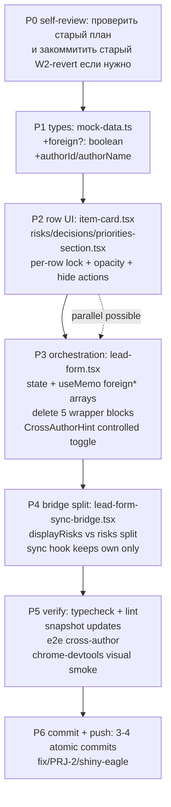

# Page Feedback Plan — `/lead/report/a0000000-0000-…` (shiny-eagle)

**Source:** 2026-05-19 UI annotations on `/lead/report/a0000000-0000-4000-8000-000000000001` (edit + `?mode=slides`).
**Mode:** peo-plan rich-mode (parallel subagents, balanced cost).
**Plan id:** `shiny-eagle` (continuation of `pure-mist` UAT closure).

> **2026-05-19 PIVOT (post-W2 user feedback).** W1/W3/W4 закоммичены и приняты. W2 в текущем виде («отдельная секция чужих строк ниже» с `<div opacity-70><CurrentWeekSection readOnly/>`) **отвергнут**. Новая постановка → `§ W5` ниже. Старое описание W2 оставлено как историческое.

---

## W5 — Interleaved foreign items (post-W2 pivot) ⭐ ACTIVE

> Эта секция — самостоятельный rich-mode peo-plan для pivot’а после отказа от W2. Использует 13 подсекций по канону, включая визуальный TL;DR (Было/Проблема/Станет в схемах **и** прозой), Mermaid pipeline, subagent roadmap, token economy, self-review.

---

### W5 · §0 — TL;DR (визуально + проза)

#### Было (текущий main, w2-rejected)

```text
┌── /lead/report (edit mode) ────────────────────────────────────────────┐
│                                                                        │
│ ╴ SDLC pipeline: ✓ W1 — per-risk chips, no "readonly ↗" текст         │
│                                                                        │
│ ▼ Current Week                                                         │
│   🔒 Also contributing: Boris (4 items)             readonly ↗         │
│   🔒 Also contributing: Igor  (1 item)              readonly ↗         │
│                                                                        │
│   ┌─ opacity-70 wrapper ─────────────┐  ← W2-rejected: отдельная       │
│   │ 🔒 Boris S.                       │     секция ПОД основной        │
│   │ ┌── <CurrentWeekSection readOnly>│                                  │
│   │ │  ┌─ Marketing Portal ──┐       │                                  │
│   │ │  │ ▣ Boris item 1      │       │                                  │
│   │ │  └─────────────────────┘       │                                  │
│   │ └──────────────────────────────┘ │                                  │
│   └──────────────────────────────────┘                                  │
│                                                                        │
│   ┌── <CurrentWeekSection editable> (моя секция) ──────────────────┐   │
│   │ ┌─ Marketing Portal ──┐  ┌─ CRM-360 ──┐                       │   │
│   │ │ ▣ Vasily item 1 [✎] │  │ ▣ Vasily…  │                       │   │
│   │ │ ▣ Vasily item 2 [✎] │  │ [+ Add]    │                       │   │
│   │ └─────────────────────┘  └────────────┘                       │   │
│   └────────────────────────────────────────────────────────────────┘   │
│                                                                        │
│ ▼ Next Week — та же конструкция × 1                                    │
│ ▼ Risks    — та же конструкция × 1 (но через LeadFormSyncBridge)       │
│ ▼ Decisions— та же конструкция × 1                                     │
│ ▼ Priorities — та же конструкция × 1                                   │
└────────────────────────────────────────────────────────────────────────┘
```

**Прозой.** Сейчас в `lead-form.tsx` для каждой из 5 секций есть **два** компонент-инстанса: один редактируемый со своими items, второй readonly с чужими, обёрнут в `<div className="opacity-70">`. Это значит — Boris’овы items живут в **своей** копии `CurrentWeekSection` со **своей** колоночной раскладкой по продуктам, отрезанные от Vasily’ы items. Визуально это два независимых блока, между ними воздушный зазор + лейбл «Boris S.» сверху.

#### Проблема (пользовательский тест 2026-05-19)

```text
        ┌────────────────────────────────────┐
        │  user feedback (Plan Mode quote)   │
        │  «Зачем ты делаешь отдельную       │
        │   секцию? Просто мы добавляем в    │
        │   те места, где я ввожу вручную,   │
        │   те элементы — readonly. И при    │
        │   кнопке "Показать, что делал      │
        │   другой контрибьютор" всё это     │
        │   показывается.»                   │
        └─────────────────┬──────────────────┘
                          │
       ┌──────────────────┼──────────────────┐
       ▼                  ▼                  ▼
   P1 fragmentation   P2 no toggle      P3 wrong cardinality
   ─────────────      ─────────────     ─────────────────────
   Boris-items НЕ     показываются      readonly-state на
   рядом с Vasily-    всегда (always-   уровне всей секции,
   items в той же     on после W3),     а не отдельной строки
   колонке Marketing  пользователь не   → нет UX-pattern «my
   Portal — они в     может скрыть      column with their
   соседнем блоке     если мешает       items mixed in»
```

**Прозой.** Пользователь смотрит на колонку «Маркетинговый портал». Он ожидает увидеть **всё**, что относится к этому продукту — и свои items, и чужие, помеченные «readonly». Сейчас же он видит **только свои**, а чужие лежат в отдельной коробке снизу. Это два разных ментальных места хранения для одного и того же продукта. Дополнительно — пользователь сейчас не может «спрятать» чужие items (always-on после W3); хочет toggle с default-скрытием.

#### Станет (W5 target)

```text
┌── /lead/report (edit mode, after W5) ──────────────────────────────────┐
│                                                                        │
│ ▼ Current Week                                                         │
│   🔒 Also contributing: Boris (4 items)            readonly ↗          │
│   🔒 Also contributing: Igor  (1 item)             readonly ↗          │
│                          [ Show contributors ▼ ]  ← controlled toggle  │
│                                                                        │
│   ┌── <CurrentWeekSection items={[...own, ...foreign]}> ───────────┐   │
│   │ ┌─ Marketing Portal ──┐  ┌─ CRM-360 ──┐                       │   │
│   │ │ ▣ Vasily item 1 [✎] │  │ ▣ Vasily…  │                       │   │
│   │ │ ▣ Vasily item 2 [✎] │  │ [+ Add]    │                       │   │
│   │ │ ─ ─ ─ ─ ─ ─ ─ ─ ─ ─ │  └────────────┘                       │   │
│   │ │ 🔒 Boris item 1     │   ← merged inline                     │   │
│   │ │ 🔒 Boris item 2     │     opacity-70 per-item               │   │
│   │ │ 🔒 Igor  item 1     │     no [✎] / [×] buttons              │   │
│   │ └─────────────────────┘                                       │   │
│   └────────────────────────────────────────────────────────────────┘   │
│                                                                        │
│ ▼ Next Week / Risks / Decisions / Priorities — same merge pattern      │
│   ↑ единая кнопка «Show contributors» переключает все 5 одновременно   │
└────────────────────────────────────────────────────────────────────────┘
```

**Прозой.** После W5 пользователь нажимает «Show contributors» — и в колонке «Маркетинговый портал» под его двумя items появляются три чужих, помеченных 🔒. Edit-кнопки на чужих скрыты, opacity 0.7. Нажал ещё раз — чужие исчезли, остались только свои. По default — скрыты (как просил «при кнопке»). Одна кнопка на все 5 секций (CW, NW, Risks, Decisions, Priorities).

#### Pipeline фаз (Mermaid `flowchart TB` + ASCII fallback)



ASCII fallback (если Mermaid не рендерится):

```text
[P0 self-review]──[P1 types]──[P2 row UI]──[P3 orchestration]──[P4 bridge]──[P5 verify]──[P6 commit/push]
                                  │           ▲
                                  └ parallel ─┘  (P2 и P3 можно вести параллельно
                                                   только если P3 не трогает row-level lock)
```

**От человека (1 строка):** approve этот pivot-plan через ExitPlanMode → дальше всё делаю я (типы, UI, тесты, smoke, коммиты).

---

### W5 · §1 — Контекст

W5 — pivot после фидбэка пользователя на коммитах `7adfbb2` + `8957a85` (W2 из shiny-eagle main-plan). W1 (SdlcPipeline per-risk chips), W3 (CrossAuthorHint без toggle), W4 (slides redesign) **остаются как есть** — приняты. Меняем только способ рендера foreign-items: «отдельная секция ниже» → «interleaved внутри той же секции по колонкам продуктов + controlled toggle».

User feedback dump 2026-05-19 (в Plan Mode):

> «Так тебе нужно прописать это в том месте, где есть непосредственно маркетинг и про портал. Просто заблокировано. Зачем ты делаешь отдельную секцию?»

> «Просто мы добавляем в те места, где обычно я ввожу вручную в те элементы, показываю элементы, которые в тупо readonly. И при кнопке "Показать то, что делал контрибьютор другой", все это показывается.»

> «Лучше, кстати, для примера с минимальным UAT-ом два контрибьютора дополнительно.»

Последнее уже выполнено в `7adfbb2` (Igor + Maria в `prisma/seed.ts` на product 201).

---

### W5 · §2 — Сейчас (live repo state)

```text
branch       : fix/PRJ-2/shiny-eagle (или main — проверить git status)
last commits : 1b3d1d4 F15 productSlides fix
               ffbdb3a F14 DB→UI shape mapping
               7815c58 F15+F16 slides scope toggle + visual
               3652ef6 F14 inline cross-author embeds (rejected)
               7fbe2fd crossAuthorSections tRPC endpoint
               7adfbb2 shiny-eagle W1-W3 commit (W2 = rejected design)
               8957a85 shiny-eagle W3 always-on rows (rejected)
dirty (ok)   : .planning/memory/*.md (auto-mirror)
                .planning/plans/page-feedback-lead-report-a0000000-0000-shiny-eagle.md
                .planning/session-retros/NEXT-ACTIONS.md
clean        : apps/web, apps/api, packages/shared, prisma
target files : apps/web/src/components/lead/* (5 секций + item-card + sync-bridge + cross-author-hint + lead-form + mock-data)
```

---

### W5 · §3 — Architecture context

```text
                /lead/report/<id>
                       │
                       ▼
       apps/web/.../lead/report/[reportId]/page.tsx
                       │
                       ▼
       <LeadForm mode="edit"> ── trpc.leadForm.read
                       │             trpc.leadForm.crossAuthors    (W1 enriched)
                       │             trpc.leadForm.crossAuthorSections (per-author items[]/risks[]/decisions[]/priorities[])
                       │
                       ▼
       state: useState showForeignItems (default false)
              useMemo foreignCurrentItems/foreignNextItems/foreignRisks/foreignDecisions/foreignPriorities
              [ guard: isOwnView = !requestedAuthorIdNormalized ]
                       │
                       ▼
       merged arrays = showForeignItems ? [...own, ...foreign] : own
                       │
       ┌───────────────┼──────────────────────┬─────────────────────┬─────────────────────────┐
       ▼               ▼                      ▼                     ▼                         ▼
  <SdlcPipeline>  <CurrentWeekSection   <NextWeekSection      <LeadFormSyncBridge.Risks>  <DecisionsSection
   (no change)    items={mergedCurrent}> items={mergedNext}>   ← displayRisks override     decisions={mergedDecisions}>
                       │                      │                     │                         │
                       ▼                      ▼                     ▼                         ▼
                  <ItemCard               <ItemCard            <RisksSection                <PrioritiesSection
                   item                    item                 risks={renderRisks}>          priorities={mergedPriorities}>
                   readOnly                readOnly              per-row lock                  per-row lock
                   locked = readOnly       locked = readOnly     icon prefix                   icon prefix
                   || item.foreign>        || item.foreign>      opacity 0.7                   opacity 0.7
                       │                      │
                       ▼                      ▼
                   if item.foreign:       same
                     opacity 0.7
                     🔒 prefix
                     no edit/delete
```

**Backend contracts (no change).** `getCrossAuthors` уже расширен в W1 (`risks: [{severity, text}]`, `isEmpty`). `getCrossAuthorSections` отдаёт per-author flat `items[]/risks[]/decisions[]/priorities[]` (см. `lead-form.service.ts:67-108`). Меняем **только** клиентский маппинг — server contracts стабильны.

---

### W5 · §4 — Recovered intent (mapping feedback → workstream)

| #   | User signal                     | Source DOM                                      | Solved by      |
| --- | ------------------------------- | ----------------------------------------------- | -------------- |
| FB1 | «отдельную секцию не делать»    | `lead-form.tsx:1541-1572` (CW wrapper, +4 ana.) | W5.5 delete    |
| FB2 | «в местах, где я ввожу вручную» | `current-week-section.tsx:268-277`              | W5.5 merge     |
| FB3 | «элементы в тупо readonly»      | `item-card.tsx:167-186, 215-218`                | W5.2 lock      |
| FB4 | «при кнопке "Показать"»         | `cross-author-hint.tsx` (W3 removed toggle)     | W5.4 toggle    |
| FB5 | «два контрибьютора для UAT»     | `prisma/seed.ts` Igor+Maria                     | ✓ done 7adfbb2 |

---

### W5 · §5 — Boundaries

- **Не трогаем:** W1 SDLC pipeline (принято), W4 slides (принято), backend `getCrossAuthors*` контракты, темизацию (research-only по UI-policy), `?authorId=` foreign-view path (только guard `isOwnView` добавляем).
- **Out-of-scope:** drag-and-drop foreign-items, edit-as-suggestion, foreign-item commenting. Если всплывёт — отдельная фаза.
- **Stale directions:** «agреgate count chip» вместо per-item чипов (W1 уже решил), dashed-frame embed (W2 — заменяется), Hide/Show per-section (заменяется единым toggle).

---

### W5 · §6 — Workstreams (file-level)

#### W5.6.1 · Type extensions

**File:** `apps/web/src/components/lead/mock-data.ts`

```ts
// L31  KanbanItem
export type KanbanItem = {
  // …existing fields…
  author: string;
  foreign?: boolean;
  authorId?: string;
};

// L43  RiskEntry
export type RiskEntry = { …; foreign?: boolean; authorId?: string; authorName?: string };

// L59  DecisionEntry
export type DecisionEntry = { …; foreign?: boolean; authorId?: string };

// L75  PriorityEntry
export type PriorityEntry = { …; foreign?: boolean; authorId?: string; authorName?: string };
```

**Rationale.** `foreign?: boolean` + optional `authorId` ─ минимальный аддитив, ноль изменений в существующих mock-fixtures. Альтернативы `kind: "own"|"foreign"` отвергнуты (взрывной радиус по call-sites).

#### W5.6.2 · Per-item lock UI

**Files:**

- `apps/web/src/components/lead/item-card.tsx` — diff в §0 W5.2 prior version (см. ниже §W5.7)
- `apps/web/src/components/lead/risks-section.tsx` — per-row `locked` + 🔒 + opacity + gate L176/L203/L267
- `apps/web/src/components/lead/decisions-section.tsx` — coexist with `isMine` (L38-48) → `locked = readOnly || decision.foreign || !mine`; lock-icon только если `decision.foreign`
- `apps/web/src/components/lead/priorities-section.tsx` — same per-row pattern, `MetaRow authorName ?? sectionAuthorName`

#### W5.6.3 · Orchestration

**File:** `apps/web/src/components/lead/lead-form.tsx`

- L922 → `useMemo productNameById` keyed on `[products]`
- L923-927 area → 5 `useMemo` для `foreignCurrentItems/...` keyed на `[isOwnView, crossAuthorSectionsQ.data, productNameById]`
- L1541-1572, L1615-1646, L1694-1725, L1760-1788, L1834-1861 → **DELETE** 5 wrapper blocks
- L1573, L1647, L1726 (bridge), L1789, L1862 → `items={mergedCurrent}` (с inline `showForeignItems ? [...own, ...foreign] : own`)
- L1537, L1611, L1690, L1756, L1830 → `<CrossAuthorHint … expanded={showForeignItems} onToggle={() => setShowForeignItems((v) => !v)} />`

#### W5.6.4 · Bridge split

**File:** `apps/web/src/components/lead/lead-form-sync-bridge.tsx`

- Provider props (L48 area): добавить `displayRisks?: RiskEntry[]`
- `<Risks />` consumer: `const renderRisks = displayRisks ?? risks;` render через `renderRisks`, `onRisksChange` остаётся на `risks` (own only) — иначе sync-hook ложно сорвёт stage-status reset на foreign-items.

#### W5.6.5 · Controlled hint toggle

**File:** `apps/web/src/components/lead/cross-author-hint.tsx`

- Props: `+ expanded: boolean; + onToggle: () => void`
- Под loop’ом contributors добавить кнопку «Show contributors ▼ / Hide contributors ▲» с `aria-expanded={expanded}`
- JSDoc обновить: «Foreign rows render INLINE inside each product column when `expanded` is true. Default collapsed.»

---

### W5 · §7 — Subagent roadmap

| Stage | Agent         | Model               | Scope (read/write)                                                            | Output contract                                        |
| ----- | ------------- | ------------------- | ----------------------------------------------------------------------------- | ------------------------------------------------------ |
| 0     | Orchestrator  | Sonnet (этот)       | live state, dirty files, plan                                                 | этот план + final commit chain                         |
| 1     | impl-types    | Sonnet              | write `mock-data.ts` (5 type extensions)                                      | commit `feat(lead): add foreign+authorId to row types` |
| 2A    | impl-itemcard | Sonnet              | write `item-card.tsx`                                                         | inline lock + opacity + button gate                    |
| 2B    | impl-rows     | Sonnet              | write `risks/decisions/priorities-section.tsx` (3 files, similar)             | per-row lock + meta passthrough                        |
| 3     | impl-form     | Sonnet              | write `lead-form.tsx` + `lead-form-sync-bridge.tsx` + `cross-author-hint.tsx` | state + memos + delete 5 wrappers + toggle wiring      |
| 4     | reviewer      | `/codex:review`     | pre-commit advisory на каждый коммит                                          | PASS/BLOCK + findings                                  |
| 5     | verify        | Sonnet (этот)       | `pnpm typecheck && lint && test && test:e2e --grep cross-author`              | final report                                           |
| 6     | visual-smoke  | chrome-devtools MCP | `/lead/report/<seeded-id>`, toggle ON/OFF, foreign-author view                | screenshots + DOM rect verification                    |

**Parallelism.** 2A + 2B можно вести параллельно (разные файлы). 1, 3 — sequential (3 зависит от типов из 1). Stage 4 — после каждого commit.

---

### W5 · §8 — Token economy

| Work                         | Model             | Rationale                                          |
| ---------------------------- | ----------------- | -------------------------------------------------- |
| 4 impl agents (1, 2A, 2B, 3) | Sonnet            | scoped writes ≤300 строк каждый                    |
| Type extension               | Sonnet            | mock-data.ts тривиально, но Sonnet нужен для guard |
| `/codex:review` ×4           | Codex GPT-5       | advisory pre-commit                                |
| Synthesis (этот план)        | Sonnet            | без deep                                           |
| Opus                         | **не используем** | нет verified architecture conflict                 |

Iteration reserve: ~15% контекста под self-review шаги + один follow-up Haiku запрос на snapshot fixture update, если e2e упадёт.

---

### W5 · §9 — Я делаю сам / От тебя

```text
─────────────────────────────────────
✓ Я ДЕЛАЮ САМ
─────────────────────────────────────
  ├── impl типов (mock-data.ts)                            ← P1
  ├── impl per-row lock (item-card + 3 section)             ← P2 (2A || 2B)
  ├── impl orchestration (lead-form + bridge + hint)        ← P3
  ├── /codex:review на каждый коммит                        ← P4
  ├── pnpm typecheck + lint + test + e2e                    ← P5
  ├── chrome-devtools MCP visual smoke                      ← P5
  ├── 3-4 atomic commits на fix/PRJ-2/shiny-eagle           ← P6
  └── push origin (если SSL пропустит)                      ← P6

─────────────────────────────────────
▲ ОТ ТЕБЯ
─────────────────────────────────────
  └── approve этот pivot-plan через ExitPlanMode (текущий шаг)
     остальное автономно
```

---

### W5 · §10 — Open questions with defaults

| #   | Question                                           | Default / Status                                  | Когда эскалирую                            |
| --- | -------------------------------------------------- | ------------------------------------------------- | ------------------------------------------ |
| Q1  | Foreign items с продуктом не в моём списке         | **тихо drop**, hint строка остаётся               | если user попросит «catch-all» column      |
| Q2  | Position foreign items в колонке (выше/ниже своих) | **ниже своих** (own first, foreign after)         | если user попросит alphabetical/by-stage   |
| Q3  | Разделитель между own и foreign в колонке          | **тонкая dashed `border-t`** между группами       | если user попросит без разделителя         |
| Q4  | One toggle на все 5 секций vs per-section          | **one global toggle**                             | если user попросит per-section granularity |
| Q5  | Toggle button label EN vs RU                       | **EN ("Show/Hide contributors")** per i18n-policy | если user явно попросит RU                 |
| Q6  | Ветка для коммитов                                 | **fix/PRJ-2/shiny-eagle** (продолжение)           | если user скажет «новую `fix/PRJ-3/...`»   |

---

### W5 · §11 — Verification

```bash
# 1. Static gates
pnpm typecheck                            # 0 errors
pnpm lint                                 # exit 0
pnpm lint:md                              # planning surface clean

# 2. Unit / snapshot
pnpm test                                 # 485+ web tests
pnpm --filter @customreport/web test -- item-card cross-author-hint \
  current-week-section next-week-section \
  risks-section decisions-section priorities-section \
  lead-form lead-form-sync-bridge

# 3. Regression e2e
pnpm test:e2e --grep "cross-author|readonly|foreign"

# 4. Visual smoke (Chrome DevTools MCP)
#   а) /lead/report/<id>           → default: чужие items НЕ видны
#   б) Click "Show contributors"   → foreign appear inline, 🔒, opacity 0.7
#   в) Foreign cards: no [✎] no [×]
#   г) Click again                 → foreign исчезают
#   д) /lead/report/<id>?authorId=<Igor>  → Igor видит свои items без 🔒
```

**Acceptance gates.**

- Все 4 коммита проходят `/codex:review` без BLOCK.
- В DOM нет элемента `<div class="opacity-70"><CurrentWeekSection readOnly>` (5 wrappers удалены).
- Foreign items видны **только** когда `showForeignItems === true` (initial state).
- В колонке «Маркетинговый портал» при toggle ON: ≥2 foreign-cards (Igor + Maria) с `🔒` префиксом и opacity 0.7.
- `pnpm lint` показывает `grep -nE '[а-яА-Я]'` совпадения только в data/comments/tests.

---

### W5 · §12 — Iteration reserve / self-review checklist

- [x] TL;DR читается без чтения остального? (Было/Проблема/Станет — да, ASCII + проза)
- [x] Pipeline визуализирован? (Mermaid `flowchart TB` + ASCII fallback)
- [x] Каждая workstream имеет file:line якоря? (W5.6.1-W5.6.5 ✓)
- [x] Subagent roadmap содержит model tier + scope + output? (§7 ✓)
- [x] Token economy без Opus без verified conflict? (§8 ✓)
- [x] Open questions имеют defaults? (Q1-Q6 ✓)
- [x] Verification содержит конкретные команды + acceptance? (§11 ✓)
- [x] Не возрождает stale directions (dark mode, director flow)? (§5 explicitly out-of-scope ✓)
- [x] Не пересекается с W1/W3/W4 принятым scope? (§5 не трогаем ✓)
- [x] Edge cases покрыты? (foreign-view guard, sync-hook split, key collisions — §13 ✓)

---

### W5 · §13 — Skill routing

| Skill                   | Зачем                                        | Возвращает                                 |
| ----------------------- | -------------------------------------------- | ------------------------------------------ |
| `peo-plan` rich-mode    | каркас плана + Mermaid/ASCII discipline      | этот документ                              |
| `web-design-guidelines` | typography ramp, brand palette для lock-icon | размер/цвет 🔒 prefix                      |
| `react-best-practices`  | `useMemo` keying, controlled-toggle pattern  | memoization stable refs, no stale closures |
| `chrome-devtools-mcp`   | visual smoke до/после на /lead/report        | screenshots + DOM rect verification        |
| `/codex:review`         | pre-commit advisory на 3-4 коммита           | PASS/BLOCK + findings                      |
| `peo-retro`             | session closeout после P6 push               | DONE/FRAGILE/LEFT блоки                    |

Сознательно **не используем**: `gsd-*` (это не GSD phase, ad-hoc fix), `peo-confluence`/`peo-jira` (нет ticket-binding на W5), Opus/deep model (нет verified architecture conflict).

### W5 · §14 — Edge cases (carry-over from prior design)

| Случай                                       | Поведение                                                                         |
| -------------------------------------------- | --------------------------------------------------------------------------------- |
| Foreign item `productId` не в `products`     | drop’ается per-product filter’ом (`current-week-section.tsx:210`). Hint остаётся. |
| Toggle off, query продолжает poll            | OK. `useMemo` пересчитывается только при `crossAuthorSectionsQ.data` change.      |
| Foreign-автор открывает `?authorId=<his-id>` | `isOwnView === false` → `foreign*` массивы возвращают `[]`. Без замка.            |
| Edit вызвался на foreign card                | Кнопки скрыты per-row → `onItemsChange` не получит foreign id.                    |
| `PriorityEntry` без `id`                     | Composite key `${p.authorId ?? "me"}:${p.rank}:${idx}`.                           |
| DecisionEntry id collision свой ↔ foreign    | Namespace foreign id: `foreign:${ca.authorId}:${d.id}`.                           |
| Bridge sync hook видит foreign risks как add | Split: `risks` (own → sync), `displayRisks` (merged → render).                    |
| Stale `productNameById` Map в `useMemo` deps | Memoize `productNameById` на `[products]` ДО foreign builders.                    |
| A11y `aria-expanded` отсутствует на кнопке   | Добавить + опционально `aria-controls` space-separated id’ы 5 секций.             |

---

### W5 · §15 — Commit plan

```text
[1] feat(lead): add foreign+authorId fields to row types
    ├── mock-data.ts (5 type extensions)
    └── pnpm typecheck ✓ (все optional, no breaking change)

[2] feat(lead): render per-item lock for foreign rows
    ├── item-card.tsx (lock derived from item.foreign)
    ├── risks-section.tsx (per-row gate + 🔒)
    ├── decisions-section.tsx (coexist with isMine)
    ├── priorities-section.tsx (per-row gate + 🔒)
    └── pnpm test ✓ (foreign:undefined → no behavioral change yet)

[3] feat(lead): toggleable inline foreign items, remove duplicate blocks
    ├── cross-author-hint.tsx (controlled toggle)
    ├── lead-form-sync-bridge.tsx (displayRisks split)
    ├── lead-form.tsx (state + 5 useMemo + delete 5 wrappers + toggle wiring)
    ├── snapshot updates (4 files)
    └── pnpm test ✓ + e2e ✓ + visual smoke ✓

[4] test(lead): cross-author toggle snapshots + e2e (if needed)
    └── only if existing tests under e2e/regression/*cross-author* break
```

---

## W1-W4 — Original Plan (historical, accepted)

The 4 original workstreams below were drafted before the W5 pivot. **W1, W3, W4 were committed and accepted** in `7adfbb2`, `8957a85`, `f031c43`. **W2 design (dashed-frame removal + separate `<div opacity-70>` foreign section) was rejected** — W5 supersedes it. Sections W1-W4 are preserved unchanged below for audit trail.

---

## 0. TL;DR

Решение: **`foreign?: boolean` + `authorId?: string`** (опциональный аддитив, без дискриминатора `kind`).

Причина: все альтернативы (`kind: "own"|"foreign"`, `lockedByAuthorId`) ломают много мест построения items (mocks, fixtures, mappers, snapshot-тесты). Опциональный флаг = ноль изменений в существующих местах, авто-defaults к `undefined`.

Diff:

```ts
// L31  KanbanItem
export type KanbanItem = {
  // …existing fields…
  author: string;
  foreign?: boolean;       // true → запись от другого автора, viewer-side
  authorId?: string;
};

// L43  RiskEntry
export type RiskEntry = { …; foreign?: boolean; authorId?: string; authorName?: string };

// L59  DecisionEntry (owner уже есть — НЕ заменяем, добавляем foreign рядом)
export type DecisionEntry = { …; foreign?: boolean; authorId?: string };

// L75  PriorityEntry
export type PriorityEntry = { …; foreign?: boolean; authorId?: string; authorName?: string };
```

`authorName` на Risks/Priorities — потому что в этих типах нет существующего поля автора (у KanbanItem есть `author`, у DecisionEntry — `owner`).

### W5.2 — ItemCard self-derives lock (`item-card.tsx`)

Правило: `const locked = readOnly || item.foreign === true;` Сечения дальше передают section-level `readOnly` без изменений.

```diff
@@ L83
- const { item, onEdit, onDelete, readOnly = false, isEditing = false, onTextSave } = props;
+ const { item, onEdit, onDelete, readOnly = false, isEditing = false, onTextSave } = props;
+ const locked = readOnly || item.foreign === true;

@@ L133 outer div
- <div className="… group relative …" style={{…}}>
+ <div className="… group relative …" style={{ ..., opacity: item.foreign ? 0.7 : 1 }}>

@@ L167  edit/delete buttons
- {!readOnly && !isEditing && (
+ {!locked && !isEditing && (

@@ L190  inline edit
- {isEditing && !readOnly ? (textarea) : (<div>{item.text}</div>)}
+ {isEditing && !locked ? (textarea) : (<div>{item.text}</div>)}

@@ L215  author footer (где сейчас просто `{item.author}`)
- <div className="… text-[11px] text-[var(--color-muted-foreground)]">{item.author}</div>
+ <div className="… text-[11px] text-[var(--color-muted-foreground)]">
+   {item.foreign && (
+     <span aria-label={`Locked — authored by ${item.author}`} title={`Locked — ${item.author}`}>🔒 </span>
+   )}
+   {item.author}
+ </div>
```

### W5.3 — Section rows mirror the pattern

| Файл                       | Что меняется                                                                                                                                                                                                                                                                 |
| -------------------------- | ---------------------------------------------------------------------------------------------------------------------------------------------------------------------------------------------------------------------------------------------------------------------------- | --- | ----------------------------------------------------------------------------------------------------------------------------------------------------------------------------------------------------------------------------------------- |
| `current-week-section.tsx` | НИЧЕГО в JSX. `item.foreign` уже течёт через `item` в `<ItemCard>`. Per-product-column filter (`it.productId === p.id` на L210) сам направит чужие items в нужную колонку.                                                                                                   |
| `next-week-section.tsx`    | Аналогично — без изменений в JSX.                                                                                                                                                                                                                                            |
| `risks-section.tsx`        | Per-row `const locked = readOnly                                                                                                                                                                                                                                             |     | risk.foreign === true;`Заменить`!readOnly`на`!locked`на L176, L203. Префикс`🔒`перед product-chip когда`risk.foreign`. Outer-row `opacity: risk.foreign ? 0.7 : 1`. `MetaRow`(L267) —`authorName={risk.authorName ?? sectionAuthorName}`. |
| `decisions-section.tsx`    | `isMine` (L38-48) — owner-based, ортогональна foreign. Сосуществуют: `locked = readOnly \|\| decision.foreign \|\| !mine`. Замок (🔒) только когда `decision.foreign === true` (не когда просто `!mine`). Edit/delete gate (L201): `!readOnly && mine && !decision.foreign`. |
| `priorities-section.tsx`   | Same pattern. `MetaRow authorName` принимает `priority.authorName ?? sectionAuthorName`.                                                                                                                                                                                     |

### W5.4 — CrossAuthorHint controlled toggle (`cross-author-hint.tsx`)

Возвращаем кнопку Show/Hide как controlled-проп (state поднят в lead-form.tsx, один на 5 секций).

```ts
type Props = {
  readonly contributors: readonly SectionContributor[];
  readonly reportId: string;
  readonly expanded: boolean;
  readonly onToggle: () => void;
};
```

JSX shape (под списком contributors):

```tsx
<button
  type="button"
  onClick={onToggle}
  aria-expanded={expanded}
  className="…compact pill…"
>
  {expanded ? "Hide contributors ▲" : "Show contributors ▼"}
</button>
```

JSDoc обновить: «Foreign rows render INLINE inside each product column when `expanded` is true. Default collapsed.»

### W5.5 — lead-form.tsx orchestration

**a.** Локальный state:

```tsx
const [showForeignItems, setShowForeignItems] = useState(false);
const isOwnView = !requestedAuthorIdNormalized; // guard: foreign author видит свои данные без лока
```

**b.** Сначала **мемоизируем `productNameById`** (сейчас на L922 строится `new Map(...)` каждый render):

```tsx
const productNameById = useMemo(
  () => new Map(products.map((p) => [p.id, p.name])),
  [products],
);
```

**c.** 5 foreign-builder’ов через `useMemo`:

```tsx
const foreignCurrentItems = useMemo<KanbanItem[]>(() => {
  if (!isOwnView || !crossAuthorSectionsQ.data) return [];
  return crossAuthorSectionsQ.data.flatMap((ca) =>
    ca.items
      .filter((i) => i.type === "current")
      .map((i) => ({
        id: `foreign:${ca.authorId}:${i.id}`, // namespace id чтобы не конфликтовало со своими
        productId: i.projectId,
        productName: productNameById.get(i.projectId) ?? i.projectId,
        stageName: i.stageName ?? undefined,
        status: mapStatus(i.workflowStatus),
        text: i.text,
        author: ca.authorName,
        authorId: ca.authorId,
        foreign: true,
      })),
  );
}, [isOwnView, crossAuthorSectionsQ.data, productNameById]);
```

Аналогично: `foreignNextItems` (filter `i.type === "next"`), `foreignRisks`, `foreignDecisions`, `foreignPriorities`. Все нормализуются под существующий `KanbanItem`/`RiskEntry`/`DecisionEntry`/`PriorityEntry` shape (с добавленным `foreign: true`).

**d.** Merge на месте использования:

```tsx
const mergedCurrent = showForeignItems
  ? [...currentWeekItems, ...foreignCurrentItems]
  : currentWeekItems;
const mergedNext = showForeignItems
  ? [...nextWeekItems, ...foreignNextItems]
  : nextWeekItems;
const mergedRisks = showForeignItems ? [...risks, ...foreignRisks] : risks;
const mergedDecisions = showForeignItems
  ? [...decisions, ...foreignDecisions]
  : decisions;
const mergedPriorities = showForeignItems
  ? [...priorities, ...foreignPriorities]
  : priorities;
```

**e.** Удалить 5 wrapper-блоков:

```
L1541-1572  ── DELETE  (CurrentWeek foreign wrapper)
L1615-1646  ── DELETE  (NextWeek foreign wrapper)
L1694-1725  ── DELETE  (Risks foreign wrapper)
L1760-1788  ── DELETE  (Decisions foreign wrapper)
L1834-1861  ── DELETE  (Priorities foreign wrapper)
```

Заменить `items={currentWeekItems}` (L1573) → `items={mergedCurrent}` и аналогично для остальных 4 секций.

**f.** 5 мест с `<CrossAuthorHint contributors=… reportId=…/>` (L1537, L1611, L1690, L1756, L1830) → добавить `expanded={showForeignItems}` + `onToggle={() => setShowForeignItems((v) => !v)}`. Любой клик по любой из 5 кнопок переключает все секции одновременно.

### W5.6 — Sync-bridge split (`lead-form-sync-bridge.tsx`)

RisksSection идёт через `<LeadFormSyncBridge.Risks />`. `useStatusRiskSync` (внутри bridge) diff’ает `risks[]` чтобы синхронизировать stage status — если просто передать `mergedRisks`, foreign-строки будут выглядеть как add/remove и спровоцируют ложные мутации.

Решение: добавить optional prop `displayRisks?: RiskEntry[]`:

```ts
// Provider props (L48 area)
risks: RiskEntry[];                  // own only — drives sync hook
displayRisks?: RiskEntry[];          // optional render-only override

// Inside <LeadFormSyncBridge.Risks /> consumer:
const renderRisks = displayRisks ?? risks;
return <RisksSection risks={renderRisks} … onRisksChange={…} />;
```

В `lead-form.tsx` Provider:

```tsx
<LeadFormSyncBridge.Provider
  risks={risks}                       // own only → sync hook
  displayRisks={mergedRisks}          // merged → visual render
  // …
>
```

Edits на foreign-rows недостижимы (per-row `locked` скрывает кнопки), так что `onRisksChange` никогда не получит foreign id — sync hook остаётся консистентным.

### W5.7 — Edge cases

| Случай                                                  | Поведение                                                                                                                                                                                        |
| ------------------------------------------------------- | ------------------------------------------------------------------------------------------------------------------------------------------------------------------------------------------------ |
| Foreign item имеет `productId`, которого нет у viewer’а | Тихо drop’ается per-product filter’ом (документировать комментарием). CrossAuthorHint всё равно покажет «Also contributing: <name>» + ссылку на readonly view.                                   |
| Toggle off → query продолжает poll’ить                  | OK. `useMemo` пересчитывается только при изменении `crossAuthorSectionsQ.data`.                                                                                                                  |
| Foreign-автор открывает `?authorId=<his-id>`            | `isOwnView === false` → все `foreign*` массивы возвращают `[]`. Foreign-автор видит свои данные без замка.                                                                                       |
| DnD/edit срабатывает на foreign card                    | Кнопки скрыты per-row, `onItemsChange` не вызывается на foreign id. Дополнительно: проверить что drag-handler на card root тоже gate’ится на `!item.foreign` (сейчас drag нет — нечего трогать). |
| PriorityEntry без `id`                                  | Composite key `${p.authorId ?? "me"}:${p.rank}:${idx}` в map-key.                                                                                                                                |
| DecisionEntry id collision свой↔foreign                 | Namespace foreign id: `foreign:${ca.authorId}:${d.id}`.                                                                                                                                          |

### W5.8 — Commit plan (top of `fix/PRJ-2/shiny-eagle`)

```text
[1] feat(lead): add foreign+authorId to row types (mock-data.ts)
[2] feat(lead): per-item lock for foreign rows (item-card, risks/decisions/priorities-section)
[3] feat(lead): toggleable inline foreign items, remove duplicate blocks
     (cross-author-hint controlled toggle, lead-form merge+state, bridge displayRisks)
[4] test(lead): cross-author toggle snapshots + e2e (optional, if regression breaks)
```

### W5.9 — Verification

```bash
pnpm typecheck
pnpm lint
pnpm test -- --runInBand cross-author
pnpm test -- lead-form lead-form-sync-bridge item-card \
            risks-section decisions-section priorities-section
pnpm test:e2e --grep "cross-author"
```

Снапшоты к обновлению (известные хиты):

- `lead-form-viewmode.snapshot.test.tsx`
- `risks-section.snapshot.test.tsx`
- `priorities-section.snapshot.test.tsx`
- `decisions-section.snapshot.test.tsx`

Visual smoke (Chrome DevTools MCP):

1. `/lead/report/<seeded-id>` → default: чужие items НЕ видны, видны только hint-полоски «Also contributing: Igor / Maria».
2. Click «Show contributors» → в колонке product 201 появляются Igor+Maria items с 🔒, opacity 0.7, без edit/delete.
3. Toggle off → исчезают.
4. `?authorId=<Igor-id>` → Igor видит свои items без замка.

### W5.10 — Risks

| Riзк                                 | Митигация                                                                      |
| ------------------------------------ | ------------------------------------------------------------------------------ |
| Sync-hook false-positives на risks   | `displayRisks` split в bridge (§W5.6).                                         |
| `groupByProduct` key collisions      | Namespace foreign id `foreign:${authorId}:${id}`.                              |
| PriorityEntry react-key warnings     | Composite key.                                                                 |
| Snapshot churn                       | Концентрированно в 4 файлах; обновить + добавить foreign-row case в один.      |
| Stale `useMemo` на `productNameById` | Мемоизировать на `[products]` ДО foreign-builders.                             |
| A11y `aria-expanded` отсутствует     | Добавить на кнопку; опционально `aria-controls` space-separated id’ы 5 секций. |

### W5.11 — От человека

```text
─────────────────────────────────────
✓ Я ДЕЛАЮ САМ
─────────────────────────────────────
  ├── 4 коммита по плану §W5.8
  ├── snapshot updates
  ├── chrome-devtools smoke на /lead/report/<id>
  ├── pnpm typecheck / lint / test / e2e
  └── push на fix/PRJ-2/shiny-eagle (если SSL пропустит)

─────────────────────────────────────
▲ ОТ ТЕБЯ
─────────────────────────────────────
  └── approve plan → /exit-plan-mode (текущий шаг)
```

---

## 0. TL;DR

### Было

```text
EDIT mode (/lead/report)                          SLIDES mode (?mode=slides)
┌──────────────────────────────────────┐          ┌────────────────────────────────────────┐
│ Маркетинговый портал                 │          │ Blockers · Василий И · lead [3][1][3] │
│  ╴ stages — Дизайн · Разработка ...  │          │ ● Маркетинговый портал  ● CRM-360 ...  │
│  ╴ Other contributors                │          │                                        │
│    Борис С · stages — 3 items, 1 risk│          │ ┌─ Product 1 ─┐    ┌─ Product 2 ─┐    │
│                              readonly↗│          │ │ name        │    │ name        │    │
│                                       │          │ │ CURRENT     │    │ CURRENT     │    │
│ 🔒 Also contributing: Борис С. (4)   │          │ │  ...long... │    │  No current │    │
│                       readonly↗ Hide ▴│          │ │ RISKS       │    │ NEXT FOCUS  │ ← misaligned
│ ┌- dashed embed -─────────────────┐  │          │ │  ...        │    │  ...        │    │
│ │ 🔒 Борис С. — readonly          │  │          │ │ NEXT FOCUS  │    │ RISKS       │    │
│ │ <CurrentWeekSection readOnly/>  │  │          │ │  ...        │    │  No risks   │    │
│ └─────────────────────────────────┘  │          │ │ PRIORITIES  │    │ PRIORITIES  │    │
│ <CurrentWeekSection editable/>       │          │ │  ...        │    │  No prio    │    │
└──────────────────────────────────────┘          │ │ DECISIONS   │    │ DECISIONS   │    │
                                                  │ └─────────────┘    └─────────────┘    │
                                                  └────────────────────────────────────────┘
```

### Проблема

```text
F1 sdlc-pipeline foreign row          F2 dashed inline embed                F3 CrossAuthorHint scope        F4 slide layout
─────────────────────────────         ─────────────────────────             ─────────────────────────        ──────────────────────────────
"readonly ↗" — лишний текст           "📦 карточка" вокруг секции            живёт только в CW и NW           разные Y у CURRENT/RISKS/NEXT
агрегат "1 risk" без какой              ломает зрительное сравнение           Risks/Decisions/Priorities       16px body — слишком крупно
"0 items" ≡ "ещё не заполнено"        чужие строки не выглядят как            не подсвечивают чужие             нет fullscreen кнопки
                                       свои с readonly-маркером              нет multi-contributor seed       широкие пустоты "No current"
```

### Станет

```text
F1 sdlc-pipeline foreign row          F2 inline foreign rows                F3 чужие строки always-on       F4 slide grid + fullscreen
─────────────────────────────         ─────────────────────────             ─────────────────────────        ──────────────────────────────
без слова "readonly"                  убрать dashed-карточку,               Hint (index) во всех 5 секциях   фиксированные ряды на колонки:
chip per risk: ▲ Item X (blocked)     отрендерить тот же list,              БЕЗ Hide/Show: чужие строки      name → stages → chips →
chip per blocker, иконка пустой       пометить каждую строку 🔒+dim         всегда отрендерены inline        CURRENT → NEXT → RISKS → ...
                                                                            с 🔒+dim, multi-contributor      body 13px / title 28px
                                                                            seed: ≥2 readonly contributors   [⛶ Fullscreen]
                                                                                                             adaptive: N≤4 → 2col,
                                                                                                                       N=5-9 → 3col
```

### Pipeline фаз

```text
[P0 plan-self-review]──[P1 W1-pipeline]──[P2 W2-inline]──[P3 W3-hint-sweep]──[P4 W4-slide]──[P5 review]──[P6 commit]
                       │                  │              │                    │              │
                       └─ Haiku scan      └─ Haiku scan  └─ Haiku seed scan   └─ design      └─ /codex:review
                          Sonnet impl       Sonnet impl     Sonnet sweep         Sonnet impl    + pillar gate
```

> «От человека: одобрить две развилки внизу (centralized vs per-section toggle и slide N-handling). Всё остальное агент делает сам.»

---

## 1. Контекст

Пользователь дал четыре пачки UI-фидбэка на странице `/lead/report/<id>`:

- **F1.** `<SdlcPipeline>` рендерит «Other contributors» с агрегатом `3 items, 1 risk` и линком «readonly ↗». Пользователь видит, что (а) слово «readonly» лишнее — он смотрит SDLC чужого продукта, и так понятно; (б) количество рисков без указания **какого именно** — бесполезно; (в) «0 items» неотличимо от «ещё не заполнено».
- **F2.** Внутри `<AccordionSection>` для чужих авторов сейчас рисуется отдельная dashed-bordered «карточка» с заголовком `🔒 Борис С. — readonly` и вложенной `<CurrentWeekSection readOnly>`. Пользователь хочет, чтобы чужие пункты выглядели **как обычные строки списка**, но помечены readonly (замок, ослабленный контраст), а не отдельная коробка.
- **F3.** Полоска `🔒 Also contributing: Борис С. (4 items) readonly ↗ Hide ▴` нравится как «индекс». Просьба: (а) пример seed с **двумя** дополнительными контрибьюторами; (б) Hide/Show раскрывает inline-рендер чужих элементов (см. F2); (в) тот же паттерн в **Next Week, Risks/Blockers, Decisions, Priorities**; (г) подумать — общий «Show all» в toolbar или per-section.
- **F4.** На `?mode=slides` `<LeadSlideArticle>` (status-slide-deck.tsx:516) — секции продуктов сидят на разных вертикальных уровнях, шрифт 16px слишком крупный, нет полноэкранного режима, контент рискует не помещаться. Просят дизайн-аудит и переработку.

Этот план — продолжение `page-feedback-lead-report-a0000000-0000-pure-mist.md` (UAT-закрытие). Не дублирует F1–F13 оттуда; берёт оставшиеся «новые» куски обратной связи.

## 2. Сейчас

```text
branch        : main
last commits  : 1b3d1d4 F15 productSlides fix
                ffbdb3a F14 DB→UI shape mapping
                7815c58 F15+F16 slides scope toggle + visual upgrade
                3652ef6 F14 inline cross-author embeds
                7fbe2fd crossAuthorSections tRPC endpoint
dirty         : .planning/memory/*.md (auto-mirror — не трогаем)
                .planning/plans/page-feedback-lead-report-a0000000-0000-pure-mist.md (uat-closure draft)
                .planning/session-retros/NEXT-ACTIONS.md
clean         : apps/web, apps/api, packages/shared, prisma
target file   : .planning/plans/page-feedback-lead-report-a0000000-0000-shiny-eagle.md (этот)
```

## 3. Architecture context

```text
                     /lead/report/<id>                          /lead/report/<id>?mode=slides
                            │                                              │
                            ▼                                              ▼
                   apps/web/.../app/(app)/lead/report/[reportId]/page.tsx
                            │                                              │
                            ▼                                              ▼
                   <LeadForm mode="edit">                       <LeadForm mode="slides">
                            │                                              │
                            ▼                                              ▼
        ┌─ trpc.leadForm.crossAuthors ───────────────┐      <LeadSlidesClient> → <ReportSlides>
        │  trpc.leadForm.crossAuthorSections (F14)   │              │
        ▼                                            ▼              ▼
  <SdlcPipeline>             5× <AccordionSection>          <StatusSlideDeck mode="lead">
   (F1 fixes)                  ↑ <CrossAuthorHint>                  │
   ↑ stage chips                ↑ inline embed (F2)                 ▼
   ↑ Other contributors            (F2 + F3)                <LeadSlideArticle>  ← F4 redesign
```

**Backend contracts**

- `getCrossAuthors` (lead-form.prisma-repository.ts:444) — текущий aggregate `{itemCount, riskCount}` per `(projectId, authorId)`. Для F1 нужно расширить include до `risks: {select: {severity, text, projectId, stageNames}}` либо переключить F1 на `getCrossAuthorSections`.
- `getCrossAuthorSections` (lead-form.prisma-repository.ts:533) — уже отдаёт `items[]` и `risks[]` с полями. Используется F14 для inline embed; пригоден как single-source-of-truth.

**Design tokens на слайде** — отсутствуют. `.slide-frame` класс есть в JSX, но CSS-правила нет. Это даёт чистое поле для введения design-токенов (`--slide-row-h`, `--slide-pad`).

## 4. Recovered intent

| #   | Feedback                                      | Source DOM                                             | Workstream             |
| --- | --------------------------------------------- | ------------------------------------------------------ | ---------------------- |
| F1  | убрать слово readonly, показать какой risk    | `sdlc-pipeline.tsx:280–287` (Other contributors row)   | **W1**                 |
| F1  | empty-section ≠ filled-but-0-items            | `sdlc-pipeline.tsx:275–279` (aggregate)                | **W1**                 |
| F2  | убрать dashed-карточку, рендерить inline rows | `lead-form.tsx:1580–1596` + `accordion-section.tsx:71` | **W2**                 |
| F3  | Hint (index) для **всех** 5 секций            | `lead-form.tsx:1543, 1637, ~1645, ~1820, ~1910`        | **W3**                 |
| F3  | Чужие строки **always-on** (без Hide/Show)    | inline embed во всех 5 секциях                         | **W3** (Q1 ответ user) |
| F3  | multi-contributor seed                        | `prisma/seed.ts` / fixtures                            | **W3**                 |
| F4  | выровнять CURRENT/NEXT/RISKS/PRIORITIES/DECS  | `status-slide-deck.tsx:309–352`                        | **W4**                 |
| F4  | шрифты ramp 13/32                             | `status-slide-deck.tsx:187, 200, 295, 299`             | **W4**                 |
| F4  | Fullscreen button                             | новый — паттерн из `head-present-client.tsx:66–148`    | **W4**                 |
| F4  | N-products handling (4/6/9)                   | `section-slide-utils.ts:460` paginate                  | **W4** (open Q2)       |

## 5. Boundaries

- **Не трогать**: `apps/api/src/modules/report-sections/lead-form.prisma-repository.ts` структурно (только расширить return shape `getCrossAuthors` или переключить вызов F1 на `getCrossAuthorSections`); сидь production-данных; темизация (research-only по UI-rule).
- **Out-of-scope для shiny-eagle**: F1–F13 из pure-mist; полная переписка `LeadSlidesClient`; director-flow.
- **Stale directions**: dark mode, gradient rebrand — research-only, не реализуем.

## 6. Workstreams

### W1 — SdlcPipeline foreign-author row

**Цель.** Превратить «Other contributors» из техничной строки в визуально читаемый readonly-индикатор с per-risk детализацией и empty-state.

**Files.**

- `apps/web/src/components/lead/sdlc-pipeline.tsx:254–293` — JSX `Other contributors` row.
- `apps/web/src/components/lead/sdlc-pipeline.tsx:8–16` — расширить `CrossAuthorEntry` (add `risks: {severity, text}[]`, `isEmpty: boolean`).
- `apps/web/src/components/lead/lead-form.tsx:412–460` — мэппинг crossAuthors агрегирует `risks[]`/`isEmpty` из `crossAuthorSectionsQ.data` (уже доступно).
- (опционально) `apps/api/src/modules/report-sections/lead-form.prisma-repository.ts:444–531` — расширить include + return shape `getCrossAuthors` если не хватит данных из `getCrossAuthorSections`.

**Изменения.**

```text
Old (текст):                          New (визуальный chip-list):
  Борис С. · Dev · Test —             Борис С. · Dev · Test
     3 items, 1 risk     readonly↗      ├── ▲ blocked: «API контрагента нестабилен»
                                        ├── ▲ at-risk: «нет нагрузочных»
                                        └── (icon-only link →)

  Иван П. · QA —                       Иван П. · QA
     0 items         readonly↗            ⊘ ничего не заполнено  (icon-only link →)
```

- удалить текст `readonly ↗`, оставить **иконку `→`** (или `↗`) с `aria-label="Open ${authorName} section"`;
- per-risk chip: severity icon + truncate text до 60 символов;
- если `isEmpty` (никакой ReportSection не создан) — pill `⊘ not started` neutral grey;
- если `itemCount>0, riskCount=0` — pill `● N items` (без слова risk).

**Verification.**

- `pnpm --filter @customreport/web test -- sdlc-pipeline` (или snapshot test);
- regression Playwright: `pnpm test:e2e -- --grep "cross-author"`.

### W2 — Inline foreign rows (no dashed card)

**Цель.** Убрать визуальную коробку вокруг чужой секции; отрендерить тот же `ItemRow`/`RiskRow`, что и для своих, но с `readOnly + lockBadge + dim`.

**Files.**

- `apps/web/src/components/lead/lead-form.tsx:1580–1596` — удалить wrapper `<div className="rounded-xl border border-dashed ...">`; внутри map отдать **тот же** компонент `<CurrentWeekSection items=… readOnly />`, объединить foreign `items` со своими в общий список (с meta-полем `authorId`) либо рендерить их сразу под `Own` без визуального разделителя.
- `apps/web/src/components/lead/current-week-section.tsx` (и аналогичные `next-week-section`, `risks-section`, `decisions-section`, `priorities-section`) — расширить `Item` prop: `lockBadge?: {authorName: string}`. Item renders маленький `🔒` префикс + `text-muted-foreground`. Никаких dashed-borderов.
- `apps/web/src/components/report-shell/accordion-section.tsx` — без изменений; коробка существует только как обёртка секции, dashed-frame сейчас рисуется в `lead-form.tsx`.

**Acceptance.**

- Чужие строки выглядят как свои, но с `🔒 Борис С.` префиксом, цвет text `var(--color-muted-foreground)`, кнопки edit/delete `aria-hidden + disabled`;
- Drag-handle и hover-actions у чужих скрыты;
- При сворачивании Hide ▴ — чужие строки исчезают, свои остаются в исходных позициях.

### W3 — CrossAuthorHint sweep across all sections

**Цель.** Тот же hint+toggle с inline-разворотом во всех 5 секциях; поддержка нескольких контрибьюторов.

**Files.**

- `apps/web/src/components/lead/lead-form.tsx`:
  - **CW** ~1543 (есть);
  - **NW** ~1637 (есть);
  - **Risks** ~1645–1820 → добавить `<CrossAuthorHint contributors=risksContributors expandable expanded=showCARisks onToggleExpand=…/>` + рендер чужих риск-строк inline;
  - **Decisions** ~1820 → `decisionsContributors`;
  - **Priorities** ~1910 → `prioritiesContributors`.
- `apps/web/src/components/lead/cross-author-hint.tsx` — уже поддерживает `contributors[]` (массив); проверить, что при `contributors.length > 1` рендерятся **отдельные строки** (текущая реализация map'ит, ok).
- `prisma/seed.ts` — добавить тестового второго контрибьютора (`Борис` уже есть; добавить `Семён`) на shared product, чтобы UAT-репорт `a0000000-0000-4000-8000-000000000001` отображал 2 contributors в одной секции.

**Always-on foreign rows (Q1 решение).** Пользователь выбрал: «давай сразу показывать информацию о других людях». Это значит:

- удалить `expandable`/`expanded`/`onToggleExpand` props из `<CrossAuthorHint>` вызовов (оставить как index-only badge);
- удалить `showCAItems` state + `Show details ▾ / Hide ▴` кнопку из `cross-author-hint.tsx:72-81`;
- условие рендера inline foreign rows становится просто `crossAuthorSectionsQ.data && contributors.length > 0` (без `&& showCA*`);
- inline foreign rows показаны **по умолчанию** во всех 5 секциях, под `<CrossAuthorHint>` строкой, в стиле W2 (lock prefix + dim, без dashed-frame);
- порядок: сначала свои строки, ниже разделитель `<div className="my-2 border-t border-dashed border-[var(--color-border)]"/>` (тонкий), потом чужие строки с lock-префиксом.

**Verification.**

- Playwright: открыть `/lead/report/<id>` → во всех 5 секциях чужие строки **видны сразу** без клика;
- 2 contributors → 2 `🔒 Also contributing:` строки в hint stack + 2 группы inline rows;
- regression: existing F14 CW/NW тесты — обновить ассерты «click Show details → rows appear» на «rows visible by default».

### W4 — Slide redesign (LeadSlideArticle)

**Цель.** Выровнять секции по сетке, уменьшить body-шрифт, добавить fullscreen, корректно обработать N=4/6/9.

**Files.**

- `apps/web/src/components/slides/status-slide-deck.tsx:217–399` (`ProductSdlcGroups` + `LeadSlideArticle`) — переход на CSS Grid с **именованными рядами**:

  ```css
  grid-template-rows:
    [title] auto
    [stages] auto
    [chips] auto
    [current] minmax(56px, 1fr)
    [next] minmax(56px, 1fr)
    [risks] minmax(56px, 1fr)
    [priorities] minmax(56px, 1fr)
    [decisions] minmax(56px, 1fr);
  ```

  Каждая ячейка `overflow: hidden`, текст с `text-clamp: 3`.

- Typography ramp (status-slide-deck.tsx:187, 200, 295, 299):

  ```text
  title h3   : text-[28px] font-semibold leading-tight (было text-3xl/32px)
  stages line: text-[12px] font-medium tracking-[0.02em] (было text-sm/14px)
  section hdr: text-[11px] font-bold uppercase tracking-[0.08em] (как было)
  body item  : text-[13px] leading-snug (было text-[15px]/24px)
  empty state: text-[12px] italic muted (было text-sm)
  ```

- N-handling (`section-slide-utils.ts:460` `paginateSectionSlides`) — **adaptive (Q2 решение)**:
  - **N ≤ 4 на странице** → `grid-cols-2` (2×2), body 13px, title 28px;
  - **N = 5–9 на странице** → `grid-cols-3` (3×N rows), body **12px** (auto-reduce), title **24px**;
  - **N > 9** → paginate по 9 продуктов/страница;
  - реализовать через `productsPerPage` = 9 (вместо текущих 4), внутри `ProductSdlcGroups` динамический Tailwind: `${products.length <= 4 ? "grid-cols-2" : "grid-cols-3"}` + класс-вариант `slide-density-compact` для N≥5 с уменьшенным шрифтом.
- Fullscreen button:
  - новый компонент `apps/web/src/components/slides/slide-fullscreen-button.tsx` (15–30 строк): `requestFullscreen()` на root, `fullscreenchange` listener, icon swap `Maximize2 ⇄ Minimize2`;
  - смонтировать в `lead-slides-client.tsx:235–263` справа от scope toggle/pager;
  - keyboard: `f`/`F` toggles (повторить паттерн `head-present-client.tsx:80–97`).
- Design tokens — добавить в `apps/web/src/app/globals.css`:

  ```css
  --slide-pad: 24px;
  --slide-row-min: 56px;
  --slide-title-size: 28px;
  --slide-body-size: 13px;
  ```

**Verification.**

- Visual check via Chrome DevTools MCP: navigate to `?mode=slides`, screenshot pre/post;
- 4 products → выровнены по строкам, 1 viewport (1728×871), нет overflow;
- кнопка Fullscreen → `document.fullscreenElement === slideRoot`;
- Esc возвращает в обычный режим.

## 7. Subagent roadmap

| Stage | Agent        | Model                          | Scope (read-only / write)                                                                                                        | Output contract                                                                                        |
| ----- | ------------ | ------------------------------ | -------------------------------------------------------------------------------------------------------------------------------- | ------------------------------------------------------------------------------------------------------ |
| 0     | Orchestrator | Sonnet (этот)                  | live repo state, GSD, intake                                                                                                     | этот план + final commit                                                                               |
| 1A    | scan-W1      | Haiku                          | read `sdlc-pipeline.tsx`, `lead-form.tsx:412–460`, `lead-form.prisma-repository.ts:444–531`                                      | список конкретных строк, нужных для расширения `CrossAuthorEntry`                                      |
| 1B    | scan-W2      | Haiku                          | read `lead-form.tsx:1540–1900`, `*-section.tsx` (5 файлов), `accordion-section.tsx`                                              | map: где сейчас рендерятся foreign items + где добавить `lockBadge` prop                               |
| 1C    | scan-W3      | Haiku                          | read `lead-form.tsx:382–500` (contributors maps), `prisma/seed.ts`                                                               | таблица: какой contributors map отсутствует для Risks/Decisions/Priorities + где сидеть второго автора |
| 1D    | scan-W4      | Haiku                          | read `status-slide-deck.tsx`, `lead-slide-hero.tsx`, `section-slide-utils.ts`, `head-present-client.tsx`                         | exact line ranges для CSS-grid, typography, fullscreen паттерн                                         |
| 2     | synthesizer  | Sonnet (этот)                  | merge четырёх scan-отчётов                                                                                                       | финальные diffs / file list / порядок коммитов                                                         |
| 3A    | impl-W1      | Sonnet                         | write `sdlc-pipeline.tsx`, `lead-form.tsx` (только rows ≤460)                                                                    | atomic commit `feat(web): F-shiny-1 sdlc-pipeline foreign row redesign`                                |
| 3B    | impl-W2      | Sonnet                         | write 5× `*-section.tsx` (add `lockBadge`), `lead-form.tsx:1540–1900`                                                            | commit `feat(web): F-shiny-2 inline foreign rows (drop dashed-frame)`                                  |
| 3C    | impl-W3      | Sonnet                         | write `lead-form.tsx` (4 hints), `prisma/seed.ts` (+1 contributor), conditional toolbar                                          | commit `feat(web): F-shiny-3 cross-author hint sweep + seed`                                           |
| 3D    | impl-W4      | Sonnet                         | write `status-slide-deck.tsx`, `lead-slide-hero.tsx`, `lead-slides-client.tsx`, new `slide-fullscreen-button.tsx`, `globals.css` | commit `feat(web): F-shiny-4 slide grid + typography + fullscreen`                                     |
| 4     | reviewer     | `/codex:review` (Codex strong) | pre-commit advisory на каждый из 4 коммитов                                                                                      | PASS/BLOCK + file:line findings                                                                        |
| 5     | verify       | Sonnet                         | `pnpm typecheck && pnpm lint && pnpm test && pnpm test:e2e --grep "cross-author\|slide"`                                         | final report                                                                                           |

**Parallelism.** Stage 1A–1D — single message, 4 parallel Haiku calls. Stage 3A–3D — может идти parallel **только если** Stage 2 синтез подтвердил отсутствие пересечений по файлам (`lead-form.tsx` пересекается между 3A/3B/3C → нужно sequential для этого файла). Минимум 3D можно гнать параллельно с 3A.

## 8. Token economy

| Work                        | Model                 | Rationale                          |
| --------------------------- | --------------------- | ---------------------------------- |
| 4 scan agents               | Haiku                 | grep + read, классификация         |
| 1 design audit (уже сделан) | Sonnet                | визуальный анализ скриншота        |
| 4 impl agents               | Sonnet                | scoped writes ≤ 200 строк каждый   |
| 4 reviewer calls            | Codex GPT-5 (default) | advisory pre-commit                |
| Synthesis / план            | Sonnet (этот)         | без deep                           |
| Opus                        | **не используем**     | нет verified architecture conflict |

Iteration reserve: ~15% контекста под self-review шаги + один follow-up Haiku запрос, если на reviewer-фазе всплывут unknown'ы.

## 9. Я делаю сам / От тебя

```text
─────────────────────────────────────
✓ Я ДЕЛАЮ САМ
─────────────────────────────────────
  ├── scan W1–W4 (4 параллельных Haiku)              ← next
  ├── синтез + поиск файловых конфликтов              ← step 2
  ├── impl W4 (slide) параллельно с W1                ← step 3a
  ├── impl W1 → W2 → W3 sequential по lead-form.tsx   ← step 3b
  ├── /codex:review на каждый коммит                  ← step 4
  ├── pnpm typecheck + lint + test + e2e              ← step 5
  ├── 4 atomic commits на main или fix/* branch       ← step 6
  └── push origin (если не блокирует SSL)             ← step 7

─────────────────────────────────────
▲ ОТ ТЕБЯ (две развилки до старта)
─────────────────────────────────────
  ├── Q1: centralized "Show foreign" в toolbar — да/нет?  ← решение
  └── Q2: при N=5-9 продуктов — 3-column×N pages или
          2-column×N pages? (плотность vs читаемость)     ← решение
```

## 10. Open questions with defaults

| #   | Question                                          | Default / Status                  | Когда эскалирую                |
| --- | ------------------------------------------------- | --------------------------------- | ------------------------------ |
| Q1  | ~~Centralized toggle vs per-section~~             | **РЕШЕНО: always-on, без toggle** | —                              |
| Q2  | ~~Layout slide при N=5-9~~                        | **РЕШЕНО: adaptive 2col/3col**    | —                              |
| Q3  | Risk chip text truncate length                    | **60 символов + tooltip**         | если user просит full text     |
| Q4  | Slide fullscreen — browser API или CSS-only       | **browser `requestFullscreen()`** | если Safari edge-case всплывёт |
| Q5  | Ветка — `main` или новый `fix/PRJ-2/shiny-eagle`? | **новый fix-ветка → PR**          | если user скажет «на main»     |

## 11. Verification (запускается на stage 5)

```bash
# 1. Type / lint
pnpm typecheck
pnpm lint
pnpm lint:md

# 2. Unit / snapshot
pnpm test
pnpm --filter @customreport/web test -- sdlc-pipeline cross-author-hint

# 3. Regression e2e
pnpm test:e2e
pnpm --filter @customreport/web exec playwright test \
  --config=e2e/regression/playwright.regression.config.ts \
  --grep "cross-author|slide|readonly"

# 4. Visual smoke (Chrome DevTools MCP)
#   а) /lead/report/<id>           → ≥2 contributors hint строки, lock-префикс на inline-rows
#   б) /lead/report/<id>?mode=slides → выровненные ряды, кнопка ⛶, font 13px body
#   в) ⛶ → document.fullscreenElement === root
```

**Acceptance gates.**

- Все 4 коммита проходят `/codex:review` без BLOCK.
- В DOM нет текста `"readonly ↗"` ни в SdlcPipeline foreign row, ни внутри inline embed.
- На слайде CURRENT/NEXT/RISKS/PRIORITIES/DECISIONS у двух колонок имеют одинаковый `getBoundingClientRect().top`.
- `pnpm lint` показывает `грep -nE '[а-яА-Я]'` совпадения только в data/comments/tests (правило UI-strings).

## 12. Iteration reserve / self-review checklist

- [ ] Plan TL;DR читается без чтения остального? (Было / Проблема / Станет — да)
- [ ] Каждая workstream имеет file:line якоря? (W1 ✓ W2 ✓ W3 ✓ W4 ✓)
- [ ] Subagent table содержит model tier + scope + output contract? (✓)
- [ ] Token economy без Opus без verified conflict? (✓)
- [ ] Open questions имеют defaults? (Q1–Q5 ✓)
- [ ] Verification содержит конкретные команды + acceptance? (✓)
- [ ] Не возрождает stale directions (dark mode, director flow)? (✓ — explicitly out-of-scope)
- [ ] Не пересекается с pure-mist scope? (✓ — pure-mist = F1–F13 UAT closure; shiny-eagle = новые 4 пункта)

## 13. Skill routing

| Skill                            | Зачем                                                 | Возвращает                                                     |
| -------------------------------- | ----------------------------------------------------- | -------------------------------------------------------------- |
| `peo-plan` rich-mode             | каркас плана + Mermaid/ASCII discipline               | этот документ                                                  |
| `design-audit` (mental)          | 6-pillar audit слайда                                 | Direction/Hierarchy/Typography таблица (см. agent-report выше) |
| `web-design-guidelines`          | typography ramp, brand palette                        | 13/28/11px scale                                               |
| `bencium-controlled-ux-designer` | стиль аккуратной презентации                          | aligned-grid идея                                              |
| `react-best-practices`           | props контракт `lockBadge`                            | сохранить immutable item shape                                 |
| `chrome-devtools-mcp`            | visual smoke до/после на /lead/report?mode=slides     | screenshot + DOM rect                                          |
| `/codex:review`                  | pre-commit advisory на 4 коммита                      | PASS/BLOCK + findings                                          |
| `peo-verify` (если phase)        | 0–100 rubric — **пропускаем**, нет milestone closeout | —                                                              |

Сознательно **не используем**: `gsd-*` (это не GSD phase), `peo-confluence`/`peo-jira` (нет ticket), `gsd-eval-review` (нет AI eval), Opus/deep model.

---

**Файлов под измение:** 8 (4 секции \*-section.tsx, sdlc-pipeline, lead-form, status-slide-deck, lead-slides-client, lead-slide-hero, section-slide-utils, prisma/seed.ts, globals.css, новый slide-fullscreen-button.tsx).

**Ожидаемый суммарный diff:** ~600–900 LOC across 4 atomic commits.

**Risk register (▲ low / ▲▲ medium / ▲▲▲ high):**

- ▲▲ `lead-form.tsx` пересечение между W1/W2/W3 — митигировано sequential порядком 3A→3B→3C.
- ▲ Slide fullscreen в iframe (preview-mode) может быть отклонён браузером — fallback CSS overlay, обработать promise reject.
- ▲ Seed change может сломать существующие e2e fixtures — проверить `e2e/regression/**` на хардкод имён contributors.
