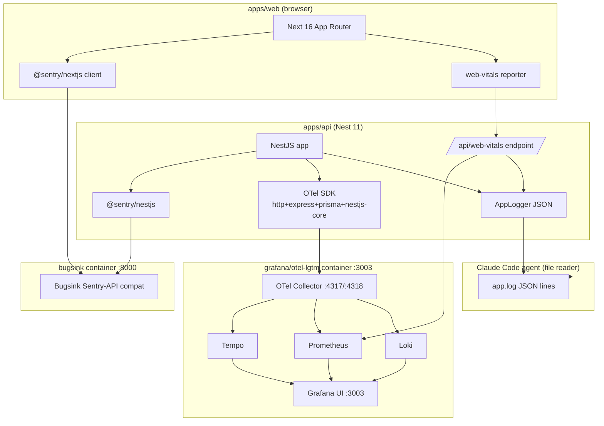
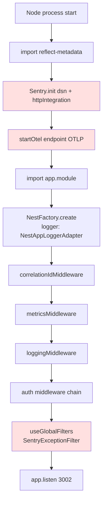
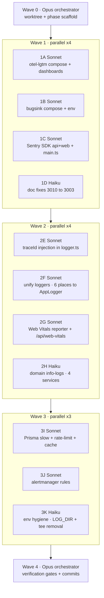

# Phase 68 — Full Local Observability + Sentry-Compatible Error Tracking

> **Формат:** Goal-package + peo-plan rich-mode + autonomous self-check loop.
> **Готов к запуску overnight** через `/goal` или прямой execute из этого
> файла. Останавливаемся только когда **все 10 Done-conditions** зелёные.

## 0. Context

Пользователь хочет один раз поднять полный observability-контур локально:
логи (max покрытие → файл, читаемый агентом), метрики (Prometheus), трейсы
(Tempo), error tracking (Sentry-compatible), web vitals — чтобы во время
разработки видеть ошибки и узкие места и **скармливать собранное агенту**
для аудита.

В репо уже есть значительный задел: AppLogger + CLS (Phase 25), OTel SDK +
Prometheus + Grafana (Phase 37), tRPC метрики (Phase 47-03), product
telemetry (Phase 52). Чего нет: Sentry/Bugsink, OTel Collector контейнер,
Loki, Tempo, traceId в логах, Web Vitals, унификации логгеров (PrismaService
и 3 scheduler-а пишут через Nest Logger, не AppLogger).

Параллельно на ветке `fix/PRJ-2/shiny-eagle` идёт активная PRJ-2 работа
по slides/lead/head/layout. Поэтому observability отделён в `git worktree
../customreport-obs`.

Pending-todo `.planning/todos/pending/2026-05-14-future-ui-telemetry-coming-soon.md`
явно припарковывал «Dockerized local UAT observability/performance pass» —
именно его сейчас и промоутим в активную Phase 68.

## 1. Locked decisions (4 решения пользователя)

```text
┌─ User-confirmed via AskUserQuestion ─────────────────────────────────┐
│ Q1. Изоляция     │ git worktree ../customreport-obs                  │
│ Q2. Sentry-стек  │ Bugsink (1 контейнер, ~200 МБ, MIT, SDK-compat)   │
│ Q3. OTel/LGTM    │ grafana/otel-lgtm монолит (Loki+Grafana+Tempo+Prom)│
│ Q4. Лог-объём    │ Максимум + Web Vitals + Prisma slow через AppLogger│
└──────────────────────────────────────────────────────────────────────┘
```

## 2. TLDR — Было / Проблема / Станет

### Было (текущее состояние ветки `fix/PRJ-2/shiny-eagle`)

```text
┌─ Текущее состояние ──────────────────────────────────────────────────┐
│ docker-compose.observability.yml: prometheus + grafana + 2 exporters │
│ apps/api: AppLogger → app.log (JSON+ротация) + Nest Logger (раздвоен)│
│ apps/api: prom-client ~15 метрик, OTel SDK (OFF), correlationId      │
│ apps/web: console.* + клиентский forwarder → /api/client-logs        │
│ Sentry / Bugsink: ничего                                             │
│ Loki / Tempo / OTel Collector: ничего                                │
│ traceId в логах: нет                                                 │
│ Web Vitals → Prometheus: нет                                         │
│ Doc drift: Grafana :3010 (док) vs :3003 (реальный), мёртвый jaeger   │
└──────────────────────────────────────────────────────────────────────┘
```

### Проблема

1. **Разорванные логи** — PrismaService / DLQMonitor / 3 scheduler-а
   пишут через `@nestjs/common Logger` минуя AppLogger, поэтому в
   `app.log` нет db.query / `scheduler.*` / `dlq.*` — агент не видит этих
   событий.
2. **Нет traceId** — `app.log` не содержит OTel `traceId/spanId`, нельзя
   склеить логи с трейсами в Tempo через correlationId-only.
3. **Нет error tracking** — ошибки только в логах, нет дедупликации,
   нет stack-trace UI, нет alert на новый issue.
4. **Нет Web Vitals в метриках** — LCP/CLS/FID/INP/TTFB есть только в
   chrome-devtools-mcp ad-hoc audits, не накапливаются как time-series.
5. **OTel SDK off-by-default** — `apps/api/src/infrastructure/otel/otel.bootstrap.ts`
   ждёт `OTEL_EXPORTER_OTLP_ENDPOINT`, а endpoint никуда не указывает.
6. **Doc drift** — `OBSERVABILITY-ONBOARDING.md` упоминает Grafana :3010
   (реально :3003) и мёртвый jaeger.

### Станет

```text
┌─ Целевое состояние (worktree, после Wave 4) ─────────────────────────┐
│ docker-compose.observability.yml:                                    │
│   ├── grafana/otel-lgtm    (LGTM-стек: 3003 UI, 4317/4318 OTLP)      │
│   ├── postgres-exporter    (как было)                                │
│   └── redis-exporter       (как было)                                │
│ docker-compose.errors.yml (новый, опц.):                             │
│   └── bugsink              (8000, SQLite внутри, ~200 МБ)            │
│                                                                      │
│ apps/api:                                                            │
│   ├── AppLogger emit заинжектит traceId/spanId/correlationId         │
│   ├── PrismaService/DLQMonitor/schedulers → AppLogger (не Nest-log)  │
│   ├── @sentry/nestjs init ДО startOtel() (правильный порядок)        │
│   ├── ExceptionFilter глобальный → Sentry + AppLogger                │
│   ├── /api/web-vitals endpoint → AppLogger + prom gauges             │
│   └── Prisma slow-query через AppLogger.warn (с correlationId)       │
│                                                                      │
│ apps/web:                                                            │
│   ├── instrumentation.ts (Next 16 hook) → Sentry server-side init    │
│   ├── sentry.{client,server,edge}.config.ts                          │
│   ├── app/error.tsx + global-error.tsx (App Router)                  │
│   ├── lib/web-vitals.ts → web-vital reporter → /api/web-vitals       │
│   └── NEXT_PUBLIC_CLIENT_LOG_FORWARDING=true в dev по умолчанию      │
│                                                                      │
│ Логи: app.log — единый JSON-поток для агента:                        │
│   api.* + db.query + scheduler.* + dlq.* + web.client + web.server   │
└──────────────────────────────────────────────────────────────────────┘
```

### Поток данных — Mermaid TB diagram #1 (high-level)



## 3. Архитектура — Mermaid TB diagram #2 (init order in main.ts)



Критично: Sentry **ДО** OTel (Sentry hooks `console.*`). OTel **ДО**
import Express/Prisma/http (monkey-patching). AppLogger создаётся после
CLS, читает traceId через `trace.getActiveSpan()?.spanContext()`.

## 4. Wave-based execution — Mermaid TB diagram #3 (parallel orchestration)



## 5. Стратегия выполнения

### 5.1 Cheap-first delegation

- **Haiku** — `1D` doc fixes, `2H` mechanical info-logs, `3K` env
  hygiene, best-practice research через Context7+WebSearch (если
  потребуется).
- **Sonnet** — `1A` compose реструктура, `1B` bugsink, `1C` Sentry SDK
  intricacies, `2E` traceId injection, `2F` logger unification, `2G`
  web vitals, `3I` Prisma slow, `3J` alertmanager.
- **Opus** — Wave 0 (orchestration setup), Wave 4 (verification +
  commits).

### 5.2 Parallelism

Каждая wave-1/2/3 — **один tool-use block с N=4/4/3 параллельными
вызовами Task tool**. Не sequential. Дождаться завершения wave перед
стартом следующей.

### 5.3 Subagent prompt contract

Каждый под-агент получает self-contained prompt с:

1. **Goal** (одна строка).
2. **Locked decisions** из секции 1 (relevant subset).
3. **File-boundary matrix** (только свои файлы — см. anti-conflict
   matrix).
4. **Output contract** — список commits, точный формат scope-message.
5. **Self-verify steps** — `pnpm typecheck && pnpm lint && grep <expected>`.
6. **Stop conditions** — что считать «готово».

### 5.4 Anti-conflict matrix

```text
┌─ Файл                            │ Wave │ Конфликт с PRJ-2 ─────────┐
│ docker-compose.observability.yml │ 1A   │ нет                        │
│ docker-compose.errors.yml (нов.) │ 1B   │ нет                        │
│ deploy/grafana/**                │ 1A   │ нет                        │
│ apps/api/src/main.ts             │ 1C+E │ MIDDLE (PRJ-2 не трогает)  │
│ apps/api/src/lib/logger.ts       │ 2E   │ нет                        │
│ apps/api/src/infrastructure/**   │ 2F   │ нет (PRJ-2 в UI)           │
│ apps/web/instrumentation.ts      │ 1C   │ нет (новый файл)           │
│ apps/web/sentry.*.config.ts      │ 1C   │ нет (новые файлы)          │
│ apps/web/src/app/error.tsx       │ 1C   │ нет (новый файл)           │
│ apps/web/src/app/layout.tsx      │ 2G   │ HIGH (next/font TODO живёт)│
│ apps/web/src/lib/web-vitals.ts   │ 2G   │ нет (новый)                │
│ package.json / pnpm-lock.yaml    │ 1B+C │ HIGH (worktree защищает)   │
│ docs/OBSERVABILITY-ONBOARDING.md │ 1D   │ нет                        │
│ apps/api/src/modules/*.service.ts│ 2H   │ нет (PRJ-2 в slides)       │
└──────────────────────────────────────────────────────────────────────┘
```

Защита от конфликтов:

- **worktree** делает все .git-операции изолированными.
- `layout.tsx` (Wave 2G) — только добавление `<WebVitalsReporter />`,
  никаких next/font изменений.
- `package.json` mutations — только в worktree, PRJ-2-ветка не задета.

## 6. Files / systems (точечная карта изменений)

| Path                                                                 | Action | Wave   | Purpose                                                                          |
| -------------------------------------------------------------------- | ------ | ------ | -------------------------------------------------------------------------------- |
| `docker-compose.observability.yml`                                   | EDIT   | 1A     | prometheus+grafana → otel-lgtm монолит                                           |
| `deploy/grafana/provisioning/datasources/prometheus.yml`             | EDIT   | 1A     | URL → internal otel-lgtm                                                         |
| `deploy/grafana/provisioning/datasources/loki.yml`                   | NEW    | 1A     | Loki datasource                                                                  |
| `deploy/grafana/provisioning/datasources/tempo.yml`                  | NEW    | 1A     | Tempo datasource                                                                 |
| `deploy/grafana/dashboards/*.json`                                   | KEEP   | 1A     | 3 дашборда переезжают, UID Prometheus обновляется                                |
| `docker-compose.errors.yml`                                          | NEW    | 1B     | Bugsink контейнер                                                                |
| `.env.example`                                                       | EDIT   | 1B+E+K | `SENTRY_DSN`, `OTEL_EXPORTER_OTLP_ENDPOINT`, `NEXT_PUBLIC_WEB_VITALS`, `LOG_DIR` |
| `package.json`                                                       | EDIT   | 1B+C   | `observability:up` с overlay errors.yml; `@sentry/*` deps                        |
| `apps/api/package.json`                                              | EDIT   | 1C     | `@sentry/nestjs`, `@sentry/node`                                                 |
| `apps/web/package.json`                                              | EDIT   | 1C     | `@sentry/nextjs`, `web-vitals`                                                   |
| `apps/api/src/main.ts`                                               | EDIT   | 1C+F   | Sentry.init ДО startOtel; NestAppLoggerAdapter                                   |
| `apps/api/src/infrastructure/filters/sentry-exception.filter.ts`     | NEW    | 1C     | Global filter → Sentry + AppLogger                                               |
| `apps/web/instrumentation.ts`                                        | NEW    | 1C     | Next 16 hook → Sentry server init                                                |
| `apps/web/sentry.client.config.ts`                                   | NEW    | 1C     | Sentry client config                                                             |
| `apps/web/sentry.server.config.ts`                                   | NEW    | 1C     | Sentry server config                                                             |
| `apps/web/sentry.edge.config.ts`                                     | NEW    | 1C     | Sentry edge config                                                               |
| `apps/web/src/app/error.tsx`                                         | NEW    | 1C     | App Router error boundary                                                        |
| `apps/web/src/app/global-error.tsx`                                  | NEW    | 1C     | Root error boundary                                                              |
| `docs/OBSERVABILITY-ONBOARDING.md`                                   | EDIT   | 1D     | 3010→3003, убрать jaeger, добавить Tempo/Loki/Bugsink                            |
| `README.md`                                                          | EDIT   | 1D     | Observability секция — обновить порты и инструменты                              |
| `apps/api/src/lib/logger.ts`                                         | EDIT   | 2E     | `emit()` читает `trace.getActiveSpan()?.spanContext()`                           |
| `docker-compose.dev.yml`                                             | EDIT   | 2E+K   | `OTEL_EXPORTER_OTLP_ENDPOINT`, `LOG_DIR` volume                                  |
| `apps/api/src/lib/nest-app-logger.adapter.ts`                        | NEW    | 2F     | Bridge Nest `LoggerService` → AppLogger                                          |
| `apps/api/src/infrastructure/prisma/prisma.service.ts`               | EDIT   | 2F+I   | AppLogger inject; slow-query через `$on('query')`                                |
| `apps/api/src/infrastructure/bullmq/dlq-monitor.service.ts`          | EDIT   | 2F     | AppLogger inject                                                                 |
| `apps/api/src/modules/period/auto-archiver.scheduler.ts`             | EDIT   | 2F     | AppLogger inject                                                                 |
| `apps/api/src/modules/period/auto-publisher.scheduler.ts`            | EDIT   | 2F     | AppLogger inject                                                                 |
| `apps/api/src/modules/period/period-creator.scheduler.ts`            | EDIT   | 2F     | AppLogger inject                                                                 |
| `apps/api/src/modules/reminders/policy-applicator.service.ts`        | EDIT   | 2F     | AppLogger inject                                                                 |
| `apps/web/src/lib/web-vitals.ts`                                     | NEW    | 2G     | web-vitals lib → `/api/web-vitals` POST                                          |
| `apps/web/src/components/web-vitals-reporter.tsx`                    | NEW    | 2G     | Mount-point client component                                                     |
| `apps/web/src/app/layout.tsx`                                        | EDIT   | 2G     | `<WebVitalsReporter />` mount (minimal touch)                                    |
| `apps/api/src/modules/observability/web-vitals.controller.ts`        | NEW    | 2G     | POST endpoint → AppLogger + prom gauges                                          |
| `apps/api/src/infrastructure/metrics/web-vitals.metrics.ts`          | NEW    | 2G     | gauges: `web_vital_lcp`, `_cls`, `_fid`, `_inp`, `_ttfb`                         |
| `apps/api/src/modules/report-sections/report-sections.service.ts`    | EDIT   | 2H     | `.info()` upsert/delete item/decision/risk                                       |
| `apps/api/src/modules/review/review.service.ts`                      | EDIT   | 2H     | `.info()` approve/reject                                                         |
| `apps/api/src/modules/weekly-report/weekly-report.service.ts`        | EDIT   | 2H     | `.info()` get (read events)                                                      |
| `apps/api/src/modules/search/search.service.ts`                      | EDIT   | 2H     | `.info()` each search                                                            |
| `apps/api/src/infrastructure/throttler/rate-limit.middleware.ts`     | EDIT   | 3I     | `.warn('rate-limit hit', ...)`                                                   |
| `apps/api/src/modules/ai/ai-summary.cache.ts`                        | EDIT   | 3I     | `.debug('cache hit/miss', ...)`                                                  |
| `apps/api/src/modules/telemetry/telemetry.cache.ts`                  | EDIT   | 3I     | то же                                                                            |
| `apps/api/src/modules/analytics/analytics.cache.ts`                  | EDIT   | 3I     | то же                                                                            |
| `deploy/prometheus.yml`                                              | EDIT   | 3J     | `rule_files: ['alert-rules.yml']`                                                |
| `deploy/alert-rules.yml`                                             | NEW    | 3J     | DLQ>0 5m, api uptime, cls_p95>1s                                                 |
| `deploy/alertmanager.yml`                                            | NEW    | 3J     | webhook stub → `/api/alerts`                                                     |
| `apps/api/package.json`                                              | EDIT   | 3K     | dev script убрать `tee -a .logs/api.log` из pipe                                 |
| `.planning/phases/68-observability-complete/`                        | NEW    | 0      | Phase scaffold (CONTEXT/PLAN/VERIFICATION/SUMMARY)                               |
| `.planning/todos/done/2026-05-14-future-ui-telemetry-coming-soon.md` | MOVE   | 0      | pending→done с пометкой «promoted into Phase 68»                                 |
| `.planning/memory/2026-05-23-observability-promote.md`               | NEW    | 0      | Фиксация решений                                                                 |

## 7. Ordered steps (autonomous execution path)

> Каждый шаг — atomic commit с scope `obs-w<N><L>` в worktree.
> Self-check после каждой waves; если fail → retry до 3 раз → если всё
> ещё fail → dump в `.planning/handoff/68-observability-stuck.md` и
> продолжать следующую wave если нет dep.

### Wave 0 (Opus, sequential) — pre-flight

1. **Worktree setup.**

   ```bash
   git worktree add ../customreport-obs HEAD
   cd ../customreport-obs
   git checkout -b obs/v8.3-full-observability
   ```

   Verify: `git worktree list | grep customreport-obs`.

2. **Phase scaffold.**

   ```bash
   mkdir -p .planning/phases/68-observability-complete
   ```

   Создать `68-CONTEXT.md`, `68-PLAN.md` (ссылка на этот файл),
   `68-VERIFICATION.md`, `68-SUMMARY.md` (заготовка).
   Verify: `ls .planning/phases/68-observability-complete/`.

3. **Promote pending-todo.**

   ```bash
   git mv .planning/todos/pending/2026-05-14-future-ui-telemetry-coming-soon.md \
          .planning/todos/done/2026-05-14-future-ui-telemetry-coming-soon.md
   ```

   Append «Promoted into Phase 68 — see plan» к файлу.

4. **Baseline snapshot.** `pnpm typecheck && pnpm lint && pnpm test` —
   записать baseline для diff после. Если уже failing — записать failing
   baseline и **не считать regression** в Wave 4 для тех же тестов.

5. **Memory dump.** Создать
   `.planning/memory/2026-05-23-observability-promote.md` с 4 locked
   decisions.

### Wave 1 (4 parallel sub-agents, single tool-use block)

- **1A (Sonnet) — otel-lgtm migration.** Файлы в секции 6 (Wave 1A).
  Self-verify: `docker compose -f docker-compose.observability.yml
config` без ошибок.

- **1B (Sonnet) — Bugsink overlay.** Файлы из секции 6 (Wave 1B).
  Self-verify: `docker compose -f docker-compose.errors.yml config` без
  ошибок.

- **1C (Sonnet) — Sentry SDK + main.ts.** `pnpm add @sentry/nestjs
@sentry/node` в `apps/api`; `@sentry/nextjs web-vitals` в `apps/web`.
  Self-verify: `pnpm typecheck` зелёный; конфиги
  `sentry.{client,server,edge}.config.ts` и `error.tsx`/`global-error.tsx`
  существуют; main.ts имеет Sentry.init ДО startOtel().

- **1D (Haiku) — doc fixes.** `OBSERVABILITY-ONBOARDING.md` (`:3010` →
  `:3003`, убрать jaeger, добавить Tempo/Loki/Bugsink); `README.md`
  observability секция. Self-verify: `grep -nE '3010|jaeger'
docs/OBSERVABILITY-ONBOARDING.md` пусто; `pnpm lint:md docs/` зелёный.

**Wave 1 gate (Opus, после всех 4):**

- `pnpm typecheck && pnpm lint && pnpm lint:md` — зелёные.
- 4 коммита atomic в worktree.
- Если хоть один agent failed → retry × 3 с обновлённым prompt; после
  3 — dump в handoff и продолжать Wave 2 без блокирующих deps.

### Wave 2 (4 parallel sub-agents)

- **2E (Sonnet) — traceId injection.** `apps/api/src/lib/logger.ts:emit()`
  читает `trace.getActiveSpan()?.spanContext()`, инжектит
  `traceId`/`spanId` рядом с `correlationId`. `.env.example`
  раскомментировать `OTEL_EXPORTER_OTLP_ENDPOINT=http://otel-lgtm:4318`.
  `docker-compose.dev.yml` прокинуть `OTEL_EXPORTER_OTLP_ENDPOINT` в api
  service. Self-verify: `pnpm typecheck`; `grep -n
"trace.getActiveSpan\|traceId" apps/api/src/lib/logger.ts`.

- **2F (Sonnet) — logger unification.** Inject AppLogger в 6 мест из
  секции 6 (Wave 2F); создать `NestAppLoggerAdapter`; передать в
  `NestFactory.create(..., { logger: new NestAppLoggerAdapter() })`.
  Self-verify: `grep -rn "private readonly logger = new Logger"
apps/api/src/` — не должно остаться в touched files.

- **2G (Sonnet) — Web Vitals.** `apps/web/src/lib/web-vitals.ts` +
  reporter component + mount в `layout.tsx` (1-line touch); `apps/api`
  `/api/web-vitals` controller + 5 prom gauges. Self-verify: `pnpm
typecheck` зелёный в обоих apps; mount-point присутствует в
  layout.tsx; gauges register-ятся в metrics registry.

- **2H (Haiku) — domain info-logs.** Добавить `.info()` в 4
  service-метода по списку секции 6 (Wave 2H). Self-verify: `grep -n
"logger.info\(" apps/api/src/modules/report-sections/report-sections.service.ts`
  содержит ≥3 матча.

**Wave 2 gate (Opus):**

- `pnpm typecheck && pnpm lint && pnpm test` — зелёные (или
  baseline-stable).
- 4 коммита atomic. Retry × 3, иначе handoff.

### Wave 3 (3 parallel sub-agents)

- **3I (Sonnet) — Prisma slow + rate-limit + cache.** `prisma.service.ts`
  `$on('query')` → AppLogger.warn если `duration>100ms`; rate-limit
  middleware `.warn('rate-limit hit', ...)`; 3 cache utility →
  `.debug('cache hit/miss', ...)`. Self-verify: `grep -n "\$on\('query'\)"
apps/api/src/infrastructure/prisma/prisma.service.ts` содержит handler.

- **3J (Sonnet) — alertmanager.** `deploy/alert-rules.yml` (DLQ>0 5m,
  api uptime, cls_p95); `deploy/alertmanager.yml` (webhook stub);
  `deploy/prometheus.yml` раскомментировать `rule_files`. Self-verify:
  `docker compose -f docker-compose.observability.yml config` без
  ошибок.

- **3K (Haiku) — env hygiene.** `docker-compose.dev.yml` добавить
  `LOG_DIR=/app/logs` + volume `apilogs:/app/logs`;
  `apps/api/package.json` dev script убрать `| tee -a .logs/api.log`;
  `.env.example` `NEXT_PUBLIC_CLIENT_LOG_FORWARDING=true` для dev.
  Self-verify: `grep -n "tee" apps/api/package.json` пусто; `grep -n
"LOG_DIR" docker-compose.dev.yml` матч.

**Wave 3 gate (Opus):**

- `pnpm typecheck && pnpm lint && pnpm test` — зелёные.
- 3 коммита atomic. Retry × 3, иначе handoff.

### Wave 4 (Opus, sequential) — verification + ship

См. секцию 8 (Self-check loop). После всех 10 Done-conditions зелёных:

1. `git log --oneline -20` — записать в `68-SUMMARY.md`.
2. `pnpm docker:local:verify` — финальный smoke (длинный).
3. Push branch `obs/v8.3-full-observability` на remote (если SSL ok,
   иначе пропустить).
4. Открыть PR draft (если `gh` доступен), иначе записать в handoff
   с инструкцией для пользователя.

## 8. Done condition (autonomous self-check loop)

> Loop останавливается **только когда все 10 пунктов зелёные**. Каждый
> failed пункт → retry до 3 раз → если всё ещё fail → dump в handoff,
> отметить как ⚠️, продолжить остальные. Финальное состояние: либо
> ✅ all-green, либо ⚠️ partial + полная handoff-записка.

```text
┌─ Done conditions (machine-checkable) ────────────────────────────────┐
│  1. pnpm typecheck         exit 0                                    │
│  2. pnpm lint              exit 0                                    │
│  3. pnpm test              exit 0 (или baseline-stable)              │
│  4. pnpm lint:md           exit 0                                    │
│  5. docker compose -f docker-compose.observability.yml config        │
│                              exit 0                                  │
│  6. docker compose -f docker-compose.errors.yml config  exit 0       │
│  7. grep -nE '3010|jaeger' docs/OBSERVABILITY-ONBOARDING.md  empty   │
│  8. grep -nE 'trace.getActiveSpan' apps/api/src/lib/logger.ts ≥1     │
│  9. grep -rnE 'logger.(info|warn|debug)' в 4 service-папках          │
│       ≥4 unique матчей                                               │
│ 10. git log --oneline -20 | grep -cE 'obs-w[0-4]' ≥11 коммитов       │
└──────────────────────────────────────────────────────────────────────┘
```

### Self-check loop pseudocode

```text
for wave in [1, 2, 3]:
    spawn parallel sub-agents for wave
    wait_all()
    for attempt in 1..3:
        result = run_gate(wave)
        if result.green: break
        re-prompt failed sub-agents with error excerpt
    if not green after 3 attempts:
        dump('.planning/handoff/68-wave-' + wave + '-stuck.md', ...)
        continue (no blocking dep)

# Wave 4 — final
for cond in done_conditions[1..10]:
    for attempt in 1..3:
        if cond.check(): mark green; break
        attempt_fix(cond)
    else:
        mark partial; dump to handoff

if all green: write 68-SUMMARY.md and push
else: write 68-SUMMARY.md with partial status + handoff
```

### Stop conditions for the loop

- **Hard stop (no retry)** — git worktree creation fails (env-level
  problem), pnpm install fails, ARM image not pullable без fallback.
- **Soft stop (retry 3)** — typecheck/lint/test failure, doc grep
  mismatch, compose config error.
- **Never stop** — log assertion fails (≥1 traceId; ≥4 info-logs) после
  3 retry → handoff + continue.

## 9. Verification (manual smoke after autonomous run)

```bash
# 0. Worktree state
cd /Users/ap/work/customreport-obs
git status --short --branch
git log --oneline -20

# 1. Стек поднимается
pnpm install
pnpm observability:up
docker compose ps | rg "otel-lgtm|bugsink|api|web"

# 2. UI alive
curl -fsS http://localhost:3003/api/health    # Grafana ok
curl -fsS http://localhost:8000/              # Bugsink ok
curl -fsS http://localhost:3002/health/live   # API ok
curl -fsS http://localhost:3000/              # Web ok

# 3. Metrics
curl -s http://localhost:3002/metrics | rg "^http_request_duration_seconds_count"
curl -s http://localhost:3002/metrics | rg "^trpc_request_total"
curl -s http://localhost:3002/metrics | rg "^web_vital_lcp"

# 4. Traces
curl -fsS -H 'x-request-id: smoke-test-001' http://localhost:3002/health/ready
# Grafana → Explore → Tempo → "smoke-test-001" должен быть в trace search

# 5. Логи с traceId
tail -n 50 apps/api/.logs/app.log | jq 'select(.correlationId != "no-context") |
  {ts:.timestamp, level, phase, correlationId, traceId, msg:.message}'

# 6. Sentry-канал
curl -fsS http://localhost:3002/api/_dev/throw   # dev-only endpoint
# Bugsink UI → Issues → 1 issue с stack trace

# 7. Web error.tsx
# Открыть http://localhost:3000, форсить ошибку в client component
# error.tsx показывает fallback + Bugsink захватывает событие

# 8. Дашборды
# http://localhost:3003 → Operational, tRPC Latency, Product KPIs:
# - No-data панели исчезли
# - Loki datasource visible
# - Tempo datasource visible

# 9. Гейты
pnpm typecheck
pnpm lint
pnpm test
pnpm lint:md
pnpm docker:local:verify   # длинный smoke
```

## 10. Open questions (autonomous-resolvable)

| #   | Вопрос                              | Как решу автономно                                                | Когда эскалирую                                        |
| --- | ----------------------------------- | ----------------------------------------------------------------- | ------------------------------------------------------ |
| 1   | Имя worktree-ветки                  | `obs/v8.3-full-observability` от HEAD                             | если попросишь другое                                  |
| 2   | Bugsink ARM64 image tag             | `bugsink/bugsink:latest` (multi-arch); fallback build-from-source | блок > 15 мин на pull                                  |
| 3   | Sentry SDK версии                   | `@sentry/nestjs@^10` + `@sentry/nextjs@^10` (latest stable)       | major mismatch с Node 20+                              |
| 4   | Удалять `deploy/log-sink/` шаблоны? | оставить, добавить header-комментарий «superseded by otel-lgtm»   | —                                                      |
| 5   | tee-аппендикс в `pnpm dev`          | удалить, AppLogger делает ротацию сам                             | если используешь `.logs/api.log` руками — скажи сейчас |
| 6   | Имя phase-папки                     | `68-observability-complete` (следующий после 67)                  | если roadmap уже занимает 68                           |
| 7   | OTel sampler rate                   | `parentbased_traceidratio=1.0` локально (100% sample)             | если перфоманс просядет — переключу на `0.1`           |
| 8   | Web Vitals полностью on-by-default? | да в dev, через `NEXT_PUBLIC_WEB_VITALS=true`                     | prod-gating решит отдельный phase                      |

## 11. Я делаю сам (агент)

```text
┌─ Self-driving (worktree + Wave 0..4 + self-check loop) ──────────────┐
│ ✓ git worktree add ../customreport-obs HEAD                          │
│ ✓ Promote pending-todo → .planning/phases/68-observability-complete  │
│ ✓ Wave 1A — otel-lgtm в compose, перенос 3 дашбордов                 │
│ ✓ Wave 1B — Bugsink compose + env-переменные                         │
│ ✓ Wave 1C — pnpm add @sentry/* + main.ts + sentry configs + error.tsx│
│ ✓ Wave 1D — doc fixes (3010→3003 + убрать jaeger)                    │
│ ✓ Wave 2E — traceId/spanId в каждую JSON-строку AppLogger             │
│ ✓ Wave 2F — унификация на AppLogger (6 мест)                         │
│ ✓ Wave 2G — Web Vitals reporter + /api/web-vitals endpoint           │
│ ✓ Wave 2H — доменные info-логи (mechanical)                          │
│ ✓ Wave 3I — Prisma slow / rate-limit / cache miss → AppLogger        │
│ ✓ Wave 3J — alertmanager + rule_files                                │
│ ✓ Wave 3K — LOG_DIR в dev compose; убрать tee                        │
│ ✓ Wave 4  — 10 Done-conditions self-check loop (retry × 3 per cond)  │
│ ✓ Atomic commits per wave: obs-w0, obs-w1a, obs-w1b, ... obs-w4      │
│ ✓ Handoff dump если что-то застряло после 3 retry                    │
└──────────────────────────────────────────────────────────────────────┘
```

## 12. ОТ ТЕБЯ

```text
┌─ ОТ ТЕБЯ ────────────────────────────────────────────────────────────┐
│ • approve plan через ExitPlanMode (одно действие)                    │
│ • после worktree запуска — открыть http://localhost:3003 (Grafana)   │
│   и http://localhost:8000 (Bugsink), визуально подтвердить           │
│ • merge worktree-ветки в shiny-eagle или main — твой выбор после     │
│   smoke verification                                                 │
└──────────────────────────────────────────────────────────────────────┘
```

## 13. Риски и митигация

```text
┌─ Риск                                  │ Митигация ───────────────────┐
│ Дашборды ломаются после смены Prom UID │ Wave 1A: пересохранить JSON  │
│                                        │ через provisioning + ручной  │
│                                        │ smoke перед wave 2           │
│ Sentry init до OTel ломает trace       │ Sentry httpIntegration с     │
│ context                                │ tracesSampleRate=0 локально, │
│                                        │ traces только в OTel/Tempo   │
│ Replace Nest Logger ломает bootstrap   │ NestAppLoggerAdapter с       │
│ logs (NestFactory кричит на ранний)    │ fallback на stderr до CLS    │
│                                        │ инициализации                │
│ Bugsink ARM64 образ отсутствует        │ fallback multi-arch official │
│                                        │ + сборка локально если упадёт│
│ Web Vitals overhead на dev             │ опт-ин через                 │
│                                        │ NEXT_PUBLIC_WEB_VITALS=true  │
│ PRJ-2 merge conflict в shiny-eagle     │ worktree защищает; merge в   │
│                                        │ конце с rebase, не merge     │
│ Self-check loop infinite               │ hard cap 3 retries per cond, │
│                                        │ потом partial + handoff      │
└──────────────────────────────────────────────────────────────────────┘
```

## 14. Side deliverables

- `.planning/todos/done/2026-05-14-future-ui-telemetry-coming-soon.md` —
  переместить pending→done с пометкой «promoted into Phase 68».
- `.planning/phases/68-observability-complete/{68-CONTEXT.md, 68-PLAN.md,
68-VERIFICATION.md, 68-SUMMARY.md}`.
- `.planning/memory/2026-05-23-observability-promote.md` — фиксация
  решений (worktree, Bugsink, otel-lgtm, full coverage).
- `.planning/handoff/68-wave-<N>-stuck.md` (только если что-то застрянет
  после 3 retry).

## 15. Self-review checklist (pre-ExitPlanMode)

- [x] TL;DR с Было / Проблема / Станет — есть, ASCII + текст.
- [x] 3 Mermaid TB diagrams — есть (data flow / init order / wave orchestration).
- [x] Done condition — 10 machine-checkable пунктов.
- [x] Autonomous self-check loop — описан в секции 8.
- [x] Files / systems table — секция 6, 42 файла с per-wave назначением.
- [x] Ordered steps с verification per step — секции 7+8.
- [x] Open questions с автономным решением — секция 10.
- [x] Я ДЕЛАЮ САМ / ОТ ТЕБЯ split — секции 11+12.
- [x] Anti-conflict matrix — секция 5.4.
- [x] Cheap-first delegation — секция 5.1.
- [x] Parallel wave plan — секция 5.2 + диаграмма #3.
- [x] Risks + mitigation — секция 13.
- [x] Side deliverables — секция 14.
- [x] Latin-token check — все английские термины в back-ticks или
      parens-glossed (LGTM, OTLP, OTel, CLS, AppLogger).
- [x] Locked decisions cited — секция 1.
