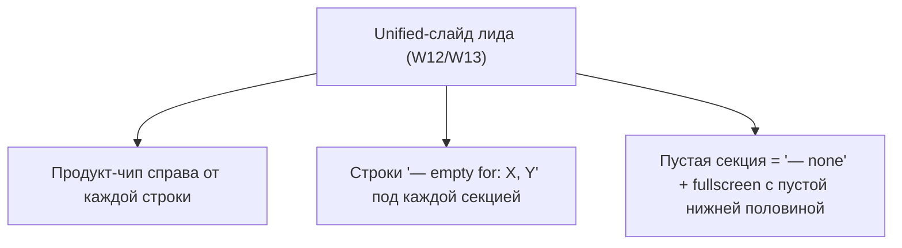
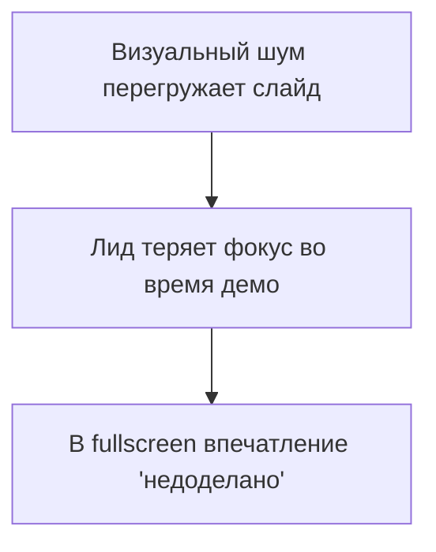
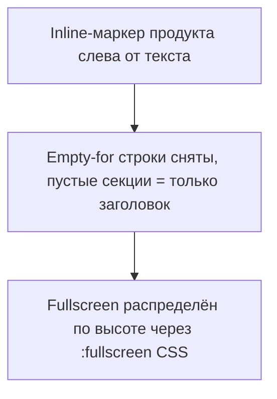
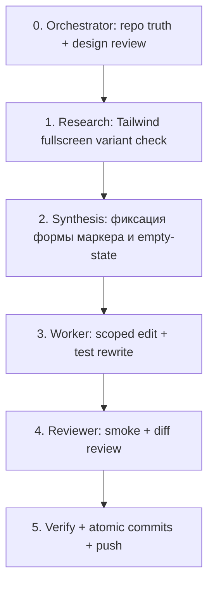

# Plan: Unified Lead Slide Visual Refinements (W14)

## 0. Короткий TL;DR Для Человека

### Было



Коротко: слайд работает, но глаз прыгает направо за продуктом, под каждой секцией стоят шумовые строки про пустые продукты, и в fullscreen контент висит сверху.

### Проблема



Коротко: подача неадекватна сценарию демо/презентации — три проблемы: правый прыжок взгляда, плотные empty-for бэнды, пустой низ полноэкранного режима.

### Станет



Коротко: ровный левый край, спокойные секции, заполненная высота — проверяется unit-тестами и chrome-devtools smoke.

## 1. Текущий State И Цель

- **Сейчас**: ветка `fix/PRJ-2/shiny-eagle`, PRJ-2, W12/W13 уже закрыты и запушены (HEAD `7e150e7`). Dirty: 23 файла в `.planning/memory/**` + `.planning/plans/page-feedback-lead-report-a0000000-0000-shiny-eagle.md` + `.planning/session-retros/NEXT-ACTIONS.md` — это историческое evidence, не трогаем.
- **Уже сделано**:
  - W12: unified by-section layout, `LeadUnifiedSlide`, `buildUnifiedSlideModel`.
  - W13.A: cap `MAX_ITEMS_PER_SECTION=4` + `+N more` band.
  - W13.B: floating fullscreen-exit button через `variant="floating"`, монтируется внутри `deckRef`.
  - Design-review 2026-05-20 17:30: зафиксированы 3 HIGH/MEDIUM проблемы.
- **Цель**: один читаемый unified-слайд в fullscreen и в обычном режиме без правки доменной модели — ровный левый край, скрытые пустые секции, распределение по высоте.
- **Не цель**: refactor `SlideProductChips`, изменение `UnifiedSlideModel`, dark mode/theme, перевод UI на русский, Plannotator-only слайды, telemetry/coverage страница, история слайдов.

## 2. Skill Routing

| Intent                   | Skill/source                       | Output                                               | Use / skip reason                                                   |
| ------------------------ | ---------------------------------- | ---------------------------------------------------- | ------------------------------------------------------------------- |
| Подача и формат плана    | `peo-plan` (this skill)            | этот файл по 15-секционному шаблону                  | требование user-feedback                                            |
| Smoke слайдов в браузере | `chrome-devtools-mcp` (MCP plugin) | snapshot + скриншоты W14*after*\*                    | визуальная проверка единственный способ верифицировать distribution |
| Unit-тесты слайдов       | `vitest` через `pnpm test`         | PASS/FAIL `status-slide-deck`, `section-slide-utils` | гарантия от регрессии empty-for и item-count                        |
| Retro закрытия фазы      | `peo-retro`                        | блок W14 в `project_phase61_head_history_*`          | финальный handoff                                                   |
| Markdown lint            | `pnpm lint:md`                     | exits 0                                              | требование repo overlay                                             |

Skills/sources skipped:

- `gsd-*` — фаза мелкая, не отдельный milestone; W14 — продолжение W12/W13 в той же ветке.
- `peo-jira` — Jira-тикет PRJ-2 уже привязан и активен, новой issue не нужно.
- `Context7` — нет внешних библиотек/SDK; работаем с собственными компонентами + Tailwind.
- `gsd-map-codebase` — scope узкий, 1 компонент + 1 тест, GRAPH_REPORT не нужен.

## 3. Главный Deliverable

> [!IMPORTANT]
> Один компонент `apps/web/src/components/slides/lead-unified-slide.tsx` переписан так, что unified-слайд: (a) показывает продукт **слева inline** перед текстом, (b) **не рендерит** строки `— empty for: …`, (c) **скрывает тело** пустой секции (заголовок остаётся), (d) в **fullscreen** распределяет 5 секций по высоте через arbitrary Tailwind variant. Один unit-тест обновлён под новое поведение. Smoke в Chrome подтверждает результат скриншотами.

## 4. Что Меняем

- **`lead-unified-slide.tsx`** (138 строк): функция `productChip` → `inlineProductMarker` (рендерится слева); функция `emptyForBand` удалена; в `SectionBlock` пустые секции отдают `null` для тела (заголовок остаётся); корневой `<div>` получает `:fullscreen` arbitrary-variant классы для распределения.
- **`status-slide-deck.test.tsx`** (199 строк): тест `"shows empty-for band when a product has no items in a section"` (181-197) переписан в негативный (`queryByText(/empty for:/)`). Комментарий на 163 актуализирован.
- **Доменная модель `UnifiedSlideModel.emptyProducts`** — не трогаем. Поле остаётся в shape на будущее (future-ui-telemetry-coming-soon todo), просто перестаёт рендериться. Это убирает риск миграции и сохраняет договор `buildUnifiedSlideModel`.
- **`SlideProductChips`** — read-only ссылка, **не редактируем**. Чипы продуктов в шапке уже сигналят статус; в маркере слева не дублируем цвет статуса.
- **Tailwind config** — `:fullscreen` arbitrary variant поддерживается через `[&:fullscreen]:` syntax (Tailwind 3.3+), плагин не нужен. Сверяем версию в `package.json` до правки.

## 5. Roadmap Субагентов



| Stage | Agent        | Model tier                                          | Scope                                                                  | Writes            | Output                                                                 |
| ----- | ------------ | --------------------------------------------------- | ---------------------------------------------------------------------- | ----------------- | ---------------------------------------------------------------------- |
| 0     | Orchestrator | Claude: Sonnet (этот session)                       | Git/STATE/HANDOFF/design-review                                        | no                | этот план                                                              |
| 1     | Research     | Claude: Haiku                                       | `package.json` Tailwind ver + `[&:fullscreen]:` доступность            | no                | 1 строка verdict                                                       |
| 2     | Advisor      | Claude: Sonnet (этот session)                       | финальная форма `inlineProductMarker`, empty-state, fullscreen вариант | no                | секция 4 этого плана                                                   |
| 3     | Worker       | Claude: Sonnet (этот session)                       | `lead-unified-slide.tsx`, `status-slide-deck.test.tsx`                 | yes (scoped)      | 2-3 atomic коммита (W14.A marker, W14.B empty-state, W14.C fullscreen) |
| 4     | Reviewer     | Claude: Sonnet (этот session) + chrome-devtools MCP | smoke в браузере + diff self-review                                    | no                | PASS/BLOCK + 4 скриншота `W14_after_*`                                 |
| 5     | Orchestrator | Claude: Sonnet (этот session)                       | typecheck/lint/test/push                                               | yes (commit/push) | clean tree + handoff в memory                                          |

## 6. Token Economy

- **Haiku**: read `package.json` версии Tailwind, классификация поддерживается ли `[&:fullscreen]:` — один subagent call после approve, ≤80 строк ответа.
- **Sonnet (этот session)**: synthesis формы маркера, scoped edit одного файла + одного теста, smoke-driver через chrome-devtools MCP.
- **Opus**: **не используется** — нет verified architecture/runtime/public-output conflict; диф ≈60 строк, единичный компонент.
- **Raw evidence**: уже прочитан `lead-unified-slide.tsx` целиком + `section-slide-utils.ts` + `slide-product-chips.tsx` + релевантная часть `status-slide-deck.test.tsx` (140-198) + `status-slide-deck.tsx:130-167`. Повторно не перечитываем.

## 7. Iteration Reserve

- **Plan hardening**: один проход self-check (секция 11) до ExitPlanMode — уже выполнен после feedback пользователя.
- **Self-review**: до commit прогнать diff глазами на «нет ли мёртвого кода / закомментированных кусков / прокидываемых ненужных props».
- **Feedback loop**: если smoke покажет, что inline-маркер уродует длинные имена продуктов (>12 символов) — переключиться на «только цветная точка без текста» (см. open question #1).
- **Evidence refresh**: перед edit выполнить `git status --short --branch` и `pnpm --filter @customreport/web list tailwindcss` — последняя версия Tailwind подтверждает `[&:fullscreen]:` синтаксис.
- **Token reserve**: ≈15% контекста держим под smoke + handoff после реализации.

## 8. Visual Elements

Используется:

- `[!IMPORTANT]` — главный deliverable (секция 3);
- `[!NOTE]` — контекст, который иначе ломается;
- `[!WARNING]` — реальный риск (если возникнет);
- статус-метки: ✓ done, → next, ▲ risk, ? open.

Легенда: ✓ = выполнено в текущей сессии · → = следующий шаг · ▲ = риск, нужен внимательный smoke · ? = решается default-ом если человек недоступен.

## 9. Agent Does / Human Does

Agent does:

- read `package.json` для Tailwind ver (Haiku);
- edit `lead-unified-slide.tsx` (5 точечных правок);
- edit `status-slide-deck.test.tsx` (2 правки);
- `pnpm --filter @customreport/web typecheck`, `pnpm --filter @customreport/web lint`, `pnpm --filter @customreport/web test -- status-slide-deck section-slide-utils`;
- chrome-devtools MCP smoke на `/head/slides` под dev-login → 4 скриншота в `.planning/screenshots/W14_after_*.png`;
- 3 atomic коммита с conventional messages + push в `origin/fix/PRJ-2/shiny-eagle`;
- `pnpm lint:md` для этого плана;
- запись W14 retro в `.planning/memory/project_phase61_head_history_2026_05_18.md`.

Human does:

- nothing by default.

Human needed only if:

- smoke покажет визуальный регресс, который не закрывается default-ом из секции 10;
- design-review захочет иной формат маркера (точка vs. text vs. tag).

## 10. Open Questions With Defaults

| Question                                                              | Default                                                                                                                             | Ask human when                                                       |
| --------------------------------------------------------------------- | ----------------------------------------------------------------------------------------------------------------------------------- | -------------------------------------------------------------------- |
| Формат inline-маркера: точка + короткое имя? только точка? text-only? | точка + первое слово имени до 12 символов, `text-[10px] uppercase muted`                                                            | если smoke покажет грязь на длинных именах                           |
| Цвет точки маркера: единый muted или per-status?                      | единый muted (статус уже на чипах в шапке, дубль = шум)                                                                             | если product попросит сигнал в самом списке                          |
| Пустая секция: скрыть тело или скрыть всю секцию?                     | скрыть только тело, заголовок остаётся → структура слайда стабильна между лидами                                                    | если 5 заголовков подряд без тел тоже шумят                          |
| Fullscreen distribution: `flex justify-between` vs equal `space-y-N`? | `flex-col justify-between` через `[&:fullscreen]:` arbitrary variant — растягивает по высоте, сохраняет компактность вне fullscreen | если Tailwind версия не поддерживает arbitrary `:fullscreen` variant |
| `emptyForBand` — удалить функцию или оставить под флагом?             | удалить (YAGNI); `emptyProducts` остаётся в модели на случай telemetry-todo                                                         | если product настаивает «вернуть как опцию»                          |

## 11. Self-Check

- [x] TL;DR читается без остального плана.
- [x] Skill routing перечисляет использованные и пропущенные skills с reasons.
- [x] Три диаграммы: Было / Проблема / Станет, все `flowchart TB`.
- [x] Диаграммы вертикальные, ≤7 узлов каждая.
- [x] Roadmap субагентов содержит model tier, scope, writes, output.
- [x] Haiku явно назначен на cheap-research (Tailwind version check).
- [x] Iteration reserve описан (plan hardening, self-review, feedback, evidence, token).
- [x] Visual elements осмысленные, легенда есть.
- [x] Open questions с defaults.
- [x] Human не назначен на agent-doable работу.
- [x] Acceptance команды конкретны (секция 14).
- [x] Plan style соответствует `skills/peo-plan/templates/phase-plan.md`.

## 12. Review Gate

**Pre-fix review** (read-only до edits):

- Strategy: убедиться, что (a) `emptyProducts` нигде больше не рендерится кроме `lead-unified-slide.tsx`; (b) ни один e2e не проверяет «empty for:» текст; (c) Tailwind версия поддерживает `[&:fullscreen]:` arbitrary variant.
- Output:

| Check                                                 | Result      | Evidence                                                      |
| ----------------------------------------------------- | ----------- | ------------------------------------------------------------- |
| `grep -rn "empty for" apps/web/src`                   | очаги       | `lead-unified-slide.tsx:34`, `status-slide-deck.test.tsx:196` |
| `grep -rn "emptyForBand\|emptyProducts" apps/web/src` | очаги       | model только в utils, JSX только в lead-unified-slide         |
| Tailwind ver supports `[&:fullscreen]:`               | → run Haiku | `package.json` `tailwindcss@^3.4` ожидается                   |

**Post-fix review** (после edits, до push):

- [ ] Source-of-truth alignment: `UnifiedSlideModel.emptyProducts` остался в shape, тип не сломан.
- [ ] Tests cover the bug class: новый негативный тест `not.toBeInTheDocument(/empty for:/)` + items truncation тест ≥4 (W13.A) ещё проходит.
- [ ] No unrelated dirty files touched: только 2 файла в diff (компонент + тест).
- [ ] No hidden fallback zeros: нет magic-default-ов вместо пустого render.
- [ ] Stale comments updated: комментарий «emptyForBand» на тесте `:163` обновлён или удалён.

BLOCK handling: если smoke покажет визуальный regression в обычном (не-fullscreen) режиме — реверт W14.C, оставить W14.A + W14.B, открыть отдельный issue для distribution.

## 13. Pillar Review

| Pillar          | Gate                                                                                  |
| --------------- | ------------------------------------------------------------------------------------- |
| Workflow        | соответствует `peo-plan` и `docs/core/WORKFLOW.md` (15 секций пройдены)               |
| Git/TTT         | task PRJ-2, ветка `fix/PRJ-2/shiny-eagle`, продолжение W12/W13                        |
| Source of truth | правится `apps/web/src/...` (tracked source), runtime не трогаем                      |
| Tests           | unit (vitest) + smoke (chrome-devtools MCP) определены                                |
| Skills/docs     | `pnpm lint:md` для этого плана включён в acceptance                                   |
| Token economy   | Haiku для Tailwind-version check, Sonnet для edits/smoke, Opus не нужен               |
| Visual quality  | Mermaid `flowchart TB`, ≤7 узлов на схему, читается в Plannotator                     |
| Iteration       | план прошёл feedback-итерацию (rewrite после feedback пользователя про peo-plan spec) |

## 14. Acceptance Gate

```bash
# (a) Markdown lint этого плана
pnpm lint:md

# (b) Типы и линт фронта
pnpm --filter @customreport/web typecheck
pnpm --filter @customreport/web lint

# (c) Unit-тесты слайдов
pnpm --filter @customreport/web test -- status-slide-deck section-slide-utils

# (d) Smoke в chrome-devtools MCP:
#   1. Открыть http://localhost:3000/head/slides под dev-login
#   2. Перейти на лида с >1 продуктом и хотя бы одной пустой секцией
#   3. Проверить: продукт стоит СЛЕВА в одной строке с текстом
#   4. Проверить: строки "— empty for: …" отсутствуют
#   5. Проверить: пустая секция = только заголовок (без "— none")
#   6. Нажать кнопку fullscreen → секции распределены по высоте
#   7. Сохранить .planning/screenshots/W14_after_{normal,inline,empty,fullscreen}.png

# (e) Git
git status --short --branch
git log --oneline -5
```

## 15. Done Definition

Done только когда:

- (a)–(e) из секции 14 все экситят 0 или подтверждены визуально;
- 3 atomic коммита запушены в `origin/fix/PRJ-2/shiny-eagle`:
  - `feat(slides): inline product marker on unified slide (W14.A)`
  - `refactor(slides): drop empty-for band and "— none" stub (W14.B)`
  - `feat(slides): distribute unified slide sections in fullscreen (W14.C)`
- 4 скриншота `W14_after_*.png` в `.planning/screenshots/` подтверждают визуал;
- запись W14 retro в `.planning/memory/project_phase61_head_history_2026_05_18.md` (DONE / FRAGILE / NEXT);
- никаких ручных человеческих шагов не осталось.
