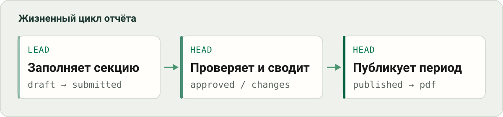

<picture>
  <source media="(prefers-color-scheme: dark)" srcset="assets/readme/hero-dark.svg">
  
</picture>

Лиды (`lead`) заполняют свои секции отчёта независимо друг от друга. Глава отдела
(`head`) просматривает, публикует и экспортирует единый сводный отчёт. Есть ещё
роли `admin` (администрирование) и `viewer` (только чтение).

> Разрушительные операции с БД не считаются безопасными по умолчанию. Точный
> список одноразовых целей и обязательный guard описаны в
> [`AGENTS.md`](./AGENTS.md), раздел «Database safety».

<picture>
  <source media="(prefers-color-scheme: dark)" srcset="assets/readme/lifecycle-dark.svg">
  
</picture>

## Что умеет MVP

- **Лид** заполняет свою секцию: статусы продуктов и активностей, задачи на
  текущую и следующую недели, риски, решения и приоритеты. Черновик сохраняется
  автоматически; лид может перенести незавершённую работу, отправить секцию и
  запросить повторное открытие.
- **Глава отдела** видит сводный дашборд и секции лидов, проверяет записи,
  оставляет комментарии и вердикты, публикует или повторно открывает период,
  показывает слайды и экспортирует отчёт в PDF.
- **Наблюдатель** читает доступный текущий или опубликованный отчёт, ищет записи
  в опубликованных периодах, открывает историю, слайды и PDF без прав на
  изменение данных.
- **Администратор** управляет пользователями, группами, продуктами, этапами,
  активностями, отчётными периодами, напоминаниями и настройками организации.
- **Система** поддерживает SAML-вход, автоматический перенос незавершённой
  работы, доставку напоминаний, неизменяемые опубликованные снимки,
  наблюдаемость и защищённые процедуры резервного копирования и восстановления.

Полная карта действующих контрактов по ролям и этапам находится в
[`openspec/specs/README.md`](./openspec/specs/README.md). Элементы с пометкой
`Coming Soon` и явно отложенные владельцем функции не входят в действующий
набор возможностей MVP. Мобильные сценарии входят в MVP и закреплены шестью
контрактами `mobile-*`. Репозиторий доказывает реализацию и сборку, но не
заменяет проверку конкретного production-развёртывания.

## Стек

- **Фронтенд** — Next.js 16 / React 19 (`apps/web`).
- **Бэкенд** — NestJS 11 + tRPC + Prisma (`apps/api`).
- **БД** — PostgreSQL; общие схемы и контракты — `packages/shared`.
- **Наблюдаемость** — трейсы/логи/метрики в Grafana (otel-lgtm: Tempo/Loki/
  Prometheus), ошибки — в Bugsink.
- **Монорепо** — pnpm workspaces + Turborepo.

## Структура

```text
weeklyreport
├── apps/web         # Next.js фронтенд
├── apps/api         # NestJS / tRPC / Prisma бэкенд
├── packages/shared  # Zod-схемы, типы, общие контракты
├── packages/ui      # shadcn/ui + токены Tailwind
├── prisma           # схема, миграции, сиды, защитные guard-ы
├── openspec         # активный бэклог (changes/) + контракты (specs/)
└── docs             # ADR-ы и гайды (см. docs/onboarding.md)
```

## Требования

- Node.js **>= 26**
- pnpm **11.17.0** (`npm install -g pnpm@11.17.0`; Node 26 не поставляет Corepack)
- Docker (для Postgres, Redis, почты и наблюдаемости)

## Быстрый старт

```bash
# 1. Зависимости
pnpm install

# 2. Окружение: скопировать пример и при необходимости поправить
cp .env.example .env
# Для `pnpm dev` пример уже использует Mailpit localhost:1025 и OTLP localhost:4318.

# 3. Поднять инфраструктуру в отдельном Compose-проекте (Postgres, Redis,
#    Mailpit, Grafana, Bugsink). Команда не запускает api/web: их единственный владелец — pnpm dev.
pnpm observability:up

# 4. Залить схему и демо-данные в базу
pnpm db:seed:profile minimal # быстрый минимальный сид
# demo | full | stress       # возрастающие возможности и объём

# 5. Запустить web + api локально (в одном процессе, параллельно)
pnpm dev
```

После старта:

Все опубликованные dev-порты привязаны к `127.0.0.1` и недоступны напрямую
с других машин в сети.

- Веб — http://localhost:3000
- API — http://localhost:3002
- Почта (Mailpit) — http://localhost:8025
- Grafana (трейсы/логи/метрики) — http://localhost:3003; логин `admin`, пароль
  из `GRAFANA_ADMIN_PASSWORD` в `.env` (в примере — только локальный пароль)
- Bugsink (ошибки) — http://localhost:8000

### Вход без реального SSO (dev)

Локально аутентификация идёт через dev-режим: `AUTH_DEV_MODE=true` и эндпоинт
`/auth/dev-login`. Переключатель ролей в UI включается флагом
`NEXT_PUBLIC_DEV_ROLE_SWITCHER=true`. В продакшене эти флаги запрещены — там
только Keycloak SAML.

## Основные команды

```bash
pnpm dev            # web + api в dev-режиме (turbo --parallel)
pnpm typecheck      # проверка типов во всех пакетах
pnpm lint           # полный набор проверок качества, отчёт по каждой
pnpm test           # unit-тесты (Vitest)
pnpm build          # production-сборка
pnpm format         # Prettier по всему дереву
```

Перед поставкой один и тот же tree должен пройти:
`pnpm format:check`, `pnpm lint`, `pnpm typecheck`, `pnpm test`, `pnpm build` и
`pnpm exec openspec validate --all --strict`.

Полезное при отладке:

```bash
pnpm logs           # хвост лога API (apps/api/.logs/app.log)
pnpm logs:errors    # только error/warn из лога API
pnpm db:seed:profile demo # пересобрать базу и залить демонстрационный профиль
```

## Куда смотреть дальше

- **[`docs/onboarding.md`](./docs/onboarding.md)** — подробный гайд для новых
  разработчиков: архитектура, поток данных, роли, окружение, наблюдаемость,
  гейты, отладка, рабочий процесс.
- **[`CONTEXT.md`](./CONTEXT.md)** — словарь терминов проекта (отчётный период,
  submission, сценарии и т.д.). Читать до того, как спорить о названиях.
- **[`docs/adr/`](./docs/adr/)** — архитектурные решения (почему так, а не иначе).
- **`openspec/`** — текущий бэклог и контракты. Список активных изменений:
  `openspec list`.
- **[`CONTRIBUTING.md`](./CONTRIBUTING.md)** — правила контрибьюции.
