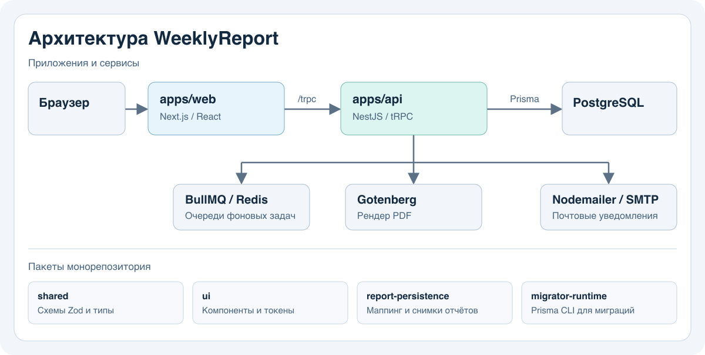
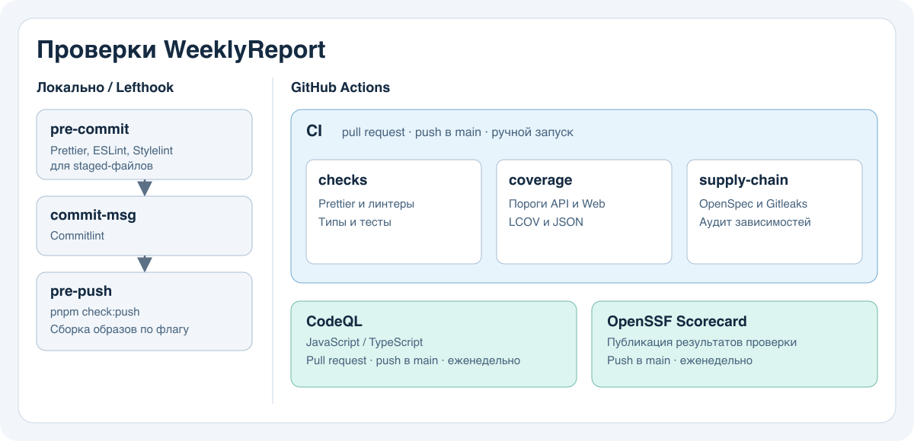
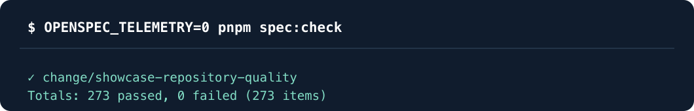
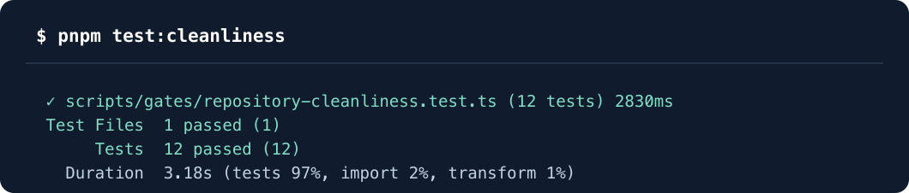

<picture>
  <source media="(prefers-color-scheme: dark)" srcset="assets/readme/hero-dark.svg">
  
</picture>

# WeeklyReport

[](https://github.com/apolenkov/weeklyreport/actions/workflows/ci.yml)
[](https://github.com/apolenkov/weeklyreport/actions/workflows/codeql.yml)
[](https://scorecard.dev/viewer/?uri=github.com/apolenkov/weeklyreport)
[](LICENSE)


В WeeklyReport лиды ведут секции еженедельного отчёта. Они отмечают статус
проектов, планы, риски и решения. Руководитель проверяет секции, публикует
общий отчёт и выгружает его в PDF.



Схема по исходникам приложений. Команда отрисовки
`rsvg-convert docs/images/architecture.svg -o docs/images/architecture.png`.

## Быстрый старт

Нужны Node.js 26 (`.nvmrc`), pnpm из поля `packageManager` и OrbStack с
Kubernetes. Текущий контекст `kubectl` должен быть `orbstack`.

```bash
kubectl config use-context orbstack
pnpm install
cp .env.example .env
pnpm deps:up
PRISMA_USER_CONSENT_FOR_DANGEROUS_AI_ACTION='давай' \
  pnpm db:bootstrap:local demo
pnpm dev
```

Откройте [localhost:3000](http://localhost:3000). В [руководстве по запуску](docs/quick-start.md)
описаны вход без SSO и проверка одноразовой базы.

## Как устроено

Монорепозиторий на pnpm и Turborepo. Next.js с React обслуживает интерфейс и
проксирует запросы `/trpc` в NestJS. API хранит данные в PostgreSQL через
Prisma. BullMQ использует Redis для очередей. Gotenberg рендерит PDF,
Nodemailer отправляет уведомления через SMTP.

| Каталог                                                     | Что в нём                                      |
| ----------------------------------------------------------- | ---------------------------------------------- |
| [apps/web](apps/web/)                                       | Интерфейс Next.js и клиент tRPC                |
| [apps/api](apps/api/)                                       | NestJS, сервер tRPC, фоновые задачи и адаптеры |
| [packages/shared](packages/shared/)                         | Общие схемы Zod, типы и контракты              |
| [packages/ui](packages/ui/)                                 | Компоненты интерфейса и токены дизайна         |
| [packages/report-persistence](packages/report-persistence/) | Маппинг Prisma и снимки опубликованных отчётов |
| [packages/migrator-runtime](packages/migrator-runtime/)     | Зависимости Prisma CLI для образа миграций     |
| [prisma](prisma/)                                           | Схема, миграции и профили тестовых данных      |

## Качество

[CI](.github/workflows/ci.yml) запускает три независимых задания на pull
request и при push в `main`. Локальные хуки описаны в [lefthook.yml](lefthook.yml).

| Проверка                                                           | Команда                                              | Где запускается                                                                         |
| ------------------------------------------------------------------ | ---------------------------------------------------- | --------------------------------------------------------------------------------------- |
| Формат Prettier                                                    | `pnpm format:check`                                  | CI `checks`, pre-push, pre-commit для staged-файлов                                     |
| ESLint и Stylelint, 0 предупреждений                               | `pnpm lint:eslint`, `pnpm lint:stylelint`            | CI `checks` и pre-push через `pnpm lint`, pre-commit для staged-файлов подходящих типов |
| Согласованность Node.js и чистота дерева Git                       | `pnpm lint:runtime-node`, `pnpm lint:cleanliness`    | CI `checks` и pre-push через `pnpm lint`                                                |
| Knip, неиспользуемые экспорты, типы, файлы и зависимости           | `pnpm lint:knip`                                     | CI `checks` и pre-push через `pnpm lint`                                                |
| Строгая проверка типов                                             | `pnpm typecheck`                                     | CI `checks`, pre-push                                                                   |
| Тесты пакетов, Prisma и репозиторных скриптов                      | `pnpm test`                                          | CI `checks`, pre-push                                                                   |
| Покрытие Vitest для API и Web                                      | `pnpm test:coverage`                                 | CI `coverage`                                                                           |
| Валидация требований OpenSpec                                      | `pnpm spec:check`                                    | CI `supply-chain`, pre-push                                                             |
| Снимок и достижимая история Git, Gitleaks с маскированием значений | `pnpm scan:secrets`                                  | CI `supply-chain`, pre-push                                                             |
| Аудит зависимостей                                                 | `pnpm audit:dependencies`                            | CI `supply-chain`, pre-push                                                             |
| Формат сообщения коммита                                           | `pnpm exec commitlint --edit`                        | Lefthook `commit-msg`                                                                   |
| Сборка приложений                                                  | `pnpm build`                                         | Локально перед сдачей                                                                   |
| Мутационные тесты переходов периода, порог 70%                     | `pnpm test:mutation`                                 | Вручную, [конфиг Stryker](apps/api/stryker.config.json)                                 |
| Статический анализ JavaScript и TypeScript                         | [CodeQL](.github/workflows/codeql.yml)               | Pull request, push в `main`, еженедельно                                                |
| Проверка настроек и практик репозитория                            | [OpenSSF Scorecard](.github/workflows/scorecard.yml) | Push в `main`, еженедельно                                                              |

Пороги покрытия в порядке «операторы / ветви / функции / строки» составляют
80% / 70% / 80% / 80% для [API](apps/api/vitest.coverage.config.ts) и
70% / 60% / 70% / 70% для [Web](apps/web/vitest.config.ts). В замер API входят
интеграционные тесты с PostgreSQL, Redis и Mailpit. LCOV и JSON-сводки
доступны в артефакте `vitest-coverage`, когда Vitest сформирует отчёты.



Схема по конфигам Lefthook и GitHub Actions. Команда отрисовки
`rsvg-convert docs/images/quality-gates.svg -o docs/images/quality-gates.png`.



Фрагмент вывода `OPENSPEC_TELEMETRY=0 pnpm spec:check`.



Фрагмент вывода `pnpm test:cleanliness`.

## Документация

- [Вводная для разработчика](docs/onboarding.md) описывает роли, окружение и тесты.
- [Словарь](CONTEXT.md) объясняет термины, которые используются в интерфейсе и коде.
- [Указатель документации](docs/README.md) ведёт к инструкциям по эксплуатации и архитектурным решениям.

## Вклад

- [CONTRIBUTING.md](CONTRIBUTING.md) описывает локальные проверки и подачу pull request.
- [SECURITY.md](SECURITY.md) объясняет, как сообщить об уязвимости в закрытом обращении.

## Лицензия

[MIT](LICENSE).
