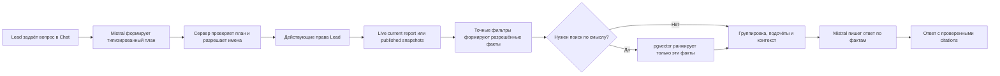

# Lead Report Assistant — сводка принятых решений

## Overview

В Weekly Report появится нативный чат для Lead: рядом с существующей кнопкой **Agent review** будет расположена кнопка **Chat**, открывающая окно или отдельную поверхность в визуальном и поведенческом стиле проекта. Lead сможет обычным языком спрашивать о своих отчётах, текущем черновике, рисках, решениях, статусах продуктов и активностей.

LLM не получает прямой доступ к базе. Mistral только переводит вопрос в строго типизированный план поиска. Сервер проверяет этот план, применяет действующие права доступа Lead, извлекает факты из исходных данных и при необходимости ранжирует уже разрешённые текстовые результаты через pgvector. Итоговый ответ строится только по найденным фактам, содержит проверенные ссылки на отчёты и явно сообщает о неоднозначности, отсутствии данных или неполной индексации.

По умолчанию поиск относится к самому Lead. Поддерживаются текущий редактируемый отчёт и три последних опубликованных отчёта; пользователь также сможет явно указать другой период, доступного соавтора, продукт, activity, этап или тип записи.

### Ключевые отличия от старой концепции

- Раньше точный и векторный поиск можно было воспринимать как два независимых способа поиска. Теперь структурный поиск всегда является первым и обязательным этапом, а pgvector только сортирует уже разрешённый набор.
- Векторный индекс больше не является копией отчётной модели или источником текста. Он хранит только hash и embedding; весь отображаемый текст каждый раз берётся из live-таблиц или опубликованного snapshot.
- Индексация не входит в транзакцию сохранения отчёта. Ошибка Mistral, Redis или pgvector не должна ломать autosave, submit или publication.
- Решение учитывает реальные права текущего проекта: чужие данные Lead ограничены совместными неархивными продуктами, а чужие activity notes, comments, reviews и `pausedReason` не передаются модели.
- В поиск входит открытый черновик, а опубликованная история читается из immutable `publishedSnapshot`, а не из изменяемых live-строк.
- Это не отдельный демонстрационный интерфейс: чат встраивается в существующий Lead toolbar и использует текущие UI primitives, tokens, tRPC, NestJS-модули, shared Zod-схемы и тестовые правила проекта.
- Используется TypeScript-реализация с Mistral для function calling, grounded answer и embeddings; экспериментальные обозначения Terra/Luna не переносятся.

## Как работает система

## Принятые функциональные решения

### 1. Пользователь и интерфейс

- Первая версия доступна только роли Lead.
- В Lead toolbar рядом с **Agent review** появляется активная кнопка **Chat**.
- Кнопка использует общую высоту `--toolbar-control-h`, существующие radii, цвета, hover/focus/busy patterns и доступное имя. Она не должна смещать соседние controls при открытии или закрытии чата.
- Чат размещается в `report-pages`/`report-sections` web slice, а не создаёт параллельную UI-архитектуру.
- Допустимо окно или отдельная страница, но исполнитель сначала должен проверить существующие Dialog/Sheet/layout patterns и выбрать вариант, который визуально и навигационно наиболее естественен для текущего Lead report. Новый route потребует обновить E2E catalog.
- Первая версия одновопросная: постоянная история чата не хранится. При неоднозначности UI показывает доступные варианты и повторяет исходный вопрос с безопасным resolution token.
- Все production UI strings остаются на английском согласно правилам проекта.

### 2. Роль Mistral

Mistral выполняет три ограниченные операции:

1. Преобразует вопрос в `SearchPlan` через function calling.
2. Строит embedding запроса и текстовых report records.
3. Формулирует ответ по подготовленному сервером `GroundingBundle`.

Mistral не выбирает SQL, database IDs, ACL, similarity threshold, число vector candidates или источник live/snapshot. Planner обязан вызвать единственный tool `search_report_entries`; свободный ответ до выполнения поиска не допускается.

Невалидный function call получает одну попытку исправления. Повторная ошибка возвращает контролируемый `invalid_plan`, а не исправляется сервером скрытыми defaults.

Это не «обычный чат в надежде, что модель догадается». API использует четыре версионируемых технических промпта: planner, исправление невалидного плана, grounded answer и исправление citations. Planner обязан вызвать один tool; answer получает только подготовленный сервером набор разрешённых фактов. Текст отчёта считается недоверенными данными и не может менять системные инструкции. Полный контракт закреплён в `docs/architecture/lead-report-assistant-prompt-contract.md`.

### 3. Периоды и источники истины

- «Текущий + 3 завершённых» означает текущий редактируемый отчёт плюс три последних опубликованных.
- «Последние 4 отчёта» без упоминания текущего означает четыре опубликованных snapshot.
- Current source — live tables только для `open`/`reopened` отчёта.
- Historical source — `Report.publishedSnapshot`.
- Один report occurrence никогда не читается одновременно из live и snapshot.
- Изменение live-строк опубликованного отчёта не меняет результат assistant: опубликованная история остаётся замороженной.

### 4. Авторизация Lead

- Автор без уточнения всегда означает текущего Lead.
- Поддерживаются `self`, `all_visible` и выбранные доступные авторы с явным `includeSelf`.
- Для собственной секции доступны продукты, activities, notes и разрешённые report records.
- Чужая секция доступна только если caller сам имеет секцию в этом отчёте и сейчас совместно владеет хотя бы одним неархивным продуктом с автором.
- К чужой секции применяется существующая pure-функция `filterSectionToSharedProducts`.
- Из чужой секции исключаются activity-parented records, activities и notes, comments, reviews, `pausedReason`, несвязанные продукты и решения без доступного product parent.
- Исторические права вычисляются по текущим assignments, как уже делает существующая Lead cross-author policy.
- Недоступная сущность не показывается даже как вариант уточнения и внешне выглядит как отсутствие совпадения.

### 5. Что можно искать

Основные candidate kinds:

- Item;
- Risk;
- Decision;
- Product status;
- Stage status;
- Activity status.

Точные параметры:

- текущий/следующие Item;
- Item workflow status;
- risk severity;
- open/resolved и timing решения;
- canonical health `blocked | at-risk | on-track | empty`;
- stages;
- carry-over;
- наличие и rank приоритета;
- продукты, activities и связанные с продуктом activities;
- авторы и периоды;
- результат `list | count | summary | comparison` и grouping.

`Item.tag` остаётся отображаемым полем, но не становится отдельным фильтром первой версии. Jira accounts используются как aliases activities, а не как самостоятельная предметная сущность. Owner решения выводится из контекста автора и не дублируется отдельным author filter.

### 6. Entity resolution

- LLM передаёт названия, а не IDs.
- Сначала сервер строит каталог только из доступных сущностей, затем нормализует ссылки через Unicode NFKC, пробелы, регистр и варианты тире.
- Поддерживаются точные aliases имени автора, текущие и snapshot-названия продукта, название activity и Jira accounts.
- Транслитерация, fuzzy matching и автоматический выбор «самого похожего» запрещены.
- Одно совпадение превращается в ID; несколько совпадений требуют уточнения; ноль доступных совпадений даёт `no_results` без утечки существования недоступного объекта.
- Resolution token подписывается, привязывается к пользователю и сущности, имеет срок действия и не заменяет повторную ACL-проверку.

### 7. Structured retrieval

- После выбора источника и применения ACL данные проецируются во временный immutable `SearchCandidate` union.
- Candidate не сохраняется в PostgreSQL и не становится новой read model.
- У occurrence есть report/section/record identity; `stableId` хранится отдельно как lineage и не склеивает carry-over между неделями.
- Все точные фильтры объединяются через AND; значения одного измерения — через OR.
- Фильтры никогда автоматически не снимаются ради непустого ответа.
- Count и comparison вычисляются сервером по полному набору, а не LLM по обрезанному контексту.
- Structured results сортируются детерминированно; semantic results — по similarity, затем периоду и стабильному ключу.

### 8. Semantic ranking

Embeddings создаются только для:

- текста Item;
- `risk + impact + mitigation`;
- `decision text + impact`;
- `activityName + note`, если note непустая.

Product и stage statuses не получают embedding. Их можно получить точным запросом или добавить как supporting facts к найденным текстовым records.

Имя продукта, автора и stage не добавляется в embedding: эти параметры должны разрешаться точно, переименование не должно переиндексировать все записи, а similarity не должна подменять ACL/entity resolution.

Semantic ranking работает только по полному exact candidate set. Если часть свежих embeddings отсутствует, система либо достраивает их в ограниченном read-through, либо ставит jobs в очередь и возвращает `semantic_index_pending`; частичная выдача запрещена.

### 9. Ответ, ограничения и citations

- `ContextBuilder` сначала считает aggregates по полному набору, затем укладывает evidence в настроенный context budget.
- Обычный summary может быть явно помечен `truncated`; явное «покажи всё» сверх hard limit возвращает `result_set_too_large`.
- Каждый фрагмент evidence получает локальный source ID (`S1`, `S2`, …).
- Answer model возвращает structured output с Markdown, использованными source IDs и флагом insufficient evidence.
- Сервер проверяет все citations. Неизвестная citation получает одну repair attempt; повторная ошибка не скрывается удалением ссылки.
- Report text считается недоверенными данными: инструкции внутри Item/Risk/Decision/note не исполняются.
- Векторная или AI-ошибка не превращается в фиктивный `no_results` и не вызывает скрытый structured fallback.

## Архитектура и соответствие кодстайлу проекта

- Существующий домен `search` остаётся владельцем поиска; новый top-level `ai`/`assistant` module не создаётся.
- Поскольку модуль начинает защищать ACL, live/snapshot и structured-before-vector invariants, он переводится в оправданный `domain/application/infrastructure` split.
- Публичный API модуля остаётся маленьким: `ReportAssistantService.answer(...)`; проект не заполняется множеством shallow NestJS services.
- Candidate projection, normalization, filtering, aggregation, context construction и citation validation реализуются как короткие pure-функции.
- Реальные внутренние seams: report search repository, Mistral language model port и embedding port. Production adapters подменяются deterministic fakes в тестах.
- Все cross-module imports проходят через `index.ts` facade. Существующая `filterSectionToSharedProducts` переиспользуется, а не копируется.
- Shared Zod contracts создаются в `packages/shared` до app-local типов; function JSON Schema генерируется из Zod и не дублируется вручную.
- Новый tRPC endpoint использует канонический `leadProcedure`, чтобы сохранить role-coverage gate.
- Existing `search.query` и его viewer/head/admin semantics не меняются.
- Новые production files сразу соблюдают `<250` строк, функции `≤50`, target cognitive complexity `<10`, immutable domain code, отсутствие `let`, warnings, lint exemptions и комментариев-археологии.

## Инфраструктурные и глобальные изменения

Этот раздел важен для владельца проекта: перечисленные изменения выходят за пределы одной UI-фичи.

### PostgreSQL и pgvector

**Что меняется:** все PostgreSQL environments должны использовать PostgreSQL 15 image с доступным pgvector; в init migration добавляется `CREATE EXTENSION vector` и таблица `SemanticEmbedding`.

**Почему:** semantic similarity должна выполняться рядом с текущими данными без отдельной vector database и новой operational platform. pgvector сохраняет существующий PostgreSQL/Prisma контур.

**Почему таблица минимальна:** она хранит только `contentHash`, provider/model/version/dimensions и vector. Тексты, ACL и report IDs там не дублируются, поэтому таблица не становится вторым источником истины.

**Риск:** смена container image и extension затрагивает локальную, test, UAT и будущую production-конфигурацию. Dev/test базы в текущей MVP-фазе можно reset; production-like данные нельзя сбрасывать. До rollout нужны backup/restore check и проверка совместимости volume с тем же major PostgreSQL. Если init migration уже отмечена выполненной на сервере, её редактирование само по себе ничего не применит: rollout должен остановиться и использовать отдельную additive migration с тем же проверенным DDL.

### Prisma и snapshot contract

**Что меняется:** добавляется Prisma model с `Unsupported("vector")`; single init migration редактируется в рамках разрешённого MVP workflow. `sectionActivitySchema` дополняется `jiraAccounts: []`, чтобы новые published snapshots замораживали activity aliases, а старые продолжали парситься.

**Почему:** Prisma не моделирует vector operations полностью, поэтому ranking выполняется параметризованным raw SQL за infrastructure boundary. Jira aliases иначе потерялись бы в исторических snapshots.

### Redis и BullMQ

**Что меняется:** добавляется embedding queue, enqueuer и worker на существующем `RawBullMqProcessor`, с единым набором default job options.

**Почему:** большие недостающие embedding-наборы нельзя синхронно строить в пользовательском запросе. Очередь уже является принятой инфраструктурой проекта, поэтому отдельный broker не нужен.

**Ограничение:** report text не кладётся в Redis. Job содержит locator и expected hash; worker повторно читает canonical source и отбрасывает устаревший job.

### Mistral и обязательная конфигурация

**Что меняется:** API получает production adapters для Mistral function calling, answer generation и embeddings. Во все environments добавляются обязательные значения модели, dimensions, timeouts, thresholds и лимиты; secret `MISTRAL_API_KEY` хранится только в secret manager/environment.

**Почему:** модельные параметры должны меняться без изменения кода, но проект запрещает скрытые defaults. Boot должен выявлять неполную конфигурацию, а не запускаться с неизвестной моделью.

**Rollout-условие:** конфигурация и secret должны быть подготовлены до выкладки версии, которая делает их обязательными. Иначе API корректно откажется стартовать. Недоступность Mistral после старта влияет на Chat, но не должна ломать report save/submit/publish.

**Стартовая конфигурация для UAT:** выбранный владельцем `mistral-medium-3-5` для planner и answer, `mistral-embed` с 1024 dimensions, endpoint `eu`. Закреплённый ID выбран вместо `mistral-medium-latest`, чтобы поведение не менялось незаметно. Более дешёвый `mistral-small-2603` можно принять только после тех же русских/английских eval-тестов.

**Privacy-условие:** до production владелец подтверждает платный workspace, режим использования данных для обучения, допустимый срок хранения/ZDR и регион обработки. Для этой функции не используются Labs models. В приложение не логируются вопросы, report text, prompts или ответы.

### API, модульные границы и зависимости

**Что меняется:** `search` становится invariant-bearing module; добавляется Lead-only tRPC procedure, официальный Mistral TypeScript client и внутренние ports/adapters.

**Почему:** создание отдельного `assistant` домена раздробило бы поисковую ответственность и противоречило canonical domain vocabulary. Полный внутренний split оправдан новыми security/data-source invariants, но наружу экспортируется только необходимый facade.

### Наблюдаемость, privacy и стоимость

**Что меняется:** добавляются bounded metrics по outcome, mode, latency, candidate counts, cache hit/miss, repairs и token usage.

**Почему:** внешние AI-вызовы имеют стоимость и могут деградировать; без метрик невозможно отличить слабый поиск от provider/indexing problem.

**Privacy:** вопросы, report text, prompts, embeddings и generated answers не логируются. Metric labels не содержат user/report/product IDs или names.

### Web UI и E2E

**Что меняется:** Lead toolbar получает Chat control и native chat surface. При новом route меняется route catalog; при dialog/sheet остаётся существующий route, но добавляются behavioral UI scenarios.

**Почему:** отдельное экспериментальное приложение выглядело бы чужеродно и дублировало session/navigation/report context. Встраивание в Lead surface даёт текущий report context и повторно использует существующие primitives.

## Стабильность и обратная совместимость

- Существующие save, autosave, submit, reopen, publication, PDF и full-text search paths не переписываются ради AI.
- Embedding generation не входит в report transaction.
- Отсутствующий или устаревший embedding не скрывается, но и не повреждает canonical content.
- Новый endpoint недоступен другим ролям по canonical middleware chain.
- Никакая existing database таблица отчёта не превращается в AI-owned projection.
- Реализация идёт вертикальными срезами: contracts → pure structured core → repository integration → pgvector → worker → Mistral → UI.
- Каждый срез сохраняет зелёными `typecheck`, `lint`, unit tests и build; DB/queue slices дополнительно проходят integration/E2E.
- Rollback приложения не требует восстановления report data. Таблица embedding cache может остаться неиспользуемой или быть удалена отдельной проверенной миграцией; canonical reports от неё не зависят.

## Что потребуется от владельца/оператора

До production/UAT включения потребуется:

1. Создать отдельные Mistral workspaces/keys для development и production; сохранить ключ как `MISTRAL_API_KEY` в local untracked `.env` или secret manager, не в Git.
2. Для первой UAT указать: planner/answer `mistral-medium-3-5`, embeddings `mistral-embed`, dimensions `1024`, server `eu`. После eval можно отдельно одобрить `mistral-small-2603` ради экономии.
3. Начать с similarity threshold `0.55`, candidate limit `500`, synchronous read-through `16`, exhaustive limit `200`, context budget `8000`, provider timeout `30000 ms`, planner output `1500` tokens, answer output `2000` tokens, embedding batch `32` и aggregate embedding budget `8000` tokens. Финальное cost/quality решение принимается по UAT-замерам.
4. Разрешить исходящие HTTPS-запросы API к Mistral, если инфраструктура использует egress allow-list.
5. Применить pgvector-совместимый PostgreSQL image/extension и новую DB schema в целевом окружении.
6. До production подтвердить plan/training/retention/ZDR/data-region posture и проверить secret/config rollout до запуска новой версии API.

После этого обычному пользователю Lead ничего настраивать не нужно: он только открывает Chat и задаёт вопрос.
