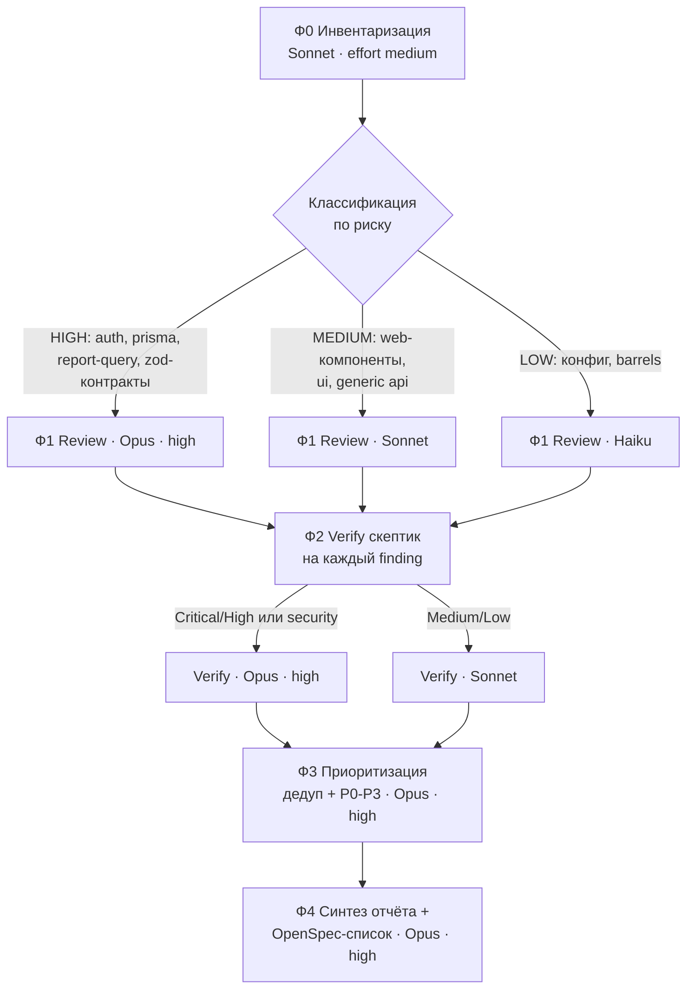
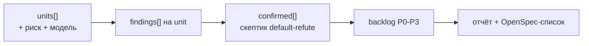

# Workflow «repo-excellence-review» — многомодельное ревью репозитория

**Суть в одну строку:** один скилл-«Ас» (`code-review-skill`) раздаёт по
reviewer-агенту на каждую подсистему, каждому — своя модель по риску, а результат
— проверенный backlog P0–P3, без автоправок.

Скрипт: `.claude/workflows/repo-excellence-review.js`.

## Что решено (входные параметры)

1. Результат — **ревью → backlog** (отчёт + список OpenSpec-изменений). Правок нет.
2. Охват — **весь репозиторий** по подсистемам: web / api / shared / ui / prisma.
3. Next-слой — вендорные Vercel-скиллы в репо: `vercel-react-best-practices`,
   `vercel-composition-patterns`, `web-design-guidelines`.
4. Дедуп с уже одобренной `docs/code-health-map.md` — на фазе приоритизации.

## Как «один скилл вызывает другие»

`code-review-skill` — это не монолит, а набор reference-гайдов.

- По языкам: `typescript.md`, `react.md`, `nestjs.md`, `css-less-sass.md`.
- По срезам: `architecture-review-guide.md`, `security-review-guide.md`,
  `performance-review-guide.md`, `common-bugs-checklist.md`,
  `code-quality-universal.md`.

Workflow подбирает для каждой единицы ревью нужные гайды и Vercel-скиллы, а
reviewer-агент их читает и применяет. Это и есть «скилл, вызывающий скиллы»,
только оркестрацию держит workflow, а не сам скилл.

## Распределение моделей (та самая «моделька»)

Принцип: **Opus там, где суждение; Sonnet — рутина; Haiku — механика.**
Без token-бюджетирования — приоритет качеству.



| Фаза                                 | Модель | Почему именно она                                                      |
| ------------------------------------ | ------ | ---------------------------------------------------------------------- |
| Ф0 Инвентаризация                    | Sonnet | Задаёт покрытие и выбор модели для всех — лёгкое суждение, не дешевим. |
| Ф1 Review (high-risk)                | Opus   | Безопасность, корректность, целостность данных — цена ошибки высока.   |
| Ф1 Review (medium)                   | Sonnet | Хорошо специфицированное ревью компонентов по reference-гайдам.        |
| Ф1 Review (low)                      | Haiku  | Конфиг и тонкие barrel-файлы.                                          |
| Ф2 Verify (severity≥High / security) | Opus   | Ложноположительные тут дороже всего — нужен сильный скептик.           |
| Ф2 Verify (Medium/Low)               | Sonnet | Перепроверка по факту кода, рутина.                                    |
| Ф3 Приоритизация                     | Opus   | Кластеризация, blast-radius, дедуп — это суждение.                     |
| Ф4 Синтез                            | Opus   | Связный отчёт и порядок изменений — качество вывода критично.          |

## Фазы (поток данных)



- **Ф0:** `git ls-files` → ~30–55 единиц ревью, каждой — подсистема, риск,
  модель, набор гайдов. Логируется покрытие (covered/total, исключения).
- **Ф1+Ф2 (pipeline, без барьера):** как только ревью одной единицы готово,
  её находки сразу уходят на проверку — не ждём остальные единицы.
- **Ф2:** на каждый finding — отдельный скептик, по умолчанию **опровергает**;
  открывает реальный код и проверяет достижимость пути.
- **Ф3 (барьер):** нужны все подтверждённые находки сразу — кластеризация и
  приоритеты.
- **Ф4:** отчёт на русском + рекомендованный порядок OpenSpec-изменений.

## Анти-шум (встроенные guardrails)

В каждый промпт ревьюера и скептика зашит блок «это НЕ дефект»:

- Русский в JSX `apps/web/src/**/*.tsx` — дефект; русский в seed/fixture/тестах
  /комментариях — это данные.
- `ComingSoon` — намеренно отложенная фича, не баг.
- Одна init-миграция в MVP — намеренно, не «нет инкрементальных миграций».
- Поведение-меняющие рефакторы под видом «cleanup» не предлагать (revert-bait).
- Lint/format/import-order — забота ESLint/Prettier, находки на них не тратить.

## Результат и что дальше

Workflow возвращает (не пишет файлы сам):

- `reportMarkdown` — тело отчёта.
- `backlog` — структурированные P0–P3.
- `recommendedChanges` — список OpenSpec-изменений с областью.

Главная сессия пишет отчёт в `docs/` и при согласии каркасит верхние
OpenSpec-изменения. Правки — потом, по одному изменению, под гейтом.

## Запуск

```text
Workflow({ scriptPath: '.claude/workflows/repo-excellence-review.js' })
```

Прогон длинный (десятки агентов, часть на Opus) — это ожидаемо. Итерация по
скрипту — правка файла + повторный запуск с тем же `scriptPath`;
`resumeFromRunId` переиспользует кэш неизменённых агентов.
