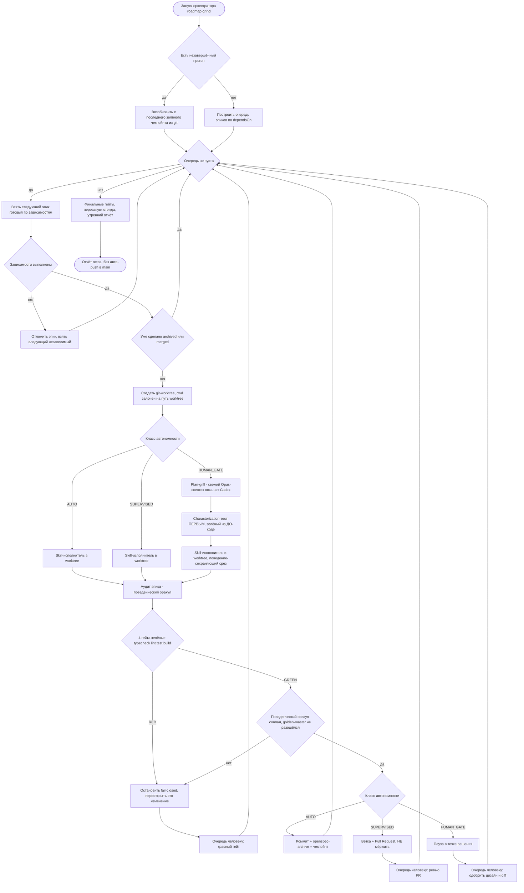

# Движок автономного ночного исполнения дорожной карты (CustomReport Roadmap Grind Engine)

Это проектный документ одного оркестратора-Workflow, который ночью проводит репозиторий по эпикам дорожной карты, соблюдая жёсткие ограничения безопасности из истории репозитория.

## 1. Как работает движок простыми словами

Пользователь запускает один оркестратор-Workflow (`roadmap-grind`) и уходит.

Дальше движок работает сам по простому циклу.

1. Берёт следующий эпик из очереди, упорядоченной по зависимостям (`dependsOn`).
2. Смотрит на класс автономности эпика и решает, как с ним обращаться.
3. Запускает skill-исполнитель (например, `openspec-apply-change`) в его собственном git-worktree.
4. Прогоняет аудит эпика — поведенческий оракул, а не только зелёные гейты.
5. Прогоняет 4 репозиторных гейта: `pnpm typecheck && pnpm lint && pnpm test && pnpm build`.
6. По итогу либо фиксирует чекпойнт, либо ставит паузу с вопросом человеку.

Развязка по классу автономности (это сердце движка):

- **AUTO** — эпик идёт без присмотра до конца: коммит + архив OpenSpec-изменения.
- **SUPERVISED** — движок доводит работу до ветки и открывает Pull Request, но НЕ мёржит; ждёт ревью человека.
- **HUMAN_GATE** — движок ставит паузу до точки решения, кладёт вопрос в очередь человеку и переходит к следующему независимому эпику; рискованную работу (auth/SAML, схема Prisma, миграции, разрушительные операции с БД) он сам не доводит до конца.

Между эпиками всегда стоит чекпойнт по зелёному гейту.

Чекпойнт — это заархивированное или смёрженное OpenSpec-изменение на коммите с зелёными гейтами.

При падении (а прошлый ночной прогон падал трижды) движок возобновляется с последнего зелёного чекпойнта, читая зафиксированный git, а НЕ возвращаемое значение прошлого агента. Бэклог никогда не перезапускается с нуля.

Важное вырожденное правило на сейчас: Codex заблокирован по квоте до 2026-06-25, поэтому все шаги план-ревью (grill / codex-review) деградируют до скептика на Opus в СВЕЖЕЙ сессии. Возобновлённая одобряющая сессия штампует «approve» и запрещена.

## 2. Схема ночного цикла



## 3. Таблица всех эпиков

«Demoted» в колонке Risk помечает строки, понижённые критиком безопасности до HUMAN_GATE (оба `demoted:true`): **E4.4** и **E5.3**.

| id   | Axis                         | Executor (кратко)                                                                                                                                                                                                                                                | Audit (кратко)                                                                                                                                                                                      | Autonomy   | Risk               | Gate (кратко)                                                                                                                                    | dependsOn                 |
| ---- | ---------------------------- | ---------------------------------------------------------------------------------------------------------------------------------------------------------------------------------------------------------------------------------------------------------------- | --------------------------------------------------------------------------------------------------------------------------------------------------------------------------------------------------- | ---------- | ------------------ | ------------------------------------------------------------------------------------------------------------------------------------------------ | ------------------------- |
| E1.1 | Code Quality                 | По одной строке-исключению из 7-строчной таблицы OBSOLETE: ff → apply → code-review(low) → verify → archive                                                                                                                                                      | Эмпирически: после удаления каждой строки `lint && typecheck` остаются зелёными                                                                                                                     | AUTO       | LOW                | `lint && typecheck` после КАЖДОГО удаления; halt на первом red                                                                                   | code-health-audit-map     |
| E1.2 | Code Quality                 | По модулю, 2 отдельных grilled-изменения (lead-form.tsx, trpc.router.ts): grill → char-тест ПЕРВЫМ → apply срезами → review(high) → verify/ai-ui-driver → archive                                                                                                | Golden-master зелёный ДО и ПОСЛЕ + живой оракул + mutation-проба ядра; reject diff шире модуля                                                                                                      | HUMAN_GATE | HIGH               | Char-тест на ДО-коде → 4 гейта → Playwright zero-console → golden-master цел; ветка+PR                                                           | code-health-audit-map     |
| E1.3 | Code Quality                 | deep-research → grill → apply knip+jscpd report-only, затем blocking после нуля ложных срабатываний; `pnpm add -D --network-concurrency=1`                                                                                                                       | knip/jscpd на чистом дереве дают ноль ложных на Nest/Next/tRPC; `catalog:check` ок                                                                                                                  | SUPERVISED | MED                | 4 гейта с новым шагом (report-only), затем blocking-флип зелёным; человек смотрит конфиг                                                         | code-health-audit-map     |
| E1.4 | Code Quality                 | ff → ratchet-тест, фиксирующий текущий набор per-file исключений как baseline → apply в `lint`/CI → review(high) → verify → archive                                                                                                                              | Доказать зубы наведённым отказом: синтетическое исключение → red, убрать → green; baseline = ОЧИЩЕННЫЙ набор после E1.1                                                                             | SUPERVISED | MED                | `lint && typecheck && test` + induced-failure доказан; человек подтверждает baseline                                                             | E1.1                      |
| E2.1 | Архитектура                  | deep-research (C4/Mermaid memo) → propose (doc-only) → apply диаграммы L1/L2/L3 + ADR + CONTEXT.md → verify → archive                                                                                                                                            | verify + `validate --strict`; диаграммы рендерятся; ADR полны против графа модулей (codegraph)                                                                                                      | AUTO       | LOW                | `format:check` (md) + `validate --strict` + парс mermaid; 4 гейта без дрейфа                                                                     | нет                       |
| E2.2 | Архитектура                  | grill дизайна правил границ → apply dependency-cruiser/eslint-boundaries как CI-гейт; разрешить type-only `web → @customreport/api`, запретить value-импорты → review(high) → verify → archive                                                                   | Новая проверка зелёная на текущем коде + fail-closed на подложенном нарушении; review конфига; `validate --strict`                                                                                  | SUPERVISED | MED                | 4 гейта (новый гейт в `lint`/`lint:boundaries`) + подложенный cross-layer импорт REJECTED + `validate --strict`                                  | E2.1                      |
| E2.3 | Архитектура                  | grill (data-access слой) → golden-master репозиториев+tRPC ПЕРВЫМ → apply по одному репозиторию (domain-типы вместо Prisma-строк) → review(high)+security-review → verify → человек → archive                                                                    | Golden-master ДО+ПОСЛЕ + mutation-проба маппера + verify рендер отчёта идентичен + Zod-контракты байт-стабильны                                                                                     | HUMAN_GATE | HIGH               | 4 гейта (prisma generate первым) + verify lead/head/admin идентичны + golden-master совпал; ветка+PR                                             | E2.1                      |
| E2.4 | Архитектура                  | grill (SSOT `trafficLightStatusSchema` уже есть; свести ~10 inline-юнионов) → char-тест статус-рендера ПЕРВЫМ → apply type-only консолидация, `\| null` сохранять по-сайтово → review(high) → verify → человек → archive                                         | Char-тест traffic-light ДО+ПОСЛЕ + каждый `\| null`/`\| empty` сохранён + review подтверждает чистое re-pointing + verify pills/pipeline/lead-form идентичны                                        | HUMAN_GATE | HIGH               | 4 гейта + char-тест + verify цвета семантически идентичны на slides+pipeline+lead-form; ветка+PR                                                 | E2.1                      |
| E3.1 | Axis 3 (DDD/трассируемость)  | ff (product-vision-doc) → apply docs/product-vision.md из north-star + CONTEXT.md; spec цитирует doc; новые продуктовые намерения → STOP человеку                                                                                                                | verify + read-only проверка: каждое утверждение трассируется к существующему источнику, не выдумано; линза «no hallucinated intent»                                                                 | SUPERVISED | LOW                | `format:check` + `validate product-vision-doc --strict` + verify clean; без /verify и ai-ui-driver                                               | нет                       |
| E3.2 | Axis 3                       | ff (capability-traceability-matrix) → apply генератор docs/traceability-matrix.md (capability→spec→code→test) read-only из openspec/codegraph/тест-globs; ПОКАЗАТЬ дыры, НЕ закрывать                                                                            | code-review(low) генератора + спот-чек 3-5 capability к реальным spec+code+test (codegraph_node); красные ячейки — ожидаемый результат                                                              | AUTO       | LOW                | Скрипт-генератор зелёный + `format:check` + `validate --strict`; без продуктового гейта                                                          | E3.1                      |
| E3.3 | Axis 3                       | grill для фиксации канонических терминов → apply расширение CONTEXT.md до глоссария + read-only term↔identifier аудит расхождений; ПЕРЕИМЕНОВАНИЯ вынести в отдельный бэклог grilled-изменений                                                                   | verify + человек ратифицирует термины; deliverable = таблица расхождений + список «renames deferred to X,Y,Z»                                                                                       | SUPERVISED | LOW                | `format:check` CONTEXT.md + `validate --strict` + полнота глоссария; вынесенные rename несут свои HUMAN_GATE гейты                               | нет                       |
| E4.1 | Процессы/Production (Axis 4) | propose → apply правка ci.yml (кэш deps, preview-env + auto-rollback скаффолды) → code-review(medium) → archive; провижининг раннеров вынесен человеку                                                                                                           | actionlint линтит YAML; `validate --strict`; 4 гейта. End-to-end green не подтвердить ночью: 0 раннеров (dispatch-only)                                                                             | SUPERVISED | MED                | actionlint clean + `validate --strict` + 4 гейта; live CI-green отложен до раннеров (человек)                                                    | нет                       |
| E4.2 | Процессы/Production          | deep-research (DORA при низком темпе) → propose → apply аддитивный metrics-скаффолд + deploy-события из CHANGELOG/тегов → code-review(low) → archive                                                                                                             | `validate --strict`; скаффолд тайпчекается; memo процитирован; честный лимит: 0 раннеров → метрики пусты до реальных деплоев                                                                        | SUPERVISED | LOW                | `validate --strict` + 4 гейта (только аддитивный код, без правки hot-path)                                                                       | E4.1                      |
| E4.3 | Процессы/Production          | grill (свежий Opus-скептик) → propose → apply 12-factor secrets/config, флип на append-only миграции, health/readiness, rate-limits, backups; УБИРАЕТ disposable-DB, правит `_destructive-guard.ts` → security-review → verify → archive; НИКОГДА не авто-мёрж   | Char-тест `_destructive-guard.ts` ПЕРВЫМ (prod-блок + non-prod-суффикс сохранены); migrate-reset CI цел; 12-factor/readiness чеклист у человека; verify health/readiness live                       | HUMAN_GATE | HIGH               | Char-тест на ДО-guard + migrate-reset CI + security-review + 4 гейта + live readiness; убирает MVP-disposable — решение человека                 | E4.1, E4.4                |
| E4.4 | Процессы/Production          | deep-research (OWASP ASVS memo) → propose → apply. SAFE-половина (AUTO): pnpm-audit/OSV CI + ASVS gap-memo. HOT-половина (HUMAN_GATE): любой SAML/authz-фикс → grill → char-тест → security-review → verify по ролям                                             | Dependency-audit CI чист (или allowlist); ASVS memo по контролям; security-review на ветке; per-role authz-sweep lead/head/admin/viewer; `validate --strict`                                        | HUMAN_GATE | **HIGH — demoted** | pnpm audit/OSV чист + security-review + `validate --strict` + 4 гейта + authz-sweep по ролям; auth-фиксы никогда не авто-мёрж                    | нет                       |
| E4.5 | Процессы/Production          | ff → apply. A (AUTO, docs): кодифицировать DoD-doc → archive. B (SUPERVISED): SemVer + генерируемый CHANGELOG к существующему commitlint; человек смотрит первый релиз. Conventional Commits уже есть — не пересобирать                                          | DoD-doc просмотрен; commitlint REJECTS плохой/ACCEPTS валидный (induced-failure, уже зелёный); changelog детерминирован; первый bump у человека; `validate --strict`                                | SUPERVISED | LOW                | commitlint reject/accept + changelog регенерится + `validate --strict` + 4 гейта (DoD-doc сам по себе AUTO; release-tooling тянет в SUPERVISED)  | нет                       |
| E5.1 | Разработка/обучение (Axis 5) | propose → apply ОДИН bootstrap-скрипт (scripts/setup.mjs): install + .env + docker up + db:fresh + seed + README quickstart; переиспользует существующие скрипты                                                                                                 | Приёмка — прогон человека на чистой машине (<~30 мин до данных); агент: verify бутит стенд, web :3000 с seed, API :3002 healthy; verify clean; link-check README                                    | SUPERVISED | LOW                | 4 гейта + скрипт проходит end-to-end на свежем checkout + verify рендерит seed; kill-port 3000 3002 перед build                                  | нет                       |
| E5.2 | Разработка/обучение          | propose → опц. deep-research (Stryker memo) → apply Stryker как devDep (`--network-concurrency=1`), одноразовая mutation-ПРОБА ядра (status/risk + period-lifecycle) + survivor-отчёт + Trophy-balance заметка; БЕЗ нового CI-гейта                              | Survivor-отчёт по ядру просмотрен (каждый выживший мутант — gap-тест или equivalent-note); coverage-полы не ниже; code-review diff; Trophy-memo в docs/                                             | SUPERVISED | MED                | 4 гейта + проба отрабатывает с читаемым survivor-отчётом + пороги coverage не снижены; SUPERVISED из-за нового devDep (node_modules-wipe hazard) | нет                       |
| E5.3 | Разработка/обучение          | grill (свежий Opus-скептик) на план закрытия дыр → char-тест на seam OTel propagator/logger ПЕРВЫМ (расширить otel.propagator.test.ts как golden-master) → apply закрытие trace↔log↔error → security-review (PII) + verify 3-way + code-review → SUPERVISED-мёрж | LIVE 3-way: один реальный ≥500, trace_id находится в Tempo И в строке app.log И в Bugsink contexts.trace.trace_id; security-review без PII; если «что класть в логи» — privacy-решение → HUMAN_GATE | HUMAN_GATE | **MED — demoted**  | 4 гейта + char-тест на seam ДО и после + live 3-way-link на реальной ошибке + security-review чист; red halt+reopen                              | нет                       |
| E5.4 | Разработка/обучение          | propose → apply docs-тур «как читать репозиторий» (onboarding.md → CONTEXT.md → ADR) + ADR-as-textbook индекс; только docs/proza → code-review(doc) → AUTO archive                                                                                               | Ревьюер проходит тур, все пути/якоря резолвятся (link-check), вход тура совпадает с E5.1 bootstrap; `validate`; `format:check` чист                                                                 | AUTO       | LOW                | `format:check` + `validate` + link-check; docs не бьют typecheck, но build остаётся зелёным                                                      | E5.1 (+ E2.1 если co-run) |

## 4. Три класса автономности

Класс — это потолок, до которого движок доводит эпик сам.

1. **AUTO (4 эпика) — доводит до конца без присмотра.**
   Удаление, документация и read-only генерация, которые не могут сломать рантайм.
   Завершение = коммит + `openspec-archive` = чекпойнт.
   Эпики: **E1.1, E2.1, E3.2, E5.4**.

2. **SUPERVISED (10 эпиков) — доводит до ветки и Pull Request, мёрж за человеком.**
   Тулинг, аддитивный код, новые devDependency, CI-гейты, конфиг — низкий-средний риск, но решение о вливании остаётся за человеком.
   Завершение = ветка + PR + вопрос человеку на ревью; авто-push в main запрещён.
   Эпики: **E1.3, E1.4, E2.2, E3.1, E3.3, E4.1, E4.2, E4.5, E5.1, E5.2**.

3. **HUMAN_GATE (6 эпиков) — ставит паузу в точке решения, сам не доводит.**
   Рефакторинг hot-кода, data-access слой, статус-семантика, переход MVP→production, SAML/authz, OTel hot-path.
   Это в точности форма revert-bait (gate-green ≠ поведение сохранено), поэтому движок останавливается, ставит вопрос в очередь и идёт к следующему независимому эпику.
   Эпики: **E1.2, E2.3, E2.4, E4.3** + понижённые критиком **E4.4, E5.3**.

Сверка: 4 + 10 + 6 = 20 эпиков, совпадает с колонкой Autonomy в таблице.

## 5. Скелет оркестратора-Workflow

Это каркас под будущий `.claude/workflows/roadmap-grind.ts` на том же Workflow DSL (`phase()` / `agent()` / `pipeline()` / `parallel()`).

Ключевые активы перенесены из прошлого `overnight-everything.js`: continuation-обёртка `agentWithRetry` (спасает от падения всего прогона при упоре в лимит хода) и чтение зафиксированного git вместо возвращаемого значения прошлого агента.

```js
// .claude/workflows/roadmap-grind.ts — СКЕЛЕТ
// Codex заблокирован по квоте до 2026-06-25 → все grill/codex-review
// деградируют до свежей Opus-сессии-скептика (НЕ возобновлённой одобряющей).
const CODEX_BLOCKED_UNTIL = new Date("2026-06-25");
const codexAvailable = () => new Date() >= CODEX_BLOCKED_UNTIL;

// Очередь = 20 эпиков из execution map; reads в дизайне выше.
// Каждый элемент: { id, axis, autonomy, risk, dependsOn:[], executor, audit, gate }
const QUEUE = loadEpicsFromExecutionMap();

const MODELS = {
  mechanical: "sonnet",
  design: "opus",
  review: "opus",
  driver: "opus",
};
const MAX_FIX_ITERS = 3; // потолок итераций фикса на эпик — против бесконечного цикла

// --- Резильентность: continuation-обёртка из be8d97dc ---
// Агент со schema, упёршийся в лимит хода ДО StructuredOutput, бросает и
// убивает весь прогон. Обёртка ловит и продолжает ту же логическую работу.
async function agentWithRetry(prompt, opts, maxRetries = 2) {
  for (let attempt = 0; attempt <= maxRetries; attempt++) {
    try {
      return await agent(prompt, opts);
    } catch (e) {
      if (attempt === maxRetries) throw e;
      prompt =
        `${prompt}\n\nCONTINUE: предыдущая попытка упёрлась в лимит хода. ` +
        `Не начинай заново — продолжи и верни StructuredOutput.`;
    }
  }
}

// --- Идемпотентность + resume ---
// Чекпойнт = заархивированное/смёрженное изменение на зелёном коммите.
// Читаем ЗАФИКСИРОВАННЫЙ git, а не возврат прошлого агента.
async function isDone(epic) {
  const archived = await bash(
    `openspec list --specs | grep -q "${epic.changeId}" && echo yes`,
  );
  return archived.trim() === "yes"; // уже сделано → пропустить
}
function depsSatisfied(epic, done) {
  return (epic.dependsOn ?? []).every((d) => done.has(d));
}

// --- 4 репозиторных гейта, fail-closed ---
async function runGates() {
  await bash("npx prisma generate"); // TS2339 на known model = stale client
  const res = await bash(
    "pnpm typecheck && pnpm lint && pnpm test && pnpm build && echo GATES_GREEN",
  );
  return res.includes("GATES_GREEN");
}

// --- План-грилл с деградацией Codex → Opus-скептик ---
async function planGrill(epic) {
  if (codexAvailable()) {
    return await runSkill("grill-with-docs-codex", { epic: epic.id });
  }
  // Свежая сессия-скептик на Opus. Возобновлённая одобряющая штампует approve.
  return await agentWithRetry(
    `Ты свежий Opus-скептик. Адверсариально разбери план эпика ${epic.id}. ` +
      `Ищи revert-bait: где gate-green ≠ сохранение поведения. ` +
      `Верни VERDICT:APPROVED или VERDICT:REVISE со списком must-fix.`,
    { label: `grill-${epic.id}`, model: MODELS.review },
  );
}

async function main() {
  phase("roadmap-grind: ночной прогон по эпикам");

  // resume: что уже зелёное — в done, бэклог НЕ перезапускается с нуля
  const done = new Set();
  for (const epic of QUEUE) if (await isDone(epic)) done.add(epic.id);

  const open = QUEUE.filter((e) => !done.has(e.id));

  for (const epic of open) {
    // зависимости + идемпотентность
    if (!depsSatisfied(epic, done)) {
      log(`skip ${epic.id}: ждёт ${epic.dependsOn}`);
      continue;
    }
    if (await isDone(epic)) {
      done.add(epic.id);
      continue;
    }

    phase(`Эпик ${epic.id} [${epic.autonomy}/${epic.risk}] — ${epic.axis}`);

    // blast-radius: свой worktree, cwd залочен на путь worktree
    const wt = await enterWorktree(`grind/${epic.id}`);

    // HUMAN_GATE и HIGH-risk: грилл + characterization-тест ПЕРВЫМ
    if (epic.autonomy === "HUMAN_GATE" || epic.risk === "HIGH") {
      const verdict = await planGrill(epic);
      if (verdict.includes("REVISE")) {
        log(`${epic.id}: план не одобрен — пауза`); /* enqueue */
      }
      // golden-master/characterization зелёный на ДО-коде = входной гейт
      await agentWithRetry(
        `Напиши characterization/golden-master тест для ${epic.id}. ` +
          `Зелёный на ТЕКУЩЕМ (до-рефактор) коде. Это оракул поведения.`,
        { label: `char-${epic.id}`, model: MODELS.design },
      );
    }

    // skill-исполнитель эпика (apply behavior-preserving срезом)
    const modelTier = epic.risk === "HIGH" ? MODELS.design : MODELS.mechanical;
    await agentWithRetry(epic.executor, {
      label: `apply-${epic.id}`,
      model: modelTier,
      schema: IMPL,
    });

    // аудит эпика — поведенческий оракул, не только зелёные гейты
    await agentWithRetry(epic.audit, {
      label: `audit-${epic.id}`,
      model: MODELS.review,
      schema: REVIEW,
    });

    // 4 гейта + цикл фикса с потолком
    let green = await runGates();
    for (let i = 0; !green && i < MAX_FIX_ITERS; i++) {
      await agentWithRetry(
        `Почини красный гейт эпика ${epic.id}, не ослабляя тесты.`,
        { label: `fix-${epic.id}-${i}`, model: MODELS.design },
      );
      green = await runGates();
    }

    if (!green) {
      // fail-closed: halt этого эпика, вопрос человеку, дальше — следующий независимый
      log(
        `${epic.id}: RED после ${MAX_FIX_ITERS} фиксов — переоткрыть изменение`,
      );
      await exitWorktree(wt);
      // enqueueHumanQuestion(`${epic.id}: красный гейт, нужен человек`)
      continue;
    }

    // === Развязка по классу автономности ===
    if (epic.autonomy === "AUTO") {
      await runSkill("openspec-archive-change", { change: epic.changeId }); // коммит + архив = чекпойнт
      done.add(epic.id);
    } else if (epic.autonomy === "SUPERVISED") {
      await bash(`git push -u origin grind/${epic.id}`); // ветка
      await bash(`gh pr create --fill --base main --head grind/${epic.id}`); // PR, НЕ мёрж
      // enqueueHumanQuestion(`${epic.id}: ревью PR`)
    } else {
      // HUMAN_GATE
      // пауза в точке решения; работа на ветке, без мёржа
      await bash(`git push -u origin grind/${epic.id}`);
      // enqueueHumanQuestion(`${epic.id}: одобрить split-дизайн и diff перед мёржем`)
    }

    await exitWorktree(wt); // cwd обратно в родительский репозиторий
  }

  phase("Финал: репозиторные гейты, перезапуск стенда, утренний отчёт");
  // НИКОГДА не авто-push в main: только ветки + PR.
}
```

## 6. Пределы и честность

Движок зелёный по гейтам — это необходимо, но НЕ достаточно. Прошлый «parallel-army» metric-refactor прошёл typecheck/lint/test/build и при этом сломал поведение (revert-bait). Поэтому движок сознательно НЕ делает следующего без человека.

1. **Не доводит до мёржа рефакторинг hot-кода.** lead-form.tsx, trpc.router, data-access слой, статус-семантика — только ветка+PR или пауза. Совпадение с golden-master — обязательное условие, не зелёный гейт.

2. **Не трогает рискованные категории сам.** auth/SAML, схема Prisma и миграции, конкуррентность, разрушительные операции с БД, переход MVP→production — эскалация человеку, никогда не авто-мёрж.

3. **Не делает массовых параллельных правок по модулям.** Один эпик = один модуль/concern = одно grilled OpenSpec-изменение. Diff шире одного модуля или превышающий бюджет изменения reject-ится. Это прямой урок revert-bait.

4. **Не пушит в main.** Только ветка + Pull Request; вливание — решение человека на ревью.

5. **Не верит «approve» от возобновлённой сессии.** Пока Codex заблокирован (до 2026-06-25), план-ревью — это свежий Opus-скептик; возобновлённая одобряющая сессия штампует и запрещена.

6. **Не идёт за красный гейт.** RED останавливает конвейер fail-closed и переоткрывает ответственное изменение; движок не патчит под более поздним изменением.

7. **Не гоняет себя нерушимо всю неделю.** Полный марафон ~8.7M токенов исчерпывает недельный лимит за один проход; устойчивый темп — примерно раз в неделю, не каждую ночь. При падении (наблюдалось трижды) — возобновление с последнего зелёного чекпойнта, а не рестарт бэклога.
